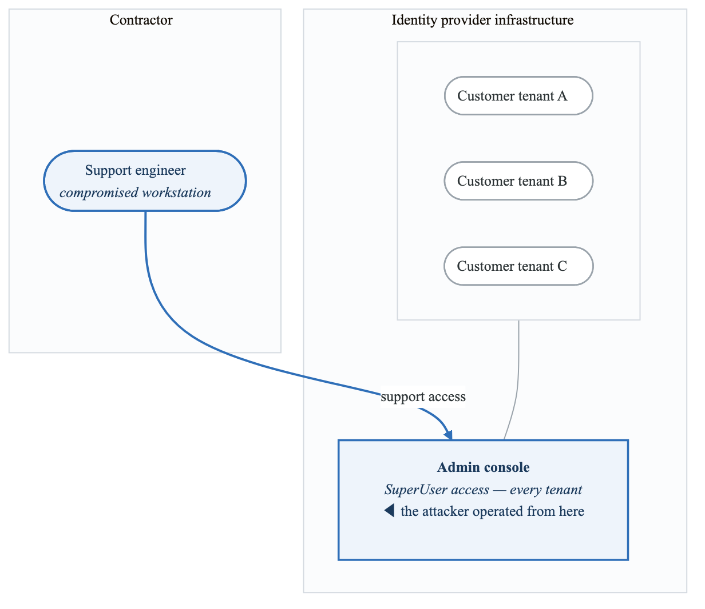
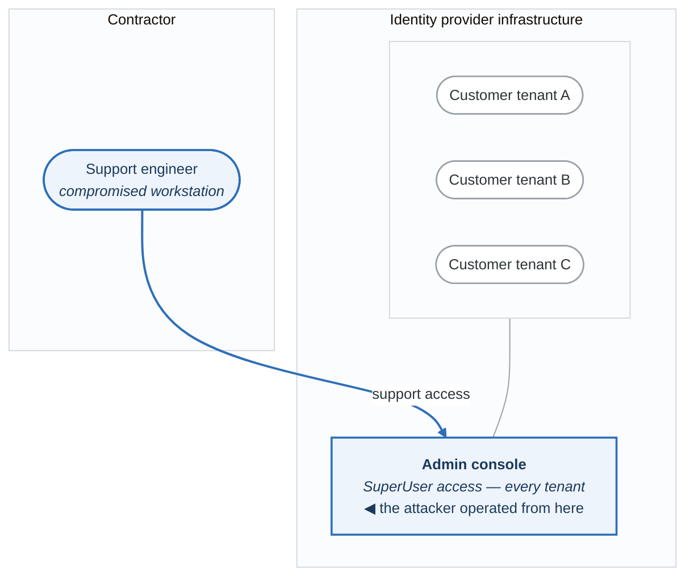
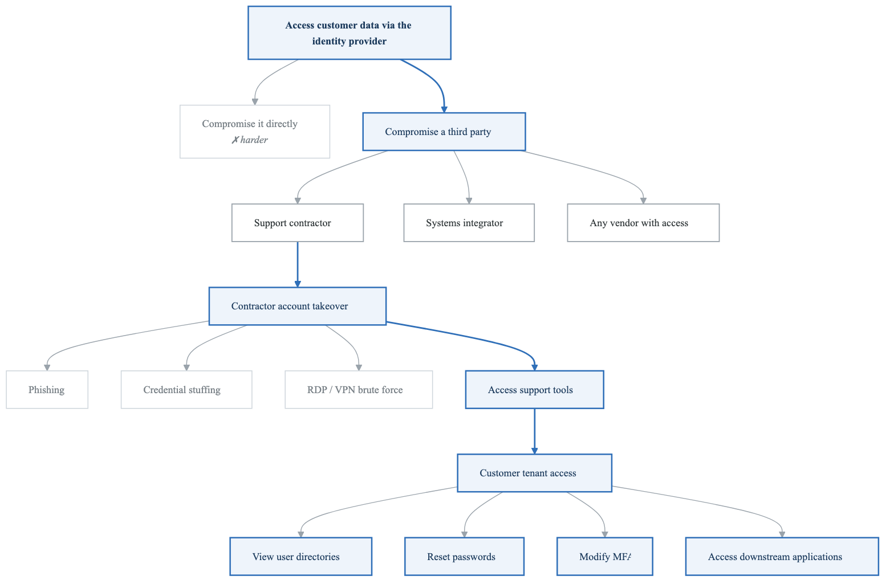
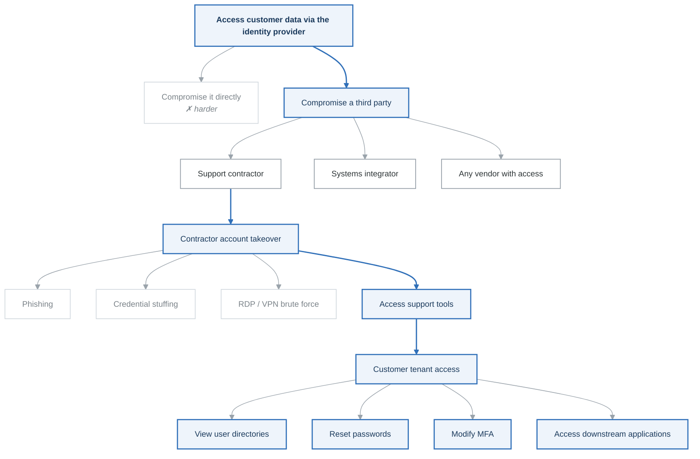

# Case Study: IdentityCo/ThreatGroup-A Breach (2022)

## Executive Summary

In January 2022, the ThreatGroup-A threat group compromised IdentityCo through a third-party support contractor (SupportCo). This breach demonstrates critical supply chain risks in identity infrastructure and the cascading impact of compromising an Identity Provider (IdP).

**Key Facts:**
- Attacker: ThreatGroup-A (DEV-0537)
- Vector: Compromised third-party support contractor
- Duration: 5 days of access (January 16-21, 2022)
- Impact: 366 IdentityCo customers potentially affected
- Disclosed: March 2022 (screenshots leaked on Telegram)

---

## Attack Timeline

January 2022 Attack Sequence:

**Jan 16: Initial access to SupportCo support engineer workstation**

- ThreatGroup-A gains access via unknown method
- Targets SupportCo employee with IdentityCo Super User access
- Workstation compromise (likely phishing or RDP)

**Jan 16-21: 5 days of access**

- Access to IdentityCo support tools
- View customer tenants
- Reset passwords
- Potentially accessed ~366 customers
- Screenshots taken as proof

**Jan 21: Access terminated**

- IdentityCo security detects and terminates session

**March 22: Public disclosure**

- ThreatGroup-A posts screenshots on Telegram
- Shows IdentityCo SuperUser dashboard
- IdentityCo forced to acknowledge breach


---

## Technical Analysis

### Attack Vector: Third-Party Access

<!-- figure: generated from the Mermaid below by _shared/diagrams/embed-figures.py — do not edit the image -->


<details>
<summary>Diagram source (Mermaid)</summary>



</details>

### What ThreatGroup-A Could Do

With SuperUser access, attackers could:

| Capability | Risk | Impact |
|------------|------|--------|
| View customer directories | Reconnaissance | User enumeration |
| Reset user passwords | Account takeover | Access any user account |
| Modify MFA settings | Bypass security | Disable MFA |
| Create admin accounts | Persistence | Backdoor access |
| Access session tokens | Impersonation | Act as any user |
| Modify application configs | Supply chain | Redirect auth flows |

### Attack Progression

**Phase 1: Contractor Compromise**

- Social engineering or credential theft
- RDP access to support workstation
- Living off the land (legitimate tools)

**Phase 2: IdentityCo Access**

- Use support engineer credentials
- Access IdentityCo SuperUser dashboard
- Enumerate customer tenants
- Take screenshots for proof

**Phase 3: Customer Impact (Potential)**

- Password resets
- MFA bypasses
- Session hijacking
- Downstream access to customer apps


---

## What Threat Modeling Would Have Found

### Trust Boundary Analysis

> ### Critical finding
>
> Third-party contractors had **the same access** as internal administrators, with **weaker security
> controls**.
>
> **Trust boundaries violated**
> - Corporate network → contractor network
> - Managed devices → contractor devices
> - Internal identity → contractor identity

| | Internal engineers | Contractor | Customer tenants |
|---|---|---|---|
| Devices | Managed | BYOD? | — |
| Network | Corporate | Home network | — |
| MFA | Strong | Shared credentials? | — |
| Privileged access management | Yes | **None** | — |
| Logging | Full | **Limited** | — |
| Holds | — | — | Full data · user credentials · app access |

**Both columns reach the same admin console with the same privilege.** That is the finding in one
line: the access was equalised and the controls were not, so the effective security of the whole
platform became the security of the weakest party holding a credential to it.

### STRIDE Analysis: Contractor Access Path

| Element | S | T | R | I | D | E | Key Threats |
|---------|---|---|---|---|---|---|-------------|
| Contractor identity | ✓ | | | | | ✓ | Account compromise, privilege abuse |
| Contractor device | ✓ | ✓ | | ✓ | | | Unmanaged device risks |
| Network path | | ✓ | | ✓ | | | MITM, session hijacking |
| Admin console | | | ✓ | | | ✓ | Unauthorized actions |
| Customer data | | | | ✓ | | ✓ | Data access, modification |

### Attack Tree: Compromise IdP via Contractor

<!-- figure: generated from the Mermaid below by _shared/diagrams/embed-figures.py — do not edit the image -->


<details>
<summary>Diagram source (Mermaid)</summary>



</details>

---

## Lessons for Identity Provider Threat Modeling

### 1. Third-Party Access is a Critical Threat Vector

```yaml
third_party_access_assessment:
  contractors:
    - name: "Support Provider"
      access_level: "Admin/SuperUser"
      security_controls:
        managed_devices: false
        mfa_enforced: partial
        pam_integration: false
        session_recording: false
        access_reviewed: quarterly
      risk_rating: HIGH

  threat_model_questions:
    - Do contractors have same access as employees?
    - Are contractor devices managed and monitored?
    - Is contractor access time-limited and audited?
    - Can contractor actions be fully attributed?
    - Is just-in-time access implemented?
```

### 2. Privileged Access Requires Defense in Depth

| Layer | Control | IdentityCo (Pre-Breach) | Recommended |
|-------|---------|-------------------|-------------|
| Identity | MFA | Partial | Hardware tokens required |
| Device | Management | Not for contractors | MDM/EDR required |
| Network | Segmentation | Limited | Zero trust network |
| Access | Just-in-time | No | PAM with approval |
| Session | Recording | Limited | Full session capture |
| Monitoring | Behavior | Basic | UEBA |

### 3. IdP is Single Point of Failure

**If IdP is compromised:**

- All SSO applications affected
- All user credentials at risk
- All downstream systems accessible
- Trust chain completely broken
- Blast radius = EVERYTHING

Threat Model Implication:
- IdP requires highest security tier
- Multiple layers of verification
- Assume breach detection capabilities
- Segmentation of customer tenants
- Break-glass procedures


---

## Detection Strategies

### Indicators of Compromise

```yaml
behavioral_indicators:
  - Multiple password resets in short period
  - Password resets for admin accounts
  - MFA setting changes
  - New admin account creation
  - Access from unusual locations
  - Access outside business hours
  - Bulk user enumeration

technical_indicators:
  - Support tool access from new IP
  - Session tokens from contractor IPs
  - API calls to admin endpoints
  - Multiple tenant access in sequence
  - Screenshot or export activity
```

### Detection Rules

```python
# Pseudo-code for anomaly detection
def detect_contractor_anomaly(event):
    if event.user.type == "contractor":
        if event.action in ["password_reset", "mfa_change", "admin_create"]:
            if event.target.role == "admin":
                alert(severity="HIGH",
                      message=f"Contractor modifying admin: {event}")

        if event.action == "tenant_access":
            recent_tenants = get_recent_tenant_access(event.user, hours=1)
            if len(recent_tenants) > 5:
                alert(severity="MEDIUM",
                      message=f"Contractor accessing multiple tenants: {event}")
```

---

## Remediation Framework

### Immediate Actions

| Action | Priority | Owner |
|--------|----------|-------|
| Revoke contractor access | P0 | Security |
| Reset all contractor credentials | P0 | IAM Team |
| Audit customer tenant access | P0 | Security |
| Notify affected customers | P0 | Legal/Comms |
| Preserve forensic evidence | P0 | IR Team |

### Short-Term (30 Days)

| Action | Priority | Owner |
|--------|----------|-------|
| Implement PAM for contractor access | P0 | IAM Team |
| Deploy session recording | P1 | Security |
| Require managed devices | P1 | IT/Security |
| Enhance monitoring rules | P1 | SOC |
| Conduct access review | P1 | Compliance |

### Long-Term (90 Days)

| Action | Priority | Owner |
|--------|----------|-------|
| Zero trust architecture | P1 | Architecture |
| Just-in-time access model | P1 | IAM Team |
| Behavioral analytics (UEBA) | P2 | SOC |
| Contractor security assessments | P2 | Vendor Mgmt |
| Tabletop exercises | P2 | Security |

---

## Threat Model Checklist: Third-Party Access

```
Identity & Access:
□ Are third-party accounts in separate identity store?
□ Is MFA enforced (hardware token preferred)?
□ Is access time-limited (JIT)?
□ Are service accounts audited?
□ Is privileged access via PAM?

Device Security:
□ Are devices managed (MDM)?
□ Is EDR deployed?
□ Is disk encryption enforced?
□ Are security updates current?
□ Is remote wipe capability available?

Network Security:
□ Is access via VPN or ZTNA?
□ Is network segmented?
□ Are connections from expected locations?
□ Is traffic inspected?
□ Are unusual connections detected?

Monitoring & Response:
□ Are all actions logged?
□ Are sessions recorded (privileged)?
□ Is behavioral analysis in place?
□ Are alerts configured for anomalies?
□ Is incident response plan tested?

Contractual & Compliance:
□ Are security requirements in contracts?
□ Is right to audit included?
□ Are security assessments conducted?
□ Is evidence of compliance collected?
□ Are breach notification requirements defined?
```

---

## Key Takeaways

1. **Third-party access = Your attack surface** - Contractors with admin access are high-value targets
2. **Same access ≠ Same security** - Contractors often have weaker device/network security
3. **IdP is crown jewel** - Compromise of IdP affects everything downstream
4. **Trust but verify** - Assume breach and implement detection
5. **Defense in depth** - Multiple controls for privileged access
6. **Visibility is critical** - You can't detect what you can't see

---

## ThreatGroup-A Threat Actor Profile

### Characteristics

| Attribute | Description |
|-----------|-------------|
| Type | Cybercriminal group |
| Motivation | Data theft, extortion, notoriety |
| Geography | UK, Brazil (primarily) |
| Tactics | Social engineering, SIM swapping, insider recruitment |
| Targets | Tech companies, IdPs, source code |

### TTPs (MITRE ATT&CK)

| Tactic | Technique | Example |
|--------|-----------|---------|
| Initial Access | Phishing | Contractor targeting |
| Initial Access | Valid Accounts | Purchased/stolen creds |
| Persistence | Account Manipulation | Create admin accounts |
| Privilege Escalation | Abuse Elevation | Support tool access |
| Collection | Data from Information Repositories | Customer tenant data |
| Exfiltration | Exfiltration Over Web Service | Screenshots |

---

## References

- [IdentityCo Official Statement](https://www.identityco.com/blog/2022/03/updated-identityco-statement-on-threatgroup-a/)
- [Microsoft THREATGROUP-A Analysis](https://www.microsoft.com/security/blog/2022/03/22/dev-0537-criminal-actor-targeting-organizations-for-data-exfiltration-and-destruction/)
- [CISA Alert on ThreatGroup-A](https://www.cisa.gov/news-events/cybersecurity-advisories)

---

## Next Case Study

→ [FileTransferApp Transfer Attack](case-studies-filetransferapp.md)

<!-- feynman-check -->

---

## Feynman check

Close the file. Blank page, no notes. Explain each of these to a competent engineer who has never
used this tool — **under five minutes, no jargon you can't define on the spot:**

- Attack Timeline
- Technical Analysis
- What Threat Modeling Would Have Found
- Lessons for Identity Provider Threat Modeling

**The gap is not what you forgot. It is where you used a word instead of a mechanism.**

| | |
|---|---|
| ✗ | *"We scan for vulnerabilities in the pipeline."* |
| ✓ | *"SAST reads source without running it, SCA resolves the dependency tree against an advisory database, and image scanning compares installed package versions to that same database. All three report what was known at build time — which is why the registry is re-scanned: the image does not change, the database does."* |

**Trace it:** A CVE published today against your base image → a blocked deploy. Name every component between the advisory and the refused `apply`.

Stop at the first component you cannot name. Reopen this file and read **only** that.

**Go deeper — only once the gap has a name:** the [SLSA threat model](https://slsa.dev/spec/v1.2/threats) — it names every point at which a build can be subverted, and most teams defend three of them.
Full list per domain: [`SOURCES.md`](../../SOURCES.md#devsecops)

→ Protocol, the three levels of knowing, and worked examples: [`MASTERY.md`](../../MASTERY.md)

<!-- /feynman-check -->
