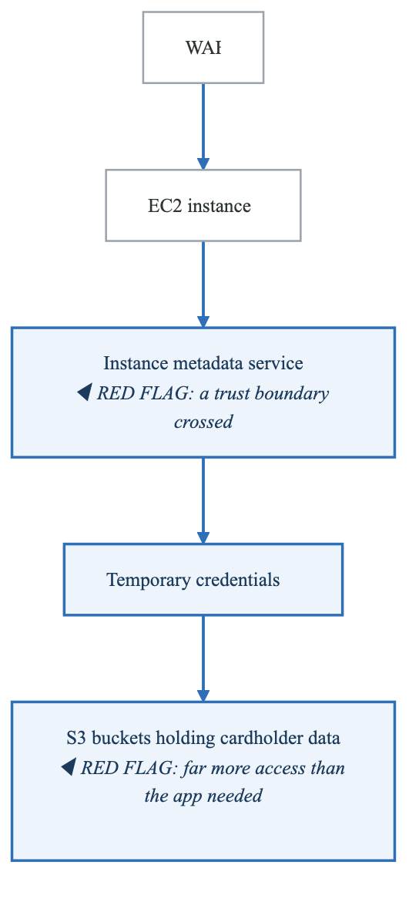
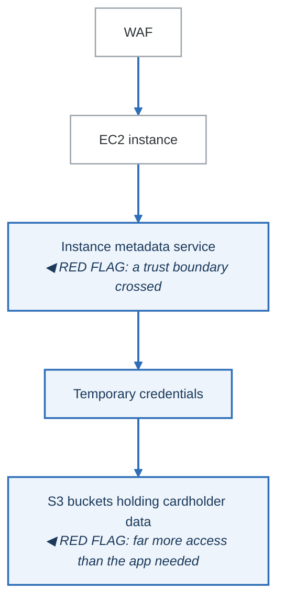
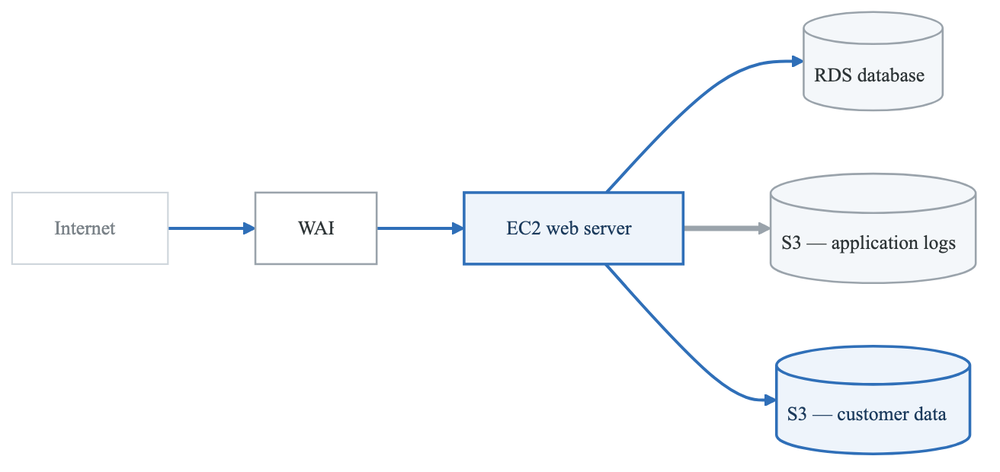
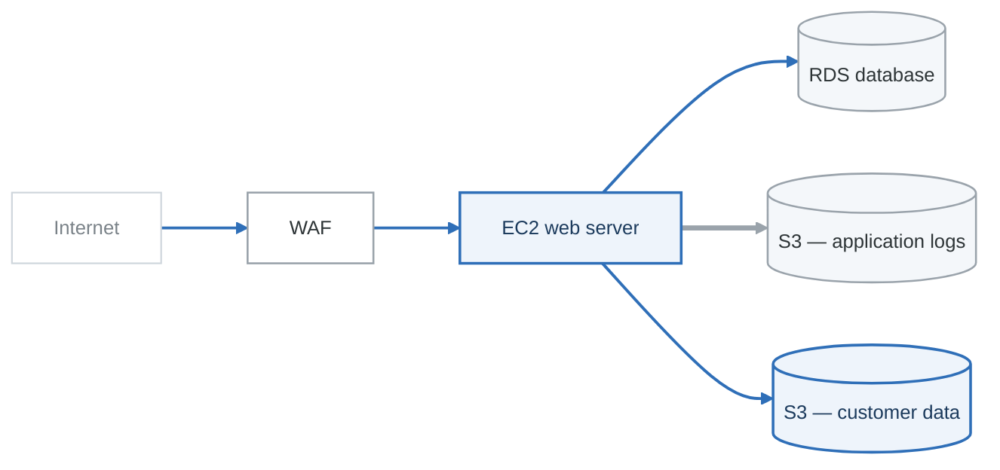

# Case Study: Meridian Bank Data Breach (2019)

## Incident Overview

| Attribute | Details |
|-----------|---------|
| **Date Discovered** | July 19, 2019 |
| **Date of Breach** | March 22-23, 2019 |
| **Records Affected** | ~106 million customers |
| **Data Exposed** | Names, addresses, phone numbers, email, DOB, income, SSNs (140,000), bank account numbers (80,000) |
| **Root Cause** | Misconfigured WAF + SSRF vulnerability |
| **Financial Impact** | $80 million fine, $190 million settlement |

---

## Attack Timeline

**ATTACK TIMELINE**

**March 12, 2019**

- Attacker begins scanning for vulnerable systems

**March 22-23, 2019**

- SSRF attack exploits misconfigured WAF
- Attacker obtains AWS credentials via IMDS
- Data exfiltration begins

**April 21, 2019**

- Attacker posts about breach on social media

**July 17, 2019**

- External security researcher alerts Meridian Bank

**July 19, 2019**

- Meridian Bank confirms breach, notifies FBI

**July 29, 2019**

- Attacker arrested by FBI


---

## Technical Analysis

### Attack Vector

**Attack chain**

| Step | What happened |
|---|---|
| **1 · Reconnaissance** | The attacker — a former employee of the cloud provider — identifies the bank's infrastructure |
| **2 · Initial access via SSRF** | A misconfigured WAF allowed requests through to the instance metadata service |
| **3 · Credential access** | Temporary cloud credentials retrieved from IMDS; the attached role had **excessive S3 permissions** |
| **4 · Data exfiltration** | The CLI used to list and sync buckets — roughly 30 GB downloaded, exfiltrated over Tor |
| **5 · Post-exploitation** | The attacker discussed it publicly, which led to identification and arrest |

The request at step 2 is the canonical SSRF payload — a `GET` to the link-local metadata address
asking for the role's security credentials.

**Three failures compounding**

1. The WAF permitted an outbound request to a link-local address
2. IMDSv1 answered that request without requiring a session token
3. The role it handed back could read far more than the application needed

Any one of the three would have stopped it. IMDSv2 — which requires a `PUT` to obtain a token first,
and sets a hop limit that a proxied request cannot satisfy — closes the second, and is a one-line
change on a launch template.

### Vulnerable Configuration

**MISCONFIGURATION DETAILS**

**WAF Configuration Issue:**

- ModSecurity WAF was misconfigured
- Allowed proxy of arbitrary requests to internal endpoints
- No restriction on requests to 169.254.169.254 (IMDS)

**IAM Role Issue:**

- EC2 instance role had broad S3 permissions
- Could list all buckets in account
- Could read from multiple data buckets
- No least privilege enforcement

**IMDS Issue (pre-IMDSv2):**

- IMDSv1 allowed simple GET requests
- No session token required
- Any process on instance could access credentials


---

## Threat Modeling Perspective

### What Threat Modeling Would Have Found

| STRIDE | Threat | Would TM Have Identified? |
|--------|--------|---------------------------|
| **Spoofing** | WAF passing arbitrary requests | Yes - SSRF is a known pattern |
| **Tampering** | N/A | - |
| **Repudiation** | Insufficient logging of IMDS access | Possibly |
| **Info Disclosure** | Data exfiltration via S3 | Yes - data flow analysis |
| **DoS** | N/A | - |
| **EoP** | Overly permissive IAM role | Yes - IAM review |

### Data Flow Analysis Would Have Shown

<!-- figure: generated from the Mermaid below by _shared/diagrams/embed-figures.py — do not edit the image -->


<details>
<summary>Diagram source (Mermaid)</summary>



</details>

### Threats That Should Have Been Identified

1. **SSRF via Proxy/WAF** (STRIDE: I, E)
   - WAF acting as proxy to internal services
   - No allowlist of valid destinations

2. **IMDS Credential Exposure** (STRIDE: I, E)
   - Any process can access instance credentials
   - No hop-count or session requirements

3. **Overly Permissive IAM** (STRIDE: E)
   - Instance role with broad S3 access
   - No separation between application and data access roles

4. **Insufficient Network Segmentation** (STRIDE: I, E)
   - WAF could reach sensitive internal endpoints
   - No micro-segmentation

---

## Lessons Learned

### Technical Controls

| Control | Before Breach | Recommended |
|---------|---------------|-------------|
| WAF Configuration | Allowed SSRF | Strict allowlist, block internal IPs |
| IMDS | v1 (no protection) | IMDSv2 with session tokens |
| IAM Permissions | Broad S3 access | Least privilege, separate roles |
| Network Segmentation | Flat within VPC | Micro-segmentation, PrivateLink |
| Logging | Limited | CloudTrail + IMDS logging |
| Detection | None for SSRF | WAF logging, anomaly detection |

### Process Improvements

1. **Regular Threat Modeling**
   - Review cloud architecture for SSRF vectors
   - Analyze IAM permissions as part of threat model

2. **Configuration Management**
   - Automated scanning for misconfigurations
   - Infrastructure as Code with security guardrails

3. **Detection Engineering**
   - Alert on IMDS access patterns
   - Monitor for unusual S3 access patterns

---

## Threat Model Exercise

### Exercise: Model This Attack

Given the architecture:

<!-- figure: generated from the Mermaid below by _shared/diagrams/embed-figures.py — do not edit the image -->


<details>
<summary>Diagram source (Mermaid)</summary>



</details>

**Tasks:**

1. Create a DFD showing all data flows, including IMDS
2. Apply STRIDE to the WAF component
3. Identify at least 3 threats that would have prevented this breach
4. Propose mitigations for each threat

---

## Mitigation Checklist

```
AWS SSRF Protection:
□ Implement IMDSv2 and require tokens
□ Set IMDSv2 hop limit to 1
□ Block 169.254.169.254 at WAF/proxy layer
□ Use VPC endpoints instead of public endpoints

IAM Hardening:
□ Apply least privilege to all roles
□ Use IAM Access Analyzer
□ Implement permission boundaries
□ Separate roles for different data classifications

Network Security:
□ Implement micro-segmentation
□ Use security groups as allowlists
□ Enable VPC Flow Logs
□ Monitor for lateral movement

Detection:
□ Enable CloudTrail for all regions
□ Log and alert on IMDS access
□ Monitor S3 access patterns
□ Implement GuardDuty
```

---

## References

- AWS Security Blog: Instance Metadata Service Version 2
- MITRE ATT&CK: T1552.005 - Cloud Instance Metadata API
- Department of Justice Press Release (July 2019)
- OCC Consent Order (August 2020)

<!-- feynman-check -->

---

## Feynman check

Close the file. Blank page, no notes. Explain each of these to a competent engineer who has never
used this tool — **under five minutes, no jargon you can't define on the spot:**

- Incident Overview
- Attack Timeline
- Technical Analysis
- Threat Modeling Perspective

**The gap is not what you forgot. It is where you used a word instead of a mechanism.**

| | |
|---|---|
| ✗ | *"We scan for vulnerabilities in the pipeline."* |
| ✓ | *"SAST reads source without running it, SCA resolves the dependency tree against an advisory database, and image scanning compares installed package versions to that same database. All three report what was known at build time — which is why the registry is re-scanned: the image does not change, the database does."* |

**Trace it:** A CVE published today against your base image → a blocked deploy. Name every component between the advisory and the refused `apply`.

Stop at the first component you cannot name. Reopen this file and read **only** that.

**Go deeper — only once the gap has a name:** the [SLSA threat model](https://slsa.dev/spec/v1.2/threats) — it names every point at which a build can be subverted, and most teams defend three of them.
Full list per domain: [`SOURCES.md`](../../SOURCES.md#devsecops)

→ Protocol, the three levels of knowing, and worked examples: [`MASTERY.md`](../../MASTERY.md)

<!-- /feynman-check -->
