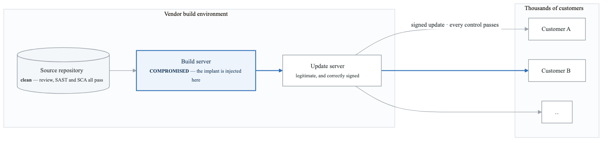
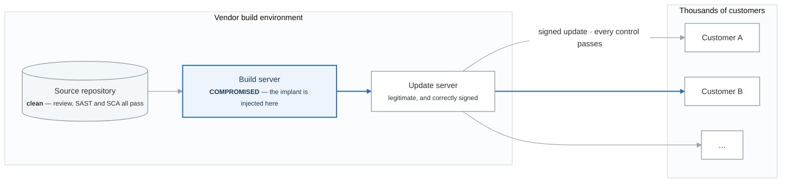
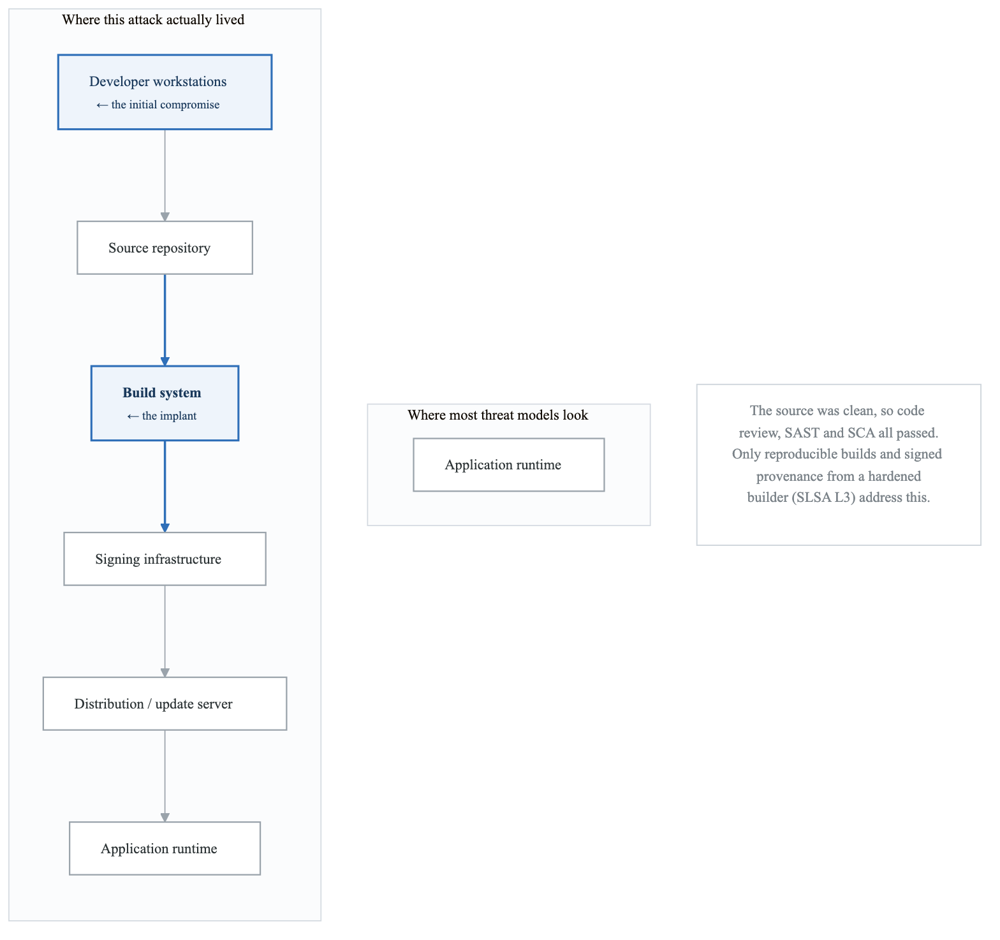
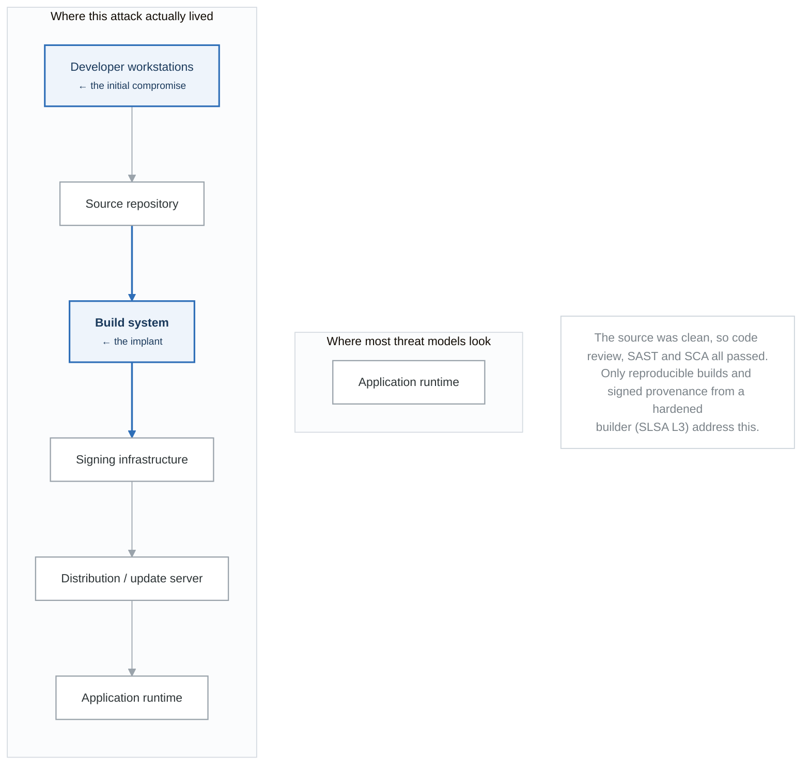
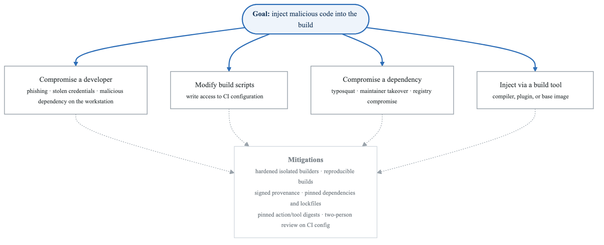
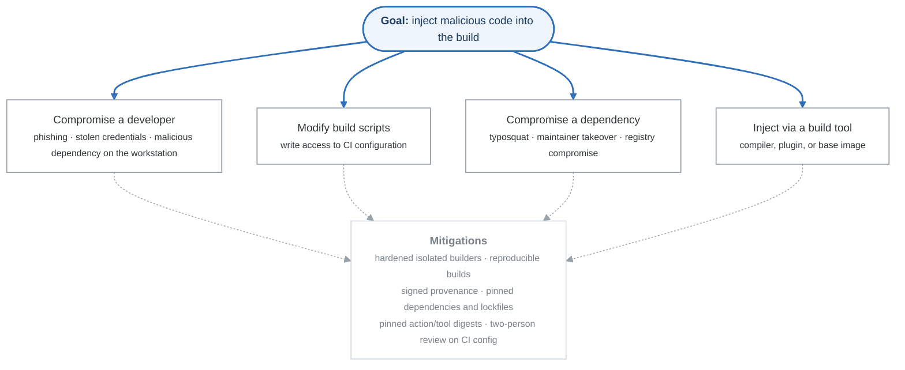

# Case Study: OrionSoft Supply Chain Attack (2020)

## Incident Overview

| Attribute | Details |
|-----------|---------|
| **Date Discovered** | December 8, 2020 (by FireEye) |
| **Attack Duration** | October 2019 - December 2020 (14+ months) |
| **Organizations Affected** | ~18,000 organizations installed backdoored updates |
| **High-Value Targets** | US Treasury, DHS, DOE, Microsoft, FireEye |
| **Attribution** | Russian SVR (APT29/Cozy Bear) |
| **Attack Type** | Software supply chain compromise |

---

## Attack Overview

<!-- figure: generated from the Mermaid below by _shared/diagrams/embed-figures.py — do not edit the image -->


<details>
<summary>Diagram source (Mermaid)</summary>



</details>

---

## Attack Chain Details

### Phase 1: Initial Compromise of OrionSoft

**Attacker Actions:**

- Gained access to OrionSoft development environment
- Compromised build system (not source repository)
- Implanted SUNSPOT malware on build server
- SUNSPOT injected SUNBURST into Orion during compilation

**Key Technique: Build Process Manipulation**

- Source code remained clean
- Malware only injected during build
- Signed with legitimate OrionSoft certificate
- Appeared as normal software update


### Phase 2: Distribution

**Timeline:**

- Oct 2019: Attackers test deployment mechanism
- Feb 2020: SUNBURST first compiled into Orion updates
- Mar-Jun 2020: Malicious updates distributed to customers
- Dec 2020: FireEye discovers breach, alerts OrionSoft


### Phase 3: Post-Compromise Activities

**SUNBURST Behavior:**

- 2-week dormancy period after installation
- DNS beaconing to attacker-controlled domains
- Victim identification and prioritization
- High-value targets received TEARDROP/RAINDROP follow-up malware
- Lateral movement and data exfiltration

**Evasion Techniques:**

- Mimicked legitimate Orion traffic patterns
- Used victim's own infrastructure for C2
- Avoided systems with security tools (sandbox detection)
- Operated during business hours to blend in
- Used legitimate cloud services (AWS, Azure)


---

## Threat Modeling Perspective

### Supply Chain Attack Surface

<!-- figure: generated from the Mermaid below by _shared/diagrams/embed-figures.py — do not edit the image -->


<details>
<summary>Diagram source (Mermaid)</summary>



</details>

### STRIDE Analysis of Build Pipeline

| Component | S | T | R | I | D | E | SUNBURST Relevance |
|-----------|---|---|---|---|---|---|--------------------|
| Dev Workstation | ✓ | ✓ | ✓ | ✓ | | ✓ | Entry point |
| Source Repo | ✓ | ✓ | ✓ | ✓ | | ✓ | Remained clean |
| Build Server | ✓ | ✓ | ✓ | ✓ | ✓ | ✓ | **Injection point** |
| Artifact Storage | | ✓ | | ✓ | ✓ | | Stored malware |
| Signing Service | ✓ | | ✓ | | | ✓ | **Legitimized malware** |
| Update Server | | ✓ | | ✓ | ✓ | | Distributed malware |

### Threats That Should Have Been Modeled

1. **Build-Time Injection** (T: Tampering)
   - Malicious code added during compilation
   - Source and binary don't match
   - Build server compromise

2. **Signing Key Abuse** (S: Spoofing, E: Elevation)
   - Malicious code signed with legitimate key
   - Trust chain exploitation
   - Certificate protection inadequate

3. **Update Mechanism Abuse** (T: Tampering, E: Elevation)
   - Software updates as attack vector
   - Trusted channel for malware delivery

4. **Supply Chain Trust** (S: Spoofing)
   - Implicit trust in vendor software
   - No verification of build integrity
   - Customer trusts signed updates

---

## Lessons for Threat Modeling

### Expanding Threat Model Scope

**Include in Scope:**

- Development environment
  - Developer workstations
  - IDE plugins and extensions
  - Development tools
- Source control
  - Repository access
  - Branch protection
  - Code review process
- Build pipeline
  - CI/CD systems
  - Build agents/runners
  - Build scripts
  - Build-time dependencies
- Artifact management
  - Package repositories
  - Container registries
  - Binary storage
- Code signing
  - Key storage (HSM?)
  - Signing process
  - Certificate management
- Distribution
  - Update mechanisms
  - `CDN/hosting`
  - Customer deployment


### Build Pipeline Threat Model

<!-- figure: generated from the Mermaid below by _shared/diagrams/embed-figures.py — do not edit the image -->


<details>
<summary>Diagram source (Mermaid)</summary>



</details>

---

## Detection and Prevention

### Controls That Would Have Helped

| Control | Description | Would It Have Detected/Prevented? |
|---------|-------------|-----------------------------------|
| **Reproducible Builds** | Same source → same binary | Yes - binary wouldn't match |
| **Build Isolation** | Ephemeral, isolated build environments | Possibly - harder to persist |
| **Binary Analysis** | Compare source to compiled output | Yes - would show extra code |
| **Behavioral Monitoring** | Monitor build server behavior | Possibly - unusual processes |
| **Multi-Party Signing** | Require multiple approvals | Possibly - higher barrier |
| **SBOM + Provenance** | Document build inputs/process | Yes - would show anomalies |

### Modern Mitigations

**Supply Chain Security Framework:**

- SLSA (Supply-chain Levels for Software Artifacts)
  - Level 1: Documentation
  - Level 2: Tamper resistance
  - Level 3: Extra resistance
  - Level 4: Maximum confidence
- Sigstore / Cosign
  - Keyless signing
  - Transparency logs
  - Verification tooling
- In-toto
  - Supply chain layout
  - Signed attestations
  - Policy enforcement
- SBOM (Software Bill of Materials)
  - Dependency tracking
  - Vulnerability correlation
  - Provenance documentation


---

## Threat Model Exercise

### Exercise: Model Your Build Pipeline

**Scenario:** You maintain a CI/CD pipeline for a critical application:

```
[Developer] → [GitHub] → [Jenkins] → [Artifactory] → [Production]
                              │
                      [Build Dependencies]
                      [npm, Maven, Docker]
```

**Tasks:**

1. **Enumerate Assets:**
   - What are the crown jewels?
   - What needs protection?

2. **Identify Entry Points:**
   - Where could an attacker enter?
   - What trust relationships exist?

3. **Apply STRIDE to Build Server:**
   - How could Jenkins be compromised?
   - What could an attacker do with access?

4. **Model Dependency Risk:**
   - How are dependencies resolved?
   - Could a malicious package be introduced?

5. **Design Controls:**
   - How would you detect a SUNBURST-style attack?
   - What preventive controls would help?

---

## Key Takeaways

1. **Trust is transitive** - Customers trusted OrionSoft, who trusted their build system

2. **Build systems are high-value targets** - Compromise once, affect thousands

3. **Signatures aren't enough** - Signed malware is still malware

4. **Source ≠ Binary** - Build process can introduce changes

5. **Threat model the full lifecycle** - Not just runtime, but development and distribution

6. **Supply chain security is a discipline** - SLSA, SBOM, provenance are essential

---

## References

- CISA Alert AA20-352A
- FireEye: Highly Evasive Attacker Leverages OrionSoft Supply Chain
- Microsoft: Solorigate Investigation
- MITRE ATT&CK: Supply Chain Compromise (T1195.002)
- SLSA Framework: slsa.dev

<!-- feynman-check -->

---

## Feynman check

Close the file. Blank page, no notes. Explain each of these to a competent engineer who has never
used this tool — **under five minutes, no jargon you can't define on the spot:**

- Incident Overview
- Attack Overview
- Attack Chain Details
- Threat Modeling Perspective

**The gap is not what you forgot. It is where you used a word instead of a mechanism.**

| | |
|---|---|
| ✗ | *"We scan for vulnerabilities in the pipeline."* |
| ✓ | *"SAST reads source without running it, SCA resolves the dependency tree against an advisory database, and image scanning compares installed package versions to that same database. All three report what was known at build time — which is why the registry is re-scanned: the image does not change, the database does."* |

**Trace it:** A CVE published today against your base image → a blocked deploy. Name every component between the advisory and the refused `apply`.

Stop at the first component you cannot name. Reopen this file and read **only** that.

**Go deeper — only once the gap has a name:** the [SLSA threat model](https://slsa.dev/spec/v1.2/threats) — it names every point at which a build can be subverted, and most teams defend three of them.
Full list per domain: [`SOURCES.md`](../../SOURCES.md#devsecops)

→ Protocol, the three levels of knowing, and worked examples: [`MASTERY.md`](../../MASTERY.md)

<!-- /feynman-check -->
