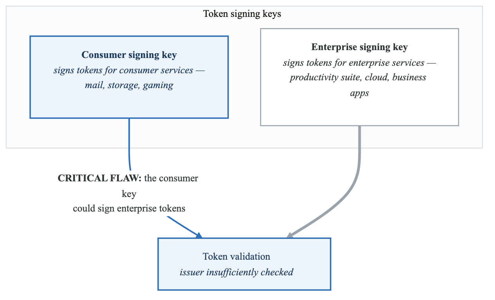
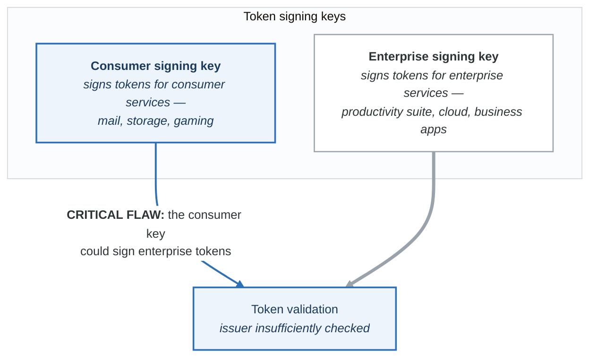
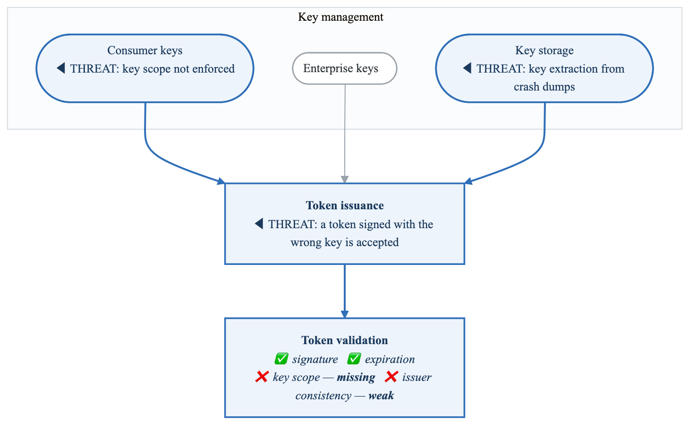
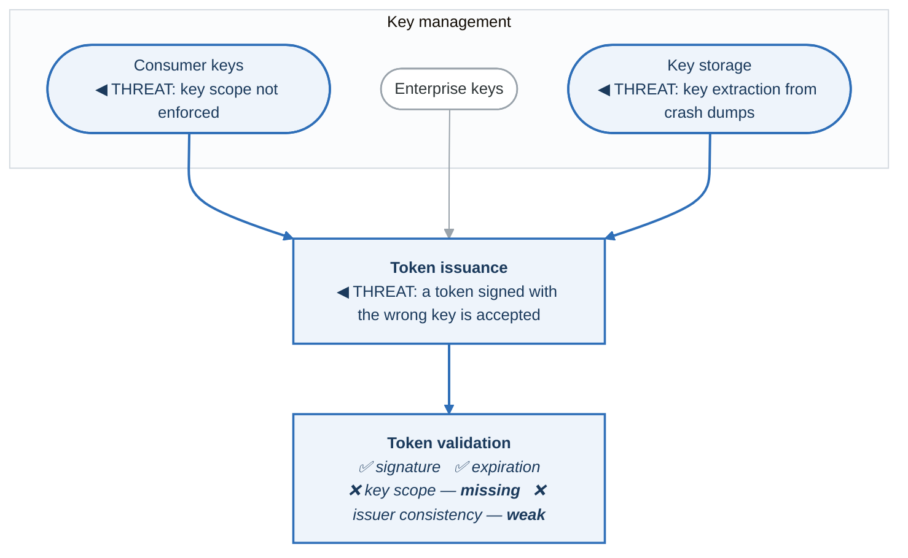
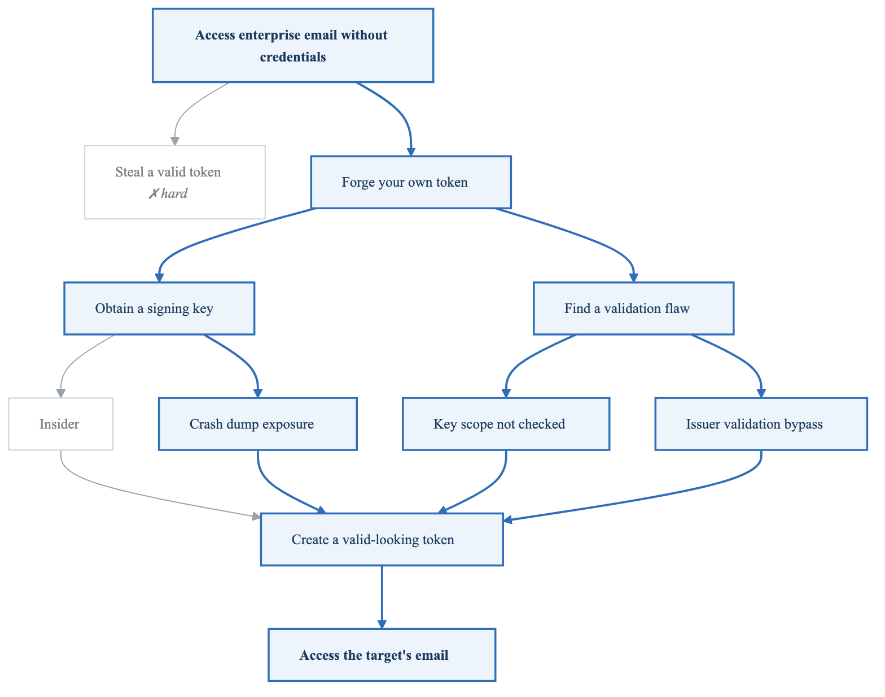
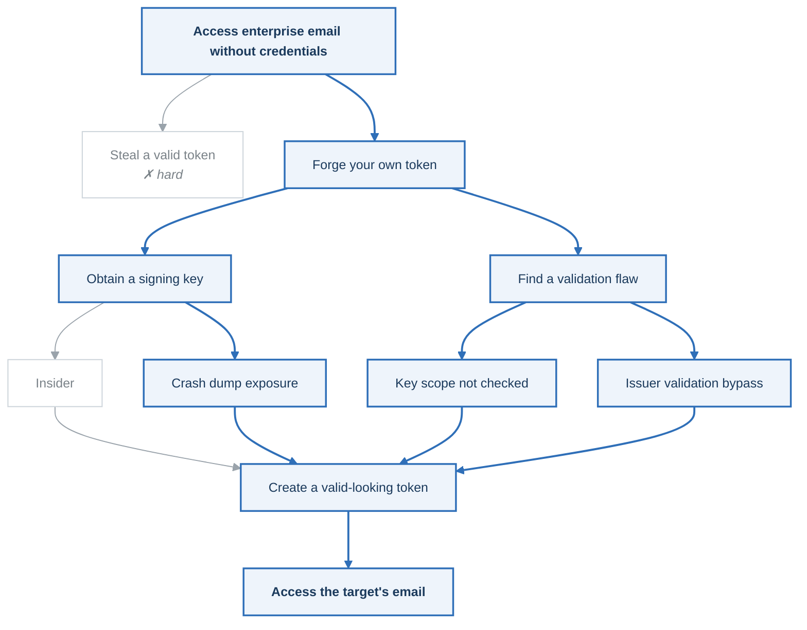

# Case Study: ThreatGroup-B Microsoft Cloud Breach (2023)

## Executive Summary

In July 2023, Microsoft disclosed that a China-based threat actor (ThreatGroup-B) had compromised email accounts of approximately 25 organizations, including US government agencies. The attackers used a stolen Microsoft consumer signing key to forge authentication tokens, accessing enterprise email without credentials.

**Key Facts:**
- Attacker: ThreatGroup-B (China-linked APT)
- Target: US government agencies, European officials
- Method: Forged authentication tokens using stolen signing key
- Duration: May 15 - June 16, 2023 (approximately one month)
- Impact: ~25 organizations, including State Department and Commerce Department

---

## Technical Background

### Microsoft Identity Architecture

<!-- figure: generated from the Mermaid below by _shared/diagrams/embed-figures.py — do not edit the image -->


<details>
<summary>Diagram source (Mermaid)</summary>



</details>

### The Attack Chain

**Attack flow**

| Step | What happened |
|---|---|
| **1 · Obtain the consumer signing key** | Method never fully established — a crash dump, an insider, or a prior breach |
| **2 · Forge access tokens for enterprise users** | Craft tokens that appear to be issued by the platform |
| **3 · Access mail with the forged token** | Accepted, because of the validation flaw |
| **4 · Read and exfiltrate mail** | Roughly 25 organisations affected, including government departments |

**The stolen key**

| | |
|---|---|
| Type | RSA private key |
| Intended use | Consumer accounts |
| **Actual use** | Sign **any** token, because of the validation bug |

**The forged token**

```json
{
  "iss": "https://sts.example.com/{tenant-id}/",
  "sub": "victim@agency.example",
  "aud": "https://mail.example.com",
  "exp": "...",
  "...": "signed with the stolen consumer key"
}
```

**What validation checked, and did not**

| Check | Result |
|---|---|
| Signature valid? | ✅ — the key was a legitimate platform key |
| Expired? | ✅ not expired |
| **Issuer and audience consistent with the signing key?** | ❌ **not properly validated** |

Result: **access granted.** A correct signature was treated as sufficient, and the question *"is this
key allowed to sign this kind of token?"* was never asked.

---

## Root Causes

### 1. Key Theft (Initial Access)

| Hypothesis | Likelihood | Evidence |
|------------|------------|----------|
| Crash dump exposure | Medium | Microsoft confirmed key in crash dump |
| Insider threat | Low | No public evidence |
| Infrastructure breach | Medium | Key stored in production system |
| Supply chain compromise | Low | No indication |

**Microsoft's Explanation:**
> "A consumer signing system crash in April 2021 resulted in a snapshot of the crashed process ('crash dump'). The crash dumps, which redact sensitive information, should not include the signing key. In this case, a race condition allowed the key to be present in the crash dump."

### 2. Token Validation Flaw (Exploitation)

**Expected behaviour**

| | |
|---|---|
| Consumer key | Can **only** sign consumer tokens |
| Enterprise key | Can **only** sign enterprise tokens |

Validation should check:

- ✅ Is the signature valid?
- ✅ **Is this key authorised for this token type?**
- ✅ Does the issuer match the expected issuer?
- ✅ Is the audience correct?

**Actual behaviour — the flaw**

| | |
|---|---|
| Consumer key | Could sign **any** token |

Validation only checked:

- ✅ Is the signature valid?
- ❌ Key-type validation missing
- ❌ Issuer validation insufficient

The gap between these two lists is the entire incident. Everything in the first list was in the
design; two lines of it were absent from the implementation, and there was no test that would have
noticed.

---

## What Threat Modeling Would Have Found

### Data Flow Diagram: Identity Token Flow

<!-- figure: generated from the Mermaid below by _shared/diagrams/embed-figures.py — do not edit the image -->


<details>
<summary>Diagram source (Mermaid)</summary>



</details>

### STRIDE Analysis: Token Signing System

| Element | S | T | R | I | D | E | Critical Threats |
|---------|---|---|---|---|---|---|------------------|
| Signing keys | ✓ | | | ✓ | | | Key theft, unauthorized access |
| Key storage | | | | ✓ | | ✓ | Crash dump exposure |
| Token issuance | ✓ | ✓ | ✓ | | | | Unauthorized token creation |
| Token validation | ✓ | | | | | ✓ | **Validation bypass** |
| Email access | ✓ | | | ✓ | | ✓ | Unauthorized data access |

### Attack Tree: Forge Identity Tokens

<!-- figure: generated from the Mermaid below by _shared/diagrams/embed-figures.py — do not edit the image -->


<details>
<summary>Diagram source (Mermaid)</summary>



</details>

---

## Lessons for Cloud Identity Threat Modeling

### 1. Signing Keys Are Crown Jewels

```yaml
key_management_threat_model:
  signing_keys:
    classification: CRITICAL
    access_controls:
      - HSM-only storage
      - No key export
      - Audit all access
      - Rotate regularly

    threat_scenarios:
      - Insider theft
      - Crash dump exposure
      - Side-channel attacks
      - Supply chain compromise

    monitoring:
      - All key operations logged
      - Anomaly detection on key usage
      - External audit of key access
```

### 2. Token Validation Must Be Complete

```python
# Incomplete validation (vulnerability)
def validate_token_insecure(token):
    decoded = jwt.decode(token, verify=True)
    if decoded['exp'] > time.time():
        return True  # Only checked expiration and signature
    return False

# Complete validation (secure)
def validate_token_secure(token):
    decoded = jwt.decode(token, verify=True)

    # Check all claims
    if decoded['exp'] <= time.time():
        raise TokenExpired()

    if decoded['iss'] not in TRUSTED_ISSUERS:
        raise InvalidIssuer()

    if decoded['aud'] != EXPECTED_AUDIENCE:
        raise InvalidAudience()

    # Verify key is authorized for this token type
    key_id = get_key_id_from_header(token)
    if not key_authorized_for_issuer(key_id, decoded['iss']):
        raise KeyNotAuthorized()  # This check was missing!

    return True
```

### 3. Defense in Depth for Identity

| Layer | Control | Purpose |
|-------|---------|---------|
| Key Storage | HSM | Prevent key extraction |
| Key Scope | Enforcement | Consumer keys can't sign enterprise tokens |
| Token Issuance | Logging | Track all token creation |
| Token Validation | Complete checks | Verify all claims |
| Access | Monitoring | Detect anomalous access patterns |
| Data | DLP | Detect unusual data access |

### 4. Crash Dumps and Debugging Data

**Sensitive Data in Debugging:**

- Memory dumps
  - May contain keys, credentials, secrets
- Core dumps
  - May contain decrypted data
- Debug logs
  - May contain tokens, session IDs
- Error messages
  - May contain sensitive context

Threat Model Implications:
□ Classify debugging data as sensitive
□ Scrub sensitive data before storage
□ Restrict access to debugging systems
□ Monitor for data exfiltration
□ Include debugging systems in scope


---

## Detection Strategies

### Indicators of Compromise

```yaml
token_anomalies:
  - Token signed by consumer key for enterprise endpoint
  - Access from unusual IP ranges
  - Access patterns inconsistent with normal usage
  - Token claims don't match user profile

access_patterns:
  - Bulk email access across multiple mailboxes
  - Access at unusual hours
  - Access from unexpected geographies
  - Programmatic access patterns (API vs. OWA)

key_management:
  - Unexpected key access in HSM logs
  - Key usage from unknown systems
  - Crash dumps containing key material
```

### Detection Rules

```python
# Pseudo-code for anomaly detection
def detect_token_anomaly(token, access_event):
    # Check if key used matches expected key type
    key_id = extract_key_id(token)
    issuer = extract_issuer(token)

    if key_is_consumer_key(key_id) and is_enterprise_issuer(issuer):
        alert(severity="CRITICAL",
              message="Consumer key used for enterprise token",
              event=access_event)

    # Check for unusual access patterns
    user = extract_user(token)
    if is_first_time_access(user, access_event.resource):
        if is_sensitive_resource(access_event.resource):
            alert(severity="HIGH",
                  message="First-time access to sensitive resource",
                  event=access_event)
```

---

## Remediation Framework

### Microsoft's Response

| Action | Description | Impact |
|--------|-------------|--------|
| Key revocation | Invalidated compromised key | Broke attack chain |
| Validation fix | Added proper key scope checks | Prevented future abuse |
| Enhanced logging | Improved audit trail | Better detection |
| Crash dump scrubbing | Removed keys from dumps | Prevented future exposure |

### Lessons for Organizations

**Immediate Actions:**
1. Enable enhanced audit logging in Azure AD/Entra ID
2. Review conditional access policies
3. Implement sign-in risk policies
4. Enable Purview audit logging for mailbox access

**Long-Term Actions:**
1. Implement Zero Trust architecture
2. Use hardware-backed credentials where possible
3. Monitor for token-based attacks
4. Conduct red team exercises on identity systems

---

## Threat Model Checklist: Cloud Identity

```
Key Management:
□ Are signing keys stored in HSM?
□ Is key export disabled?
□ Are key operations fully logged?
□ Is key rotation automated?
□ Are keys scoped to specific services?

Token Issuance:
□ Are all token claims validated?
□ Is issuer properly verified?
□ Is audience properly verified?
□ Is key type/scope enforced?
□ Are tokens short-lived?

Token Validation:
□ Is signature validation complete?
□ Are all claims checked?
□ Is key-to-issuer mapping verified?
□ Are expired tokens rejected?
□ Is token reuse prevented?

Monitoring:
□ Are all authentications logged?
□ Is anomaly detection in place?
□ Are sign-in risks evaluated?
□ Is cross-tenant access monitored?
□ Are privileged operations alerted?

Debugging & Support:
□ Are crash dumps scrubbed?
□ Is debug data classified?
□ Is access to debugging restricted?
□ Are sensitive values masked in logs?
□ Is data retention minimized?
```

---

## Key Takeaways

1. **Signing keys are the ultimate crown jewels** - Their compromise allows unlimited forgery
2. **Token validation must be defense in depth** - Multiple checks, not just signature
3. **Crash dumps are security data** - Treat debugging artifacts as sensitive
4. **Cloud identity is shared responsibility** - Even with trusted providers, monitor your tenant
5. **Nation-state actors target identity** - Authentication systems are high-value targets
6. **Scope enforcement is critical** - Keys should only work for intended purposes

---

## Government Response

### CISA and Security Community

- CISA issued guidance on detecting ThreatGroup-B activity
- Congressional hearings on Microsoft security practices
- Enhanced requirements for government cloud providers
- Increased scrutiny on cloud provider security

### Regulatory Implications

| Regulation | Impact |
|------------|--------|
| FedRAMP | Enhanced key management requirements |
| CMMC | Additional identity controls |
| NIST | Updated guidance on token security |
| Zero Trust | Accelerated adoption mandates |

---

## References

- [Microsoft ThreatGroup-B Analysis](https://www.microsoft.com/security/blog/2023/07/14/analysis-of-threatgroup-b-techniques-for-unauthorized-email-access/)
- [Microsoft Post-Incident Review](https://msrc.microsoft.com/blog/2023/09/results-of-major-technical-investigations-for-threatgroup-b-key-acquisition/)
- [CISA Advisory](https://www.cisa.gov/news-events/cybersecurity-advisories)
- [Wiz Research on Key Exposure](https://www.wiz.io/blog/threatgroup-b-compromised-microsoft-key-enables-authentication-of-countless-micr)

---

## Next Steps

→ [Return to Case Studies Index](../threat-modeling-roadmap.md#case-studies)

<!-- feynman-check -->

---

## Feynman check

Close the file. Blank page, no notes. Explain each of these to a competent engineer who has never
used this tool — **under five minutes, no jargon you can't define on the spot:**

- Technical Background
- Root Causes
- What Threat Modeling Would Have Found
- Lessons for Cloud Identity Threat Modeling

**The gap is not what you forgot. It is where you used a word instead of a mechanism.**

| | |
|---|---|
| ✗ | *"We scan for vulnerabilities in the pipeline."* |
| ✓ | *"SAST reads source without running it, SCA resolves the dependency tree against an advisory database, and image scanning compares installed package versions to that same database. All three report what was known at build time — which is why the registry is re-scanned: the image does not change, the database does."* |

**Trace it:** A CVE published today against your base image → a blocked deploy. Name every component between the advisory and the refused `apply`.

Stop at the first component you cannot name. Reopen this file and read **only** that.

**Go deeper — only once the gap has a name:** the [SLSA threat model](https://slsa.dev/spec/v1.2/threats) — it names every point at which a build can be subverted, and most teams defend three of them.
Full list per domain: [`SOURCES.md`](../../SOURCES.md#devsecops)

→ Protocol, the three levels of knowing, and worked examples: [`MASTERY.md`](../../MASTERY.md)

<!-- /feynman-check -->
