# Data Flow Diagrams for Threat Modeling

## Introduction

Data Flow Diagrams (DFDs) are the foundation of system-centric threat modeling. They provide a visual representation of how data moves through a system, making it easier to identify where threats may exist.

---

## DFD Elements

### Core Notation

**DFD element notation**

Five shapes, and in Mermaid they map cleanly onto node shapes you already have:

<!-- figure: generated from the Mermaid below by _shared/diagrams/embed-figures.py — do not edit the image -->
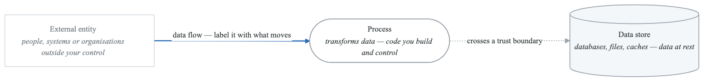

<details>
<summary>Diagram source (Mermaid)</summary>

```mermaid
%%{init: {'theme':'base','themeVariables':{'fontFamily':'Helvetica, Arial, sans-serif','fontSize':'13px','primaryColor':'#ffffff','primaryTextColor':'#2d3436','primaryBorderColor':'#9aa3ab','lineColor':'#9aa3ab','textColor':'#2d3436','clusterBkg':'#fbfcfd','clusterBorder':'#d4dae0','edgeLabelBackground':'#ffffff','tertiaryColor':'#eef4fb'},'flowchart':{'curve':'basis','padding':14,'nodeSpacing':42,'rankSpacing':58}}}%%
flowchart LR
  classDef default fill:#ffffff,stroke:#9aa3ab,stroke-width:1.3px,color:#2d3436
  classDef n    fill:#ffffff,stroke:#9aa3ab,stroke-width:1.3px,color:#2d3436
  classDef crit fill:#eef4fb,stroke:#2f6fb8,stroke-width:1.8px,color:#1b3a5c
  classDef data fill:#f4f7fa,stroke:#9aa3ab,stroke-width:1.3px,color:#2d3436
  classDef mut  fill:#ffffff,stroke:#cfd6dc,stroke-width:1.1px,color:#7a8288
  classDef warn fill:#fdf0ec,stroke:#c0522d,stroke-width:1.6px,color:#8a3a1e
  EE["External entity<br/><i>people, systems or organisations<br/>outside your control</i>"]
  PR(["Process<br/><i>transforms data — code you build and control</i>"])
  DS[("Data store<br/><i>databases, files, caches — data at rest</i>")]
  EE ==>|"data flow — label it with what moves"| PR
  PR -.->|"crosses a trust boundary"| DS
  class EE mut
  class PR n
  class DS data
  linkStyle 0 stroke:#2f6fb8,stroke-width:2px
```

</details>

| Element | Shape | Means |
|---|---|---|
| **External entity** | Rectangle | People, systems or organisations **outside your control** — a source or destination of data |
| **Process** | Rounded / circle | Something that transforms data: a service, a function, code you own |
| **Data store** | Double line / cylinder | Persists data at rest — databases, files, caches |
| **Data flow** | Arrow | Movement of data. Label it with the *content*, not the protocol |
| **Trust boundary** | Dashed line | Where the trust level changes |

The labels on data flows are where the value is. "HTTPS" tells you nothing a threat model can use;
"session token + cart contents" tells you exactly what an attacker gains by reading that flow.

### Element Details

#### External Entities (Rectangles)
Represent actors or systems outside your control:
- Users (end users, admins)
- Third-party services (payment processors, OAuth providers)
- External systems (partner APIs, legacy systems)
- IoT devices

**Questions to ask:**
- Who or what interacts with our system?
- What's outside our security boundary?
- What do we not control?

#### Processes (Circles/Ovals)
Represent code or logic that transforms data:
- Web servers
- API endpoints
- Background workers
- Lambda functions
- Microservices

**Questions to ask:**
- What code processes this data?
- What transformations occur?
- Where do we make decisions?

#### Data Stores (Parallel Lines)
Represent where data persists:
- Databases (SQL, NoSQL)
- File systems
- Caches (Redis, Memcached)
- Message queues
- Object storage (S3)
- Secrets stores

**Questions to ask:**
- Where does data live?
- What's the data sensitivity?
- Who can access it?

#### Data Flows (Arrows)
Represent data movement:
- API calls
- Database queries
- File transfers
- Message passing

**Label flows with:**
- Data type (credentials, PII, transactions)
- Protocol (HTTPS, gRPC, SQL)
- Authentication method

#### Trust Boundaries (Dashed Lines)
Represent security perimeters:
- Network boundaries (internet/DMZ/internal)
- Process boundaries
- Account/tenant boundaries
- Permission boundaries

**Critical:** Data crossing trust boundaries needs validation!

---

## DFD Levels

### Level 0: Context Diagram

Shows the entire system as a single process with external entities.

<!-- figure: generated from the Mermaid below by _shared/diagrams/embed-figures.py — do not edit the image -->
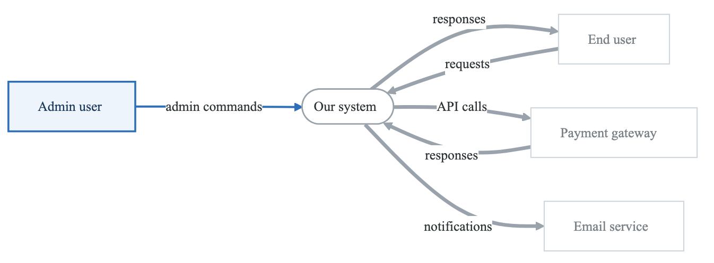

<details>
<summary>Diagram source (Mermaid)</summary>

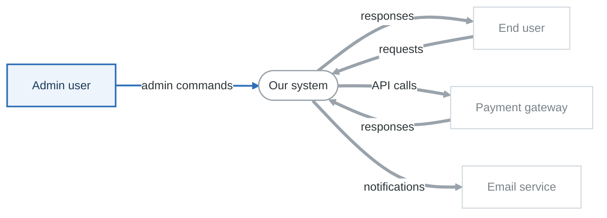

</details>

**Purpose:**
- Establish scope
- Identify all external entities
- Understand system context

### Level 1: System Diagram

Breaks down the system into major components.

<!-- figure: generated from the Mermaid below by _shared/diagrams/embed-figures.py — do not edit the image -->
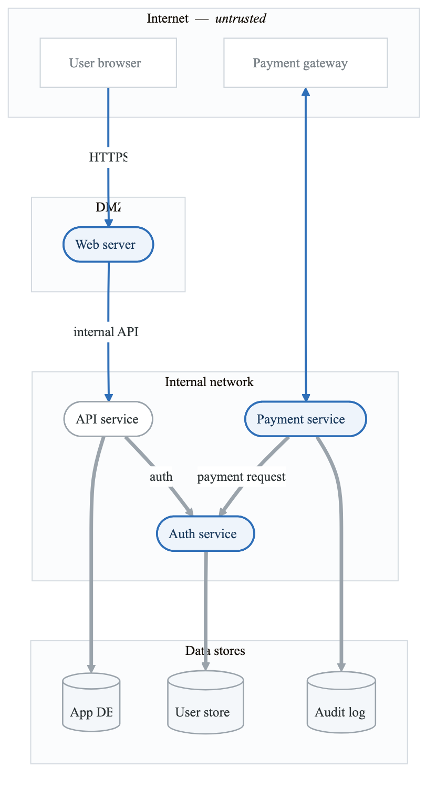

<details>
<summary>Diagram source (Mermaid)</summary>

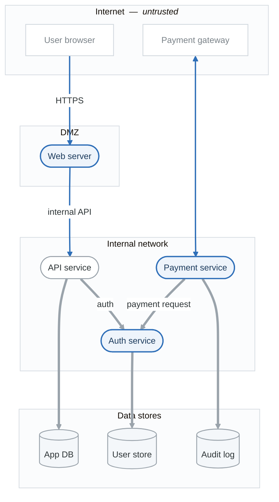

</details>

**Purpose:**
- Show major components
- Identify trust boundaries
- Map data flows between components

### Level 2: Component Diagram

Detailed view of a single component (when needed).

<!-- figure: generated from the Mermaid below by _shared/diagrams/embed-figures.py — do not edit the image -->
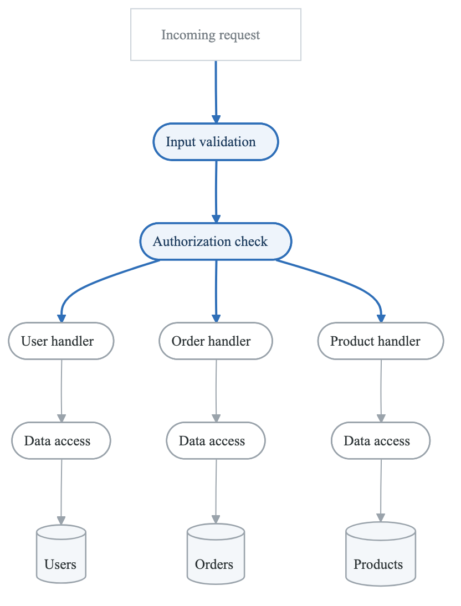

<details>
<summary>Diagram source (Mermaid)</summary>

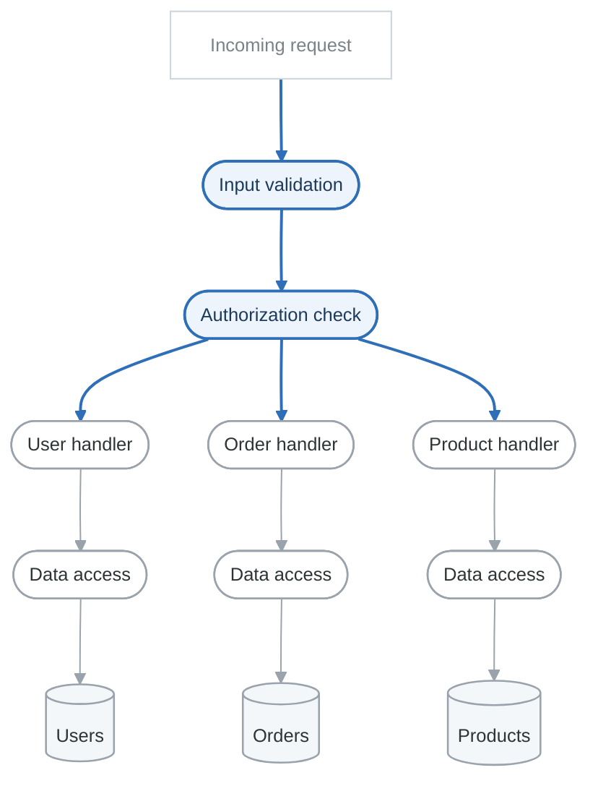

</details>

**Purpose:**
- Deep dive into complex components
- Identify internal attack vectors
- Understand data transformations

---

## Trust Boundaries in Cloud Environments

### AWS Trust Boundaries

<!-- figure: generated from the Mermaid below by _shared/diagrams/embed-figures.py — do not edit the image -->


<details>
<summary>Diagram source (Mermaid)</summary>

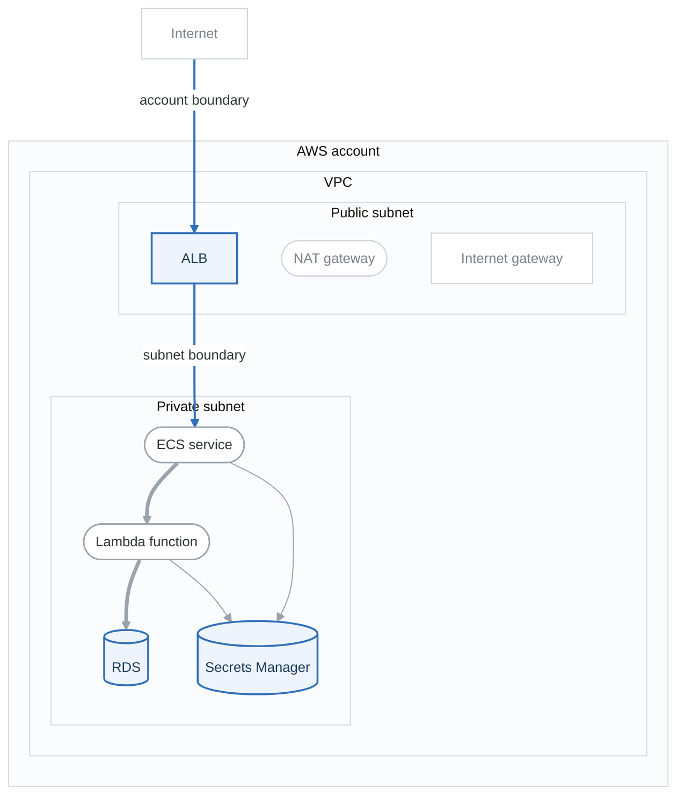

</details>

**Trust boundaries on this diagram**

1. Internet ↔ AWS account
2. Public subnet ↔ private subnet
3. VPC ↔ AWS services (S3, Secrets Manager — via VPC endpoints)
4. **IAM role boundaries** — not drawable, and often the most important

Boundary 4 is the one that catches people. Two Lambda functions in the same subnet with the same
security group can have entirely different reach, because the boundary between them is an IAM policy
and no network diagram will ever show it.

### Kubernetes Trust Boundaries

<!-- figure: generated from the Mermaid below by _shared/diagrams/embed-figures.py — do not edit the image -->
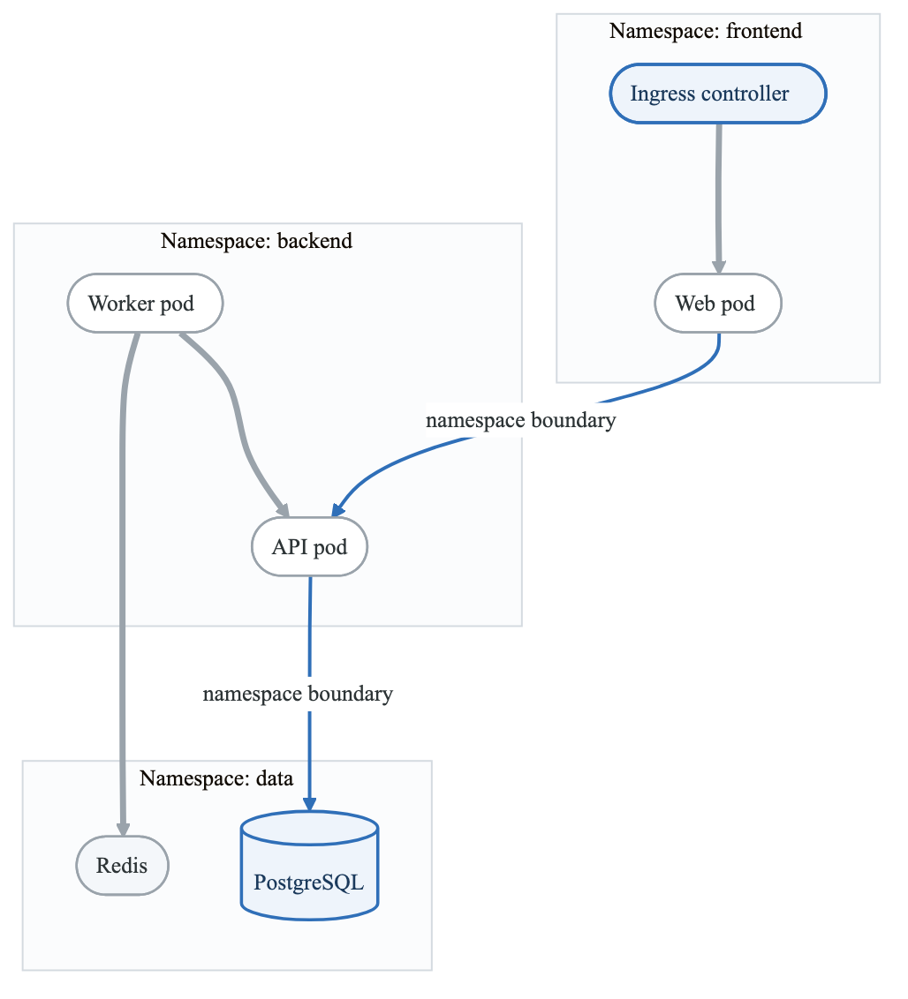

<details>
<summary>Diagram source (Mermaid)</summary>

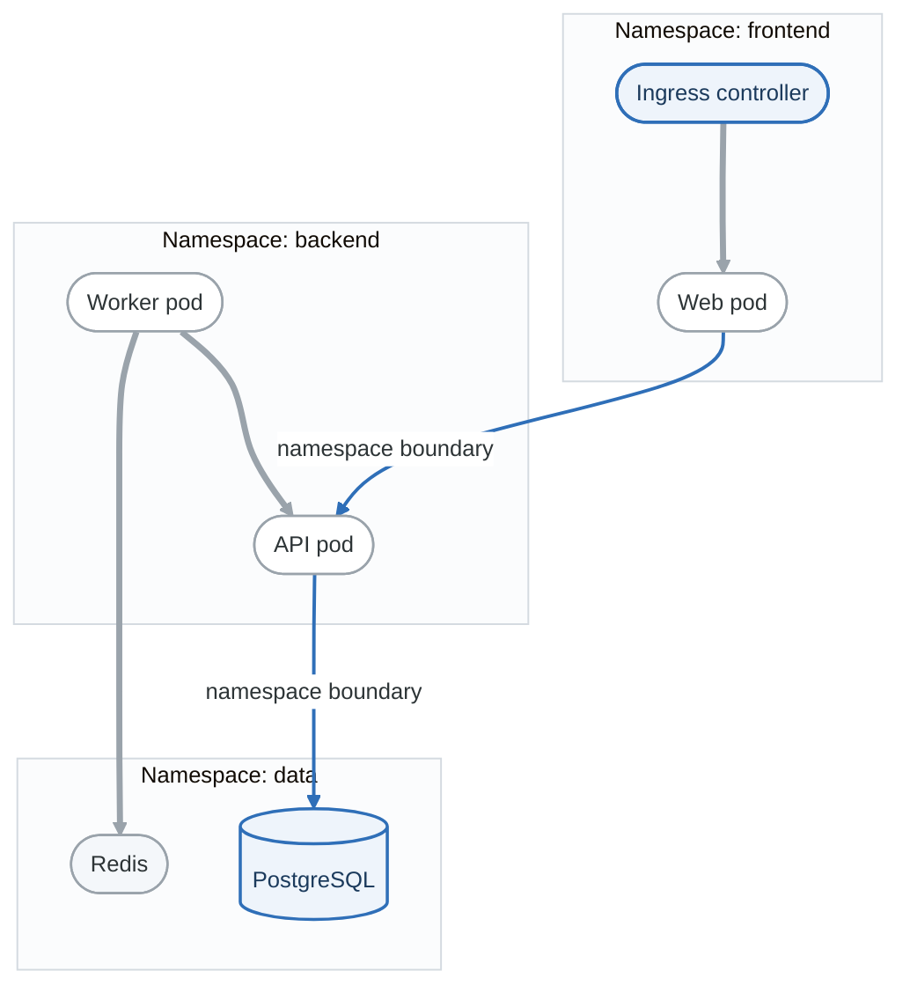

</details>

---

## Creating Effective DFDs

### Step-by-Step Process

**Step 1: Gather Information**

- Architecture documents
- API specifications
- Network diagrams
- Deployment configs (Terraform, K8s manifests)
- Interview stakeholders

**Step 2: Identify External Entities**

- Who/what interacts with the system?
- Users, admins, third parties
- External services and systems

**Step 3: Identify Processes**

- What components process data?
- Microservices, functions, workers
- Consider deployment boundaries

**Step 4: Identify Data Stores**

- Where does data persist?
- Databases, caches, queues, storage
- Include secrets stores

**Step 5: Map Data Flows**

- How does data move?
- Label with data types
- Include protocols
- Note authentication methods

**Step 6: Draw Trust Boundaries**

- Where does trust change?
- Network boundaries
- Account/tenant boundaries
- Permission boundaries


### Common Mistakes

| Mistake | Problem | Solution |
|---------|---------|----------|
| Too much detail | Overwhelming, misses big picture | Start at Level 0, drill down as needed |
| Missing trust boundaries | Can't identify boundary-crossing threats | Always mark where trust changes |
| Unlabeled flows | Don't know what data moves where | Label every flow with data type |
| Forgetting external entities | Miss user-facing threats | Include all actors |
| Ignoring ops flows | Miss admin/deployment threats | Include CI/CD, monitoring, admin |
| Static view only | Miss temporal threats | Consider authentication, sessions |

### DFD Review Checklist

```
□ All external entities identified
□ All processes (services/functions) shown
□ All data stores included
□ All data flows labeled with:
  □ Data type/content
  □ Protocol
  □ Authentication method
□ Trust boundaries clearly marked
□ Matches actual architecture
□ Includes operational flows (monitoring, deployment)
□ Sensitive data flows highlighted
□ Entry points identified
□ Exit points identified
```

---

## DFD Tools

### Free/Open-Source Options

| Tool | Type | Best For |
|------|------|----------|
| draw.io / diagrams.net | Web/Desktop | General purpose, good templates |
| OWASP Threat Dragon | Web/Desktop | Integrated threat modeling |
| Mermaid | Text-based | Documentation, version control |
| PlantUML | Text-based | Developers, automation |
| Excalidraw | Web | Quick sketching, collaboration |

### Mermaid Example

<!-- figure: generated from the Mermaid below by _shared/diagrams/embed-figures.py — do not edit the image -->
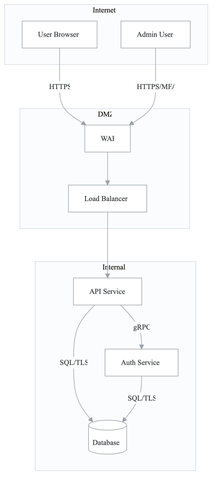

<details>
<summary>Diagram source (Mermaid)</summary>

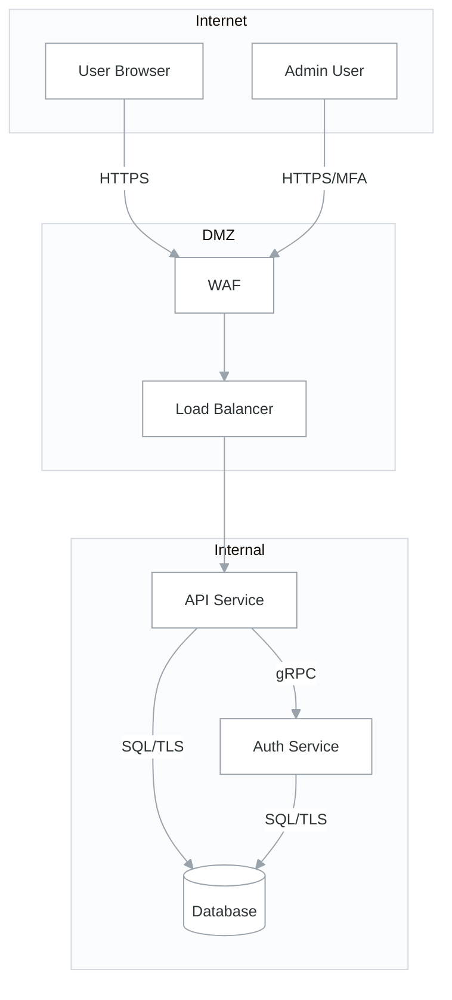

</details>

### PlantUML Example

```plantuml
@startuml
!include https://raw.githubusercontent.com/plantuml-stdlib/C4-PlantUML/master/C4_Container.puml

Person(user, "User", "End user of the system")
System_Boundary(system, "Our System") {
    Container(web, "Web App", "React", "User interface")
    Container(api, "API", "Node.js", "Business logic")
    ContainerDb(db, "Database", "PostgreSQL", "Stores data")
}
System_Ext(payment, "Payment Gateway", "Processes payments")

Rel(user, web, "Uses", "HTTPS")
Rel(web, api, "Calls", "HTTPS/JSON")
Rel(api, db, "Reads/Writes", "SQL/TLS")
Rel(api, payment, "Processes", "HTTPS/REST")
@enduml
```

---

## Practical Exercises

### Exercise 1: Create a Level 0 DFD

**Scenario:** A mobile banking application that allows users to:
- Log in with username/password and MFA
- View account balances
- Transfer money between accounts
- Pay bills
- Receive notifications

**Task:** Create a Level 0 (context) DFD showing:
- All external entities
- The banking system as a single process
- All data flows with labels

### Exercise 2: Create a Level 1 DFD

**Scenario:** Expand the mobile banking app to show:
- Mobile app
- API Gateway
- Authentication service
- Account service
- Transfer service
- Notification service
- Core banking integration
- Database(s)

**Task:** Create a Level 1 DFD with:
- Trust boundaries (mobile, DMZ, internal, core banking)
- Data flow labels
- Protocol information

### Exercise 3: Cloud Architecture DFD

**Scenario:** A serverless image processing pipeline on AWS:
- Users upload images to S3 via presigned URLs
- S3 triggers Lambda for processing
- Lambda resizes images and stores in another S3 bucket
- Lambda writes metadata to DynamoDB
- CloudFront serves processed images
- SNS sends completion notifications

**Task:** Create a DFD showing:
- All AWS services as processes or data stores
- Trust boundaries (internet, AWS account, VPC if applicable)
- IAM role boundaries
- Data sensitivity labels

---

## Key Takeaways

1. **DFDs are the foundation** - You can't threat model what you can't see

2. **Start simple** - Level 0 first, drill down where needed

3. **Trust boundaries are critical** - Data crossing boundaries needs validation

4. **Label everything** - Unlabeled flows create confusion

5. **Include operational flows** - CI/CD, monitoring, admin access

6. **Keep them current** - Update when architecture changes

7. **Use appropriate tools** - Match tool to team and process

---

## Next Steps

→ [Lab 01: Basic Web Application Threat Model](labs-lab-01-basic-web-app-README.md)
→ [STRIDE Deep Dive](content-02-methodologies-stride.md)

<!-- feynman-check -->

---

## Feynman check

Close the file. Blank page, no notes. Explain each of these to a competent engineer who has never
used this tool — **under five minutes, no jargon you can't define on the spot:**

- DFD Elements
- DFD Levels
- Trust Boundaries in Cloud Environments
- Creating Effective DFDs

**The gap is not what you forgot. It is where you used a word instead of a mechanism.**

| | |
|---|---|
| ✗ | *"We scan for vulnerabilities in the pipeline."* |
| ✓ | *"SAST reads source without running it, SCA resolves the dependency tree against an advisory database, and image scanning compares installed package versions to that same database. All three report what was known at build time — which is why the registry is re-scanned: the image does not change, the database does."* |

**Trace it:** A CVE published today against your base image → a blocked deploy. Name every component between the advisory and the refused `apply`.

Stop at the first component you cannot name. Reopen this file and read **only** that.

**Go deeper — only once the gap has a name:** the [SLSA threat model](https://slsa.dev/spec/v1.2/threats) — it names every point at which a build can be subverted, and most teams defend three of them.
Full list per domain: [`SOURCES.md`](../../SOURCES.md#devsecops)

→ Protocol, the three levels of knowing, and worked examples: [`MASTERY.md`](../../MASTERY.md)

<!-- /feynman-check -->
