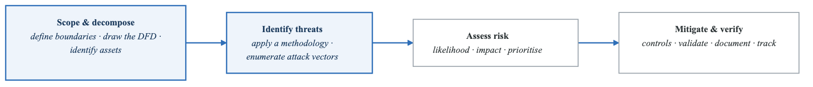
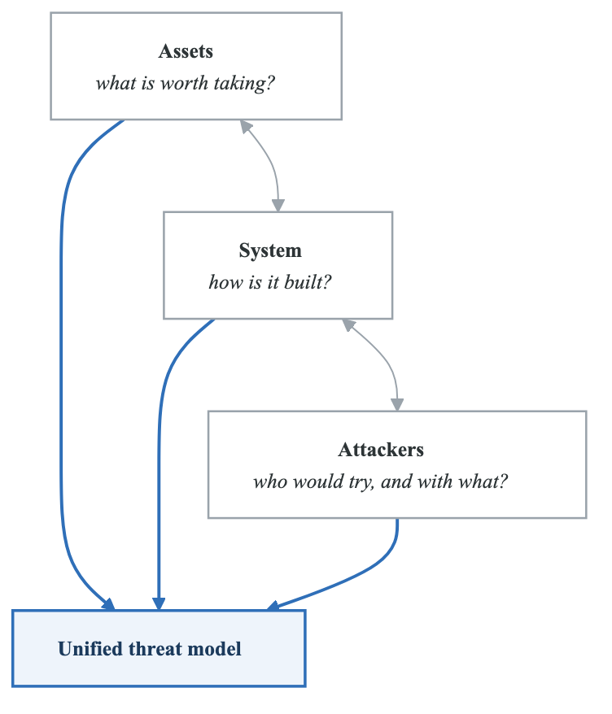
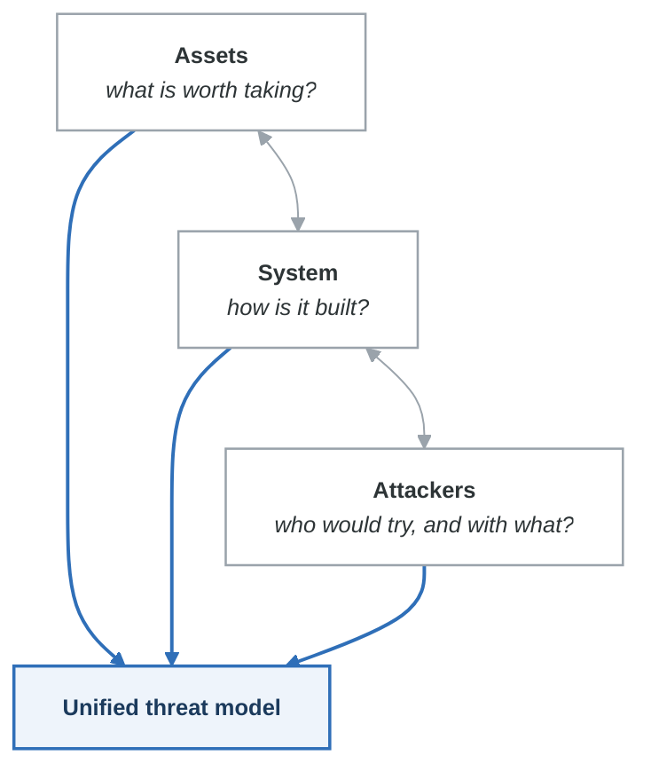
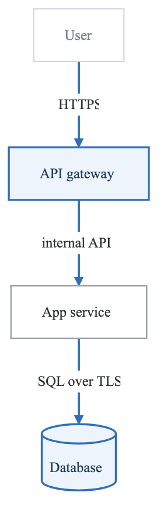
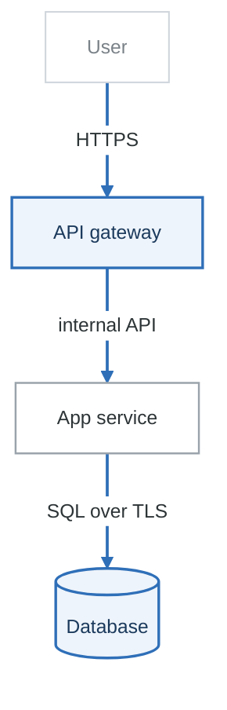

# Introduction to Threat Modeling

## What is Threat Modeling?

Threat modeling is a structured approach to identifying, quantifying, and addressing security risks in a system. It answers four fundamental questions:

> ### The four questions
>
> **1. What are we building?** → understand the architecture
> **2. What can go wrong?** → identify threats and vulnerabilities
> **3. What are we going to do about it?** → define mitigations and controls
> **4. Did we do a good job?** → validate and verify

Everything else in threat modelling — STRIDE, PASTA, attack trees, DFDs — is a technique for
answering one of these four. If a session is not answering one of them, it is a design review.

Question 4 is the one that gets skipped, and it is the one that turns a threat model from a document
into a practice: a mitigation nobody verified is a belief, not a control.

---

## Why Threat Model?

### The Cost of Security Defects

```
Cost to Fix a Security Defect by Phase:

Design Phase:     $████                          1x
Development:      $████████                      6x
Testing:          $████████████████             15x
Production:       $████████████████████████████ 60-100x
Post-Breach:      $████████████████████████████████████ 1000x+
```

### Business Value

| Benefit | Description |
|---------|-------------|
| **Cost Reduction** | Finding issues early is 10-100x cheaper than post-production |
| **Compliance** | Required by PCI DSS, HIPAA, FedRAMP, SOC 2 |
| **Risk Visibility** | Leadership understands security posture |
| **Prioritization** | Focus resources on highest-risk areas |
| **Security Culture** | Developers think about security proactively |
| **Faster Delivery** | Fewer security surprises blocking releases |

### When to Threat Model

| Trigger | Action |
|---------|--------|
| New system design | Full threat model |
| Major feature addition | Incremental threat model |
| Architecture change | Review and update |
| New integration/dependency | Assess integration risks |
| Security incident | Post-incident review and update |
| Compliance audit | Validate current model |
| Regular cadence | Quarterly review for critical systems |

---

## The Threat Modeling Process

### High-Level Flow

```mermaid
%%{init: {'theme':'base','themeVariables':{'fontFamily':'Helvetica, Arial, sans-serif','fontSize':'13px','primaryColor':'#ffffff','primaryTextColor':'#2d3436','primaryBorderColor':'#9aa3ab','lineColor':'#9aa3ab','textColor':'#2d3436','clusterBkg':'#fbfcfd','clusterBorder':'#d4dae0','edgeLabelBackground':'#ffffff','tertiaryColor':'#eef4fb'},'flowchart':{'curve':'basis','padding':14,'nodeSpacing':42,'rankSpacing':58}}}%%
flowchart LR
  classDef default fill:#ffffff,stroke:#9aa3ab,stroke-width:1.3px,color:#2d3436
  classDef n    fill:#ffffff,stroke:#9aa3ab,stroke-width:1.3px,color:#2d3436
  classDef crit fill:#eef4fb,stroke:#2f6fb8,stroke-width:1.8px,color:#1b3a5c
  classDef data fill:#f4f7fa,stroke:#9aa3ab,stroke-width:1.3px,color:#2d3436
  classDef mut  fill:#ffffff,stroke:#cfd6dc,stroke-width:1.1px,color:#7a8288
  classDef warn fill:#fdf0ec,stroke:#c0522d,stroke-width:1.6px,color:#8a3a1e
  A["<b>Scope &amp; decompose</b><br/><i>define boundaries · draw the DFD ·<br/>identify assets</i>"]
  B["<b>Identify threats</b><br/><i>apply a methodology ·<br/>enumerate attack vectors</i>"]
  C["<b>Assess risk</b><br/><i>likelihood · impact · prioritise</i>"]
  D["<b>Mitigate &amp; verify</b><br/><i>controls · validate · document · track</i>"]
  A ==> B ==> C ==> D
  class A crit
  class B crit
  class C n
  class D n
  linkStyle 0,1,2 stroke:#2f6fb8,stroke-width:2px

%% The loop is not shown and it should be: a mitigation changes the system,
%% which changes the DFD, which changes the threats. A threat model with a
%% completion date is out of date on that date.
```

<!-- figure: generated from the Mermaid below by _shared/diagrams/embed-figures.py — do not edit the image -->


<details>
<summary>Diagram source (Mermaid)</summary>



</details>

### Step 1: Scope and Decompose

**Define Scope:**
- What system or component are we modeling?
- What's in scope vs. out of scope?
- What are our assumptions?

**Decompose the System:**
- Create architecture diagrams
- Build Data Flow Diagrams (DFDs)
- Identify trust boundaries
- Document entry/exit points
- List assets and their sensitivity

**Outputs:**
- System description document
- DFD (Level 0, Level 1, optionally Level 2)
- Asset inventory with classification
- List of external dependencies

### Step 2: Identify Threats

**Apply a Methodology:**
- STRIDE (Microsoft)
- PASTA (Risk-centric)
- LINDDUN (Privacy)
- Attack Trees
- Kill Chain analysis

**Systematic Enumeration:**
- Walk through each component
- Consider each data flow
- Examine trust boundary crossings
- Use threat libraries and patterns

**Outputs:**
- Enumerated threat list
- Attack vectors and scenarios
- Threat-to-asset mapping

### Step 3: Assess Risks

**For Each Threat, Evaluate:**
- Likelihood (probability of occurrence)
- Impact (consequence if exploited)
- Existing controls (current mitigations)
- Residual risk (remaining risk after controls)

**Prioritization Methods:**
- DREAD scoring
- Risk matrix (likelihood × impact)
- CVSS-based assessment
- Business-driven prioritization

**Outputs:**
- Prioritized threat list
- Risk ratings
- Focus areas for mitigation

### Step 4: Mitigate and Verify

**Select Mitigations:**
- Eliminate the threat (remove feature/component)
- Mitigate (implement controls)
- Transfer (insurance, SLAs)
- Accept (document and monitor)

**Verify:**
- Security testing validates controls
- Penetration testing validates model completeness
- Code review confirms implementation

**Outputs:**
- Mitigation plan
- Security requirements
- Test cases
- Tracking tickets

---

## Threat Modeling Approaches

### Asset-Centric
**Focus:** What are we protecting?
**Good for:** Data classification, compliance
**Process:** Identify assets → Identify threats to assets → Protect assets

### Attacker-Centric
**Focus:** Who might attack us and how?
**Good for:** Targeted threat analysis, threat intelligence
**Process:** Identify attackers → Model attacker goals → Anticipate attacks

### System-Centric
**Focus:** What can go wrong in the system?
**Good for:** Design review, comprehensive analysis
**Process:** Model system → Analyze components → Identify weaknesses

### Hybrid Approach (Recommended)

Combine all three for comprehensive coverage:

<!-- figure: generated from the Mermaid below by _shared/diagrams/embed-figures.py — do not edit the image -->


<details>
<summary>Diagram source (Mermaid)</summary>



</details>

---

## Threat Modeling in DevSecOps

### Shift-Left Security

```
Traditional:    Plan → Build → Test → Deploy → [SECURITY] → Operate
                                                    ↑
                                              Late, expensive

DevSecOps:      Plan → Build → Test → Deploy → Operate
                  ↑       ↑       ↑       ↑        ↑
               [SEC]   [SEC]   [SEC]   [SEC]    [SEC]
                  ↑
            Threat Modeling Here
```

### Integration Points

| Phase | Threat Modeling Activity |
|-------|-------------------------|
| **Requirements** | Security requirements derived from threat model |
| **Design** | Threat model review as design gate |
| **Development** | Developers reference threat model for guidance |
| **Code Review** | Check implementation against identified threats |
| **Testing** | Test cases based on threat scenarios |
| **Deployment** | Validate security controls in place |
| **Operations** | Monitor for threats, update model on incidents |

### Agile/Sprint Integration

**Sprint Planning:**

- Identify security-relevant stories
- Quick threat assessment for new features
- Add security tasks to sprint

**Sprint Execution:**

- Developers reference threat model
- Security review of critical PRs
- Incremental model updates

**Sprint Review:**

- Demo security controls
- Update threat model if needed
- Carry forward security debt


---

## Artifacts of Threat Modeling

### 1. System Description
- Purpose and scope
- Architecture overview
- Technology stack
- External dependencies

### 2. Data Flow Diagram
<!-- figure: generated from the Mermaid below by _shared/diagrams/embed-figures.py — do not edit the image -->


<details>
<summary>Diagram source (Mermaid)</summary>



</details>

### 3. Threat List

| ID | Threat | Category | Component | Risk | Mitigation |
|----|--------|----------|-----------|------|------------|
| T1 | SQL Injection | Tampering | API | High | Parameterized queries |
| T2 | Session hijacking | Spoofing | Auth | High | Secure cookies, MFA |
| T3 | Data exfiltration | Info Disclosure | DB | Critical | Encryption, DLP |

### 4. Risk Register

| Threat ID | Likelihood | Impact | Risk Score | Status |
|-----------|------------|--------|------------|--------|
| T1 | Medium | High | High | Mitigated |
| T2 | Low | High | Medium | In Progress |
| T3 | Low | Critical | High | Accepted |

### 5. Mitigation Plan

| Threat ID | Mitigation | Owner | Status | Due Date |
|-----------|------------|-------|--------|----------|
| T1 | Implement ORM | Dev Team | Done | - |
| T2 | Add MFA | Identity Team | In Progress | Q2 |
| T3 | Deploy DLP | Security | Planned | Q3 |

---

## Common Pitfalls

### Pitfall 1: Analysis Paralysis
**Problem:** Trying to identify every possible threat
**Solution:** Time-box sessions, focus on high-risk areas, iterate

### Pitfall 2: Too Abstract
**Problem:** Threats are vague and not actionable
**Solution:** Be specific about attack vectors and impacts

### Pitfall 3: One and Done
**Problem:** Threat model created once, never updated
**Solution:** Integrate updates into development process

### Pitfall 4: No Follow-Through
**Problem:** Threats identified but never mitigated
**Solution:** Create tickets, track progress, gate deployments

### Pitfall 5: Wrong Participants
**Problem:** Only security team involved
**Solution:** Include developers, architects, ops, product owners

### Pitfall 6: Focusing on Tools
**Problem:** Thinking the tool will do the work
**Solution:** Tools assist; human analysis is essential

---

## Getting Started Checklist

For your first threat model:

```
□ Define the scope (single service or component)
□ Gather existing documentation
□ Identify participants (dev, arch, security, ops)
□ Schedule 2-hour session
□ Create or review architecture diagram
□ Draw Data Flow Diagram
□ Apply STRIDE to each component
□ Document top 10 threats
□ Prioritize by risk
□ Assign mitigations
□ Create tracking tickets
□ Schedule follow-up review
```

---

## Practical Exercise

### Exercise: Elevator Pitch

Write a 2-minute explanation of threat modeling for:

1. **A developer** who thinks security is the security team's job
2. **A product manager** who is concerned about delivery timelines
3. **An executive** who wants to know the ROI

### Exercise: Identify the Trigger

For each scenario, decide if a threat model update is needed:

1. Adding a new payment method to checkout
2. Upgrading React from 17 to 18
3. Adding a new third-party analytics integration
4. Fixing a CSS bug on the login page
5. Moving from EC2 to Lambda for a service
6. Adding rate limiting to an existing API

---

## Key Takeaways

1. **Threat modeling is about asking the right questions** - What can go wrong?

2. **Timing matters** - Earlier is cheaper; design phase is ideal

3. **It's a team activity** - Diverse perspectives find more threats

4. **Process over tools** - Methodology matters more than software

5. **Iterate and improve** - Perfect is the enemy of good

6. **Connect to action** - Threats without mitigations are just a list

---

## Next Steps

→ [Assets, Threats, and Threat Actors](assets-threats-actors.md)
→ [Data Flow Diagrams Basics](dfd-basics.md)

<!-- feynman-check -->

---

## Feynman check

Close the file. Blank page, no notes. Explain each of these to a competent engineer who has never
used this tool — **under five minutes, no jargon you can't define on the spot:**

- What is Threat Modeling?
- Why Threat Model?
- The Threat Modeling Process
- Threat Modeling Approaches

**The gap is not what you forgot. It is where you used a word instead of a mechanism.**

| | |
|---|---|
| ✗ | *"We scan for vulnerabilities in the pipeline."* |
| ✓ | *"SAST reads source without running it, SCA resolves the dependency tree against an advisory database, and image scanning compares installed package versions to that same database. All three report what was known at build time — which is why the registry is re-scanned: the image does not change, the database does."* |

**Trace it:** A CVE published today against your base image → a blocked deploy. Name every component between the advisory and the refused `apply`.

Stop at the first component you cannot name. Reopen this file and read **only** that.

**Go deeper — only once the gap has a name:** the [SLSA threat model](https://slsa.dev/spec/v1.2/threats) — it names every point at which a build can be subverted, and most teams defend three of them.
Full list per domain: [`SOURCES.md`](../../SOURCES.md#devsecops)

→ Protocol, the three levels of knowing, and worked examples: [`MASTERY.md`](../../MASTERY.md)

<!-- /feynman-check -->
