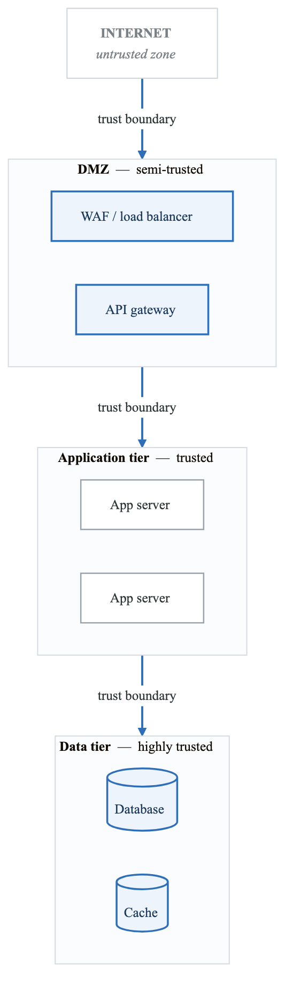
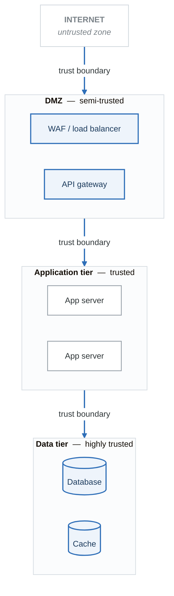

# Security Fundamentals for Threat Modeling

## Introduction

Before diving into threat modeling, you need a solid foundation in security concepts. This module covers the essential security principles that underpin all threat modeling activities.

---

## The CIA Triad (Extended)

The classic security triad, extended with additional properties relevant to modern systems.

### Confidentiality
**Definition:** Ensuring information is accessible only to authorized parties.

**Threats to Confidentiality:**
- Unauthorized data access
- Data leakage/exfiltration
- Eavesdropping/sniffing
- Social engineering
- Improper access controls

**Controls:**
- Encryption (at rest, in transit)
- Access control lists (ACLs)
- Data classification
- Network segmentation
- DLP (Data Loss Prevention)

**Cloud-Specific Considerations:**
- Shared responsibility model
- Multi-tenancy isolation
- Key management (KMS, HSM)
- Storage bucket policies
- VPC/network controls

### Integrity
**Definition:** Ensuring data is accurate, complete, and unmodified by unauthorized parties.

**Threats to Integrity:**
- Unauthorized modification
- Data tampering
- Man-in-the-middle attacks
- SQL injection
- Malware

**Controls:**
- Hashing and checksums
- Digital signatures
- Version control
- Input validation
- Audit logging

**Cloud-Specific Considerations:**
- Object versioning
- Immutable infrastructure
- Infrastructure as Code (IaC)
- Container image signing
- GitOps practices

### Availability
**Definition:** Ensuring systems and data are accessible when needed.

**Threats to Availability:**
- Denial of Service (DoS/DDoS)
- System failures
- Resource exhaustion
- Ransomware
- Natural disasters

**Controls:**
- Redundancy and replication
- Load balancing
- Auto-scaling
- Backup and recovery
- DDoS protection

**Cloud-Specific Considerations:**
- Multi-AZ/multi-region deployment
- Managed services SLAs
- Reserved capacity
- Chaos engineering
- DR planning

### Extended Properties

#### Authentication
Verifying the identity of users, systems, or processes.

| Method | Strength | Use Case |
|--------|----------|----------|
| Passwords | Low-Medium | Legacy systems |
| MFA/2FA | Medium-High | User accounts |
| Certificates | High | Service-to-service |
| Biometrics | High | Physical access |
| Hardware tokens | Very High | Privileged access |

#### Authorization
Determining what authenticated entities are allowed to do.

**Models:**
- **DAC (Discretionary Access Control):** Owner-controlled permissions
- **MAC (Mandatory Access Control):** System-enforced, classification-based
- **RBAC (Role-Based Access Control):** Permissions by role assignment
- **ABAC (Attribute-Based Access Control):** Policy-based, attribute-driven
- **ReBAC (Relationship-Based Access Control):** Based on relationships between entities

#### Non-Repudiation
Ensuring actions cannot be denied by the party that performed them.

**Mechanisms:**
- Digital signatures
- Audit logs with tamper protection
- Timestamps from trusted sources
- Blockchain/immutable ledgers

---

## Security Principles

### Principle of Least Privilege (PoLP)

> "Every program and every privileged user of the system should operate using the least amount of privilege necessary to complete the job."
> — Jerome Saltzer

**Application:**
- Grant minimum necessary permissions
- Time-bound access when possible
- Regular access reviews
- Just-in-time (JIT) access

**Cloud Examples:**
```
# Bad: Overly permissive
{
  "Effect": "Allow",
  "Action": "s3:*",
  "Resource": "*"
}

# Good: Specific and scoped
{
  "Effect": "Allow",
  "Action": ["s3:GetObject", "s3:ListBucket"],
  "Resource": [
    "arn:aws:s3:::my-bucket",
    "arn:aws:s3:::my-bucket/*"
  ]
}
```

### Defense in Depth

Multiple layers of security controls so that if one layer fails, others remain.

**Layer 1: Perimeter Security**

- Firewalls, WAF, DDoS protection

**Layer 2: Network Security**

- Segmentation, VPCs, security groups

**Layer 3: Host Security**

- Hardening, patching, EDR

**Layer 4: Application Security**

- Input validation, authentication, encryption

**Layer 5: Data Security**

- Encryption, access controls, classification

**Layer 6: Monitoring & Response**

- Logging, alerting, incident response


### Zero Trust Architecture

> "Never trust, always verify."

**Core Principles:**
1. Verify explicitly (always authenticate and authorize)
2. Use least privilege access
3. Assume breach (minimize blast radius)

**Implementation Components:**
- Strong identity verification
- Device health validation
- Micro-segmentation
- Continuous monitoring
- Encrypted communications everywhere

### Fail Secure vs. Fail Open

| Approach | Behavior | Use Case |
|----------|----------|----------|
| Fail Secure | Deny access on failure | Security-critical systems |
| Fail Open | Allow access on failure | Availability-critical systems |

**Example:** A firewall should fail secure (block all traffic if rules can't be evaluated), while a building's fire exit should fail open (unlock if power fails).

### Separation of Duties

No single individual should have complete control over a critical process.

**Examples:**
- Code author cannot approve their own PR
- DBA cannot approve their own production queries
- Finance: one person creates, another approves payments

### Security by Design

Build security into systems from the start, rather than adding it later.

**Practices:**
- Threat modeling during design phase
- Secure defaults
- Security requirements alongside functional requirements
- Security testing in CI/CD

---

## Common Vulnerability Classes

Understanding common vulnerabilities helps you identify threats during threat modeling.

### OWASP Top 10 (2021)

| # | Vulnerability | Description |
|---|---------------|-------------|
| A01 | Broken Access Control | Restrictions not properly enforced |
| A02 | Cryptographic Failures | Weak crypto, exposed data |
| A03 | Injection | SQL, NoSQL, OS, LDAP injection |
| A04 | Insecure Design | Missing security controls |
| A05 | Security Misconfiguration | Default configs, verbose errors |
| A06 | Vulnerable Components | Known vulnerable dependencies |
| A07 | Auth Failures | Broken authentication |
| A08 | Data Integrity Failures | Insecure deserialization, CI/CD |
| A09 | Logging Failures | Insufficient logging/monitoring |
| A10 | SSRF | Server-Side Request Forgery |

### Cloud-Specific Vulnerabilities

| Category | Examples |
|----------|----------|
| IAM | Overly permissive policies, unused credentials |
| Storage | Public buckets, unencrypted data |
| Network | Open security groups, missing VPC flow logs |
| Compute | Unpatched instances, exposed metadata service |
| Serverless | Function injection, excessive permissions |
| Containers | Privileged containers, vulnerable base images |

---

## Attack Surfaces

### Definition
The sum of all points where an attacker can try to enter or extract data from a system.

### Types of Attack Surfaces

**External Attack Surface:**
- Public-facing web applications
- APIs
- Email systems
- DNS
- Cloud management consoles

**Internal Attack Surface:**
- Internal applications
- Databases
- File shares
- Internal APIs
- Service accounts

**Physical Attack Surface:**
- Data centers
- Workstations
- Mobile devices
- IoT devices
- Network equipment

### Reducing Attack Surface

1. Remove unnecessary services
2. Close unused ports
3. Eliminate default accounts
4. Disable debugging interfaces in production
5. Implement network segmentation
6. Use allowlists instead of blocklists

---

## Trust Boundaries

### Definition
A boundary where the level of trust changes. Data crossing a trust boundary should be validated.

### Common Trust Boundaries

<!-- figure: generated from the Mermaid below by _shared/diagrams/embed-figures.py — do not edit the image -->


<details>
<summary>Diagram source (Mermaid)</summary>



</details>

### Cloud Trust Boundaries

- AWS Account boundaries
- VPC boundaries
- Subnet boundaries (public vs. private)
- Security group boundaries
- IAM permission boundaries
- Kubernetes namespace boundaries

---

## Knowledge Check

### Questions

1. A system allows users to download files but doesn't validate the file path parameter, allowing `../../../etc/passwd`. Which security property is violated?

2. An API accepts JSON but doesn't validate the schema, allowing injection of unexpected fields. What vulnerability class is this?

3. A developer has full access to production databases. Which security principle is violated?

4. Your microservice authenticates to other services using a static API key stored in environment variables. What's the security concern?

5. An S3 bucket is configured with `"Principal": "*"`. What's the threat?

### Answers

1. **Integrity** (and Confidentiality) - Path traversal allows unauthorized file access and potentially modification.

2. **Injection** (A03) and **Insecure Design** (A04) - Mass assignment vulnerability due to missing input validation.

3. **Principle of Least Privilege** and **Separation of Duties** - Developer should have read-only access at most; production access should require approval.

4. **Credential exposure risk** - Static keys can be leaked in logs, code, or container images. Better: Use IAM roles, workload identity, or secrets management.

5. **Broken Access Control** - Public bucket allows anyone on the internet to access contents.

---

## Practical Exercise

### Exercise 1: Identify Security Properties

For each scenario, identify which security property (CIA + extended) is the primary concern:

1. An attacker intercepts API calls between your mobile app and backend
2. A disgruntled employee deletes production database tables
3. A DDoS attack takes down your e-commerce site during Black Friday
4. A user claims they never placed an order, but their account shows the transaction
5. An attacker gains access using a valid session token from another user

### Exercise 2: Map Controls to Threats

Create a table mapping these threats to appropriate controls:

| Threat | Control(s) |
|--------|------------|
| SQL Injection | |
| Credential stuffing | |
| Data exfiltration via S3 | |
| Lateral movement after compromise | |
| Supply chain attack via npm | |

---

## Next Steps

With these fundamentals in place, proceed to:
→ [Introduction to Threat Modeling](content-01-foundations-intro-threat-modeling.md)

<!-- feynman-check -->

---

## Feynman check

Close the file. Blank page, no notes. Explain each of these to a competent engineer who has never
used this tool — **under five minutes, no jargon you can't define on the spot:**

- The CIA Triad (Extended)
- Security Principles
- Common Vulnerability Classes
- Attack Surfaces

**The gap is not what you forgot. It is where you used a word instead of a mechanism.**

| | |
|---|---|
| ✗ | *"We scan for vulnerabilities in the pipeline."* |
| ✓ | *"SAST reads source without running it, SCA resolves the dependency tree against an advisory database, and image scanning compares installed package versions to that same database. All three report what was known at build time — which is why the registry is re-scanned: the image does not change, the database does."* |

**Trace it:** A CVE published today against your base image → a blocked deploy. Name every component between the advisory and the refused `apply`.

Stop at the first component you cannot name. Reopen this file and read **only** that.

**Go deeper — only once the gap has a name:** the [SLSA threat model](https://slsa.dev/spec/v1.2/threats) — it names every point at which a build can be subverted, and most teams defend three of them.
Full list per domain: [`SOURCES.md`](../../SOURCES.md#devsecops)

→ Protocol, the three levels of knowing, and worked examples: [`MASTERY.md`](../../MASTERY.md)

<!-- /feynman-check -->
