# Attack Trees

## Overview

Attack trees are a graphical representation of how a system can be attacked. They provide a structured way to analyze the security of a system by modeling the steps an attacker might take to achieve a goal.

<!-- figure: generated from the Mermaid below by _shared/diagrams/embed-figures.py — do not edit the image -->
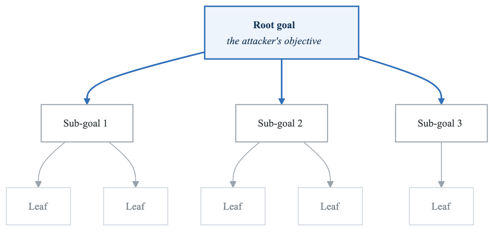

<details>
<summary>Diagram source (Mermaid)</summary>

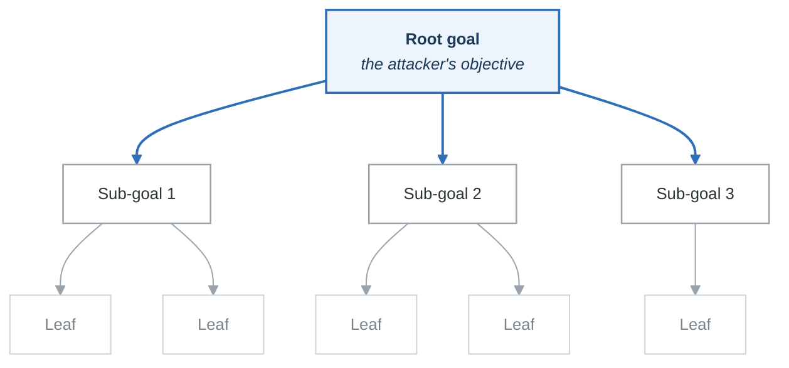

</details>

---

## Attack Tree Fundamentals

### Node Types

**Root Node:** The attacker's ultimate goal
**Examples:**

- Steal customer credit card data
- Gain administrative access
- Disrupt payment processing
- Exfiltrate trade secrets
- Compromise CI/CD pipeline


**Intermediate Nodes:** Sub-goals that contribute to the main goal
**Example for "Steal customer data":**

- Gain database access
- Intercept data in transit
- Compromise admin account
- Exploit application vulnerability


**Leaf Nodes:** Atomic attacks that cannot be further decomposed
**Example for "Gain database access":**

- SQL injection on login form
- Stolen DBA credentials
- Exposed database port
- Backup file accessible on S3


### Logical Operators

**OR Nodes (Default):** Any child achieving success means parent succeeds
<!-- figure: generated from the Mermaid below by _shared/diagrams/embed-figures.py — do not edit the image -->
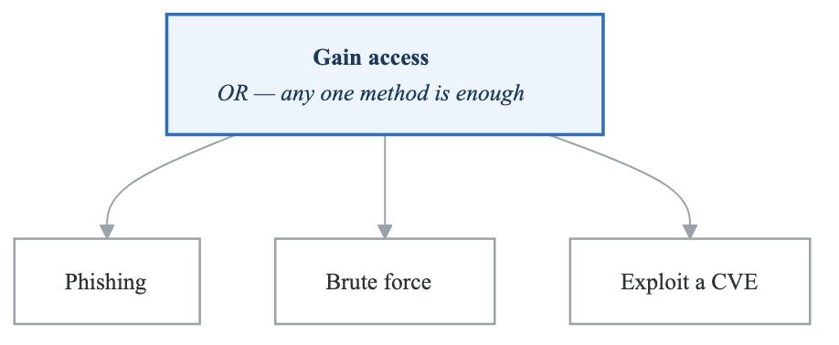

<details>
<summary>Diagram source (Mermaid)</summary>

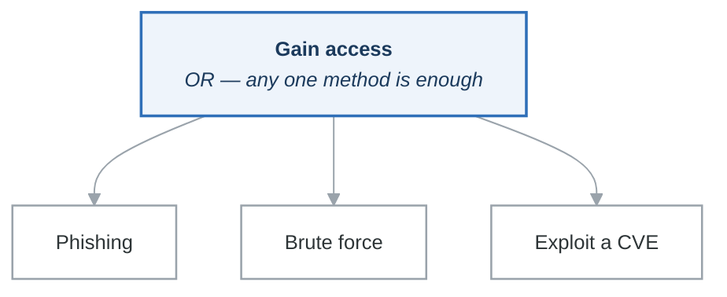

</details>

**AND Nodes:** All children must succeed for parent to succeed
<!-- figure: generated from the Mermaid below by _shared/diagrams/embed-figures.py — do not edit the image -->
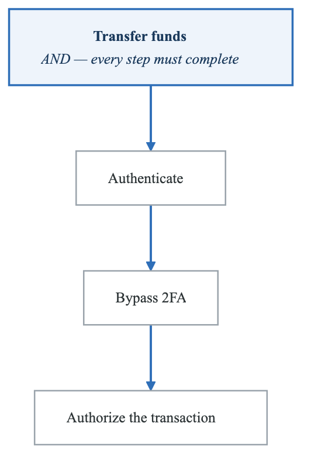

<details>
<summary>Diagram source (Mermaid)</summary>

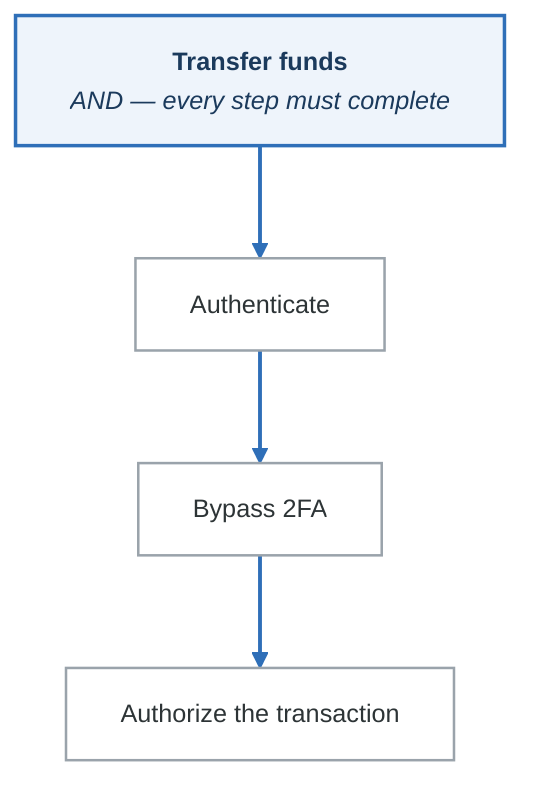

</details>

### Visual Notation

**Attack tree notation**

| Notation | Meaning |
|---|---|
| `[Goal]` | A goal node |
| **OR** *(default, no marker)* | Any one child succeeding achieves the parent |
| **AND** *(arc across the children)* | Every child must succeed |
| `[Leaf]*` | A leaf, annotated with attributes |

**Leaf attributes** — what turns a tree into a prioritised list:

| Attribute | Records |
|---|---|
| Cost | What the attack costs the attacker |
| Time | How long it takes |
| Skill | The capability required |
| Detection | The probability you would notice |

Detection probability is the attribute most often left out and the one that most changes priorities.
A cheap, easy attack you would *certainly* detect is often a lower priority than an expensive one
that leaves no trace.

---

## Building Attack Trees

### Step 1: Define the Root Goal

Start with what the attacker wants to achieve:
**Good Root Goals:**

- "Steal payment card data" (specific, measurable)
- "Disrupt production service for 4+ hours"
- "Gain persistent access to internal network"
- "Exfiltrate source code repository"

**Poor Root Goals:**

- "Hack the system" (too vague)
- "Cause damage" (not specific)
- "Be malicious" (not actionable)


### Step 2: Decompose into Sub-Goals

Break down into logical sub-components:
<!-- figure: generated from the Mermaid below by _shared/diagrams/embed-figures.py — do not edit the image -->
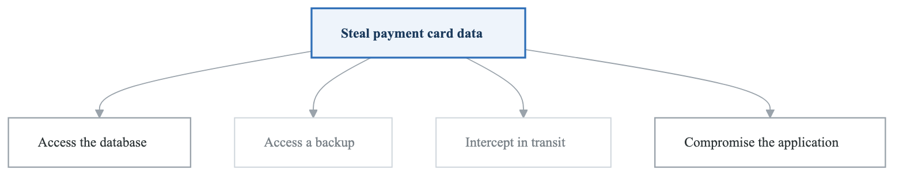

<details>
<summary>Diagram source (Mermaid)</summary>

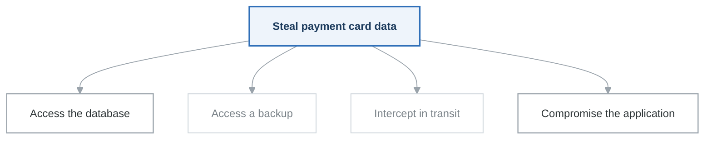

</details>

### Step 3: Continue Decomposition

Each sub-goal becomes a parent:
<!-- figure: generated from the Mermaid below by _shared/diagrams/embed-figures.py — do not edit the image -->
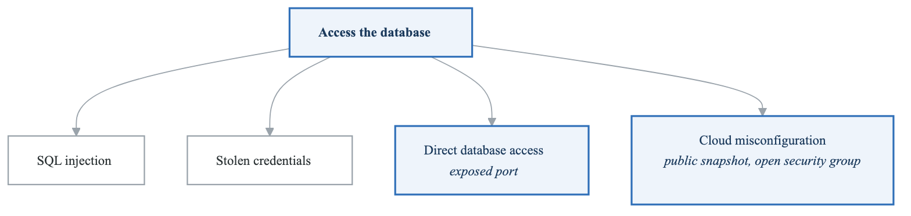

<details>
<summary>Diagram source (Mermaid)</summary>

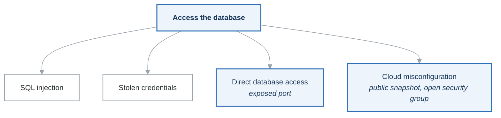

</details>

### Step 4: Identify Leaf Nodes

Decompose until you reach atomic attacks:
<!-- figure: generated from the Mermaid below by _shared/diagrams/embed-figures.py — do not edit the image -->
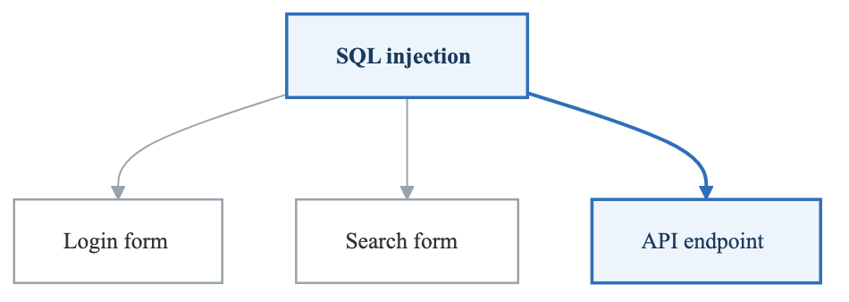

<details>
<summary>Diagram source (Mermaid)</summary>

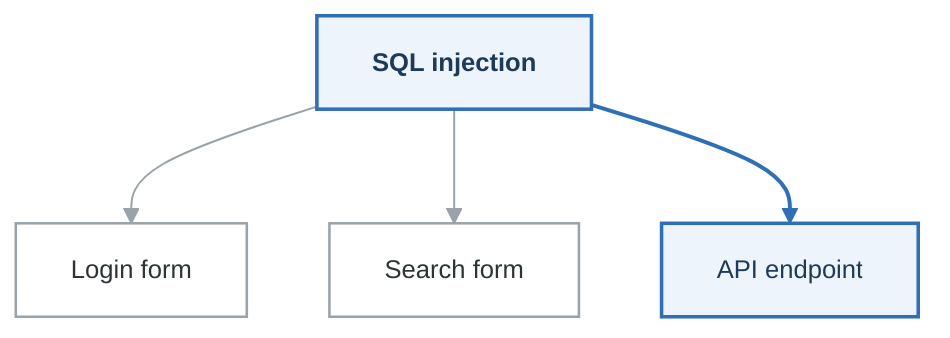

</details>

### Step 5: Add Attributes (Optional)

Quantify attacks for analysis:
**[Phishing for Credentials]**

- Cost: Low ($100 for campaign)
- Time: 1-2 weeks
- Skill: Medium
- Probability: 30%
- Detection: Medium


---

## Attack Tree Example: Cloud Infrastructure Compromise

<!-- figure: generated from the Mermaid below by _shared/diagrams/embed-figures.py — do not edit the image -->
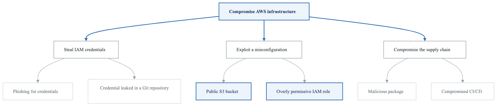

<details>
<summary>Diagram source (Mermaid)</summary>

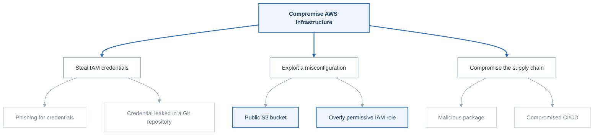

</details>

**Decomposing *phishing for credentials***

<!-- figure: generated from the Mermaid below by _shared/diagrams/embed-figures.py — do not edit the image -->


<details>
<summary>Diagram source (Mermaid)</summary>

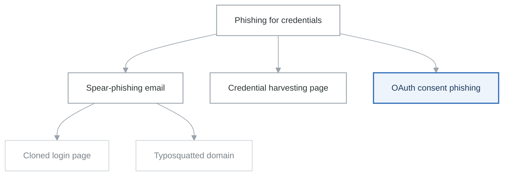

</details>

**Decomposing *compromised CI/CD*** — an **AND** chain, so any one link cut stops it

<!-- figure: generated from the Mermaid below by _shared/diagrams/embed-figures.py — do not edit the image -->
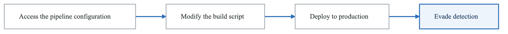

<details>
<summary>Diagram source (Mermaid)</summary>

```mermaid
%%{init: {'theme':'base','themeVariables':{'fontFamily':'Helvetica, Arial, sans-serif','fontSize':'13px','primaryColor':'#ffffff','primaryTextColor':'#2d3436','primaryBorderColor':'#9aa3ab','lineColor':'#9aa3ab','textColor':'#2d3436','clusterBkg':'#fbfcfd','clusterBorder':'#d4dae0','edgeLabelBackground':'#ffffff','tertiaryColor':'#eef4fb'},'flowchart':{'curve':'basis','padding':14,'nodeSpacing':42,'rankSpacing':58}}}%%
flowchart LR
  classDef default fill:#ffffff,stroke:#9aa3ab,stroke-width:1.3px,color:#2d3436
  classDef n    fill:#ffffff,stroke:#9aa3ab,stroke-width:1.3px,color:#2d3436
  classDef crit fill:#eef4fb,stroke:#2f6fb8,stroke-width:1.8px,color:#1b3a5c
  classDef data fill:#f4f7fa,stroke:#9aa3ab,stroke-width:1.3px,color:#2d3436
  classDef mut  fill:#ffffff,stroke:#cfd6dc,stroke-width:1.1px,color:#7a8288
  classDef warn fill:#fdf0ec,stroke:#c0522d,stroke-width:1.6px,color:#8a3a1e
  A["Access the pipeline configuration"]
  B["Modify the build script"]
  C["Deploy to production"]
  D["Evade detection"]
  A ==> B ==> C ==> D
  class A,B,C n
  class D crit
  linkStyle 0,1,2 stroke:#2f6fb8,stroke-width:2px
```

</details>

**Attributes for *public S3 bucket***

| | |
|---|---|
| Cost | Free — public scanning tools find these continuously |
| Time | Hours |
| Skill | Low |
| Probability | Medium — a common misconfiguration |
| Detection | **Low** — often no access logging at all |

That row set is why "public S3 bucket" outranks far more sophisticated branches: free, fast, easy,
common, and invisible.

---

## Attack Tree Analysis

### Qualitative Analysis

Assign categories to attributes:

| Attribute | Low | Medium | High |
|-----------|-----|--------|------|
| Cost | < $100 | $100-$10K | > $10K |
| Time | Hours | Days-Weeks | Months |
| Skill | Script kiddie | Intermediate | Expert |
| Detection | Rarely detected | Sometimes | Usually |

### Quantitative Analysis

Calculate path metrics:

**For OR nodes:** Take the minimum (easiest path wins)
```
Probability(OR) = max(P1, P2, P3, ...)
Cost(OR) = min(C1, C2, C3, ...)
```

**For AND nodes:** Combine (all must succeed)
```
Probability(AND) = P1 × P2 × P3 × ...
Cost(AND) = C1 + C2 + C3 + ...
```

**Example Calculation:**
**Scoring the paths**

| Path | Steps | Probability | Attacker cost |
|---|---|---|---|
| **A** | Phishing → credentials → access | 0.3 × 0.8 × 0.9 = **21.6%** | $100 |
| **B** | Find a public S3 bucket → exfiltrate | 0.4 × 0.95 = **38%** | **$0** |
| **C** | Supply chain → CI/CD → deploy | 0.1 × 0.5 × 0.7 × 0.6 = **2.1%** | $1,700 |

**Highest-risk path: B** — 38% probability at zero cost.
**Priority mitigation: S3 bucket security.**

Multiplying along a path is what makes the long, sophisticated attack chain fall to the bottom: four
steps at 60–70% each compound to 2%. It is also why the *shortest* path usually wins, and why
"they'd need to chain four exploits" is a weaker defence than it sounds.

---

## Attack Trees for Cloud-Native Systems

### Kubernetes Cluster Compromise

<!-- figure: generated from the Mermaid below by _shared/diagrams/embed-figures.py — do not edit the image -->
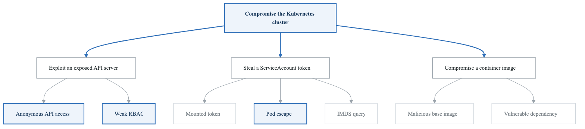

<details>
<summary>Diagram source (Mermaid)</summary>

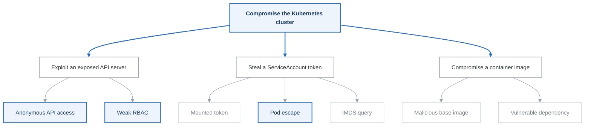

</details>

**Decomposing *pod escape***

<!-- figure: generated from the Mermaid below by _shared/diagrams/embed-figures.py — do not edit the image -->


<details>
<summary>Diagram source (Mermaid)</summary>

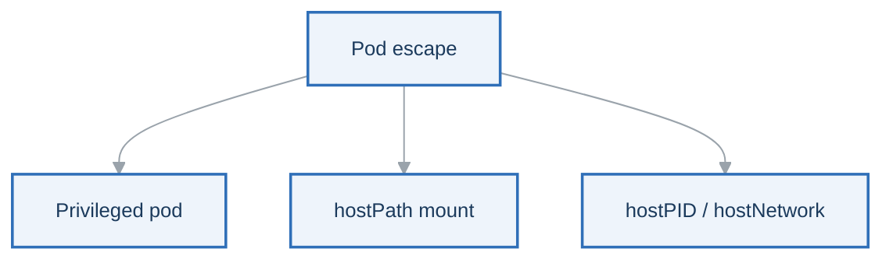

</details>

All three escape branches are closed by the same control: the `restricted` Pod Security Standard,
enforced at admission. One policy, three branches of the tree — which is what a good mitigation looks
like, and why decomposing before mitigating is worth the time.

### Serverless Function Compromise

<!-- figure: generated from the Mermaid below by _shared/diagrams/embed-figures.py — do not edit the image -->
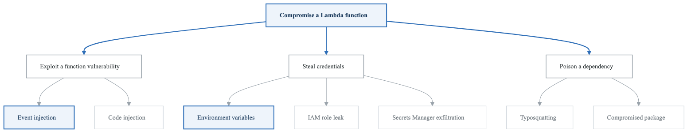

<details>
<summary>Diagram source (Mermaid)</summary>

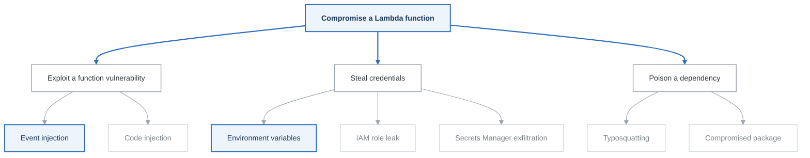

</details>

### CI/CD Pipeline Attack

<!-- figure: generated from the Mermaid below by _shared/diagrams/embed-figures.py — do not edit the image -->


<details>
<summary>Diagram source (Mermaid)</summary>

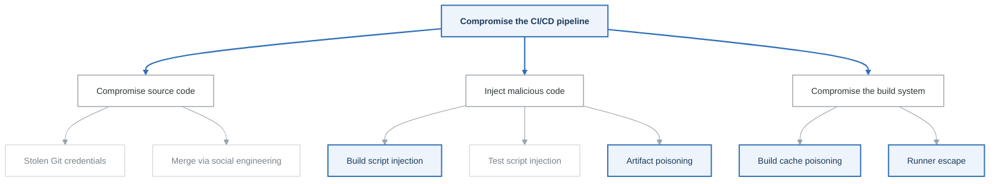

</details>

---

## Using Attack Trees Effectively

### When to Use Attack Trees

| Scenario | Value |
|----------|-------|
| Analyzing specific high-value assets | High |
| Understanding attack paths | High |
| Prioritizing security investments | High |
| Communicating risk to stakeholders | High |
| Comprehensive threat enumeration | Medium (use with STRIDE) |
| Quick threat assessment | Low (time-consuming) |

### Best Practices

**DO:**

- Start with a clear, specific goal
- Decompose to actionable leaf nodes
- Include realistic attack paths
- Consider attacker resources and capabilities
- Update trees when system changes
- Use for highest-risk scenarios

**DON'T:**

- Try to model every possible attack
- Make trees too deep (> 6-7 levels)
- Ignore low-tech attacks (social engineering)
- Forget AND conditions
- Create without system knowledge
- Let trees become stale


### Attack Tree Templates

**Data Breach Tree:**
**[Data Breach]**

- [Access via Application]
  - SQL Injection
  - Authentication Bypass
  - API Vulnerability
- [Access via Infrastructure]
  - Cloud Misconfiguration
  - Credential Theft
  - Network Intrusion
- [Access via Insider]
  - Malicious Employee
  - Compromised Account
  - Social Engineering
- [Access via Third Party]
  - Vendor Compromise
  - Supply Chain Attack
  - Partner Data Sharing


**Account Takeover Tree:**
**[Account Takeover]**

- [Obtain Credentials]
  - Phishing
  - Credential Stuffing
  - Brute Force
  - Data Breach Reuse
- [Bypass Authentication]
  - Session Hijacking
  - Token Theft
  - MFA Bypass
- [Exploit Account Recovery]
  - Password Reset Abuse
  - Security Question Guess
  - SIM Swapping


---

## Practical Exercise

### Exercise: Build an Attack Tree

**Scenario:** E-commerce platform with:
- Customer accounts with saved payment methods
- Admin panel for inventory management
- API for mobile app
- Third-party payment processor integration

**Root Goal:** Steal customer payment card data

**Task:**
1. Identify at least 4 main attack paths (sub-goals)
2. Decompose each path to leaf nodes
3. Identify at least one AND condition
4. Assign qualitative attributes (Cost, Skill, Detection)
5. Identify the highest-risk path

**Template to complete:**
<!-- figure: generated from the Mermaid below by _shared/diagrams/embed-figures.py — do not edit the image -->
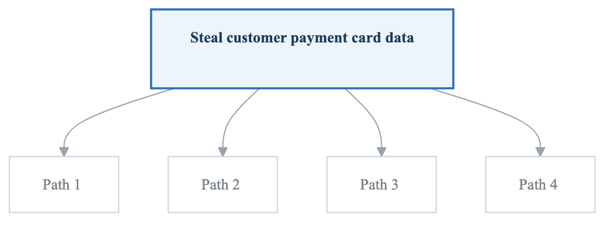

<details>
<summary>Diagram source (Mermaid)</summary>

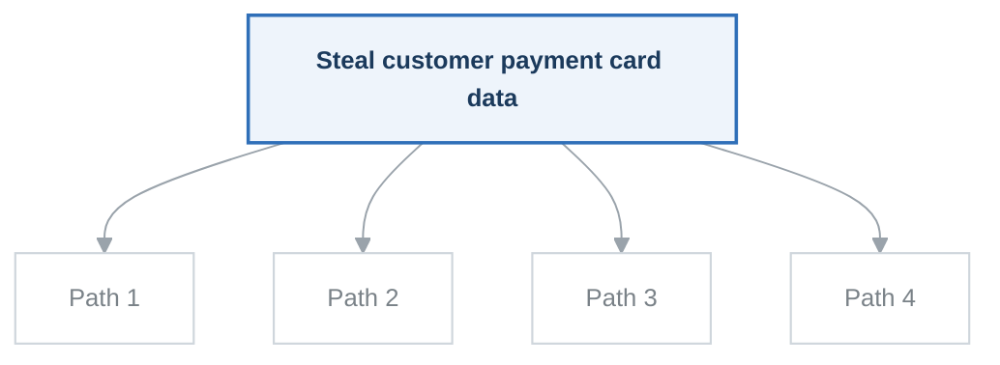

</details>

### Exercise Solution Approach

1. **Brainstorm attack paths:**
   - Compromise the database
   - Intercept data during checkout
   - Compromise admin account
   - Attack payment processor integration
   - Social engineer customer support

2. **Decompose each path**

3. **Look for AND conditions:**
   - E.g., "Compromise admin AND disable logging AND exfiltrate data"

4. **Assess paths:**
   - Which is cheapest?
   - Which requires least skill?
   - Which is hardest to detect?

---

## Key Takeaways

1. **Attack trees model attacker goals** - Think like an attacker

2. **AND/OR logic matters** - Understand dependencies

3. **Quantification enables prioritization** - Compare paths objectively

4. **Keep trees focused** - One root goal per tree

5. **Update regularly** - Trees become stale

6. **Combine with other methods** - Use with STRIDE for completeness

---

## Next Steps

→ [Methodology Selection Guide](methodology-selection.md)
→ [Lab 02: API Threat Model](../../labs/lab-02-api-threat-model/)

<!-- feynman-check -->

---

## Feynman check

Close the file. Blank page, no notes. Explain each of these to a competent engineer who has never
used this tool — **under five minutes, no jargon you can't define on the spot:**

- Attack Tree Fundamentals
- Building Attack Trees
- Attack Tree Example: Cloud Infrastructure Compromise
- Attack Tree Analysis

**The gap is not what you forgot. It is where you used a word instead of a mechanism.**

| | |
|---|---|
| ✗ | *"We scan for vulnerabilities in the pipeline."* |
| ✓ | *"SAST reads source without running it, SCA resolves the dependency tree against an advisory database, and image scanning compares installed package versions to that same database. All three report what was known at build time — which is why the registry is re-scanned: the image does not change, the database does."* |

**Trace it:** A CVE published today against your base image → a blocked deploy. Name every component between the advisory and the refused `apply`.

Stop at the first component you cannot name. Reopen this file and read **only** that.

**Go deeper — only once the gap has a name:** the [SLSA threat model](https://slsa.dev/spec/v1.2/threats) — it names every point at which a build can be subverted, and most teams defend three of them.
Full list per domain: [`SOURCES.md`](../../SOURCES.md#devsecops)

→ Protocol, the three levels of knowing, and worked examples: [`MASTERY.md`](../../MASTERY.md)

<!-- /feynman-check -->
