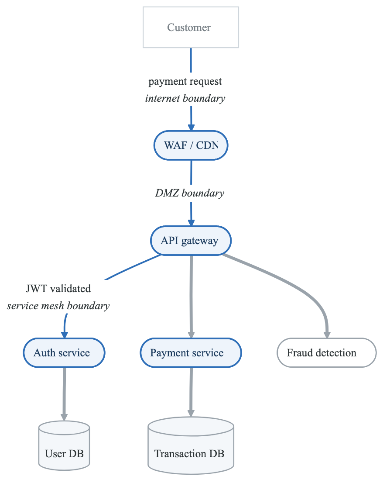
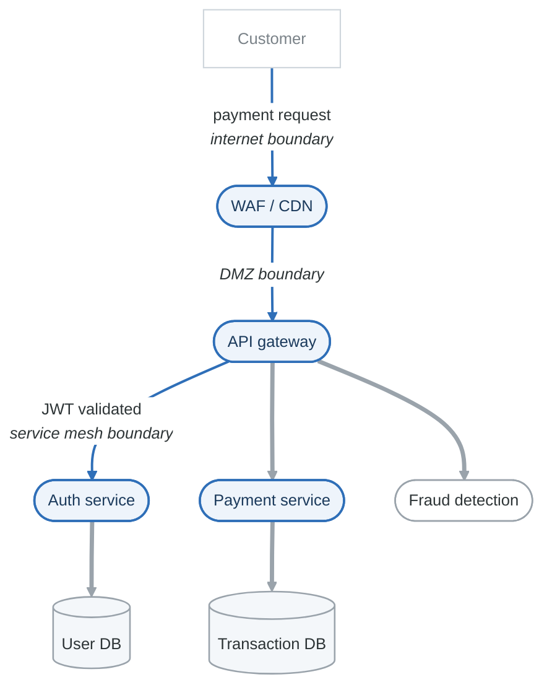
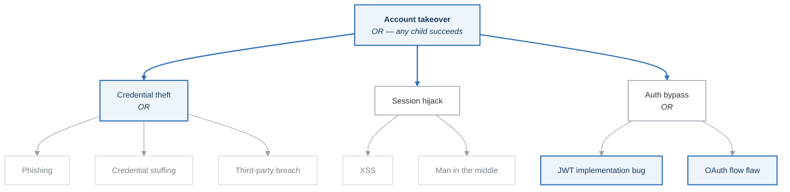

# PASTA Threat Modeling Framework

## Overview

PASTA (Process for Attack Simulation and Threat Analysis) is a seven-stage, risk-centric threat modeling methodology. Unlike STRIDE which focuses on technical threat categories, PASTA aligns threat analysis with business objectives and risk management.

**PASTA FRAMEWORK**

```
            7 Stages of Threat Analysis
Stage 1: Define Business Objectives
    ↓
Stage 2: Define Technical Scope
    ↓
Stage 3: Application Decomposition
    ↓
Stage 4: Threat Analysis
    ↓
Stage 5: Vulnerability Analysis
    ↓
Stage 6: Attack Modeling
    ↓
Stage 7: Risk & Impact Analysis
```


---

## When to Use PASTA

| Use PASTA When | Use STRIDE When |
|----------------|-----------------|
| Business risk alignment is critical | Quick technical assessment |
| Compliance/regulatory drivers exist | Developer-focused analysis |
| Executive stakeholder involvement | Component-level review |
| Full system lifecycle assessment | Design phase review |
| Attack simulation is valuable | Time-constrained sessions |

---

## The Seven Stages

### Stage 1: Define Business Objectives

**Purpose:** Align threat modeling with business goals and risk appetite.

**Activities:**
- Identify business objectives for the application
- Understand compliance requirements
- Define security requirements
- Establish risk tolerance levels
- Identify key stakeholders

**Key Questions:**
```
□ What business processes does this system support?
□ What's the financial impact of a security incident?
□ What are the regulatory/compliance requirements?
□ What's the organization's risk appetite?
□ Who are the key stakeholders?
□ What are the security priorities (CIA)?
```

**Outputs:**
| Artifact | Description |
|----------|-------------|
| Business Context Document | System purpose and value |
| Compliance Matrix | Applicable regulations |
| Risk Appetite Statement | Acceptable risk levels |
| Security Objectives | CIA priorities, specific goals |

**Example - FinTech Payment Platform:**
**Business Objectives:**

- Process $50M+ daily transactions
- Maintain PCI DSS Level 1 compliance
- Achieve 99.99% availability
- Protect customer financial data
- Enable rapid feature deployment

**Risk Appetite:**

- Zero tolerance for cardholder data exposure
- Low tolerance for service disruption
- Medium tolerance for feature delay for security
- Compliance violations: unacceptable

Security Priorities:
1. Confidentiality (payment data)
2. Integrity (transaction accuracy)
3. Availability (service uptime)


---

### Stage 2: Define Technical Scope

**Purpose:** Establish boundaries and technical context for the assessment.

**Activities:**
- Define system boundaries
- Document technology stack
- Identify external dependencies
- Map network architecture
- Document data flows at high level

**Key Questions:**
```
□ What's in scope vs. out of scope?
□ What technologies are used?
□ What external systems/APIs are integrated?
□ What cloud services are utilized?
□ What are the deployment environments?
□ What sensitive data is processed?
```

**Outputs:**
| Artifact | Description |
|----------|-------------|
| Scope Statement | In/out of scope boundaries |
| Technology Inventory | Stack components |
| Integration Map | External dependencies |
| Data Classification | Sensitive data types |

**Example - FinTech Payment Platform:**
**Technical Scope:**

- In Scope:
  - Payment API (Kubernetes)
  - Customer Portal (React SPA)
  - Transaction Database (PostgreSQL)
  - Message Queue (RabbitMQ)
  - AWS Infrastructure
- Out of Scope:
  - Third-party payment processor internals
  - Customer bank systems
  - Corporate IT systems
- Technology Stack:
  - Frontend: React, TypeScript
  - Backend: Node.js, Express
  - Database: PostgreSQL, Redis
  - Infrastructure: AWS EKS, RDS, ElastiCache
  - Security: AWS WAF, Secrets Manager
  - Monitoring: CloudWatch, Datadog


---

### Stage 3: Application Decomposition

**Purpose:** Break down the application into analyzable components.

**Activities:**
- Create Data Flow Diagrams (DFDs)
- Identify trust boundaries
- Document entry/exit points
- Map user roles and access patterns
- Identify assets and their sensitivity

**Key Questions:**
```
□ How does data flow through the system?
□ Where are the trust boundaries?
□ What are all the entry points?
□ What user roles exist?
□ What assets need protection?
□ What are the authentication/authorization mechanisms?
```

**Outputs:**
| Artifact | Description |
|----------|-------------|
| DFD (Level 0, 1, 2) | Data flow visualization |
| Trust Boundary Map | Security perimeters |
| Entry Point Catalog | All system interfaces |
| Asset Inventory | Valuable data/functions |
| Actor/Role Matrix | User types and permissions |

**Example - Payment Flow DFD:**
<!-- figure: generated from the Mermaid below by _shared/diagrams/embed-figures.py — do not edit the image -->


<details>
<summary>Diagram source (Mermaid)</summary>



</details>

---

### Stage 4: Threat Analysis

**Purpose:** Identify threats relevant to the application context.

**Activities:**
- Research threat intelligence for your industry
- Identify relevant threat actors
- Map threat actor capabilities and motivations
- Enumerate threats using STRIDE or other frameworks
- Correlate threats with assets and entry points

**Key Questions:**
```
□ Who would want to attack this system?
□ What are their motivations?
□ What techniques would they use (TTPs)?
□ What recent attacks have affected similar systems?
□ What industry-specific threats exist?
□ What insider threats are relevant?
```

**Outputs:**
| Artifact | Description |
|----------|-------------|
| Threat Actor Profiles | Who might attack |
| Threat Library | Enumerated threats |
| TTP Mapping | Attack techniques |
| Threat Intelligence Summary | Industry-specific threats |

**Example - FinTech Threat Analysis:**
**Threat Actors:**

- Cybercriminals (Financial Motivation)
  - Capability: Medium-High
  - Intent: Financial theft, fraud
  - TTPs: Credential stuffing, account takeover, BEC
- Insider Threats
  - Capability: High (legitimate access)
  - Intent: Financial gain, revenge
  - TTPs: Data exfiltration, fraud, sabotage
- Nation-State (Unlikely but possible)
  - Capability: Very High
  - Intent: Economic espionage
  - TTPs: Supply chain, zero-day

**Threat Library (Sample):**

- T001: Account takeover via credential stuffing
- T002: Payment fraud through parameter tampering
- T003: Data exfiltration by malicious insider
- T004: API abuse for unauthorized transactions
- T005: Supply chain attack via compromised dependency
- T006: Ransomware disrupting payment processing


---

### Stage 5: Vulnerability Analysis

**Purpose:** Identify weaknesses that threats could exploit.

**Activities:**
- Review design for security weaknesses
- Analyze code for vulnerabilities (if available)
- Review configurations
- Check for known vulnerabilities in dependencies
- Map vulnerabilities to threats

**Key Questions:**
```
□ What security weaknesses exist in the design?
□ Are there known vulnerabilities in our stack?
□ What misconfigurations might exist?
□ Are security controls properly implemented?
□ What gaps exist in our current defenses?
```

**Outputs:**
| Artifact | Description |
|----------|-------------|
| Vulnerability Assessment | Identified weaknesses |
| Dependency Scan Results | CVEs in libraries |
| Configuration Review | Misconfigurations |
| Control Gap Analysis | Missing controls |

**Vulnerability Categories:**
**Design Vulnerabilities:**

- Weak authentication mechanisms
- Insufficient input validation
- Missing encryption
- Excessive trust
- Single points of failure

**Implementation Vulnerabilities:**

- SQL injection vectors
- XSS vulnerabilities
- Insecure deserialization
- Hardcoded credentials
- Sensitive data in logs

**Configuration Vulnerabilities:**

- Default credentials
- Verbose error messages
- Debug endpoints exposed
- Overly permissive IAM
- Missing security headers

**Dependency Vulnerabilities:**

- CVEs in libraries
- Outdated packages
- Vulnerable base images
- Transitive dependencies


---

### Stage 6: Attack Modeling

**Purpose:** Simulate realistic attack scenarios.

**Activities:**
- Build attack trees for high-priority threats
- Map attacks to MITRE ATT&CK
- Develop attack scenarios/playbooks
- Identify attack paths and chains
- Estimate attack feasibility

**Key Questions:**
```
□ What are the most likely attack paths?
□ Can attacks be chained together?
□ What's the easiest path to our crown jewels?
□ How would an attacker move laterally?
□ What would an attack timeline look like?
```

**Attack Tree Example - Account Takeover:**
<!-- figure: generated from the Mermaid below by _shared/diagrams/embed-figures.py — do not edit the image -->


<details>
<summary>Diagram source (Mermaid)</summary>



</details>

**Attack Scenario Example:**
Scenario: Customer Account Takeover
Actor: Cybercriminal
Motivation: Financial fraud

Attack Chain:

**1. Reconnaissance**

- Identify target customers via social media

**2. Initial Access**

- Credential stuffing using leaked credentials

**3. Execution**

- Login to customer portal

**4. Persistence**

- Add attacker-controlled payment method

**5. Impact**

- Initiate fraudulent transactions

**MITRE ATT&CK Mapping:**

- T1589: Gather Victim Identity Information
- T1110.004: Credential Stuffing
- T1078: Valid Accounts
- T1098: Account Manipulation
- T1657: Financial Theft


---

### Stage 7: Risk & Impact Analysis

**Purpose:** Quantify risk and prioritize mitigations.

**Activities:**
- Calculate risk scores for each threat
- Assess business impact of successful attacks
- Prioritize threats by risk level
- Develop mitigation strategies
- Create remediation roadmap

**Risk Calculation:**
Risk = Likelihood × Impact

**Likelihood Factors:**

- Threat actor capability
- Attack complexity
- Vulnerability exploitability
- Existing controls

**Impact Factors:**

- Financial loss
- Regulatory penalties
- Reputational damage
- Operational disruption
- Data sensitivity


**Risk Matrix:**
| Likelihood ↓ &nbsp; Impact → | **Low** | **Medium** | **High** | **Critical** |
|---|---|---|---|---|
| **High** | Medium | High | **Critical** | **Critical** |
| **Medium** | Low | Medium | High | **Critical** |
| **Low** | Low | Low | Medium | High |
| **Very low** | Info | Low | Low | Medium |

PASTA earns the *Very low* row: because stage 7 scores risk against a real attacker profile rather
than an abstract one, plenty of theoretically alarming findings end up there, and saying so
explicitly is what keeps the register from being a list of everything anyone ever thought of.

**Risk Register Example:**
| ID | Threat | Likelihood | Impact | Risk | Mitigation | Owner | Status |
|----|--------|------------|--------|------|------------|-------|--------|
| T001 | Account takeover | High | Critical | Critical | MFA, rate limiting | Auth Team | In Progress |
| T002 | Payment fraud | Medium | Critical | Critical | Fraud detection | Fraud Team | Planned |
| T003 | Data exfiltration | Low | Critical | High | DLP, access review | Security | Planned |
| T004 | API abuse | High | Medium | High | Rate limiting, monitoring | API Team | Done |

**Mitigation Strategy Framework:**
For each threat, consider:

**1. AVOID - Eliminate the risk**

- Remove the feature/functionality

**2. MITIGATE - Reduce likelihood or impact**

- Implement security controls

**3. TRANSFER - Share the risk**

- Insurance, SLAs, third-party services

**4. ACCEPT - Acknowledge and monitor**

- Document decision, implement monitoring


---

## PASTA Outputs Summary

After completing all seven stages:

**PASTA Deliverables:**

- Business Context Document
- Technical Scope Definition
- Data Flow Diagrams (L0, L1, L2)
- Trust Boundary Analysis
- Asset Inventory
- Threat Actor Profiles
- Threat Library
- Vulnerability Assessment
- Attack Trees / Scenarios
- MITRE ATT&CK Mapping
- Risk Register (Prioritized)
- Mitigation Recommendations
- Remediation Roadmap


---

## Practical Exercise: PASTA Mini-Assessment

**Scenario:** Healthcare Patient Portal

A hospital is deploying a patient portal that allows:
- Patient registration and login
- Viewing medical records
- Scheduling appointments
- Messaging healthcare providers
- Prescription refill requests
- Bill payment

**Task:** Complete a condensed PASTA assessment:

### Stage 1: Business Objectives
```
Your answer:
- Business objectives:
- Compliance requirements:
- Risk appetite:
```

### Stage 2: Technical Scope
```
Your answer:
- In scope:
- Out of scope:
- Key technologies:
```

### Stage 3: Application Decomposition
```
Your answer:
- Draw a Level 1 DFD
- Identify trust boundaries
- List entry points
```

### Stage 4: Threat Analysis
```
Your answer:
- Relevant threat actors:
- Top 5 threats:
```

### Stage 5: Vulnerability Analysis
```
Your answer:
- Potential design weaknesses:
- Configuration risks:
```

### Stage 6: Attack Modeling
```
Your answer:
- Build an attack tree for "PHI Data Breach"
- Describe one attack scenario
```

### Stage 7: Risk Analysis
```
Your answer:
- Create a risk register with top 5 threats
- Propose mitigations
```

---

## Key Takeaways

1. **PASTA is risk-centric** - Aligns security with business objectives

2. **Seven stages build on each other** - Each stage informs the next

3. **Business context matters** - Start with why, not how

4. **Attack modeling adds realism** - Think like an attacker

5. **Prioritization is key** - Focus on highest-risk items

6. **Documentation enables action** - Comprehensive outputs drive remediation

---

## Next Steps

→ [LINDDUN Privacy Threats](linddun.md)
→ [Lab 03: Microservices with PASTA](../../labs/lab-03-microservices/)

<!-- feynman-check -->

---

## Feynman check

Close the file. Blank page, no notes. Explain each of these to a competent engineer who has never
used this tool — **under five minutes, no jargon you can't define on the spot:**

- When to Use PASTA
- The Seven Stages
- PASTA Outputs Summary
- Stage 1: Define Business Objectives

**The gap is not what you forgot. It is where you used a word instead of a mechanism.**

| | |
|---|---|
| ✗ | *"We scan for vulnerabilities in the pipeline."* |
| ✓ | *"SAST reads source without running it, SCA resolves the dependency tree against an advisory database, and image scanning compares installed package versions to that same database. All three report what was known at build time — which is why the registry is re-scanned: the image does not change, the database does."* |

**Trace it:** A CVE published today against your base image → a blocked deploy. Name every component between the advisory and the refused `apply`.

Stop at the first component you cannot name. Reopen this file and read **only** that.

**Go deeper — only once the gap has a name:** the [SLSA threat model](https://slsa.dev/spec/v1.2/threats) — it names every point at which a build can be subverted, and most teams defend three of them.
Full list per domain: [`SOURCES.md`](../../SOURCES.md#devsecops)

→ Protocol, the three levels of knowing, and worked examples: [`MASTERY.md`](../../MASTERY.md)

<!-- /feynman-check -->
