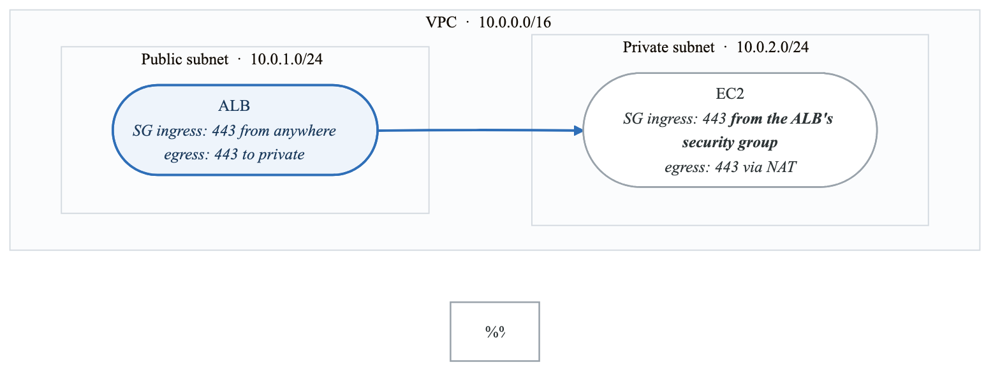
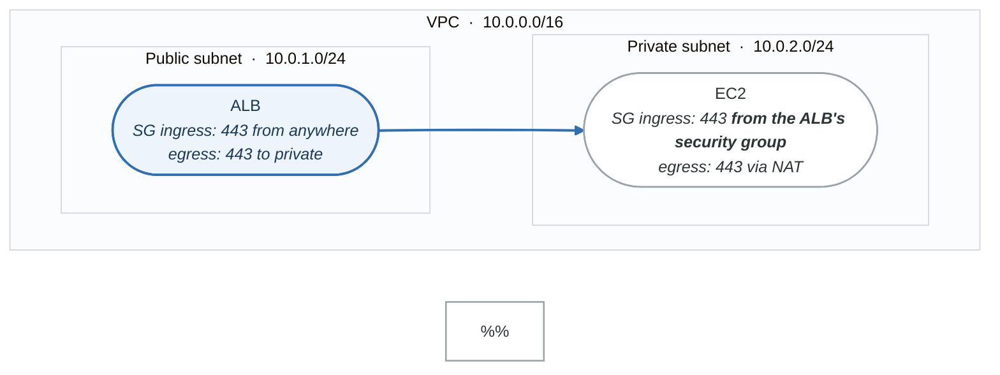
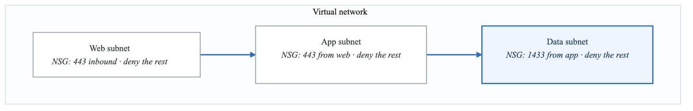

# Cloud Security for Threat Modeling

## Overview

Cloud environments introduce unique security considerations that must be addressed in threat models. This guide covers AWS, Azure, and GCP security fundamentals for threat modelers.

---

## Shared Responsibility Model

### Understanding Responsibilities

**The shared responsibility model**

| Layer | Who owns it |
|---|---|
| Physical security · network fabric · hypervisor · storage infrastructure | **Cloud provider** |
| Network controls · encryption · identity and access · logging | **Shared** — they provide the feature, you configure it |
| Data · applications · IAM policy · OS and runtime · network configuration | **You** |

The middle row is where the breaches happen. The provider gives you encryption, IAM and logging; the
number of buckets, roles and trails that are actually configured is entirely yours, and "the provider
handles security" is a sentence that has only ever been true about the top row.

### By Service Type

| Service Type | Provider Manages | Customer Manages |
|--------------|------------------|------------------|
| IaaS (EC2, VMs) | Hardware, hypervisor | OS, runtime, data |
| PaaS (Lambda, App Service) | Hardware to runtime | Code, data, config |
| SaaS (S3, Cosmos DB) | Infrastructure to app | Data, access |

---

## AWS Security

### Core Security Services

| Service | Purpose | Threat Model Relevance |
|---------|---------|------------------------|
| IAM | Identity & access | Authentication, authorization |
| VPC | Network isolation | Network segmentation |
| KMS | Key management | Encryption at rest |
| CloudTrail | Audit logging | Detection, forensics |
| GuardDuty | Threat detection | Runtime protection |
| Security Hub | Security posture | Compliance monitoring |

### IAM Threat Modeling

```yaml
iam_threats:
  - threat: Overly permissive policies
    pattern: "Action: *" or "Resource: *"
    impact: Lateral movement, data access
    mitigation: Least privilege, resource scoping

  - threat: Long-lived access keys
    pattern: Access keys without rotation
    impact: Credential compromise
    mitigation: Role-based access, STS

  - threat: Cross-account confusion
    pattern: Trust policies with external accounts
    impact: Unauthorized access
    mitigation: ExternalId, condition keys

  - threat: Role chaining
    pattern: AssumeRole to escalate privileges
    impact: Privilege escalation
    mitigation: Permission boundaries
```

### VPC Security

<!-- figure: generated from the Mermaid below by _shared/diagrams/embed-figures.py — do not edit the image -->


<details>
<summary>Diagram source (Mermaid)</summary>



</details>

### S3 Security

| Control | Configuration | Threat Addressed |
|---------|---------------|------------------|
| Block Public Access | s3:BlockPublicAccess | Data exposure |
| Bucket Policies | Explicit deny | Unauthorized access |
| Object ACLs | Disable | Accidental public |
| Encryption | SSE-S3/SSE-KMS | Data at rest |
| VPC Endpoints | Gateway endpoint | Data in transit |
| Access Logging | S3 server access logs | Forensics |

---

## Azure Security

### Core Security Services

| Service | Purpose | Threat Model Relevance |
|---------|---------|------------------------|
| Entra ID (Azure AD) | Identity | Authentication, SSO |
| Azure RBAC | Authorization | Access control |
| Key Vault | Secrets/keys | Credential management |
| Virtual Network | Network isolation | Segmentation |
| Microsoft Defender | Threat detection | Runtime protection |
| Azure Monitor | Logging | Detection |

### Entra ID Security

```yaml
entra_id_threats:
  - threat: Credential compromise
    vectors:
      - Phishing
      - Password spray
      - Token theft
    mitigations:
      - Conditional Access
      - MFA
      - Password protection

  - threat: Application consent abuse
    vectors:
      - Illicit consent grant
      - Malicious app registration
    mitigations:
      - Admin consent workflow
      - App governance

  - threat: Privileged role abuse
    vectors:
      - Global admin compromise
      - Standing privileges
    mitigations:
      - PIM (Privileged Identity Management)
      - Just-in-time access
```

### Azure Networking

```mermaid
%%{init: {'theme':'base','themeVariables':{'fontFamily':'Helvetica, Arial, sans-serif','fontSize':'13px','primaryColor':'#ffffff','primaryTextColor':'#2d3436','primaryBorderColor':'#9aa3ab','lineColor':'#9aa3ab','textColor':'#2d3436','clusterBkg':'#fbfcfd','clusterBorder':'#d4dae0','edgeLabelBackground':'#ffffff','tertiaryColor':'#eef4fb'},'flowchart':{'curve':'basis','padding':14,'nodeSpacing':42,'rankSpacing':58}}}%%
flowchart LR
  classDef default fill:#ffffff,stroke:#9aa3ab,stroke-width:1.3px,color:#2d3436
  classDef n    fill:#ffffff,stroke:#9aa3ab,stroke-width:1.3px,color:#2d3436
  classDef crit fill:#eef4fb,stroke:#2f6fb8,stroke-width:1.8px,color:#1b3a5c
  classDef data fill:#f4f7fa,stroke:#9aa3ab,stroke-width:1.3px,color:#2d3436
  classDef mut  fill:#ffffff,stroke:#cfd6dc,stroke-width:1.1px,color:#7a8288
  classDef warn fill:#fdf0ec,stroke:#c0522d,stroke-width:1.6px,color:#8a3a1e
  subgraph VN["Virtual network"]
    direction LR
    WEB["Web subnet<br/><i>NSG: 443 inbound · deny the rest</i>"]
    APP["App subnet<br/><i>NSG: 443 from web · deny the rest</i>"]
    DATA["Data subnet<br/><i>NSG: 1433 from app · deny the rest</i>"]
    WEB ==> APP ==> DATA
  end
  class WEB n
  class APP n
  class DATA crit
  linkStyle 0,1 stroke:#2f6fb8,stroke-width:2px

%% Beyond NSGs:
%%   Azure Firewall / NVA   application-aware filtering and egress control
%%   Private Endpoints      a PaaS service gets a private IP inside your VNet
%%   Service Endpoints      VNet-routed access to PaaS, but the service keeps
%%                          its public endpoint -- which is the difference that
%%                          matters when the requirement says "not reachable
%%                          from the internet".
```

<!-- figure: generated from the Mermaid below by _shared/diagrams/embed-figures.py — do not edit the image -->


<details>
<summary>Diagram source (Mermaid)</summary>



</details>

---

## GCP Security

### Core Security Services

| Service | Purpose | Threat Model Relevance |
|---------|---------|------------------------|
| Cloud IAM | Identity & access | Authorization |
| Cloud Identity | User management | Authentication |
| VPC Service Controls | Data perimeter | Exfiltration prevention |
| Cloud KMS | Key management | Encryption |
| Security Command Center | Posture management | Compliance |
| Cloud Audit Logs | Logging | Detection |

### GCP IAM Model

**Organization**

- Folders
  - Production
    - Project A
    - Project B
  - Development
    - Project C
- Policies (inherited)

IAM Hierarchy:
- Organization policies apply to all
- Folder policies apply to contained projects
- Project policies are most specific


### Service Account Security

```yaml
service_account_threats:
  - threat: Key file exposure
    pattern: Downloaded JSON keys
    impact: Persistent access
    mitigation: Workload Identity, no keys

  - threat: Over-privileged service accounts
    pattern: Editor/Owner roles
    impact: Lateral movement
    mitigation: Custom roles, least privilege

  - threat: Service account impersonation
    pattern: iam.serviceAccountTokenCreator
    impact: Privilege escalation
    mitigation: Restrict impersonation

  - threat: Default service accounts
    pattern: Compute Engine default SA
    impact: Inherited permissions
    mitigation: Disable, use custom SA
```

---

## Cross-Cloud Threats

### Common Patterns

| Threat | AWS | Azure | GCP |
|--------|-----|-------|-----|
| Metadata service abuse | IMDS (169.254.169.254) | IMDS | Metadata server |
| Over-privileged identities | IAM policies | RBAC roles | IAM bindings |
| Public storage | S3 buckets | Blob containers | GCS buckets |
| Misconfigured networking | Security groups | NSGs | Firewall rules |
| Unencrypted data | S3/EBS | Blob/Disk | GCS/PD |
| Exposed secrets | Parameter Store | Key Vault | Secret Manager |

### IMDS Exploitation

```
Attack flow:
1. SSRF vulnerability in application
2. Request: http://169.254.169.254/latest/meta-data/
3. Obtain instance role credentials
4. Access cloud resources with stolen credentials

Mitigations:
- AWS: IMDSv2 (require PUT token)
- Azure: Disable IMDS where not needed
- GCP: Metadata concealment, Workload Identity
```

---

## Cloud Threat Model Checklist

```
Identity & Access:
□ Is MFA enforced for human users?
□ Are service accounts least privileged?
□ Are credentials short-lived (no long-term keys)?
□ Is access reviewed regularly?
□ Are privileged actions logged?

Network:
□ Is network segmented appropriately?
□ Are public IPs minimized?
□ Is egress controlled?
□ Are VPC endpoints used for cloud services?
□ Is traffic encrypted (TLS)?

Data:
□ Is data encrypted at rest?
□ Is data encrypted in transit?
□ Are encryption keys properly managed?
□ Is access logging enabled?
□ Are backups encrypted?

Compute:
□ Are images hardened?
□ Is IMDSv2 (or equivalent) enforced?
□ Are patches applied regularly?
□ Is unnecessary software removed?
□ Are containers non-root?

Monitoring:
□ Are cloud audit logs enabled?
□ Are logs centralized?
□ Are alerts configured for security events?
□ Is threat detection enabled (GuardDuty, Defender, SCC)?
□ Are logs retained appropriately?
```

---

## Next Steps

→ [Kubernetes Security](content-03-technical-skills-kubernetes.md)
→ [Serverless Security](content-03-technical-skills-serverless.md)

<!-- feynman-check -->

---

## Feynman check

Close the file. Blank page, no notes. Explain each of these to a competent engineer who has never
used this tool — **under five minutes, no jargon you can't define on the spot:**

- Shared Responsibility Model
- AWS Security
- Azure Security
- GCP Security

**The gap is not what you forgot. It is where you used a word instead of a mechanism.**

| | |
|---|---|
| ✗ | *"We scan for vulnerabilities in the pipeline."* |
| ✓ | *"SAST reads source without running it, SCA resolves the dependency tree against an advisory database, and image scanning compares installed package versions to that same database. All three report what was known at build time — which is why the registry is re-scanned: the image does not change, the database does."* |

**Trace it:** A CVE published today against your base image → a blocked deploy. Name every component between the advisory and the refused `apply`.

Stop at the first component you cannot name. Reopen this file and read **only** that.

**Go deeper — only once the gap has a name:** the [SLSA threat model](https://slsa.dev/spec/v1.2/threats) — it names every point at which a build can be subverted, and most teams defend three of them.
Full list per domain: [`SOURCES.md`](../../SOURCES.md#devsecops)

→ Protocol, the three levels of knowing, and worked examples: [`MASTERY.md`](../../MASTERY.md)

<!-- /feynman-check -->
