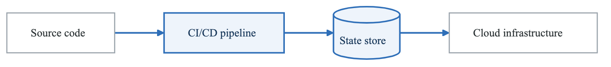

# Infrastructure as Code Security

## Overview

Infrastructure as Code (IaC) enables version-controlled, reproducible infrastructure but also introduces security risks. This guide covers threat modeling for Terraform, CloudFormation, and other IaC tools.

---

## IaC Attack Surface

**Where an IaC pipeline can be attacked**

```mermaid
%%{init: {'theme':'base','themeVariables':{'fontFamily':'Helvetica, Arial, sans-serif','fontSize':'13px','primaryColor':'#ffffff','primaryTextColor':'#2d3436','primaryBorderColor':'#9aa3ab','lineColor':'#9aa3ab','textColor':'#2d3436','clusterBkg':'#fbfcfd','clusterBorder':'#d4dae0','edgeLabelBackground':'#ffffff','tertiaryColor':'#eef4fb'},'flowchart':{'curve':'basis','padding':14,'nodeSpacing':42,'rankSpacing':58}}}%%
flowchart LR
  classDef default fill:#ffffff,stroke:#9aa3ab,stroke-width:1.3px,color:#2d3436
  classDef n    fill:#ffffff,stroke:#9aa3ab,stroke-width:1.3px,color:#2d3436
  classDef crit fill:#eef4fb,stroke:#2f6fb8,stroke-width:1.8px,color:#1b3a5c
  classDef data fill:#f4f7fa,stroke:#9aa3ab,stroke-width:1.3px,color:#2d3436
  classDef mut  fill:#ffffff,stroke:#cfd6dc,stroke-width:1.1px,color:#7a8288
  classDef warn fill:#fdf0ec,stroke:#c0522d,stroke-width:1.6px,color:#8a3a1e
  S["Source code"] ==> C["CI/CD pipeline"] ==> T[("State store")] ==> I["Cloud infrastructure"]
  class S n
  class C crit
  class T crit
  class I n
  linkStyle 0,1,2 stroke:#2f6fb8,stroke-width:2px
```

<!-- figure: generated from the Mermaid below by _shared/diagrams/embed-figures.py — do not edit the image -->


<details>
<summary>Diagram source (Mermaid)</summary>



</details>

| Stage | Threats |
|---|---|
| **Source code** | Secrets committed · malicious changes · misconfiguration written in |
| **CI/CD pipeline** | Credential theft · supply-chain compromise · privilege abuse |
| **State store** | State exposure · state tampering · **sensitive data stored in plaintext** |
| **Cloud infrastructure** | Misconfiguration applied · drift from the declared state · public exposure |

The state store is the stage people secure last and should secure first. Terraform state contains
resource attributes in the clear — including database passwords, private keys and connection strings
— so a readable state file is frequently a faster path to production than anything in the source
repository.

---

## Terraform Security

### Common Misconfigurations

```hcl
# BAD: Public S3 bucket
resource "aws_s3_bucket_acl" "example" {
  bucket = aws_s3_bucket.example.id
  acl    = "public-read"  # VULNERABLE
}

# GOOD: Private with explicit deny
resource "aws_s3_bucket_public_access_block" "example" {
  bucket = aws_s3_bucket.example.id

  block_public_acls       = true
  block_public_policy     = true
  ignore_public_acls      = true
  restrict_public_buckets = true
}
```

```hcl
# BAD: Hardcoded secrets
resource "aws_db_instance" "database" {
  username = "admin"
  password = "SuperSecret123!"  # VULNERABLE
}

# GOOD: Use secrets management
data "aws_secretsmanager_secret_version" "db_password" {
  secret_id = "prod/database/password"
}

resource "aws_db_instance" "database" {
  username = "admin"
  password = data.aws_secretsmanager_secret_version.db_password.secret_string
}
```

### State File Security

```yaml
state_file_threats:
  - name: Sensitive data exposure
    description: State contains secrets, passwords, keys
    locations:
      - local files
      - S3 buckets
      - Terraform Cloud
    mitigations:
      - Encrypt state at rest
      - Restrict state access
      - Use sensitive variable marking

  - name: State tampering
    description: Modify state to change infrastructure
    impact: Unauthorized changes, resource hijacking
    mitigations:
      - State locking
      - Version control
      - Audit logging

  - name: State theft
    description: Steal state for reconnaissance
    impact: Infrastructure mapping, credential theft
    mitigations:
      - Access controls
      - Encryption
      - Monitoring
```

### Secure Backend Configuration

```hcl
# Secure S3 backend
terraform {
  backend "s3" {
    bucket         = "company-terraform-state"
    key            = "prod/infrastructure/terraform.tfstate"
    region         = "us-east-1"
    encrypt        = true
    dynamodb_table = "terraform-state-lock"
    kms_key_id     = "alias/terraform-state-key"
  }
}
```

---

## CloudFormation Security

### Security Best Practices

```yaml
# Use parameter constraints
Parameters:
  Environment:
    Type: String
    AllowedValues:
      - dev
      - staging
      - prod
    Description: Deployment environment

  DatabasePassword:
    Type: String
    NoEcho: true  # Mask in console
    MinLength: 16
    AllowedPattern: "[a-zA-Z0-9!@#$%^&*()_+]+"

Resources:
  # Use Dynamic References for secrets
  Database:
    Type: AWS::RDS::DBInstance
    Properties:
      MasterUsername: admin
      MasterUserPassword: '{{resolve:secretsmanager:prod/db/password:SecretString:password}}'

  # Deny public access
  Bucket:
    Type: AWS::S3::Bucket
    Properties:
      PublicAccessBlockConfiguration:
        BlockPublicAcls: true
        BlockPublicPolicy: true
        IgnorePublicAcls: true
        RestrictPublicBuckets: true
```

### StackSets Security

```yaml
stack_sets_threats:
  - name: Cross-account privilege escalation
    description: StackSets can deploy to multiple accounts
    mitigation: Limit administration account, use service-managed

  - name: Malicious stack deployment
    description: Deploy compromised templates
    mitigation: Template validation, approval workflow
```

---

## IaC Scanning Tools

### Pre-Commit Scanning

```yaml
# .pre-commit-config.yaml
repos:
  - repo: https://github.com/bridgecrewio/checkov
    rev: '2.5.0'
    hooks:
      - id: checkov

  - repo: https://github.com/antonbabenko/pre-commit-terraform
    rev: v1.83.0
    hooks:
      - id: terraform_tfsec
      - id: terraform_validate
      - id: terraform_fmt

  - repo: https://github.com/aws-cloudformation/cfn-lint
    rev: v0.83.0
    hooks:
      - id: cfn-lint
```

### CI/CD Integration

```yaml
# GitHub Actions
name: IaC Security Scan

on: [push, pull_request]

jobs:
  scan:
    runs-on: ubuntu-latest
    steps:
      - uses: actions/checkout@v4

      - name: Checkov Scan
        uses: bridgecrewio/checkov-action@master
        with:
          directory: terraform/
          framework: terraform
          output_format: sarif

      - name: tfsec Scan
        uses: aquasecurity/tfsec-action@v1.0.0
        with:
          github_token: ${{ secrets.GITHUB_TOKEN }}

      - name: KICS Scan
        uses: Checkmarx/kics-action@v1.7
        with:
          path: terraform/
          fail_on: high,medium
```

---

## Common IaC Vulnerabilities

### By Category

```yaml
categories:
  - name: Encryption
    issues:
      - Unencrypted storage (S3, EBS, RDS)
      - Missing KMS key rotation
      - Unencrypted data in transit
    checkov_ids: [CKV_AWS_19, CKV_AWS_17, CKV_AWS_144]

  - name: Network Exposure
    issues:
      - Security group allows 0.0.0.0/0
      - Public subnets with sensitive resources
      - Missing VPC flow logs
    checkov_ids: [CKV_AWS_23, CKV_AWS_24, CKV_AWS_25]

  - name: Access Control
    issues:
      - Overly permissive IAM policies
      - Missing MFA for root account
      - Public access to resources
    checkov_ids: [CKV_AWS_1, CKV_AWS_40, CKV_AWS_20]

  - name: Logging & Monitoring
    issues:
      - CloudTrail not enabled
      - S3 access logging disabled
      - Missing GuardDuty
    checkov_ids: [CKV_AWS_67, CKV_AWS_18, CKV_AWS_214]
```

---

## Policy as Code

### Open Policy Agent (OPA)

```rego
# Deny public S3 buckets
package terraform.aws.s3

deny[msg] {
    resource := input.resource.aws_s3_bucket[name]
    resource.acl == "public-read"
    msg := sprintf("S3 bucket %v has public-read ACL", [name])
}

deny[msg] {
    resource := input.resource.aws_s3_bucket[name]
    resource.acl == "public-read-write"
    msg := sprintf("S3 bucket %v has public-read-write ACL", [name])
}

# Require encryption
deny[msg] {
    resource := input.resource.aws_s3_bucket[name]
    not has_encryption(resource)
    msg := sprintf("S3 bucket %v lacks encryption configuration", [name])
}

has_encryption(bucket) {
    bucket.server_side_encryption_configuration
}
```

### Sentinel (Terraform Cloud)

```python
# Require specific tags
import "tfplan/v2" as tfplan

required_tags = ["Environment", "Owner", "CostCenter"]

ec2_instances = filter tfplan.resource_changes as _, rc {
    rc.type is "aws_instance" and
    rc.mode is "managed" and
    (rc.change.actions contains "create" or rc.change.actions contains "update")
}

deny_ec2_without_tags = rule {
    all ec2_instances as _, instance {
        all required_tags as tag {
            instance.change.after.tags contains tag
        }
    }
}

main = rule {
    deny_ec2_without_tags
}
```

---

## IaC Threat Model Checklist

```
Code Security:
□ No hardcoded secrets
□ Sensitive variables marked as sensitive
□ Remote state encrypted
□ State access controlled
□ Code review required for changes

Pipeline Security:
□ Least privilege CI/CD credentials
□ Plan output reviewed before apply
□ Approval gates for production
□ Drift detection enabled
□ Audit logging configured

Resource Configuration:
□ Encryption enabled (at rest and transit)
□ Public access blocked by default
□ Least privilege IAM policies
□ Logging enabled
□ Network access restricted

Scanning & Validation:
□ Pre-commit hooks configured
□ IaC scanning in CI/CD
□ Policy as code enforced
□ Compliance checks automated
□ Vulnerability scanning for modules
```

---

## Next Steps

→ [API Security](content-03-technical-skills-api-security.md)
→ [Cloud Security](content-03-technical-skills-cloud-security.md)

<!-- feynman-check -->

---

## Feynman check

Close the file. Blank page, no notes. Explain each of these to a competent engineer who has never
used this tool — **under five minutes, no jargon you can't define on the spot:**

- IaC Attack Surface
- Terraform Security
- CloudFormation Security
- IaC Scanning Tools

**The gap is not what you forgot. It is where you used a word instead of a mechanism.**

| | |
|---|---|
| ✗ | *"We scan for vulnerabilities in the pipeline."* |
| ✓ | *"SAST reads source without running it, SCA resolves the dependency tree against an advisory database, and image scanning compares installed package versions to that same database. All three report what was known at build time — which is why the registry is re-scanned: the image does not change, the database does."* |

**Trace it:** A CVE published today against your base image → a blocked deploy. Name every component between the advisory and the refused `apply`.

Stop at the first component you cannot name. Reopen this file and read **only** that.

**Go deeper — only once the gap has a name:** the [SLSA threat model](https://slsa.dev/spec/v1.2/threats) — it names every point at which a build can be subverted, and most teams defend three of them.
Full list per domain: [`SOURCES.md`](../../SOURCES.md#devsecops)

→ Protocol, the three levels of knowing, and worked examples: [`MASTERY.md`](../../MASTERY.md)

<!-- /feynman-check -->
