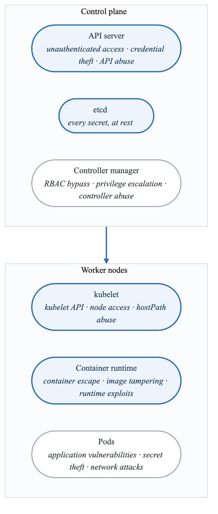
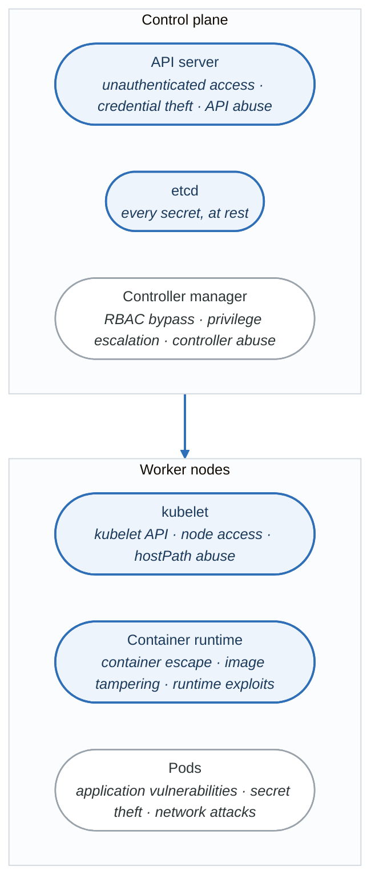
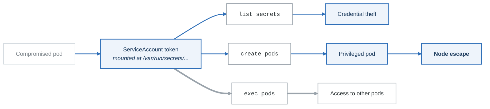

# Kubernetes Security for Threat Modeling

## Overview

Kubernetes introduces a complex attack surface that requires specialized threat modeling. This guide covers the key security concepts and threat patterns for containerized workloads.

---

## Kubernetes Attack Surface

<!-- figure: generated from the Mermaid below by _shared/diagrams/embed-figures.py — do not edit the image -->


<details>
<summary>Diagram source (Mermaid)</summary>



</details>

---

## Five Layers of Kubernetes Security

### 1. Cluster Infrastructure

```yaml
threats:
  - name: etcd compromise
    description: Direct access to etcd exposes all cluster secrets
    mitigations:
      - Encrypt etcd at rest
      - Restrict network access
      - Use TLS for etcd

  - name: Control plane API exposure
    description: Public API server enables attacks
    mitigations:
      - Private API endpoint
      - Network policies
      - Strong authentication

  - name: Node compromise
    description: Compromised node accesses all pods
    mitigations:
      - CIS benchmarks
      - Node hardening
      - Pod security policies
```

### 2. Cluster Configuration

```yaml
# RBAC Analysis
threats:
  - name: Overly permissive RBAC
    pattern: |
      rules:
      - apiGroups: ["*"]
        resources: ["*"]
        verbs: ["*"]
    impact: Cluster admin access
    detection: rbac-police, rakkess

  - name: Service account token abuse
    pattern: automountServiceAccountToken not disabled
    impact: Pod can access API
    detection: KubeLinter

  - name: Admission controller bypass
    pattern: Missing/misconfigured admission
    impact: Policy bypass
    detection: Policy audit
```

### 3. Container Security

```yaml
container_threats:
  - name: Privileged container
    pattern: securityContext.privileged: true
    impact: Host access, escape
    detection: OPA/Gatekeeper

  - name: Root user
    pattern: runAsUser not set or 0
    impact: Container escape easier
    detection: KubeLinter

  - name: Dangerous capabilities
    pattern: capabilities.add includes SYS_ADMIN
    impact: Kernel access
    detection: Falco

  - name: Host path mount
    pattern: volumes.hostPath
    impact: Node filesystem access
    detection: OPA/Gatekeeper
```

### 4. Network Security

```yaml
# NetworkPolicy example
apiVersion: networking.k8s.io/v1
kind: NetworkPolicy
metadata:
  name: api-network-policy
  namespace: production
spec:
  podSelector:
    matchLabels:
      app: api
  policyTypes:
  - Ingress
  - Egress
  ingress:
  - from:
    - podSelector:
        matchLabels:
          app: frontend
    ports:
    - protocol: TCP
      port: 8080
  egress:
  - to:
    - podSelector:
        matchLabels:
          app: database
    ports:
    - protocol: TCP
      port: 5432
```

### 5. Application Security

```yaml
application_threats:
  - name: Secret exposure
    locations:
      - Environment variables (visible in pod spec)
      - ConfigMaps (unencrypted)
      - Logs
    mitigations:
      - External secrets operators
      - Sealed secrets
      - Vault integration

  - name: Service-to-service attacks
    vectors:
      - Pod impersonation
      - DNS spoofing
      - Traffic interception
    mitigations:
      - mTLS (service mesh)
      - Network policies
      - Pod identity
```

---

## RBAC Threat Modeling

### Dangerous Permissions

| Permission | Risk | Abuse Scenario |
|------------|------|----------------|
| `pods/exec` | Critical | Execute in any container |
| `secrets` (get/list) | Critical | Read all secrets |
| `pods` (create) | High | Create privileged pod |
| `serviceaccounts/token` | High | Impersonate service accounts |
| `nodes` | High | Access node information |
| `persistentvolumes` | Medium | Access persistent data |

### RBAC Attack Paths

<!-- figure: generated from the Mermaid below by _shared/diagrams/embed-figures.py — do not edit the image -->


<details>
<summary>Diagram source (Mermaid)</summary>



</details>

### Least Privilege Example

```yaml
# Good: Specific permissions
apiVersion: rbac.authorization.k8s.io/v1
kind: Role
metadata:
  name: app-role
  namespace: production
rules:
- apiGroups: [""]
  resources: ["configmaps"]
  resourceNames: ["app-config"]  # Specific resource
  verbs: ["get"]                 # Read-only

- apiGroups: [""]
  resources: ["secrets"]
  resourceNames: ["app-secret"]
  verbs: ["get"]
```

---

## Pod Security Standards

### Levels

| Level | Description | Use Case |
|-------|-------------|----------|
| Privileged | No restrictions | System pods |
| Baseline | Prevent known escalations | General workloads |
| Restricted | Hardened | Sensitive workloads |

### Restricted Profile

```yaml
apiVersion: v1
kind: Pod
metadata:
  name: secure-pod
spec:
  securityContext:
    runAsNonRoot: true
    runAsUser: 1000
    runAsGroup: 1000
    fsGroup: 1000
    seccompProfile:
      type: RuntimeDefault

  containers:
  - name: app
    image: app:1.0@sha256:abc123...  # Digest pinning
    securityContext:
      allowPrivilegeEscalation: false
      readOnlyRootFilesystem: true
      capabilities:
        drop:
        - ALL
    resources:
      limits:
        cpu: "100m"
        memory: "128Mi"
      requests:
        cpu: "50m"
        memory: "64Mi"
```

---

## Supply Chain Security

### Image Security

```yaml
supply_chain_threats:
  - name: Malicious base image
    attack: Compromised public image
    mitigations:
      - Use trusted registries
      - Scan images
      - Minimal base images

  - name: Image tag mutation
    attack: Tag points to new image
    mitigations:
      - Use image digests
      - Admission controllers
      - Image signing

  - name: Build-time injection
    attack: Malicious code in CI/CD
    mitigations:
      - Signed builds
      - SLSA provenance
      - Reproducible builds
```

### Image Signing and Verification

```yaml
# Kyverno policy for signature verification
apiVersion: kyverno.io/v1
kind: ClusterPolicy
metadata:
  name: verify-images
spec:
  validationFailureAction: Enforce
  rules:
  - name: verify-signature
    match:
      resources:
        kinds:
        - Pod
    verifyImages:
    - imageReferences:
      - "*"
      attestors:
      - entries:
        - keys:
            publicKeys: |
              -----BEGIN PUBLIC KEY-----
              ...
              -----END PUBLIC KEY-----
```

---

## Service Mesh Security

### Istio mTLS

```yaml
# Strict mTLS enforcement
apiVersion: security.istio.io/v1beta1
kind: PeerAuthentication
metadata:
  name: default
  namespace: production
spec:
  mtls:
    mode: STRICT

# Authorization policy
apiVersion: security.istio.io/v1beta1
kind: AuthorizationPolicy
metadata:
  name: api-authz
  namespace: production
spec:
  selector:
    matchLabels:
      app: api
  action: ALLOW
  rules:
  - from:
    - source:
        principals:
        - "cluster.local/ns/production/sa/frontend"
    to:
    - operation:
        methods: ["GET", "POST"]
        paths: ["/api/*"]
```

---

## Kubernetes Threat Model Template

```yaml
system: Kubernetes Application
cluster:
  provider: EKS/GKE/AKS
  version: 1.28

components:
  - name: API Server
    threats:
      - Unauthenticated access
      - Token theft
    controls:
      - OIDC authentication
      - Audit logging

  - name: Worker Nodes
    threats:
      - Node compromise
      - Container escape
    controls:
      - Node hardening
      - Pod security standards

  - name: Application Pods
    threats:
      - Privilege escalation
      - Secret theft
      - Lateral movement
    controls:
      - RBAC
      - Network policies
      - Secret encryption

data_flows:
  - from: User
    to: Ingress
    threats: [MitM, DDoS]
    controls: [TLS, WAF]

  - from: Pod A
    to: Pod B
    threats: [Spoofing, Tampering]
    controls: [mTLS, NetworkPolicy]

  - from: Pod
    to: Secret
    threats: [Disclosure]
    controls: [RBAC, Encryption]
```

---

## Detection and Monitoring

### Key Events to Monitor

```yaml
critical_events:
  - Anonymous authentication success
  - Failed API authentication
  - Privileged pod creation
  - Secret access
  - Exec into container
  - Node status changes
  - RBAC changes
  - Network policy changes

detection_tools:
  - Falco: Runtime security
  - Tetragon: eBPF observability
  - Trivy: Vulnerability scanning
  - Kube-bench: CIS benchmarks
  - KubeAudit: Security auditing
```

---

## Next Steps

→ [Serverless Security](content-03-technical-skills-serverless.md)
→ [Infrastructure as Code Security](content-03-technical-skills-iac-security.md)

<!-- feynman-check -->

---

## Feynman check

Close the file. Blank page, no notes. Explain each of these to a competent engineer who has never
used this tool — **under five minutes, no jargon you can't define on the spot:**

- Kubernetes Attack Surface
- Five Layers of Kubernetes Security
- RBAC Threat Modeling
- Pod Security Standards

**The gap is not what you forgot. It is where you used a word instead of a mechanism.**

| | |
|---|---|
| ✗ | *"We scan for vulnerabilities in the pipeline."* |
| ✓ | *"SAST reads source without running it, SCA resolves the dependency tree against an advisory database, and image scanning compares installed package versions to that same database. All three report what was known at build time — which is why the registry is re-scanned: the image does not change, the database does."* |

**Trace it:** A CVE published today against your base image → a blocked deploy. Name every component between the advisory and the refused `apply`.

Stop at the first component you cannot name. Reopen this file and read **only** that.

**Go deeper — only once the gap has a name:** the [SLSA threat model](https://slsa.dev/spec/v1.2/threats) — it names every point at which a build can be subverted, and most teams defend three of them.
Full list per domain: [`SOURCES.md`](../../SOURCES.md#devsecops)

→ Protocol, the three levels of knowing, and worked examples: [`MASTERY.md`](../../MASTERY.md)

<!-- /feynman-check -->
