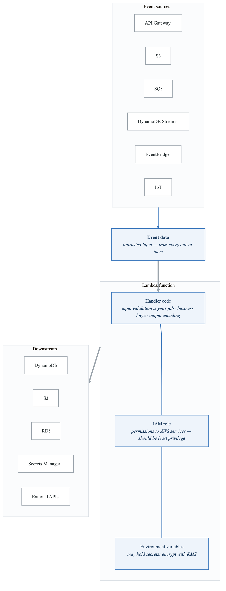
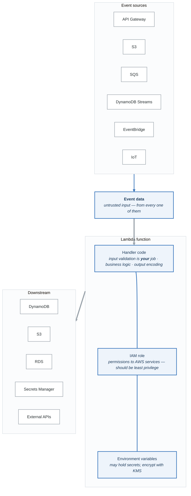

# Serverless Security for Threat Modeling

## Overview

Serverless architectures shift security responsibilities and introduce new threat patterns. This guide covers AWS Lambda, Azure Functions, and GCP Cloud Functions security considerations.

---

## Serverless Threat Landscape

**Traditional vs serverless attack surface**

| Layer | Traditional | Serverless |
|---|---|---|
| OS | You | Provider |
| Runtime | You | Provider |
| Dependencies | You | **Shared** |
| Application | You | **You** |
| Data | You | **You** |

Serverless removes two layers and concentrates the risk in the remaining three. That is a real
reduction — and it is why the threats that remain are *application* threats: event injection,
over-broad IAM roles, and dependencies. Nobody is going to compromise your Lambda by exploiting the
kernel.

### New Attack Vectors

| Attack Vector | Description | STRIDE |
|---------------|-------------|--------|
| Event injection | Malicious data in triggers | T |
| Function code injection | Exploit to modify code | T, E |
| Dependency poisoning | Malicious packages | T |
| Over-privileged IAM | Excessive permissions | E |
| Data exposure in logs | Sensitive data logged | I |
| Cold start exploitation | Race conditions | T, E |
| Shared /tmp abuse | Data leakage between invocations | I |

---

## AWS Lambda Security

### Lambda Attack Surface

<!-- figure: generated from the Mermaid below by _shared/diagrams/embed-figures.py — do not edit the image -->


<details>
<summary>Diagram source (Mermaid)</summary>



</details>

### Lambda IAM Threat Modeling

```yaml
# Over-privileged (BAD)
iam_policy_bad:
  Version: "2012-10-17"
  Statement:
    - Effect: Allow
      Action:
        - "*"
      Resource: "*"

# Least privilege (GOOD)
iam_policy_good:
  Version: "2012-10-17"
  Statement:
    - Effect: Allow
      Action:
        - dynamodb:GetItem
        - dynamodb:PutItem
      Resource:
        - "arn:aws:dynamodb:us-east-1:123456789:table/orders"
    - Effect: Allow
      Action:
        - s3:GetObject
      Resource:
        - "arn:aws:s3:::order-receipts/*"
```

### Event Injection Examples

```python
# Vulnerable Lambda handler
def handler(event, context):
    # Event from API Gateway
    user_input = event['body']

    # SQL Injection risk
    query = f"SELECT * FROM users WHERE id = '{user_input}'"

    # Command injection risk
    os.system(f"process_file.sh {user_input}")

    # Path traversal risk
    file_path = f"/tmp/{user_input}"
    open(file_path, 'r')

    # SSRF risk
    response = requests.get(user_input)
```

### Secure Lambda Pattern

```python
import json
import boto3
from aws_lambda_powertools import Logger, Tracer
from aws_lambda_powertools.utilities.validation import validate

logger = Logger()
tracer = Tracer()

# Define expected schema
INPUT_SCHEMA = {
    "type": "object",
    "properties": {
        "user_id": {"type": "string", "pattern": "^[a-zA-Z0-9-]+$"},
        "action": {"type": "string", "enum": ["read", "write"]}
    },
    "required": ["user_id", "action"]
}

@tracer.capture_lambda_handler
@logger.inject_lambda_context
def handler(event, context):
    # Validate input
    try:
        body = json.loads(event.get('body', '{}'))
        validate(event=body, schema=INPUT_SCHEMA)
    except Exception as e:
        logger.error("Validation failed", extra={"error": str(e)})
        return {"statusCode": 400, "body": "Invalid input"}

    # Use parameterized queries
    dynamodb = boto3.resource('dynamodb')
    table = dynamodb.Table('users')
    response = table.get_item(
        Key={'user_id': body['user_id']}  # Safe
    )

    return {"statusCode": 200, "body": json.dumps(response)}
```

---

## Azure Functions Security

### Key Threats

| Threat | Description | Mitigation |
|--------|-------------|------------|
| Function key exposure | Hardcoded or leaked keys | Managed identity, Key Vault |
| Binding injection | Malicious input via bindings | Input validation |
| Cross-function access | Accessing other function data | App isolation |
| Storage account abuse | Functions share storage | Separate storage accounts |

### Managed Identity Pattern

```csharp
// Secure: Using Managed Identity
public static async Task<IActionResult> Run(
    HttpRequest req,
    ILogger log)
{
    // Get token using Managed Identity
    var credential = new DefaultAzureCredential();

    // Access Key Vault securely
    var secretClient = new SecretClient(
        new Uri("https://myvault.vault.azure.net/"),
        credential
    );

    var secret = await secretClient.GetSecretAsync("api-key");

    // Use secret...
}
```

---

## GCP Cloud Functions Security

### Key Threats

| Threat | Description | Mitigation |
|--------|-------------|------------|
| Service account abuse | Over-privileged SA | Least privilege |
| Pub/Sub message injection | Malicious events | Message validation |
| Cloud Storage trigger abuse | Malicious file uploads | File validation |
| VPC connector misconfiguration | Network exposure | VPC Service Controls |

### Workload Identity Pattern

```python
# Secure: Using Workload Identity
from google.cloud import secretmanager

def handler(request):
    # Automatically uses function's service account
    client = secretmanager.SecretManagerServiceClient()

    name = "projects/my-project/secrets/api-key/versions/latest"
    response = client.access_secret_version(request={"name": name})

    secret = response.payload.data.decode("UTF-8")
    # Use secret...
```

---

## Serverless Threat Model Template

```yaml
system: Serverless Application
provider: AWS/Azure/GCP

functions:
  - name: OrderProcessor
    trigger: API Gateway
    runtime: Python 3.11

    data_inputs:
      - source: HTTP Request Body
        validation: JSON Schema
        sensitivity: Contains PII

    permissions:
      - DynamoDB: Read/Write to orders table
      - S3: Write to receipts bucket
      - Secrets Manager: Read API key

    threats:
      - name: Event injection
        vector: Malicious JSON in request
        stride: Tampering
        mitigation: Input validation, JSON schema

      - name: Over-privileged IAM
        vector: Function has excessive permissions
        stride: Elevation of Privilege
        mitigation: Least privilege roles

      - name: Secret exposure
        vector: Secrets in environment variables
        stride: Information Disclosure
        mitigation: Secrets Manager, encryption

      - name: Dependency vulnerability
        vector: Vulnerable npm/pip package
        stride: Tampering, Elevation
        mitigation: SCA scanning, lock files

    dependencies:
      - package: requests
        version: 2.28.0
        vulnerabilities: Check CVE database
```

---

## Serverless Security Checklist

```
Function Configuration:
□ Minimal IAM permissions (least privilege)
□ VPC configuration for internal resources
□ Timeout and memory limits set
□ Reserved concurrency for DoS protection
□ Dead letter queues for failed invocations

Secrets Management:
□ No secrets in environment variables (use Secrets Manager)
□ Encryption at rest enabled
□ KMS key rotation configured
□ Secret access audited

Input Handling:
□ All event data validated
□ JSON schema validation
□ Input sanitization
□ Error handling doesn't leak info

Dependencies:
□ Package versions pinned
□ Lock files committed
□ Vulnerability scanning in CI/CD
□ Minimal dependencies

Logging & Monitoring:
□ Structured logging (no sensitive data)
□ CloudWatch/Azure Monitor alerts
□ Tracing enabled (X-Ray, etc.)
□ Anomaly detection configured

Network:
□ VPC endpoints for AWS services
□ No public endpoints unless required
□ Egress controlled
□ mTLS for service-to-service
```

---

## Next Steps

→ [Infrastructure as Code Security](content-03-technical-skills-iac-security.md)
→ [API Security](content-03-technical-skills-api-security.md)

<!-- feynman-check -->

---

## Feynman check

Close the file. Blank page, no notes. Explain each of these to a competent engineer who has never
used this tool — **under five minutes, no jargon you can't define on the spot:**

- Serverless Threat Landscape
- AWS Lambda Security
- Azure Functions Security
- GCP Cloud Functions Security

**The gap is not what you forgot. It is where you used a word instead of a mechanism.**

| | |
|---|---|
| ✗ | *"We scan for vulnerabilities in the pipeline."* |
| ✓ | *"SAST reads source without running it, SCA resolves the dependency tree against an advisory database, and image scanning compares installed package versions to that same database. All three report what was known at build time — which is why the registry is re-scanned: the image does not change, the database does."* |

**Trace it:** A CVE published today against your base image → a blocked deploy. Name every component between the advisory and the refused `apply`.

Stop at the first component you cannot name. Reopen this file and read **only** that.

**Go deeper — only once the gap has a name:** the [SLSA threat model](https://slsa.dev/spec/v1.2/threats) — it names every point at which a build can be subverted, and most teams defend three of them.
Full list per domain: [`SOURCES.md`](../../SOURCES.md#devsecops)

→ Protocol, the three levels of knowing, and worked examples: [`MASTERY.md`](../../MASTERY.md)

<!-- /feynman-check -->
