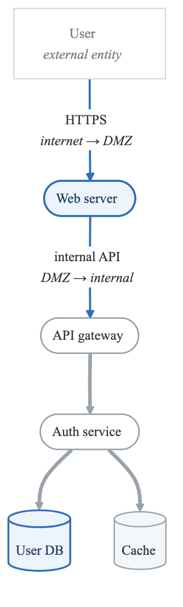
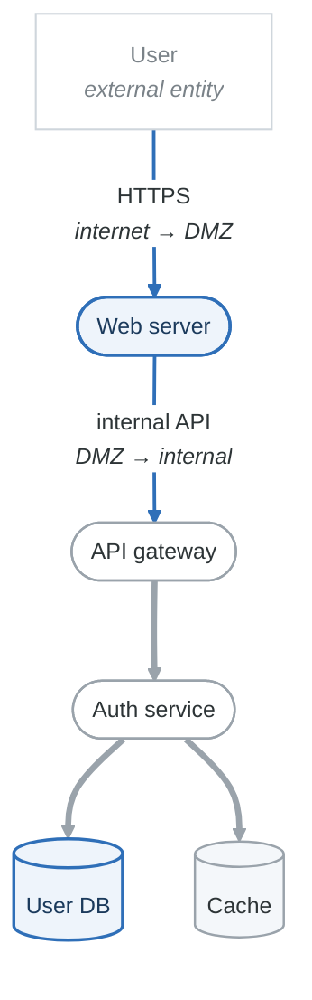
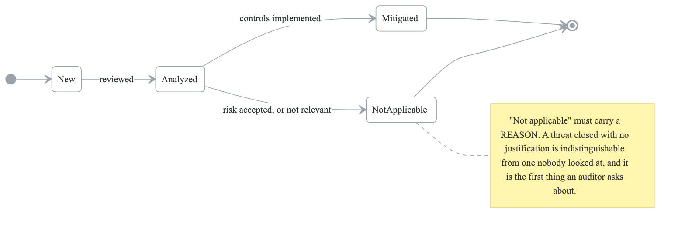
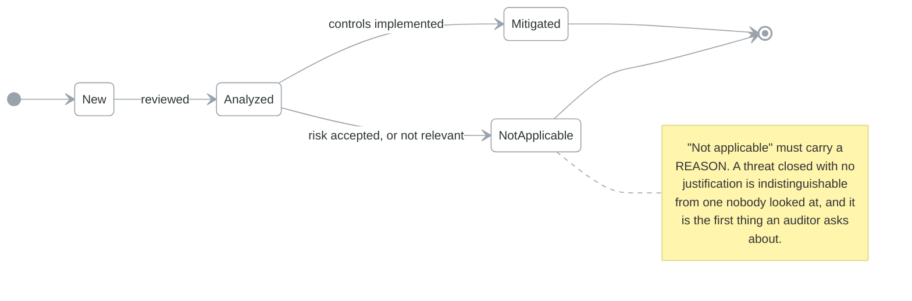

# OWASP Threat Dragon

## Overview

OWASP Threat Dragon is a free, open-source threat modeling tool that helps you create data flow diagrams and identify threats using STRIDE methodology.

**Key Features:**
- Web-based and desktop applications
- Visual diagram editor
- STRIDE threat generation
- Exportable reports
- Integration with GitHub

---

## Installation

### Web Version

Access directly at: https://www.threatdragon.com/

### Desktop Application

```bash
# Download from GitHub releases
# https://github.com/OWASP/threat-dragon/releases

# macOS
brew install --cask threat-dragon

# Windows
# Download .exe installer from releases

# Linux (AppImage)
chmod +x ThreatDragon-*.AppImage
./ThreatDragon-*.AppImage
```

### Docker

```bash
docker run -p 3000:3000 owasp/threat-dragon:stable
```

---

## Creating Your First Model

### Step 1: Create New Model

```
1. Open Threat Dragon
2. Click "New Model"
3. Enter model details:
   - Title: "E-Commerce API"
   - Owner: "Security Team"
   - Description: "Threat model for customer-facing API"
4. Click "Create"
```

### Step 2: Add Diagram

```
1. Click "Add Diagram"
2. Name: "Data Flow Diagram"
3. Diagram Type: "STRIDE"
4. Click "Create"
```

### Step 3: Add Elements

**Available Elements:**

| Element | Symbol | Use For |
|---------|--------|---------|
| Process | Circle | Applications, services, functions |
| Data Store | Parallel lines | Databases, files, caches |
| External Entity | Rectangle | Users, external systems |
| Data Flow | Arrow | Communication between elements |
| Trust Boundary | Dashed box | Security perimeters |

### Step 4: Configure Elements

For each element, configure:
- Name
- Description
- Out of scope (if applicable)
- Properties (technology, data processed)

---

## Building a Complete DFD

### Example: Web Application

```
Elements to add:
1. External Entity: "User" (outside trust boundary)
2. Process: "Web Server"
3. Process: "API Gateway"
4. Process: "Authentication Service"
5. Data Store: "User Database"
6. Data Store: "Session Cache"
7. Trust Boundary: "DMZ"
8. Trust Boundary: "Internal Network"

Data Flows:
- User → Web Server: HTTPS requests
- Web Server → API Gateway: Internal API calls
- API Gateway → Auth Service: Token validation
- Auth Service → User Database: Credential lookup
- Auth Service → Session Cache: Session storage
```

### Diagram Layout

<!-- figure: generated from the Mermaid below by _shared/diagrams/embed-figures.py — do not edit the image -->


<details>
<summary>Diagram source (Mermaid)</summary>



</details>

---

## Generating Threats

### Automatic Threat Generation

1. Select an element
2. Click "Threats" tab
3. Click "Generate Threats"
4. Review STRIDE threats

### STRIDE Per Element

| Element Type | Applicable STRIDE |
|--------------|-------------------|
| Process | S, T, R, I, D, E |
| Data Store | T, R, I, D |
| Data Flow | T, I, D |
| External Entity | S, R |

### Threat Properties

For each threat, document:

```yaml
threat:
  title: "SQL Injection in User Database"
  type: "Tampering"
  status: "Open"  # Open, Mitigated, Not Applicable
  severity: "High"
  description: |
    Attacker could inject malicious SQL through
    user input to modify database records.
  mitigation: |
    Use parameterized queries and input validation.
```

---

## Threat Status Workflow

<!-- figure: generated from the Mermaid below by _shared/diagrams/embed-figures.py — do not edit the image -->


<details>
<summary>Diagram source (Mermaid)</summary>



</details>

---

## Exporting Reports

### Available Formats

```bash
# PDF Report
File → Export → PDF

# Image Export
File → Export → PNG/SVG

# JSON Model
File → Export → JSON
```

### Report Sections

1. Model overview
2. Diagrams
3. Threat list
4. Mitigation status
5. Risk summary

---

## GitHub Integration

### Connecting to GitHub

```
1. Settings → GitHub
2. Authorize with GitHub OAuth
3. Select repository for threat models
4. Models stored as JSON files
```

### Workflow Integration

```yaml
# .github/workflows/threat-model.yml
name: Threat Model Review

on:
  pull_request:
    paths:
      - 'threat-models/**'

jobs:
  review:
    runs-on: ubuntu-latest
    steps:
      - uses: actions/checkout@v4

      - name: Validate Threat Model
        run: |
          # Custom validation script
          python scripts/validate_threat_model.py threat-models/*.json

      - name: Check for Open Threats
        run: |
          jq '.detail.diagrams[].cells[]?.threats[]? | select(.status == "Open")' \
            threat-models/*.json
```

---

## Best Practices

### Diagram Organization

```
Recommended structure:
1. Context Diagram (Level 0)
   - System as single process
   - External entities
   - High-level data flows

2. Component Diagram (Level 1)
   - Major components
   - Trust boundaries
   - Inter-component flows

3. Detailed Diagrams (Level 2+)
   - Specific services
   - Detailed data flows
   - Technology-specific
```

### Threat Documentation

```markdown
## Good Threat Description

**Title:** Authentication Bypass via Token Forgery

**Description:**
An attacker could forge JWT tokens by exploiting weak
signing algorithms (e.g., alg:none attack) to gain
unauthorized access to protected resources.

**Attack Scenario:**
1. Attacker intercepts valid JWT
2. Modifies claims (e.g., changes role to admin)
3. Sets alg header to "none"
4. Server accepts unsigned token

**Impact:**
- Unauthorized access to admin functions
- Data breach of all user records
- Compliance violation (PCI DSS)

**Mitigation:**
- Enforce RS256 algorithm validation
- Validate 'alg' header against whitelist
- Implement token binding
```

---

## Threat Dragon vs Other Tools

| Feature | Threat Dragon | MS TMT | Threagile |
|---------|---------------|--------|-----------|
| Free | ✓ | ✓ | ✓ |
| Open Source | ✓ | ✗ | ✓ |
| Web-based | ✓ | ✗ | ✗ |
| Desktop | ✓ | ✓ | ✗ |
| STRIDE | ✓ | ✓ | ✓ |
| Auto-generation | Basic | Advanced | Advanced |
| Code integration | ✗ | ✗ | ✓ |
| Custom rules | ✗ | ✓ | ✓ |

---

## Templates

### Web Application Template

```json
{
  "version": "2.0",
  "summary": {
    "title": "Web Application Template",
    "owner": "Security Team"
  },
  "detail": {
    "diagrams": [
      {
        "title": "Web App DFD",
        "cells": [
          {
            "type": "tm.Actor",
            "name": "User"
          },
          {
            "type": "tm.Process",
            "name": "Web Server"
          },
          {
            "type": "tm.Process",
            "name": "Application Server"
          },
          {
            "type": "tm.Store",
            "name": "Database"
          },
          {
            "type": "tm.Boundary",
            "name": "Trust Boundary"
          }
        ]
      }
    ]
  }
}
```

---

## Keyboard Shortcuts

| Action | Shortcut |
|--------|----------|
| New model | Ctrl/Cmd + N |
| Save | Ctrl/Cmd + S |
| Undo | Ctrl/Cmd + Z |
| Redo | Ctrl/Cmd + Shift + Z |
| Delete | Delete/Backspace |
| Copy | Ctrl/Cmd + C |
| Paste | Ctrl/Cmd + V |
| Zoom in | Ctrl/Cmd + + |
| Zoom out | Ctrl/Cmd + - |

---

## Next Steps

→ [Microsoft Threat Modeling Tool](content-04-tools-ms-tmt.md)
→ [pytm Python Library](content-04-tools-pytm.md)

<!-- feynman-check -->

---

## Feynman check

Close the file. Blank page, no notes. Explain each of these to a competent engineer who has never
used this tool — **under five minutes, no jargon you can't define on the spot:**

- Creating Your First Model
- Building a Complete DFD
- Generating Threats
- Threat Status Workflow

**The gap is not what you forgot. It is where you used a word instead of a mechanism.**

| | |
|---|---|
| ✗ | *"We scan for vulnerabilities in the pipeline."* |
| ✓ | *"SAST reads source without running it, SCA resolves the dependency tree against an advisory database, and image scanning compares installed package versions to that same database. All three report what was known at build time — which is why the registry is re-scanned: the image does not change, the database does."* |

**Trace it:** A CVE published today against your base image → a blocked deploy. Name every component between the advisory and the refused `apply`.

Stop at the first component you cannot name. Reopen this file and read **only** that.

**Go deeper — only once the gap has a name:** the [SLSA threat model](https://slsa.dev/spec/v1.2/threats) — it names every point at which a build can be subverted, and most teams defend three of them.
Full list per domain: [`SOURCES.md`](../../SOURCES.md#devsecops)

→ Protocol, the three levels of knowing, and worked examples: [`MASTERY.md`](../../MASTERY.md)

<!-- /feynman-check -->
