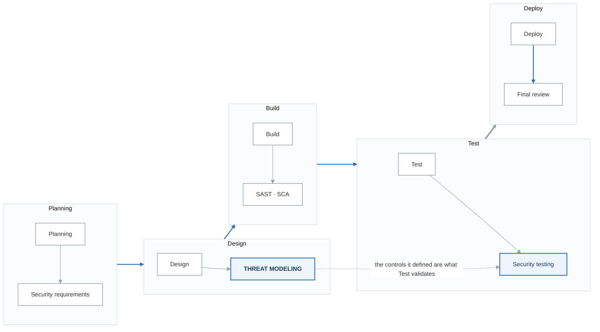

# Building a Threat Modeling Program

## Overview

A successful threat modeling program requires organizational buy-in, clear processes, trained practitioners, and continuous improvement. This guide covers how to build and scale threat modeling in an enterprise.

---

## Program Maturity Model

**Level 1: Ad-Hoc**

- Threat modeling done occasionally
- No standard process
- Depends on individual expertise
- Inconsistent results

**Level 2: Defined**

- Standard methodology selected
- Templates and tools available
- Some training provided
- Documented process

**Level 3: Managed**

- Integrated into SDLC
- Metrics tracked
- Regular training
- Central team support

**Level 4: Optimized**

- Automated tooling
- Threat intelligence integration
- Continuous improvement
- Business-aligned prioritization

**Level 5: Innovative**

- Threat modeling as code
- Real-time risk assessment
- Proactive threat hunting
- Industry leadership


---

## Getting Started

### 1. Assess Current State

```yaml
assessment_questions:
  process:
    - Is threat modeling performed today?
    - Who performs it?
    - What methodology is used?
    - How is it triggered?

  skills:
    - How many people can lead threat modeling?
    - What training exists?
    - Are there security champions?

  tools:
    - What tools are available?
    - Are threat models stored/tracked?
    - Is there integration with issue tracking?

  culture:
    - Is security valued by leadership?
    - Do developers see security as important?
    - Is there a security champion program?
```

### 2. Define Goals

```yaml
program_goals:
  short_term_90_days:
    - Train 10 threat modeling practitioners
    - Complete threat models for 5 critical systems
    - Select and deploy tooling

  medium_term_6_months:
    - Integrate into CI/CD pipeline
    - All new projects require threat model
    - Establish metrics and reporting

  long_term_12_months:
    - 50% of development teams self-sufficient
    - Automated threat model validation
    - Threat intelligence integration
```

### 3. Secure Executive Sponsorship

**Business Case Elements:**

| Benefit | Metric | Value |
|---------|--------|-------|
| Reduced remediation cost | Shift-left savings | 10-100x cheaper to fix in design |
| Compliance | Audit findings | Fewer findings, faster audits |
| Risk reduction | Breach probability | Lower likelihood |
| Efficiency | Security review time | Faster reviews with context |
| Confidence | Release velocity | Deploy faster with assurance |

---

## Program Components

### 1. Methodology & Process

**When to Threat Model:**

- New project/system
- Major architectural changes
- Security-relevant feature additions
- Third-party integrations
- Compliance requirements
- Before major releases
- Periodically (annual refresh)

Process Flow:
1. Trigger identified (new project, change)
2. Threat model request submitted
3. Preparation (gather artifacts)
4. Threat modeling session (2-4 hours)
5. Documentation (template completion)
6. Finding prioritization
7. Tracking in issue system
8. Validation and sign-off


### 2. Roles and Responsibilities

| Role | Responsibilities | Time Commitment |
|------|------------------|-----------------|
| Program Lead | Strategy, metrics, tooling | Full-time |
| Threat Modeling SME | Lead sessions, train others | 50-80% |
| Security Champion | Team liaison, basic modeling | 10-20% |
| Product Owner | Provide context, prioritize findings | Per session |
| Architect | Explain system design | Per session |
| Developers | Contribute domain knowledge | Per session |

### 3. Training Program

```yaml
training_tracks:
  awareness:
    audience: All developers
    duration: 2 hours
    topics:
      - What is threat modeling
      - Why it matters
      - Basic STRIDE concepts
      - How to participate

  practitioner:
    audience: Security champions, senior devs
    duration: 16 hours
    topics:
      - STRIDE deep dive
      - DFD creation
      - Threat identification
      - Risk prioritization
      - Tool usage
    certification: Lead threat models with support

  expert:
    audience: Security team, architects
    duration: 40 hours
    topics:
      - Multiple methodologies
      - Advanced scenarios
      - Facilitation skills
      - Custom threat libraries
      - Program management
    certification: Independent facilitator
```

### 4. Tooling Stack

| Category | Options | Purpose |
|----------|---------|---------|
| Modeling | Threat Dragon, MS TMT, Threagile | Create diagrams, generate threats |
| Documentation | Confluence, Git, SharePoint | Store and version models |
| Tracking | Jira, GitHub Issues, Azure DevOps | Track findings as issues |
| Automation | pytm, Threagile, custom scripts | CI/CD integration |
| Metrics | Custom dashboards, Power BI | Program measurement |

---

## SDLC Integration

### Integration Points

<!-- figure: generated from the Mermaid below by _shared/diagrams/embed-figures.py — do not edit the image -->


<details>
<summary>Diagram source (Mermaid)</summary>



</details>

### Gate Criteria

```yaml
design_gate:
  required:
    - Threat model completed
    - High/Critical risks addressed
    - Security requirements defined

release_gate:
  required:
    - Threat model current (within 6 months)
    - All high findings closed
    - Medium findings have plan
```

---

## Metrics and Reporting

### Program Metrics

| Metric | Target | Purpose |
|--------|--------|---------|
| Coverage | 100% critical systems | Adoption |
| Throughput | 10 threat models/month | Capacity |
| Cycle time | < 2 weeks request to complete | Efficiency |
| Finding discovery | 5-15 findings/model | Quality |
| Remediation rate | 80% high findings in 90 days | Effectiveness |
| Self-service rate | 50% led by champions | Scalability |

### Executive Dashboard

**Threat modelling programme dashboard**

| Area | Metric | Current |
|---|---|---|
| **Coverage** | Critical systems with a current threat model | 90% |
| **Throughput** | Models completed, month to date | 8 of 10 |
| **Findings** | Open | 45 |
| | Closed | 120 |
| **Training** | Certified facilitators | 25 |
| | In training | 8 |

**Risk distribution of open findings**

| Severity | Share |
|---|---|
| Critical | 5% |
| High | 20% |
| Medium | 45% |
| Low | 30% |

Coverage and throughput together are the honest pair. 90% coverage with 8 models a month says the
programme is keeping up; the same coverage with 2 a month says you are looking at a snapshot that is
quietly going stale.

The distribution is the second sanity check. A programme reporting 40% critical findings is either
in serious trouble or has no severity discipline — and it is almost always the second.

---

## Common Challenges

### Challenge: "No Time for Threat Modeling"

**Solutions:**
- Integrate into existing design reviews
- Provide templates that reduce effort
- Show ROI of early finding discovery
- Start with high-risk projects only

### Challenge: "We Don't Have Security Experts"

**Solutions:**
- Train security champions
- Use automated tools
- Provide library of common threats
- External support for critical systems

### Challenge: "Threat Models Get Stale"

**Solutions:**
- Link to architecture documentation
- Trigger refresh on changes
- Automated drift detection
- Annual review process

### Challenge: "Findings Don't Get Fixed"

**Solutions:**
- Integrate with issue tracking
- Include in sprint planning
- Report to leadership
- Gate releases on high findings

---

## Implementation Roadmap

**Phase 1: Foundation (Months 1-3)**

- Secure executive sponsor
- Select methodology (STRIDE recommended)
- Deploy basic tooling
- Train initial practitioners (5-10)
- Pilot with 3-5 projects
- Document lessons learned

**Phase 2: Expansion (Months 4-6)**

- Train security champions
- Integrate with SDLC gates
- Establish metrics
- Expand to all new projects
- Create threat library

**Phase 3: Optimization (Months 7-12)**

- Automate where possible
- Self-service enablement
- Continuous improvement
- Advanced training
- Industry benchmarking


---

## Next Steps

→ [Compliance Mapping](content-05-enterprise-compliance-mapping.md)
→ [Scaling Threat Modeling](content-05-enterprise-scaling.md)

<!-- feynman-check -->

---

## Feynman check

Close the file. Blank page, no notes. Explain each of these to a competent engineer who has never
used this tool — **under five minutes, no jargon you can't define on the spot:**

- Program Maturity Model
- Program Components
- SDLC Integration
- Metrics and Reporting

**The gap is not what you forgot. It is where you used a word instead of a mechanism.**

| | |
|---|---|
| ✗ | *"We scan for vulnerabilities in the pipeline."* |
| ✓ | *"SAST reads source without running it, SCA resolves the dependency tree against an advisory database, and image scanning compares installed package versions to that same database. All three report what was known at build time — which is why the registry is re-scanned: the image does not change, the database does."* |

**Trace it:** A CVE published today against your base image → a blocked deploy. Name every component between the advisory and the refused `apply`.

Stop at the first component you cannot name. Reopen this file and read **only** that.

**Go deeper — only once the gap has a name:** the [SLSA threat model](https://slsa.dev/spec/v1.2/threats) — it names every point at which a build can be subverted, and most teams defend three of them.
Full list per domain: [`SOURCES.md`](../../SOURCES.md#devsecops)

→ Protocol, the three levels of knowing, and worked examples: [`MASTERY.md`](../../MASTERY.md)

<!-- /feynman-check -->
