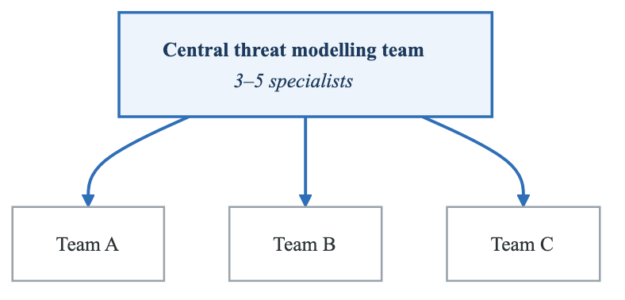
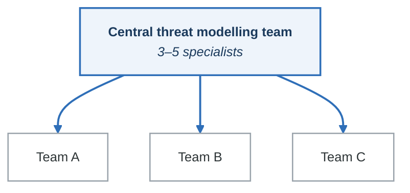
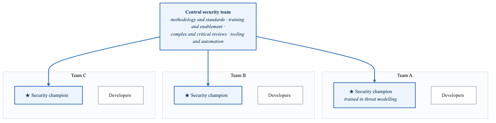
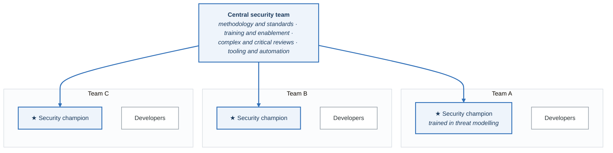
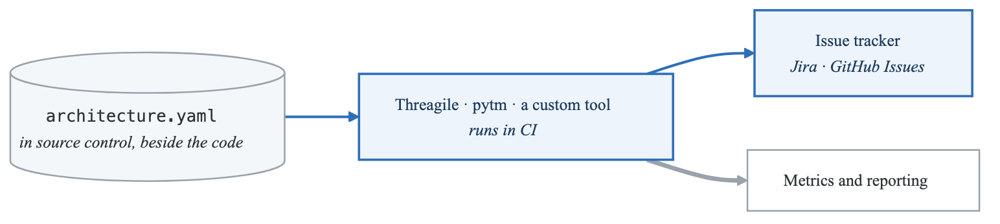
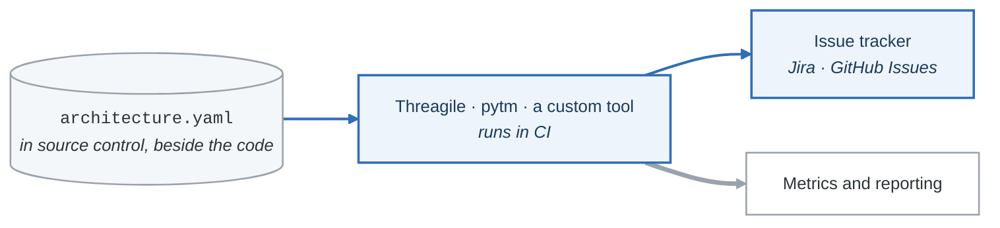

# Scaling Threat Modeling

## Overview

As organizations grow, threat modeling must scale beyond a central security team. This guide covers strategies for scaling threat modeling across large enterprises.

---

## Scaling Models

### Centralized Model

<!-- figure: generated from the Mermaid below by _shared/diagrams/embed-figures.py — do not edit the image -->


<details>
<summary>Diagram source (Mermaid)</summary>



</details>

### Federated Model (Recommended)

<!-- figure: generated from the Mermaid below by _shared/diagrams/embed-figures.py — do not edit the image -->


<details>
<summary>Diagram source (Mermaid)</summary>



</details>

### Hybrid Model

```yaml
hybrid_approach:
  tier_1_self_service:
    scope: Low-risk changes, simple features
    ownership: Development team
    support: Templates, automated tools
    review: Spot check by security

  tier_2_champion_led:
    scope: Medium complexity, new services
    ownership: Security champion
    support: Training, office hours
    review: Security team review

  tier_3_expert_led:
    scope: Critical systems, complex architecture
    ownership: Security team
    support: Deep engagement
    review: Full security review
```

---

## Security Champion Program

### Role Definition

```yaml
security_champion:
  selection_criteria:
    - Interest in security
    - Technical credibility with team
    - Communication skills
    - At least 2 years in role

  time_commitment:
    - 10-20% of time on security activities
    - Monthly community meetings
    - Quarterly training

  responsibilities:
    - Lead threat models for team projects
    - Triage security findings
    - Escalate complex issues
    - Represent security in team discussions
    - Share learnings with community

  benefits:
    - Training and certification
    - Career development
    - Recognition
    - Community membership
```

### Champion Training Path

**Level 1: Security Awareness (All developers)**

- Security fundamentals
- Secure coding basics
- How to participate in threat modeling

**Level 2: Champion Foundation**

- STRIDE methodology
- DFD creation
- Basic facilitation
- Using threat modeling tools
- Certification: Can participate in sessions

**Level 3: Champion Practitioner**

- Lead sessions independently
- Risk assessment
- Finding prioritization
- Tool customization
- Certification: Can lead standard threat models

**Level 4: Champion Expert**

- Complex architectures
- Multiple methodologies
- Train other champions
- Program improvement
- Certification: Mentor and trainer


---

## Self-Service Enablement

### Questionnaire-Based Approach

```yaml
self_service_questionnaire:
  system_classification:
    - Does it process PII? [Yes/No]
    - Does it process payment data? [Yes/No]
    - Is it internet-facing? [Yes/No]
    - Does it integrate with external systems? [Yes/No]
    - What is the business criticality? [Low/Medium/High/Critical]

  routing_logic:
    full_threat_model_required:
      - PII or payment data: Yes
      - Internet-facing + High/Critical: Yes
      - Any Critical: Yes

    champion_led:
      - Medium complexity without PII/payment
      - Internal systems with moderate risk

    self_service_template:
      - Low risk, simple changes
      - Internal tools
```

### Templates by System Type

| System Type | Template | Complexity |
|-------------|----------|------------|
| Web API | API threat template | Medium |
| Internal tool | Basic STRIDE checklist | Low |
| Mobile app | Mobile app template | Medium |
| Data pipeline | Data flow template | Medium |
| Microservice | Service mesh template | High |
| Cloud infrastructure | IaC security template | High |

---

## Automation Strategies

### Threat Modeling as Code

```yaml
# Automated threat model generation
automation_pipeline:
  trigger: PR to architecture/main
  steps:
    - parse_architecture:
        input: architecture.yaml
        output: dfd.json

    - generate_threats:
        input: dfd.json
        rules: company_threat_rules.yaml
        output: threats.json

    - assess_risk:
        input: threats.json
        data_classification: data_catalog.yaml
        output: risks.json

    - create_issues:
        input: risks.json
        threshold: medium
        target: jira

    - update_dashboard:
        input: risks.json
        target: security_dashboard
```

### Integration Points

<!-- figure: generated from the Mermaid below by _shared/diagrams/embed-figures.py — do not edit the image -->


<details>
<summary>Diagram source (Mermaid)</summary>



</details>

---

## Metrics for Scaling

### Coverage Metrics

| Metric | Formula | Target |
|--------|---------|--------|
| System coverage | Systems with TM / Total systems | 100% critical, 80% all |
| Champion coverage | Teams with champion / Total teams | 100% |
| Self-service rate | Self-service TMs / Total TMs | 50-70% |
| Champion-led rate | Champion-led TMs / Total TMs | 20-40% |
| Expert-led rate | Expert-led TMs / Total TMs | 10-20% |

### Efficiency Metrics

| Metric | Formula | Target |
|--------|---------|--------|
| Cycle time | Median time request to complete | < 2 weeks |
| Session duration | Average threat model session | 2-4 hours |
| Rework rate | TMs requiring significant revision | < 10% |
| Automation rate | Auto-generated threats / Total threats | > 50% |

### Quality Metrics

| Metric | Formula | Target |
|--------|---------|--------|
| Finding validation | Findings confirmed valid | > 80% |
| Coverage depth | Avg threats per component | 3-5 |
| Remediation rate | High findings fixed in SLA | > 90% |
| Satisfaction score | Champion/team satisfaction | > 4/5 |

---

## Scaling Challenges

### Challenge: Champion Burnout

**Solutions:**
- Limit champion responsibilities to 20%
- Rotate champions
- Provide recognition and career growth
- Hire more security staff

### Challenge: Inconsistent Quality

**Solutions:**
- Standard templates and checklists
- Peer review of threat models
- Quality scoring and feedback
- Ongoing training

### Challenge: Tool Adoption

**Solutions:**
- Choose tools that integrate with existing workflows
- Provide training and documentation
- Show value through automation
- Iterate based on feedback

### Challenge: Keeping Models Current

**Solutions:**
- Trigger reviews on architecture changes
- Automated drift detection
- Annual refresh requirement
- Link models to living documentation

---

## Implementation Checklist

```
Foundation:
□ Methodology selected and documented
□ Templates created for common scenarios
□ Tooling deployed and tested
□ Training program designed

Champion Program:
□ Champion role defined
□ Selection criteria established
□ Training curriculum created
□ Community structure set up
□ Recognition program defined

Self-Service:
□ Questionnaire for routing
□ Self-service templates available
□ Automation for simple cases
□ Escalation path clear

Metrics:
□ Coverage dashboard live
□ Efficiency tracking in place
□ Quality metrics defined
□ Regular reporting to leadership

Continuous Improvement:
□ Feedback collection mechanism
□ Quarterly program reviews
□ Annual methodology updates
□ Benchmarking against industry
```

---

## Next Steps

→ [Risk Communication](risk-communication.md)
→ [Building a Program](building-program.md)

<!-- feynman-check -->

---

## Feynman check

Close the file. Blank page, no notes. Explain each of these to a competent engineer who has never
used this tool — **under five minutes, no jargon you can't define on the spot:**

- Scaling Models
- Security Champion Program
- Self-Service Enablement
- Automation Strategies

**The gap is not what you forgot. It is where you used a word instead of a mechanism.**

| | |
|---|---|
| ✗ | *"We scan for vulnerabilities in the pipeline."* |
| ✓ | *"SAST reads source without running it, SCA resolves the dependency tree against an advisory database, and image scanning compares installed package versions to that same database. All three report what was known at build time — which is why the registry is re-scanned: the image does not change, the database does."* |

**Trace it:** A CVE published today against your base image → a blocked deploy. Name every component between the advisory and the refused `apply`.

Stop at the first component you cannot name. Reopen this file and read **only** that.

**Go deeper — only once the gap has a name:** the [SLSA threat model](https://slsa.dev/spec/v1.2/threats) — it names every point at which a build can be subverted, and most teams defend three of them.
Full list per domain: [`SOURCES.md`](../../SOURCES.md#devsecops)

→ Protocol, the three levels of knowing, and worked examples: [`MASTERY.md`](../../MASTERY.md)

<!-- /feynman-check -->
