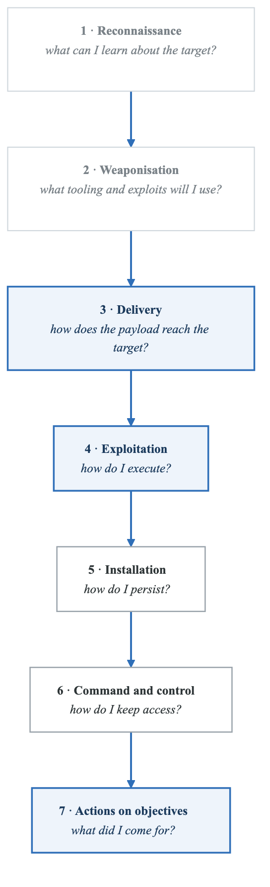
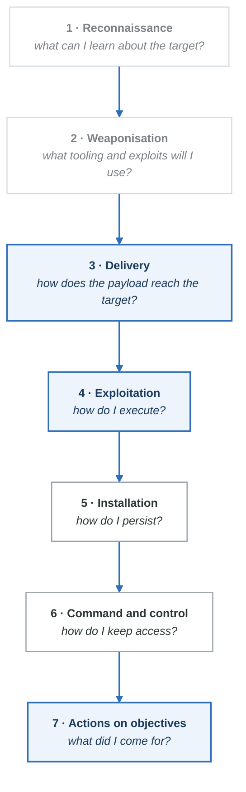
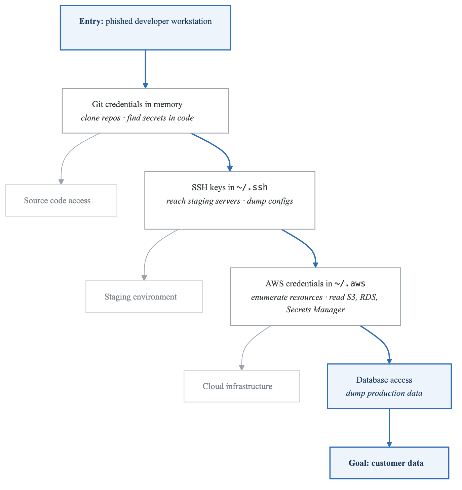
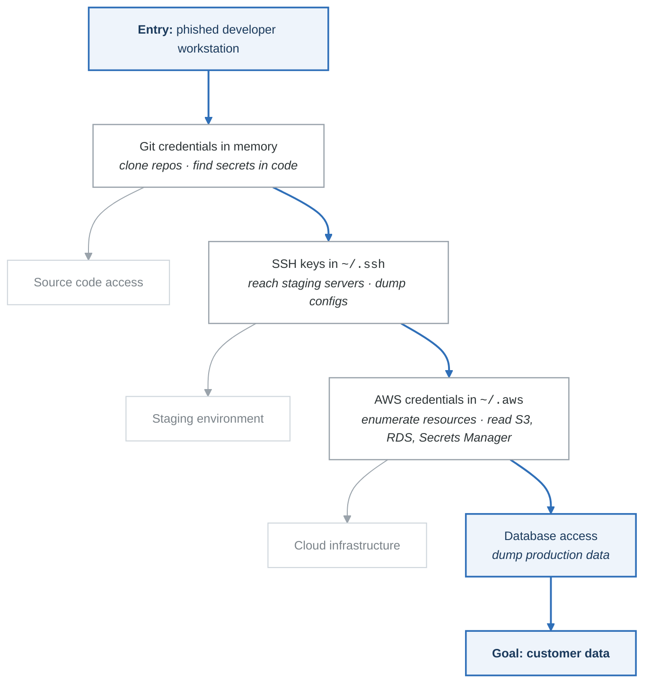

# Adversarial Thinking for Threat Modeling

## Overview

Adversarial thinking is the ability to adopt an attacker's perspective to identify vulnerabilities and attack paths that defenders might overlook. This guide covers techniques to develop and apply adversarial thinking in threat modeling.

---

## The Attacker Mindset

### Defender vs Attacker Perspective

**Defender and attacker mindsets**

| Defender | Attacker |
|---|---|
| *"How do I protect everything?"* | *"How do I get in anywhere?"* |
| Must defend **every** entry point | Needs **one** vulnerability |
| Bounded by budget and headcount | Creative, persistent, patient |
| Follows policy and procedure | Ignores rules, exploits assumptions |
| Focused on **intended** behaviour | Focused on **unintended** behaviour |

The last row is the one to internalise. Every threat model is an exercise in temporarily abandoning
the question *"does this work?"* for the question *"what else does this do?"* — and the people who
built the system are the worst at it, because they have spent months teaching themselves to think
about the intended path.

### Attacker Economics

```yaml
attacker_economics:
  motivation_drivers:
    financial:
      - Ransomware: Average payment $200K-$1M
      - Data theft: $150-$350 per record
      - Fraud: Direct monetary gain
      - Cryptomining: Ongoing revenue

    espionage:
      - Trade secrets: Competitive advantage
      - State secrets: National security
      - Research: Billions in R&D savings

    disruption:
      - Hacktivism: Publicity, impact
      - Nation-state: Geopolitical goals
      - Revenge: Personal satisfaction

  cost_benefit_analysis:
    attack_costs:
      - Tool acquisition: $0-$50K (or free)
      - Infrastructure: $100-$10K/month
      - Time/expertise: Primary investment
      - Legal risk: Varies by jurisdiction

    decision_factors:
      - Expected value = (Probability of success × Payout) - Costs
      - Low-hanging fruit prioritized
      - Path of least resistance preferred
      - Automation increases ROI

  implications_for_defense:
    - Increase attacker costs (defense in depth)
    - Decrease attacker ROI (limit blast radius)
    - Raise detection probability (monitoring)
    - Make alternatives more attractive
```

---

## Attack Path Analysis

### Kill Chain Thinking

<!-- figure: generated from the Mermaid below by _shared/diagrams/embed-figures.py — do not edit the image -->


<details>
<summary>Diagram source (Mermaid)</summary>



</details>

### Attack Tree Development

```yaml
attack_tree_example:
  goal: Steal customer payment data

  OR_branches:
    - path: Compromise web application
      AND_steps:
        - Find SQL injection vulnerability
        - Extract database credentials
        - Dump customer table
        - Exfiltrate data
      difficulty: Medium
      detection_risk: Medium

    - path: Phish employee
      AND_steps:
        - Research target employees
        - Craft convincing email
        - Deploy credential harvester
        - Access internal systems
        - Pivot to payment database
      difficulty: Low
      detection_risk: Low-Medium

    - path: Supply chain attack
      AND_steps:
        - Identify third-party vendor
        - Compromise vendor
        - Inject malicious code
        - Wait for victim deployment
        - Harvest payment data
      difficulty: High
      detection_risk: Very Low

    - path: Insider threat
      AND_steps:
        - Recruit or coerce employee
        - Access legitimate systems
        - Export data
      difficulty: Variable
      detection_risk: Medium

  attacker_preference_order: [2, 1, 4, 3]  # By ROI
```

### Lateral Movement Mapping

<!-- figure: generated from the Mermaid below by _shared/diagrams/embed-figures.py — do not edit the image -->


<details>
<summary>Diagram source (Mermaid)</summary>



</details>

---

## Assumptions Attackers Exploit

### Common Defender Assumptions

```yaml
dangerous_assumptions:
  - assumption: "Attackers need sophisticated tools"
    reality: Most attacks use commodity tools and living-off-the-land
    exploitation: PowerShell, WMI, native OS tools bypass detection

  - assumption: "Our perimeter is secure"
    reality: Identity is the new perimeter; cloud and remote work blur boundaries
    exploitation: Credential theft, OAuth abuse, VPN vulnerabilities

  - assumption: "Employees won't fall for phishing"
    reality: 1-3% click rate is typical; only need one victim
    exploitation: Spearphishing, vishing, MFA fatigue

  - assumption: "Our vendors are secure"
    reality: Supply chain is only as strong as weakest link
    exploitation: Third-party access, software supply chain attacks

  - assumption: "Attackers want our production data"
    reality: Development/staging often has production data copies
    exploitation: Less-monitored environments, weaker controls

  - assumption: "We'd detect an intrusion quickly"
    reality: Average dwell time is months
    exploitation: Low-and-slow attacks, living-off-the-land

  - assumption: "Our data isn't valuable"
    reality: All data has value; access can be sold/leveraged
    exploitation: Ransomware targets everyone; data enables pivoting
```

### Trust Boundary Violations

```yaml
trust_boundary_exploits:
  network_segmentation:
    assumption: "VLANs isolate networks"
    attack: "VLAN hopping, shared services bridge segments"

  authentication:
    assumption: "MFA stops credential theft"
    attack: "Session token theft, adversary-in-the-middle, MFA fatigue"

  encryption:
    assumption: "TLS secures all traffic"
    attack: "Certificate manipulation, endpoint compromise, traffic analysis"

  cloud_isolation:
    assumption: "VPCs are isolated"
    attack: "Metadata service abuse, cross-account roles, shared services"

  container_isolation:
    assumption: "Containers are sandboxed"
    attack: "Container escape, shared kernel, privileged containers"

  service_accounts:
    assumption: "Service accounts are controlled"
    attack: "Overprivileged permissions, key theft, impersonation"
```

---

## Adversarial Exercises

### Purple Team Threat Modeling

```yaml
purple_team_exercise:
  purpose: Validate threat model findings with practical testing

  participants:
    - Red team: Simulate attacks
    - Blue team: Detect and respond
    - Threat modeler: Document gaps

  process:
    1_select_scenarios:
      - Choose high-risk threats from model
      - Prioritize by likelihood and impact
      - Define success criteria

    2_plan_attack:
      - Red team develops attack plan
      - Blue team prepares monitoring
      - Establish rules of engagement

    3_execute:
      - Red team executes attack path
      - Blue team monitors for detection
      - Document timeline and observations

    4_analyze:
      - What was detected?
      - What was missed?
      - How effective were controls?

    5_update_threat_model:
      - Add newly discovered paths
      - Update risk ratings
      - Document control gaps

  example_scenario:
    threat: "Attacker steals developer credentials"
    attack_steps:
      - Phishing email with credential harvester
      - Use credentials to access GitHub
      - Clone repositories
      - Search for secrets in code
      - Use secrets to access cloud resources
    success_criteria:
      - Time to detection
      - Alerts generated
      - Response effectiveness
```

### Tabletop Exercises

```yaml
tabletop_format:
  scenario: "A critical zero-day in your main framework is announced"

  phases:
    - name: Discovery
      time: T+0
      questions:
        - How would we learn about this vulnerability?
        - Who needs to be notified?
        - What's our initial response?

    - name: Assessment
      time: T+1 hour
      questions:
        - How do we inventory affected systems?
        - What's the potential impact?
        - Are we already compromised?

    - name: Exploitation Active
      time: T+24 hours
      questions:
        - Attackers are exploiting this in the wild
        - Can we detect exploitation attempts?
        - What's our mitigation strategy?

    - name: Compromise Suspected
      time: T+48 hours
      questions:
        - We see suspicious activity
        - How do we investigate?
        - When do we escalate to incident?

    - name: Lessons Learned
      questions:
        - What gaps did this reveal?
        - How should we update our threat model?
        - What controls would have helped?
```

---

## Thinking Like Specific Attackers

### By Motivation

```yaml
financially_motivated:
  mindset:
    - ROI focused
    - Automation preferred
    - Scalable attacks
    - Quick monetization

  targets:
    - Low-hanging fruit
    - High-value data
    - Ransomable systems

  ttps:
    - Commodity malware
    - Phishing at scale
    - Known vulnerabilities

  threat_model_focus:
    - Patch management
    - Backup/recovery
    - Data classification

nation_state:
  mindset:
    - Mission focused
    - Patient (months/years)
    - Resource rich
    - Stealthy

  targets:
    - Specific intelligence
    - Strategic access
    - Supply chain

  ttps:
    - Zero-days
    - Custom tooling
    - Living-off-the-land

  threat_model_focus:
    - Detection capability
    - Insider threats
    - Supply chain security

hacktivist:
  mindset:
    - Publicity seeking
    - Impact focused
    - Ideologically driven

  targets:
    - Public-facing systems
    - Reputational damage
    - Data leaks

  ttps:
    - DDoS
    - Defacement
    - Data dumps

  threat_model_focus:
    - Availability
    - Reputation
    - Public attack surface
```

### Attacker Persona Exercise

```yaml
exercise_create_persona:
  step_1_define_actor:
    name: "Budget Bob" (opportunistic criminal)
    motivation: Quick profit
    skills: Script kiddie level
    resources: Free tools, shared infrastructure
    risk_tolerance: Low (avoids well-defended targets)

  step_2_attack_planning:
    questions_as_bob:
      - What can I find with Shodan?
      - Are there known CVEs with exploits?
      - Can I buy access on dark web?
      - What's the fastest path to payment?

  step_3_attack_execution:
    bob_priorities:
      - Scan for vulnerable services
      - Try default credentials
      - Deploy ransomware
      - Demand quick payment

  step_4_defense_evaluation:
    would_bob_succeed:
      - Are we running vulnerable software?
      - Do we have default passwords?
      - Would we detect scanning?
      - Could we recover without paying?

  repeat_with_other_personas:
    - "Advanced Amy" (APT operator)
    - "Insider Ivan" (disgruntled employee)
    - "Contractor Carl" (third-party risk)
```

---

## Practical Techniques

### Abuse Case Development

```yaml
abuse_cases:
  use_case: "User resets password"

  abuse_cases:
    - name: Account takeover via password reset
      actor: External attacker
      steps:
        - Enumerate valid usernames
        - Request password reset for victim
        - Intercept reset email (compromised email)
        - Set new password
        - Access victim account
      mitigations:
        - Rate limiting on reset requests
        - MFA requirement after reset
        - Email verification delay
        - Notify account of reset attempt

    - name: Reset mechanism bypass
      actor: External attacker
      steps:
        - Analyze reset token format
        - Predict or brute-force token
        - Use token to reset password
      mitigations:
        - Cryptographically random tokens
        - Short token expiration
        - Single-use tokens
        - Token binding to account

    - name: Social engineering help desk
      actor: External attacker
      steps:
        - Call help desk as victim
        - Convince to reset password
        - Receive temporary password
      mitigations:
        - Identity verification procedures
        - No phone-based password resets
        - Callback verification
```

### "How Would I Attack This?"

```yaml
adversarial_questions:
  for_each_component:
    - What's the most valuable asset here?
    - What's the weakest link in the chain?
    - How would I get in with minimal effort?
    - Once in, how would I move laterally?
    - How would I avoid detection?
    - How would I maintain access?
    - What would I steal/destroy?
    - How would I cover my tracks?

  for_each_control:
    - How would I bypass this?
    - Is there a way around it?
    - Does it have default configurations?
    - What happens if it fails?
    - Does it create new attack surface?

  for_each_data_flow:
    - Can I intercept this?
    - Can I inject into this?
    - Can I manipulate this?
    - What credentials flow here?
```

---

## Building Adversarial Skills

### Training Resources

| Resource | Type | Focus |
|----------|------|-------|
| HackTheBox | Labs | Practical exploitation |
| TryHackMe | Guided | Beginner-friendly |
| PortSwigger Academy | Web | Web application attacks |
| SANS Cyber Ranges | Labs | Enterprise scenarios |
| ATT&CK Evaluations | Reports | Real-world TTPs |
| Threat reports | Reading | Attacker behaviors |

### Daily Practice

```
Weekly activities:
□ Read one threat report
□ Map one attack to ATT&CK
□ Analyze one breach case study
□ Practice one attack technique (lab)
□ Update one threat model with adversarial scenario

Monthly activities:
□ Conduct tabletop exercise
□ Review threat landscape changes
□ Update attack personas
□ Validate controls against new techniques
```

---

## Next Steps

→ [AI/ML Threat Modeling](ai-ml-threats.md)
→ [Supply Chain Security](supply-chain.md)

<!-- feynman-check -->

---

## Feynman check

Close the file. Blank page, no notes. Explain each of these to a competent engineer who has never
used this tool — **under five minutes, no jargon you can't define on the spot:**

- The Attacker Mindset
- Attack Path Analysis
- Assumptions Attackers Exploit
- Thinking Like Specific Attackers

**The gap is not what you forgot. It is where you used a word instead of a mechanism.**

| | |
|---|---|
| ✗ | *"We scan for vulnerabilities in the pipeline."* |
| ✓ | *"SAST reads source without running it, SCA resolves the dependency tree against an advisory database, and image scanning compares installed package versions to that same database. All three report what was known at build time — which is why the registry is re-scanned: the image does not change, the database does."* |

**Trace it:** A CVE published today against your base image → a blocked deploy. Name every component between the advisory and the refused `apply`.

Stop at the first component you cannot name. Reopen this file and read **only** that.

**Go deeper — only once the gap has a name:** the [SLSA threat model](https://slsa.dev/spec/v1.2/threats) — it names every point at which a build can be subverted, and most teams defend three of them.
Full list per domain: [`SOURCES.md`](../../SOURCES.md#devsecops)

→ Protocol, the three levels of knowing, and worked examples: [`MASTERY.md`](../../MASTERY.md)

<!-- /feynman-check -->
