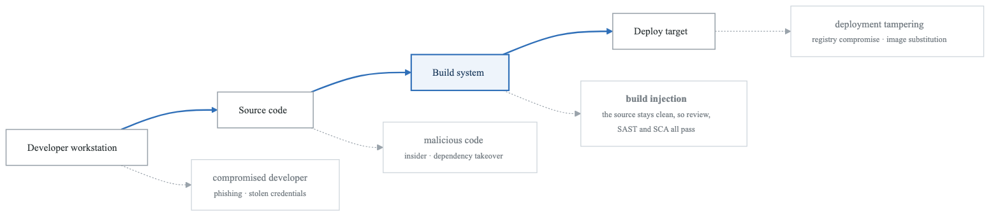
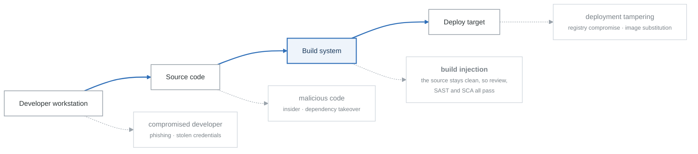
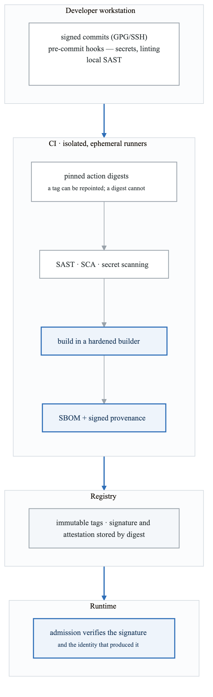
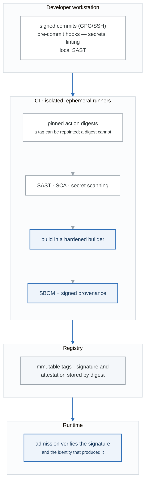

# Supply Chain Security Threat Modeling

## Overview

Supply chain attacks target the trust relationships between organizations and their suppliers, vendors, and dependencies. This guide covers threat modeling for software supply chains, third-party integrations, and vendor relationships.

---

## Supply Chain Attack Surface

<!-- figure: generated from the Mermaid below by _shared/diagrams/embed-figures.py — do not edit the image -->


<details>
<summary>Diagram source (Mermaid)</summary>



</details>

---

## SLSA Framework

### Supply-chain Levels for Software Artifacts

```yaml
slsa_levels:
  level_0:
    name: No guarantees
    requirements: None
    threats_addressed: None

  level_1:
    name: Documentation of build process
    requirements:
      - Build process defined and documented
      - Provenance generated automatically
    threats_addressed:
      - Basic understanding of build

  level_2:
    name: Tamper resistance of build service
    requirements:
      - Version control for source
      - Build service generates provenance
      - Hosted build platform
    threats_addressed:
      - Tampering during build
      - Source integrity

  level_3:
    name: Extra resistance to specific threats
    requirements:
      - Source verified through history
      - Hermetic builds
      - Isolated builds
      - Parameterless builds
    threats_addressed:
      - Source tampering
      - Build parameter manipulation
      - Cross-build contamination

  level_4:
    name: Highest confidence
    requirements:
      - Two-person review
      - Hermetic, reproducible builds
      - Continuous security testing
    threats_addressed:
      - Insider threats
      - Compromised credentials
```

### SLSA Implementation

```yaml
slsa_implementation:
  source:
    requirements:
      - Git with signed commits
      - Branch protection rules
      - Code review required
      - Protected branches
    tools:
      - GitHub/GitLab protected branches
      - Signed commits (GPG/SSH)

  build:
    requirements:
      - Hermetic build environment
      - Pinned dependencies
      - Build from clean checkout
      - Generate SBOM
    tools:
      - GitHub Actions
      - Cloud Build
      - Tekton

  provenance:
    requirements:
      - Attestation of build
      - Non-forgeable
      - Authenticated source
    tools:
      - Sigstore
      - in-toto
      - SLSA GitHub Generator

  verification:
    requirements:
      - Verify signatures
      - Check provenance
      - Validate SBOM
    tools:
      - cosign
      - slsa-verifier
      - syft
```

---

## Dependency Threats

### Open Source Dependency Attacks

```yaml
dependency_attacks:
  typosquatting:
    description: Register similar package names
    examples:
      - lodash → lodahs
      - requests → request
      - tensorflow → tensorfIow (capital i)
    detection:
      - Package name similarity analysis
      - Installation age/popularity checks
      - Author verification

  dependency_confusion:
    description: Exploit priority of public vs private registries
    examples:
      - Upload public package with internal name
      - Higher version number takes precedence
    detection:
      - Namespace scoping
      - Registry prioritization
      - Dependency locking

  account_takeover:
    description: Compromise maintainer account
    examples:
      - UA-Parser-JS (2021)
      - event-stream (2018)
      - node-ipc (2022)
    detection:
      - Maintainer activity monitoring
      - Unexpected version changes
      - Code diff analysis

  abandoned_packages:
    description: Take over unmaintained packages
    examples:
      - Request maintainership transfer
      - Domain hijacking for email
    detection:
      - Maintainer activity tracking
      - Ownership change alerts

  malicious_updates:
    description: Push compromised version of legitimate package
    examples:
      - OrionSoft (build compromise)
      - Codecov (script injection)
    detection:
      - Version pinning
      - Code signing verification
      - Behavioral analysis
```

### SBOM (Software Bill of Materials)

```yaml
sbom:
  purpose: Inventory of all components in software

  formats:
    - SPDX (Linux Foundation)
    - CycloneDX (OWASP)
    - SWID Tags (ISO)

  contents:
    - Component name and version
    - Supplier information
    - Dependency relationships
    - License information
    - Vulnerability references

  generation_tools:
    - syft (Anchore)
    - trivy (Aqua)
    - cdxgen (CycloneDX)
    - spdx-sbom-generator

  usage:
    vulnerability_management:
      - Match components against vulnerability databases
      - Track affected versions
      - Prioritize remediation

    license_compliance:
      - Identify license obligations
      - Detect incompatible licenses

    supply_chain_visibility:
      - Understand dependency tree
      - Identify risky dependencies
      - Track component provenance

  example_workflow:
    - Generate SBOM during build
    - Sign SBOM with Sigstore
    - Store with artifact
    - Verify SBOM at deployment
    - Continuous vulnerability scanning
```

---

## Third-Party Vendor Risk

### Vendor Assessment Framework

```yaml
vendor_assessment:
  security_evaluation:
    questionnaires:
      - SIG (Standardized Information Gathering)
      - CAIQ (Consensus Assessments Initiative)
      - Custom security questionnaire

    certifications:
      - SOC 2 Type II
      - ISO 27001
      - FedRAMP
      - HITRUST

    technical_assessment:
      - Penetration test results
      - Vulnerability management program
      - Incident response capability

  risk_factors:
    data_access:
      - What data does vendor access?
      - How is data protected?
      - Where is data stored?

    integration_depth:
      - API access level
      - Network connectivity
      - Identity federation

    criticality:
      - Business process dependency
      - Availability requirements
      - Recovery capability

  tiering:
    tier_1_critical:
      criteria:
        - Access to sensitive data
        - Business critical function
        - Deep integration
      assessment:
        - Annual SOC 2 review
        - Penetration test results
        - On-site assessment
        - Continuous monitoring

    tier_2_important:
      criteria:
        - Limited sensitive data
        - Important but not critical
        - Moderate integration
      assessment:
        - Annual questionnaire
        - Certification review
        - Periodic check-ins

    tier_3_standard:
      criteria:
        - No sensitive data
        - Non-critical function
        - Minimal integration
      assessment:
        - Self-attestation
        - Contract review
        - Ad-hoc evaluation
```

### Third-Party Integration Threats

```yaml
integration_threats:
  oauth_integrations:
    threats:
      - Overprivileged scopes
      - Token theft
      - Scope creep over time
      - Zombie integrations
    controls:
      - Minimal scope principle
      - Token expiration
      - Regular access review
      - Revocation capability

  api_integrations:
    threats:
      - API key leakage
      - Unencrypted traffic
      - Excessive data sharing
      - No rate limiting
    controls:
      - Key rotation
      - TLS enforcement
      - Data minimization
      - Monitoring and alerting

  identity_federation:
    threats:
      - IdP compromise affects all relying parties
      - SAML/OIDC vulnerabilities
      - Token forgery (ThreatGroup-B)
    controls:
      - Multiple IdP support
      - Token validation
      - Session monitoring
      - Anomaly detection

  data_sharing:
    threats:
      - Data breach at vendor
      - Unauthorized data use
      - Data residency violations
      - Retention beyond need
    controls:
      - Data classification
      - Encryption requirements
      - Contractual obligations
      - Right to audit
```

---

## CI/CD Pipeline Security

### Pipeline Threat Model

```yaml
cicd_threats:
  source_code:
    - Malicious commit injection
    - Branch protection bypass
    - Credential exposure in code
    controls:
      - Signed commits
      - Required reviews
      - Pre-commit secret scanning

  build_environment:
    - Compromised build agents
    - Build script injection
    - Environment variable manipulation
    controls:
      - Ephemeral build environments
      - Hardened build images
      - Minimal build permissions

  dependencies:
    - Dependency confusion
    - Compromised packages
    - Typosquatting
    controls:
      - Private registry
      - Dependency pinning
      - SBOM generation

  secrets:
    - Secret exposure in logs
    - Overprivileged secrets
    - Long-lived credentials
    controls:
      - Secret masking
      - Just-in-time access
      - Short-lived tokens

  artifacts:
    - Artifact tampering
    - Unsigned deployments
    - Registry compromise
    controls:
      - Artifact signing
      - Provenance attestation
      - Registry access control

  deployment:
    - Unauthorized deployment
    - Configuration tampering
    - Rollback attacks
    controls:
      - Deployment approval
      - GitOps with signed commits
      - Immutable infrastructure
```

### Secure Pipeline Architecture

<!-- figure: generated from the Mermaid below by _shared/diagrams/embed-figures.py — do not edit the image -->


<details>
<summary>Diagram source (Mermaid)</summary>



</details>

---

## Case Studies Analysis

### OrionSoft (2020)

```yaml
orionsoft:
  attack_vector: Build system compromise
  duration: 14+ months undetected
  impact: 18,000+ organizations

  attack_chain:
    1_initial_access: Compromised OrionSoft build server
    2_persistence: Modified build process
    3_payload: Inserted the DUSKFALL backdoor
    4_distribution: Legitimate update mechanism
    5_activation: Dormancy period before C2

  failures:
    - Build environment not isolated
    - No build process verification
    - No code signing validation
    - Insufficient monitoring

  lessons:
    - Secure build infrastructure
    - Implement SLSA practices
    - Monitor for anomalous code
    - Verify build provenance
```

### Codecov (2021)

```yaml
codecov:
  attack_vector: Bash uploader script modification
  duration: 2+ months
  impact: Thousands of CI/CD pipelines

  attack_chain:
    1_initial_access: Docker image creation process flaw
    2_modification: Altered bash uploader script
    3_exfiltration: Script sent environment variables to attacker
    4_targets: CI/CD secrets from customers

  failures:
    - No integrity verification of script
    - Customers ran untrusted scripts
    - Excessive permissions in CI/CD
    - Secrets in environment variables

  lessons:
    - Verify external scripts (checksums)
    - Pin versions of dependencies
    - Minimal secrets in CI/CD
    - Monitor for script changes
```

### 3CX (2023)

```yaml
3cx:
  attack_vector: Upstream supply chain (X_TRADER)
  attribution: North Korea (Lazarus)
  impact: 600,000+ companies

  attack_chain:
    1_initial: Compromised Trading Technologies (X_TRADER)
    2_pivot: 3CX developer infected via X_TRADER
    3_compromise: Malicious code inserted in 3CX build
    4_distribution: Trojanized 3CX distributed to customers
    5_payload: Information stealer, additional malware

  failures:
    - Upstream dependency compromise
    - Developer workstation not isolated
    - Build process not hermetic
    - Limited supply chain visibility

  lessons:
    - Multi-tier supply chain risk
    - Developer security critical
    - Hermetic builds essential
    - Behavioral monitoring needed
```

---

## Supply Chain Threat Model Template

```yaml
supply_chain_threat_model:
  software_components:
    - component: React frontend
      source: npm (public)
      version_pinned: true
      sbom_generated: true
      vulnerability_scanning: dependabot
      risk: Medium

    - component: Internal auth library
      source: Private npm registry
      version_pinned: true
      signed: true
      risk: Low

  build_pipeline:
    platform: GitHub Actions
    slsa_level: 2
    controls:
      - Branch protection enabled
      - Required reviews: 2
      - Signed commits required
      - CODEOWNERS enforced
    gaps:
      - Not hermetic builds
      - No provenance attestation

  third_party_vendors:
    - vendor: Auth0
      tier: 1 (Critical)
      data_access: User credentials, sessions
      integration: OAuth/OIDC
      assessment: SOC 2 reviewed annually
      controls:
        - MFA required
        - IP restrictions
        - Audit logging

    - vendor: Stripe
      tier: 1 (Critical)
      data_access: Payment processing
      integration: API
      assessment: PCI DSS compliant
      controls:
        - Restricted API keys
        - Webhook signature verification

  prioritized_risks:
    - risk: Dependency confusion attack
      likelihood: Medium
      impact: High
      mitigation: Private registry with namespace scoping

    - risk: Compromised vendor credential
      likelihood: Medium
      impact: Critical
      mitigation: Just-in-time access, session monitoring

    - risk: Build system compromise
      likelihood: Low
      impact: Critical
      mitigation: Ephemeral runners, SLSA level 3
```

---

## Supply Chain Security Checklist

```
Dependency Management:
□ SBOM generated for all releases
□ Dependencies version pinned
□ Private registry for sensitive packages
□ Dependency scanning in CI/CD
□ License compliance checking
□ Typosquatting detection

Build Security:
□ SLSA level 2+ implementation
□ Signed artifacts (Sigstore/similar)
□ Provenance attestation
□ Hermetic build environments
□ Ephemeral build agents
□ Build reproducibility

CI/CD Security:
□ Branch protection enabled
□ Required code review
□ Signed commits
□ Minimal pipeline permissions
□ Secret scanning
□ OIDC for cloud access (no long-lived secrets)

Vendor Management:
□ Vendor tiering implemented
□ Security assessments completed
□ Contract security requirements
□ Regular access reviews
□ Incident notification clauses
□ Right to audit

Runtime Protection:
□ Admission control for signed images
□ Policy enforcement (OPA/Kyverno)
□ Runtime monitoring
□ Vulnerability scanning in production
□ Drift detection
```

---

## Next Steps

→ [Zero Trust Architecture](content-06-advanced-zero-trust.md)
→ [Return to Advanced Topics](threat-modeling-roadmap.md#advanced-topics)

<!-- feynman-check -->

---

## Feynman check

Close the file. Blank page, no notes. Explain each of these to a competent engineer who has never
used this tool — **under five minutes, no jargon you can't define on the spot:**

- Supply Chain Attack Surface
- SLSA Framework
- Dependency Threats
- Third-Party Vendor Risk

**The gap is not what you forgot. It is where you used a word instead of a mechanism.**

| | |
|---|---|
| ✗ | *"We scan for vulnerabilities in the pipeline."* |
| ✓ | *"SAST reads source without running it, SCA resolves the dependency tree against an advisory database, and image scanning compares installed package versions to that same database. All three report what was known at build time — which is why the registry is re-scanned: the image does not change, the database does."* |

**Trace it:** A CVE published today against your base image → a blocked deploy. Name every component between the advisory and the refused `apply`.

Stop at the first component you cannot name. Reopen this file and read **only** that.

**Go deeper — only once the gap has a name:** the [SLSA threat model](https://slsa.dev/spec/v1.2/threats) — it names every point at which a build can be subverted, and most teams defend three of them.
Full list per domain: [`SOURCES.md`](../../SOURCES.md#devsecops)

→ Protocol, the three levels of knowing, and worked examples: [`MASTERY.md`](../../MASTERY.md)

<!-- /feynman-check -->
