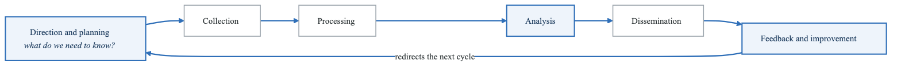
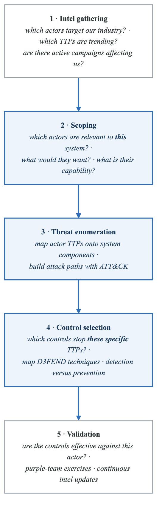
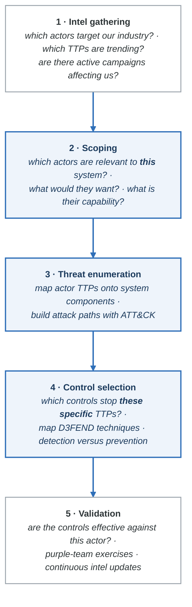

# Threat Intelligence Integration

## Overview

Threat intelligence transforms threat modeling from theoretical exercise to actionable defense by incorporating real-world attacker behavior, TTPs, and current campaigns into your analysis.

---

## Threat Intelligence Fundamentals

### Intelligence Types

```yaml
intelligence_types:
  strategic:
    audience: Executives, board
    timeframe: Long-term (1-5 years)
    focus: Threat landscape trends, geopolitical risks
    sources: Industry reports, government advisories
    threat_model_use: Program prioritization, investment decisions

  tactical:
    audience: Security architects, defenders
    timeframe: Medium-term (weeks to months)
    focus: TTPs, attack patterns, malware families
    sources: MITRE ATT&CK, threat reports, ISACs
    threat_model_use: Control selection, detection engineering

  operational:
    audience: SOC, incident response
    timeframe: Short-term (hours to days)
    focus: Active campaigns, threat actor infrastructure
    sources: Threat feeds, dark web monitoring
    threat_model_use: Immediate threat validation

  technical:
    audience: Security engineers, analysts
    timeframe: Immediate
    focus: IOCs, signatures, hashes
    sources: OSINT, commercial feeds, sharing platforms
    threat_model_use: Detection rules, blocking
```

### Intelligence Lifecycle

```mermaid
%%{init: {'theme':'base','themeVariables':{'fontFamily':'Helvetica, Arial, sans-serif','fontSize':'13px','primaryColor':'#ffffff','primaryTextColor':'#2d3436','primaryBorderColor':'#9aa3ab','lineColor':'#9aa3ab','textColor':'#2d3436','clusterBkg':'#fbfcfd','clusterBorder':'#d4dae0','edgeLabelBackground':'#ffffff','tertiaryColor':'#eef4fb'},'flowchart':{'curve':'basis','padding':14,'nodeSpacing':42,'rankSpacing':58}}}%%
flowchart LR
  classDef default fill:#ffffff,stroke:#9aa3ab,stroke-width:1.3px,color:#2d3436
  classDef n    fill:#ffffff,stroke:#9aa3ab,stroke-width:1.3px,color:#2d3436
  classDef crit fill:#eef4fb,stroke:#2f6fb8,stroke-width:1.8px,color:#1b3a5c
  classDef data fill:#f4f7fa,stroke:#9aa3ab,stroke-width:1.3px,color:#2d3436
  classDef mut  fill:#ffffff,stroke:#cfd6dc,stroke-width:1.1px,color:#7a8288
  classDef warn fill:#fdf0ec,stroke:#c0522d,stroke-width:1.6px,color:#8a3a1e
  D["Direction and planning<br/><i>what do we need to know?</i>"]
  C["Collection"]
  P["Processing"]
  A["Analysis"]
  DI["Dissemination"]
  F["Feedback and improvement"]
  D ==> C ==> P ==> A ==> DI ==> F
  F ==>|"redirects the next cycle"| D
  class D crit
  class C,P n
  class A crit
  class DI n
  class F crit
  linkStyle 0,1,2,3,4,5 stroke:#2f6fb8,stroke-width:2px

%% The cycle fails at "Direction" more often than anywhere else. Intelligence
%% collected without a question to answer becomes a feed nobody reads, and the
%% programme is judged on the volume of indicators rather than on a decision it
%% changed.
```

<!-- figure: generated from the Mermaid below by _shared/diagrams/embed-figures.py — do not edit the image -->


<details>
<summary>Diagram source (Mermaid)</summary>



</details>

---

## Integrating Intel with STRIDE

### STRIDE-ATT&CK Mapping

```yaml
stride_attack_mapping:
  spoofing:
    attack_techniques:
      - T1078: Valid Accounts
      - T1134: Access Token Manipulation
      - T1556: Modify Authentication Process
      - T1111: Multi-Factor Authentication Interception
    threat_actors:
      - APT29 (token theft)
      - Lazarus (credential harvesting)
    recent_campaigns:
      - ThreatGroup-B (token forgery)
      - IdentityCo/ThreatGroup-A (session hijacking)

  tampering:
    attack_techniques:
      - T1565: Data Manipulation
      - T1195: Supply Chain Compromise
      - T1027: Obfuscated Files or Information
      - T1553: Subvert Trust Controls
    threat_actors:
      - APT41 (supply chain)
      - OrionSoft attackers
    recent_campaigns:
      - 3CX supply chain attack
      - FileTransferApp vulnerability exploitation

  repudiation:
    attack_techniques:
      - T1070: Indicator Removal
      - T1562: Impair Defenses
      - T1036: Masquerading
    threat_actors:
      - Most APT groups use anti-forensics
    detection_gaps:
      - Log integrity not verified
      - Insufficient retention

  information_disclosure:
    attack_techniques:
      - T1005: Data from Local System
      - T1039: Data from Network Shared Drive
      - T1567: Exfiltration Over Web Service
      - T1048: Exfiltration Over Alternative Protocol
    threat_actors:
      - FIN7 (financial data)
      - APT10 (intellectual property)
    recent_campaigns:
      - LastPass breach
      - Accellion FTA attacks

  denial_of_service:
    attack_techniques:
      - T1498: Network Denial of Service
      - T1499: Endpoint Denial of Service
      - T1489: Service Stop
    threat_actors:
      - Killnet (hacktivism)
      - Nation-state disruption operations
    recent_campaigns:
      - Healthcare DDoS campaigns
      - Financial sector attacks

  elevation_of_privilege:
    attack_techniques:
      - T1068: Exploitation for Privilege Escalation
      - T1548: Abuse Elevation Control Mechanism
      - T1484: Domain Policy Modification
    threat_actors:
      - APT28 (zero-days)
      - Ransomware groups
    recent_campaigns:
      - ProxyLogon/ProxyShell
      - Print Spooler vulnerabilities
```

---

## Threat Actor Profiling

### Actor Profile Template

```yaml
threat_actor_profile:
  identifier:
    name: APT29 / Cozy Bear / The Dukes
    aliases: [Nobelium, Midnight Blizzard, UNC2452]
    attribution: Russian SVR (Foreign Intelligence Service)
    confidence: High

  motivation:
    primary: Espionage
    secondary: [Intelligence collection, Long-term access]
    targets:
      industries: [Government, Think tanks, Healthcare, Technology]
      geography: [US, EU, NATO countries]

  capabilities:
    sophistication: Advanced
    resources: Nation-state level
    zero_day_usage: Yes (historically)
    custom_tooling: Yes

  ttps:
    initial_access:
      - T1566.001: Spearphishing Attachment
      - T1195.002: Compromise Software Supply Chain
      - T1078: Valid Accounts (stolen)

    persistence:
      - T1098: Account Manipulation
      - T1136: Create Account
      - T1505.003: Web Shell

    defense_evasion:
      - T1027: Obfuscated Files
      - T1070: Indicator Removal
      - T1036: Masquerading

    collection:
      - T1114: Email Collection
      - T1213: Data from Information Repositories

    exfiltration:
      - T1567: Exfiltration Over Web Service
      - T1048: Exfiltration Over Alternative Protocol

  infrastructure:
    - Compromised legitimate infrastructure
    - Cloud services (Azure, AWS, GCP)
    - Residential proxies

  notable_campaigns:
    - OrionSoft Orion (2020)
    - COVID-19 vaccine research (2020)
    - Microsoft cloud attacks (2023)

  relevance_to_organization:
    applicable: true
    reasons:
      - Organization in target industries
      - Uses OrionSoft/Microsoft products
      - Has government contracts
    priority: High
```

### Industry-Specific Actors

```yaml
financial_services:
  threat_actors:
    - name: FIN7/Carbanak
      focus: Payment card theft, ATM attacks
      ttps: Spearphishing, POS malware

    - name: Lazarus Group
      focus: SWIFT system attacks, cryptocurrency
      ttps: Supply chain, zero-days

    - name: Silence Group
      focus: ATM jackpotting, bank infrastructure
      ttps: Insider recruitment, long dwell time

healthcare:
  threat_actors:
    - name: Various ransomware groups
      focus: Disruption, data theft
      ttps: VPN exploitation, RDP brute force

    - name: APT41
      focus: Research theft, patient data
      ttps: Supply chain, web exploits

    - name: APT10
      focus: Healthcare research, PHI
      ttps: Managed service provider compromise

government:
  threat_actors:
    - name: APT29 (Russia)
      focus: Policy intelligence, diplomatic
      ttps: Supply chain, OAuth abuse

    - name: APT28 (Russia)
      focus: Political interference
      ttps: Credential harvesting, zero-days

    - name: APT40 (China)
      focus: Maritime, defense, research
      ttps: Web exploitation, spearphishing
```

---

## Intelligence Sources

### Open Source Intelligence (OSINT)

| Source | Type | Use Case |
|--------|------|----------|
| MITRE ATT&CK | TTP database | Control mapping |
| VirusTotal | Malware analysis | IOC enrichment |
| Shodan | Asset discovery | Attack surface monitoring |
| AlienVault OTX | Threat indicators | Detection rules |
| CISA Advisories | Government alerts | Vulnerability prioritization |
| Vendor blogs | Threat research | Campaign awareness |
| GitHub advisories | Software vulnerabilities | Dependency security |

### Industry Sharing (ISACs)

```yaml
isacs:
  - name: FS-ISAC
    sector: Financial Services
    value: Financial-specific threats, fraud patterns

  - name: H-ISAC
    sector: Healthcare
    value: Healthcare threats, ransomware alerts

  - name: IT-ISAC
    sector: Technology
    value: Software vulnerabilities, supply chain

  - name: Auto-ISAC
    sector: Automotive
    value: Vehicle security, connected car threats
```

### Threat Feeds

```yaml
free_feeds:
  - name: AlienVault OTX
    url: https://otx.alienvault.com/
    format: STIX/TAXII
    content: IOCs, pulses

  - name: Abuse.ch
    url: https://abuse.ch/
    format: CSV, JSON
    content: Malware, C2 domains

  - name: Emerging Threats
    url: https://rules.emergingthreats.net/
    format: Suricata/Snort rules
    content: IDS signatures

  - name: PhishTank
    url: https://phishtank.org/
    format: CSV, JSON
    content: Phishing URLs
```

---

## Intelligence-Driven Threat Modeling

### Process Integration

<!-- figure: generated from the Mermaid below by _shared/diagrams/embed-figures.py — do not edit the image -->


<details>
<summary>Diagram source (Mermaid)</summary>



</details>

### Threat Modeling with ATT&CK

```yaml
example_threat_model:
  system: Customer Payment Portal

  relevant_actors:
    - actor: FIN7
      relevance: Targets payment systems
      priority: High

    - actor: Magecart groups
      relevance: Web skimming attacks
      priority: High

    - actor: Ransomware operators
      relevance: Opportunistic
      priority: Medium

  attack_path_analysis:
    fin7_scenario:
      initial_access:
        technique: T1566.001 (Spearphishing)
        target: Employee with portal access
        likelihood: High

      execution:
        technique: T1059.001 (PowerShell)
        detection: EDR, script logging

      persistence:
        technique: T1053.005 (Scheduled Task)
        detection: Task creation monitoring

      collection:
        technique: T1056.001 (Keylogging)
        target: Payment credentials

      exfiltration:
        technique: T1041 (Exfil Over C2)
        detection: Network monitoring

    magecart_scenario:
      initial_access:
        technique: T1195.002 (Supply Chain)
        target: Third-party JavaScript
        likelihood: Medium

      execution:
        technique: T1059.007 (JavaScript)
        location: Customer browser

      collection:
        technique: T1056.004 (Web Credential Capture)
        target: Payment form data

      exfiltration:
        technique: T1567 (Exfil to Web Service)
        detection: CSP violations, SRI

  controls_derived:
    - control: Email security gateway
      mitigates: T1566.001

    - control: Subresource Integrity (SRI)
      mitigates: T1195.002

    - control: Content Security Policy
      mitigates: T1059.007, T1567

    - control: Network segmentation
      mitigates: Lateral movement
```

---

## Building an Intel Program

### Maturity Model

**Level 1: Ad-Hoc**

- Reactive to major incidents
- No formal intel sources
- General awareness only
- No threat model integration

**Level 2: Emerging**

- Subscribe to basic feeds
- Manual intel review
- Occasional threat model updates
- Some ISAC participation

**Level 3: Defined**

- Formal intel team/role
- Multiple curated sources
- Regular threat model updates
- Threat actor profiles maintained

**Level 4: Managed**

- Automated intel processing
- Integrated with SIEM/SOAR
- Threat hunting informed by intel
- Metrics on intel effectiveness

**Level 5: Optimized**

- Predictive analysis
- Original intel production
- Industry sharing leadership
- Continuous threat model adaptation


### Implementation Checklist

```
Foundation:
□ Identify crown jewels and likely adversaries
□ Subscribe to relevant ISAC
□ Set up OSINT monitoring
□ Create threat actor profiles for top 3 actors
□ Map ATT&CK to existing controls

Integration:
□ Update threat models with actor-specific scenarios
□ Brief threat modeling teams on relevant threats
□ Create attack path exercises from intel
□ Validate controls against actor TTPs

Automation:
□ Feed intel into threat modeling tools
□ Automate ATT&CK mapping updates
□ Alert on new techniques affecting systems
□ Track control coverage over time

Continuous Improvement:
□ Post-incident intel updates
□ Quarterly threat landscape reviews
□ Annual actor profile refreshes
□ Benchmark against peer organizations
```

---

## Tools for Intel Integration

### MITRE ATT&CK Navigator

```python
# Example: Generate Navigator layer from threat model
import json

def create_attack_layer(threat_model):
    layer = {
        "name": f"Threats - {threat_model['system']}",
        "versions": {"attack": "14", "navigator": "4.9", "layer": "4.5"},
        "domain": "enterprise-attack",
        "description": f"Relevant threats for {threat_model['system']}",
        "techniques": []
    }

    for threat in threat_model['threats']:
        layer['techniques'].append({
            "techniqueID": threat['attack_id'],
            "color": get_color_by_risk(threat['risk']),
            "comment": threat['description'],
            "enabled": True,
            "metadata": [{
                "name": "control",
                "value": threat.get('mitigation', 'None')
            }]
        })

    return json.dumps(layer, indent=2)

def get_color_by_risk(risk):
    colors = {
        'critical': '#ff0000',
        'high': '#ff6600',
        'medium': '#ffff00',
        'low': '#00ff00'
    }
    return colors.get(risk, '#ffffff')
```

### OpenCTI Integration

```yaml
opencti_integration:
  purpose: Centralized threat intelligence platform

  inputs:
    - STIX/TAXII feeds
    - MITRE ATT&CK
    - Internal reports
    - ISAC sharing

  outputs:
    - Threat actor profiles
    - Campaign tracking
    - IOC management
    - ATT&CK heatmaps

  threat_model_integration:
    - Query relevant actors by industry
    - Map TTPs to system components
    - Track technique evolution
    - Correlate IOCs with infrastructure
```

---

## Next Steps

→ [Adversarial Thinking](adversarial-thinking.md)
→ [Supply Chain Security](supply-chain.md)

<!-- feynman-check -->

---

## Feynman check

Close the file. Blank page, no notes. Explain each of these to a competent engineer who has never
used this tool — **under five minutes, no jargon you can't define on the spot:**

- Threat Intelligence Fundamentals
- Integrating Intel with STRIDE
- Threat Actor Profiling
- Intelligence Sources

**The gap is not what you forgot. It is where you used a word instead of a mechanism.**

| | |
|---|---|
| ✗ | *"We scan for vulnerabilities in the pipeline."* |
| ✓ | *"SAST reads source without running it, SCA resolves the dependency tree against an advisory database, and image scanning compares installed package versions to that same database. All three report what was known at build time — which is why the registry is re-scanned: the image does not change, the database does."* |

**Trace it:** A CVE published today against your base image → a blocked deploy. Name every component between the advisory and the refused `apply`.

Stop at the first component you cannot name. Reopen this file and read **only** that.

**Go deeper — only once the gap has a name:** the [SLSA threat model](https://slsa.dev/spec/v1.2/threats) — it names every point at which a build can be subverted, and most teams defend three of them.
Full list per domain: [`SOURCES.md`](../../SOURCES.md#devsecops)

→ Protocol, the three levels of knowing, and worked examples: [`MASTERY.md`](../../MASTERY.md)

<!-- /feynman-check -->
