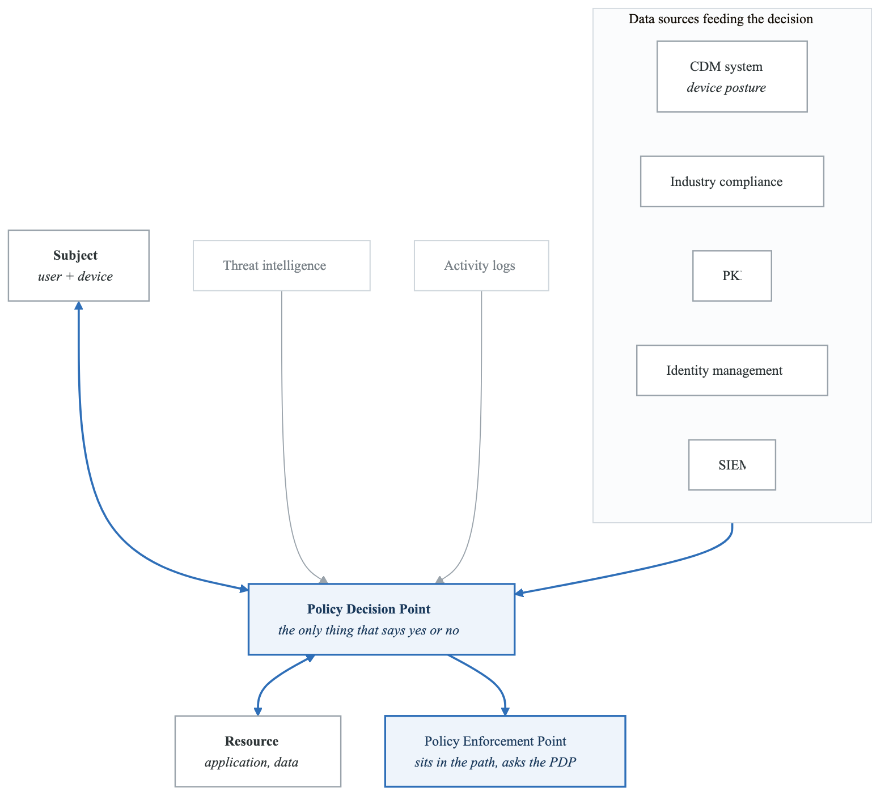
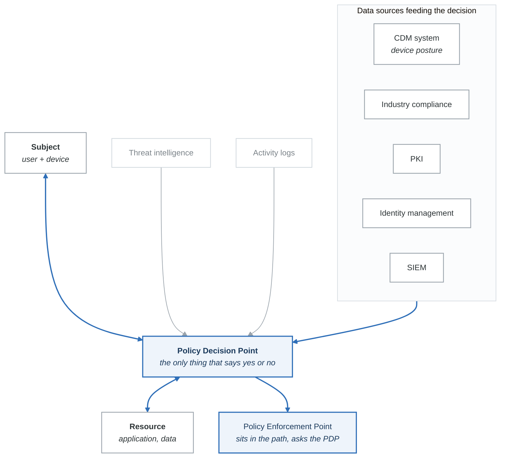
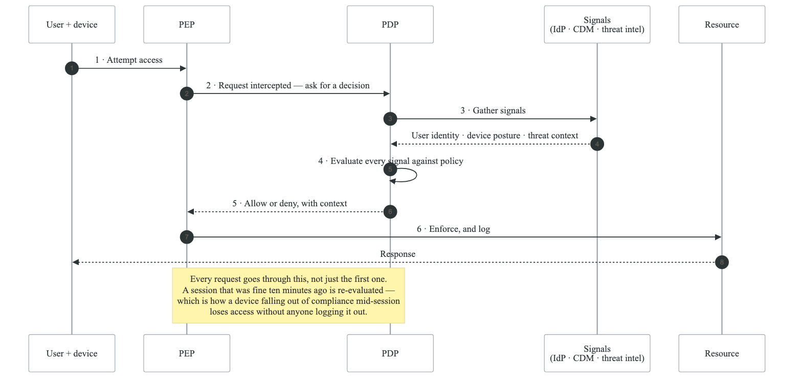
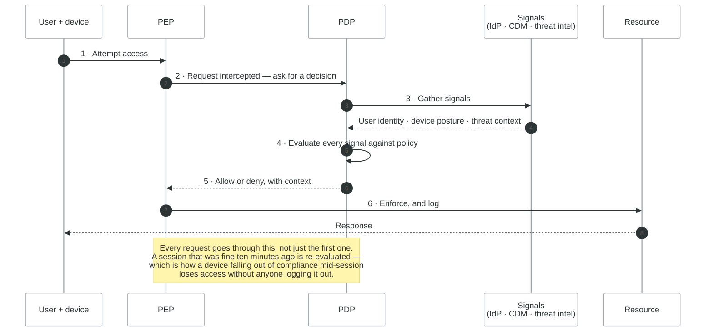

# Zero Trust Architecture Threat Modeling

## Overview

Zero Trust is a security model that assumes no implicit trust based on network location or user identity. This guide covers threat modeling for Zero Trust architectures and how ZTA principles enhance threat modeling outcomes.

---

## Zero Trust Principles

### Core Tenets

```yaml
zero_trust_principles:
  never_trust_always_verify:
    description: Authenticate and authorize every access request
    traditional: Trust internal network
    zero_trust: Verify regardless of network location

  least_privilege:
    description: Grant minimum access needed for task
    traditional: Broad role-based access
    zero_trust: Just-in-time, just-enough access

  assume_breach:
    description: Design as if attackers are already inside
    traditional: Perimeter-focused defense
    zero_trust: Defense in depth, blast radius limitation

  verify_explicitly:
    description: Use all available context for decisions
    traditional: Username and password
    zero_trust: User + device + location + behavior + risk

  micro_segmentation:
    description: Isolate workloads and limit lateral movement
    traditional: Flat network, VLANs
    zero_trust: Application-level segmentation
```

### NIST Zero Trust Architecture

<!-- figure: generated from the Mermaid below by _shared/diagrams/embed-figures.py — do not edit the image -->


<details>
<summary>Diagram source (Mermaid)</summary>



</details>

---

## Zero Trust Threat Model

### STRIDE Applied to ZTA

```yaml
zt_stride_analysis:
  spoofing:
    without_zt:
      - Stolen credentials provide full access
      - Network position implies trust
      - Device impersonation successful
    with_zt:
      - Credentials alone insufficient
      - Device posture verified
      - Continuous authentication
    residual_threats:
      - Session token theft
      - Compromised trusted device
      - MFA bypass techniques

  tampering:
    without_zt:
      - Lateral movement after compromise
      - Data modification undetected
      - Configuration changes unmonitored
    with_zt:
      - Micro-segmentation limits movement
      - Policy enforcement at each hop
      - Continuous monitoring
    residual_threats:
      - Authorized user abuse
      - Policy bypass vulnerabilities
      - Misconfigured segmentation

  repudiation:
    without_zt:
      - Shared accounts
      - Insufficient logging
      - Log tampering
    with_zt:
      - Individual identity required
      - Comprehensive logging
      - Immutable audit trails
    residual_threats:
      - Insider with valid credentials
      - Log aggregation gaps
      - Log analysis delays

  information_disclosure:
    without_zt:
      - Network sniffing effective
      - Overprivileged access exposes data
      - Data exfiltration paths exist
    with_zt:
      - Encryption everywhere
      - Minimal access principle
      - DLP at policy points
    residual_threats:
      - Authorized data access abuse
      - Endpoint compromise
      - Policy gaps

  denial_of_service:
    without_zt:
      - Flat network enables spread
      - Single point of failure
      - Resource exhaustion
    with_zt:
      - Segmentation contains impact
      - Distributed architecture
      - Rate limiting at PEPs
    residual_threats:
      - PDP/PEP overload
      - Cascading failures
      - Authentication service DoS

  elevation_of_privilege:
    without_zt:
      - Admin credentials grant all
      - Role accumulation over time
      - Permanent elevated access
    with_zt:
      - Just-in-time access
      - Continuous evaluation
      - Context-based restrictions
    residual_threats:
      - Privilege escalation in apps
      - Policy engine compromise
      - Trusted component abuse
```

---

## ZTA Components Threat Analysis

### Identity Provider (IdP)

```yaml
idp_threats:
  component: Identity Provider
  criticality: Critical (single point of trust)

  threats:
    credential_compromise:
      attack: Phishing, credential stuffing
      impact: Attacker assumes user identity
      controls:
        - MFA enforcement
        - Phishing-resistant authentication
        - Credential monitoring

    idp_infrastructure_compromise:
      attack: Direct attack on IdP systems
      impact: Complete identity system takeover
      examples: ThreatGroup-B (Microsoft)
      controls:
        - IdP hardening
        - Signing key protection
        - Separation of duties
        - Multi-region redundancy

    token_manipulation:
      attack: Token theft, forging, replay
      impact: Session hijacking, impersonation
      controls:
        - Short token lifetime
        - Token binding
        - Continuous validation
        - Anomaly detection

    federated_trust_abuse:
      attack: Compromise federated IdP
      impact: Access to all relying parties
      controls:
        - Limit federation partners
        - Monitor federated sessions
        - Conditional access policies
```

### Policy Decision Point (PDP)

```yaml
pdp_threats:
  component: Policy Decision Point
  criticality: Critical (makes access decisions)

  threats:
    policy_bypass:
      attack: Find paths that skip PDP
      impact: Unauthorized access
      controls:
        - Default deny
        - Complete mediation
        - Policy testing

    policy_manipulation:
      attack: Modify policies to grant access
      impact: Unauthorized access, persistence
      controls:
        - Policy version control
        - Approval workflows
        - Audit logging

    decision_spoofing:
      attack: Forge PDP decisions
      impact: PEPs grant unauthorized access
      controls:
        - Signed decisions
        - Mutual TLS
        - Decision verification

    context_poisoning:
      attack: Manipulate risk signals
      impact: Incorrect access decisions
      controls:
        - Multiple signal sources
        - Signal validation
        - Anomaly detection
```

### Policy Enforcement Point (PEP)

```yaml
pep_threats:
  component: Policy Enforcement Point
  criticality: High (enforces access)

  threats:
    pep_bypass:
      attack: Direct resource access avoiding PEP
      impact: Policy not enforced
      controls:
        - Network architecture enforcement
        - Resource-level validation
        - Monitoring for bypass attempts

    pep_compromise:
      attack: Attacker controls enforcement point
      impact: All policies ineffective
      controls:
        - PEP hardening
        - Multiple PEP layers
        - Mutual verification

    fail_open:
      attack: Cause PEP to fail in open state
      impact: Unrestricted access during failure
      controls:
        - Fail closed design
        - Health monitoring
        - Graceful degradation

    traffic_inspection_evasion:
      attack: Encrypted tunnels, protocol abuse
      impact: Policy cannot inspect content
      controls:
        - TLS inspection where appropriate
        - Protocol enforcement
        - Behavioral analysis
```

---

## Implementing ZTA Threat Modeling

### Asset-Centric Approach

```yaml
asset_centric_zt:
  step_1_identify_assets:
    - Data assets (crown jewels)
    - Application services
    - Infrastructure components
    - User populations

  step_2_map_access_flows:
    for_each_asset:
      - Who needs access?
      - What devices/applications?
      - From where?
      - When/how frequently?

  step_3_define_policies:
    policy_elements:
      - Required authentication strength
      - Device posture requirements
      - Location restrictions
      - Time-based access
      - Risk score thresholds

  step_4_place_enforcement:
    - Identity verification points
    - Network segmentation
    - Application-level controls
    - Data-level protection

  step_5_monitor_and_adapt:
    - Continuous verification
    - Anomaly detection
    - Policy refinement
    - Threat intelligence integration
```

### Zero Trust Data Flow Diagram

<!-- figure: generated from the Mermaid below by _shared/diagrams/embed-figures.py — do not edit the image -->


<details>
<summary>Diagram source (Mermaid)</summary>



</details>

---

## ZTA for Cloud Environments

### Cloud Zero Trust Patterns

```yaml
cloud_zt_patterns:
  aws:
    identity:
      - IAM Identity Center (SSO)
      - AWS SSO + MFA
      - Role assumption with conditions
      - Service control policies

    network:
      - VPC endpoints (private connectivity)
      - Security groups (micro-segmentation)
      - PrivateLink
      - AWS Verified Access

    data:
      - KMS encryption
      - S3 bucket policies
      - Resource-based policies
      - Macie for DLP

    monitoring:
      - CloudTrail (audit)
      - GuardDuty (threat detection)
      - Security Hub (posture)

  azure:
    identity:
      - Entra ID (Azure AD)
      - Conditional Access
      - PIM (Just-in-time)
      - App registrations

    network:
      - Private endpoints
      - NSG micro-segmentation
      - Azure Firewall
      - Azure Private Link

    data:
      - Azure Key Vault
      - Storage encryption
      - Azure Information Protection
      - Defender for Storage

    monitoring:
      - Azure Monitor
      - Defender for Cloud
      - Sentinel SIEM

  gcp:
    identity:
      - Cloud Identity
      - Context-Aware Access
      - Workload Identity Federation
      - BeyondCorp Enterprise

    network:
      - VPC Service Controls
      - Private Google Access
      - Cloud Armor
      - Identity-Aware Proxy

    data:
      - Cloud KMS
      - DLP API
      - VPC Service Controls

    monitoring:
      - Cloud Audit Logs
      - Security Command Center
      - Chronicle SIEM
```

### BeyondCorp Model

```yaml
beyondcorp:
  description: Google's Zero Trust implementation

  principles:
    - Access based on device and user, not network
    - All access through access proxy
    - Comprehensive logging and monitoring
    - Inventory-based device trust

  components:
    trust_engine:
      purpose: Determines trust level
      inputs:
        - User authentication
        - Device inventory status
        - Device certificate
        - Security posture

    access_control_engine:
      purpose: Authorization decisions
      inputs:
        - Trust level
        - ACLs for resource
        - Time and location

    access_proxy:
      purpose: Enforcement point
      function:
        - Routes requests to resources
        - Enforces access decisions
        - Terminates TLS
        - Logs all access

  threat_model_implications:
    - Device compromise is key risk
    - Access proxy is critical infrastructure
    - Trust engine accuracy essential
    - Continuous verification required
```

---

## Zero Trust Maturity Model

### Assessment Framework

```yaml
zt_maturity:
  traditional:
    identity: Passwords, network location
    devices: Minimal management
    network: Perimeter-based
    applications: Network-level access
    data: Location-based protection
    visibility: Basic logging

  initial:
    identity: MFA for some apps
    devices: MDM for managed devices
    network: Some segmentation
    applications: VPN access
    data: Some encryption
    visibility: SIEM deployed

  advanced:
    identity: MFA everywhere, SSO
    devices: Posture-based access
    network: Micro-segmentation
    applications: Identity-aware access
    data: Classification + DLP
    visibility: Behavioral analytics

  optimal:
    identity: Continuous, risk-based
    devices: Real-time posture
    network: Software-defined perimeters
    applications: Zero trust app access
    data: Automated protection
    visibility: ML-driven detection
```

---

## ZTA Threat Model Checklist

```
Identity:
□ Phishing-resistant MFA deployed
□ Continuous authentication
□ Device binding for sessions
□ Risk-based access policies
□ Privileged access management
□ Identity provider resilience

Devices:
□ Device inventory maintained
□ Posture assessment enforced
□ Certificate-based identity
□ EDR/XDR deployed
□ Patch compliance verified
□ Unmanaged device controls

Network:
□ Micro-segmentation implemented
□ East-west traffic monitoring
□ DNS security controls
□ TLS everywhere
□ Network access control
□ Lateral movement detection

Applications:
□ Application-level authentication
□ API security gateway
□ Session management
□ Input validation
□ Output encoding
□ Application layer monitoring

Data:
□ Data classification
□ Encryption at rest and transit
□ DLP controls
□ Access logging
□ Data discovery
□ Retention policies

Visibility:
□ Comprehensive logging
□ Log aggregation
□ Behavioral analytics
□ Threat detection
□ Incident response integration
□ Continuous monitoring
```

---

## Next Steps

→ [Return to Advanced Topics](../threat-modeling-roadmap.md#advanced-topics)
→ [Enterprise Scaling](../05-enterprise/scaling.md)

<!-- feynman-check -->

---

## Feynman check

Close the file. Blank page, no notes. Explain each of these to a competent engineer who has never
used this tool — **under five minutes, no jargon you can't define on the spot:**

- Zero Trust Principles
- Zero Trust Threat Model
- ZTA Components Threat Analysis
- Implementing ZTA Threat Modeling

**The gap is not what you forgot. It is where you used a word instead of a mechanism.**

| | |
|---|---|
| ✗ | *"We scan for vulnerabilities in the pipeline."* |
| ✓ | *"SAST reads source without running it, SCA resolves the dependency tree against an advisory database, and image scanning compares installed package versions to that same database. All three report what was known at build time — which is why the registry is re-scanned: the image does not change, the database does."* |

**Trace it:** A CVE published today against your base image → a blocked deploy. Name every component between the advisory and the refused `apply`.

Stop at the first component you cannot name. Reopen this file and read **only** that.

**Go deeper — only once the gap has a name:** the [SLSA threat model](https://slsa.dev/spec/v1.2/threats) — it names every point at which a build can be subverted, and most teams defend three of them.
Full list per domain: [`SOURCES.md`](../../SOURCES.md#devsecops)

→ Protocol, the three levels of knowing, and worked examples: [`MASTERY.md`](../../MASTERY.md)

<!-- /feynman-check -->
