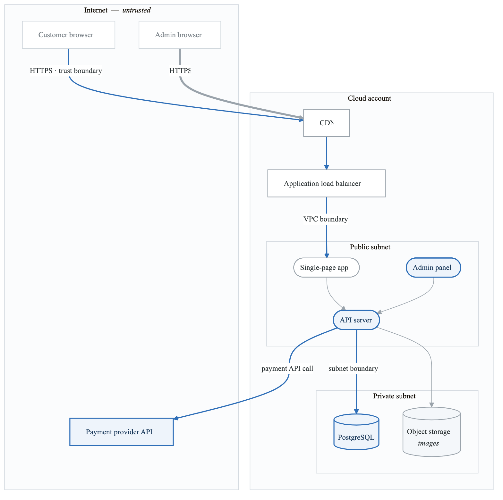
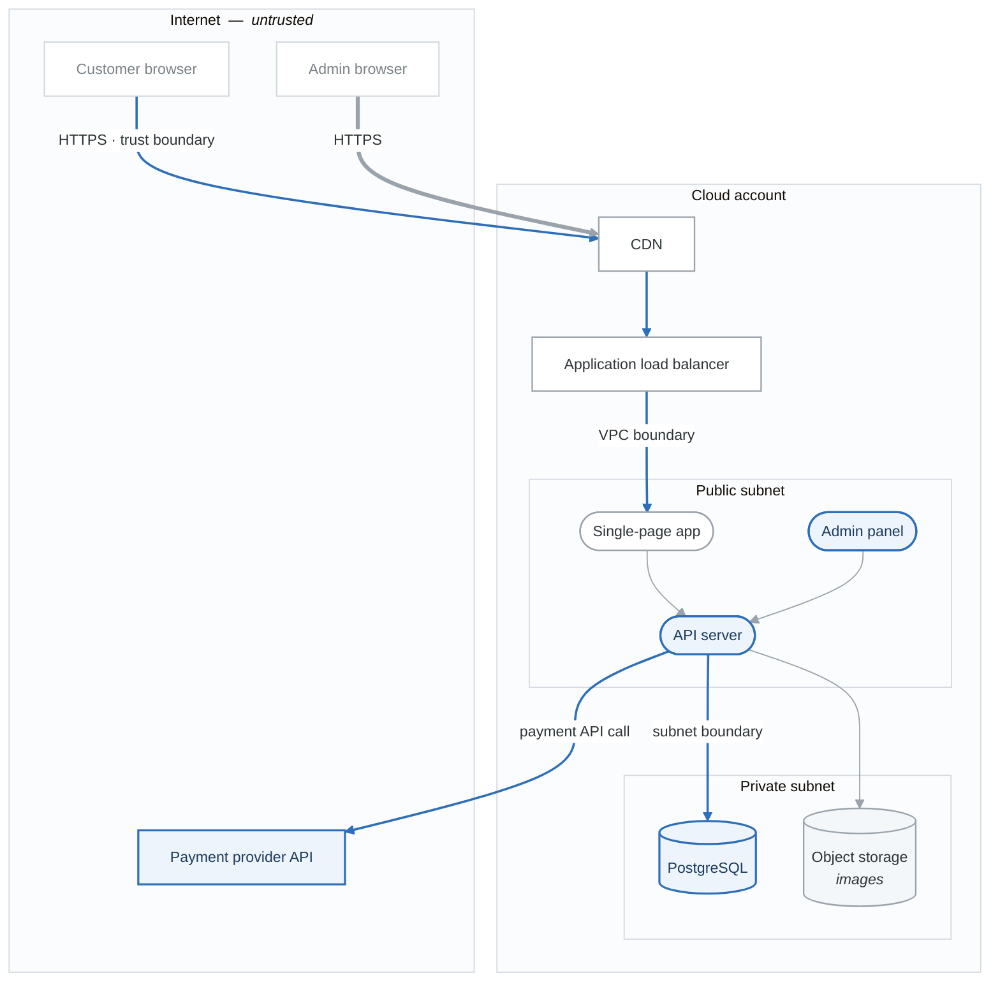

# Lab 01: Basic Web Application Threat Model

## Objective

Create your first threat model for a simple web application using STRIDE methodology.

---

## Scenario: BookStore Online

You are the security engineer for BookStore Online, a startup launching an e-commerce platform for selling books.

### Application Overview

**BookStore Online - MVP Features:**

- User registration and login
- Browse book catalog
- Search for books
- Add books to shopping cart
- Checkout with credit card
- View order history
- Admin panel for inventory management


### Technology Stack

| Component | Technology |
|-----------|------------|
| Frontend | React SPA |
| Backend API | Node.js / Express |
| Database | PostgreSQL |
| Authentication | JWT tokens |
| Payment | Stripe API integration |
| Hosting | AWS (EC2, RDS, S3) |
| CDN | CloudFront |

---

## Architecture Diagram

<!-- figure: generated from the Mermaid below by _shared/diagrams/embed-figures.py — do not edit the image -->


<details>
<summary>Diagram source (Mermaid)</summary>



</details>

---

## Lab Tasks

### Task 1: Create a Data Flow Diagram (30 minutes)

Using the architecture above, create a detailed Level 1 DFD showing:

1. **External Entities:**
   - Customer
   - Admin User
   - Stripe Payment API

2. **Processes:**
   - Web Application (Frontend)
   - API Server
   - Admin Panel

3. **Data Stores:**
   - User Database
   - Product Database
   - Order Database
   - S3 Image Storage

4. **Data Flows:** Label each flow with:
   - Data type (credentials, PII, payment data, etc.)
   - Protocol (HTTPS, SQL, etc.)

5. **Trust Boundaries:**
   - Internet boundary
   - VPC boundary
   - Subnet boundary

**Deliverable:** Hand-drawn or digital DFD

---

### Task 2: Apply STRIDE (45 minutes)

For each component, apply STRIDE and document threats.

#### Example: API Server

| STRIDE | Threat | Description |
|--------|--------|-------------|
| Spoofing | T001 | Attacker forges JWT token to impersonate user |
| Tampering | T002 | SQL injection modifies order prices |
| Repudiation | T003 | User denies placing order, no audit log |
| Info Disclosure | T004 | Error messages reveal database schema |
| DoS | T005 | No rate limiting allows API exhaustion |
| EoP | T006 | Regular user accesses admin endpoints |

**Complete the following tables:**

#### Customer Browser → CloudFront (Data Flow)
| STRIDE | Applicable | Threat |
|--------|------------|--------|
| S | | |
| T | ✓ | |
| R | | |
| I | ✓ | |
| D | ✓ | |
| E | | |

#### PostgreSQL Database (Data Store)
| STRIDE | Applicable | Threat |
|--------|------------|--------|
| S | | |
| T | ✓ | |
| R | | |
| I | ✓ | |
| D | ✓ | |
| E | | |

#### Admin Panel (Process)
| STRIDE | Applicable | Threat |
|--------|------------|--------|
| S | ✓ | |
| T | ✓ | |
| R | ✓ | |
| I | ✓ | |
| D | ✓ | |
| E | ✓ | |

**Deliverable:** Completed STRIDE tables for all components

---

### Task 3: Risk Assessment (20 minutes)

Prioritize the threats you identified using this matrix:

```
Impact:
- Critical: Complete system compromise, massive data breach
- High: Significant data loss, major service disruption
- Medium: Limited data exposure, partial service impact
- Low: Minimal impact, nuisance

Likelihood:
- High: Known attack vectors, easy to exploit
- Medium: Requires some skill/resources
- Low: Difficult, requires significant resources
```

**Complete this risk register:**

| ID | Threat | Likelihood | Impact | Risk Score | Priority |
|----|--------|------------|--------|------------|----------|
| T001 | | | | | |
| T002 | | | | | |
| T003 | | | | | |
| T004 | | | | | |
| T005 | | | | | |

---

### Task 4: Mitigation Recommendations (20 minutes)

For your top 5 threats, propose mitigations:

| Threat ID | Mitigation | Control Type | Implementation |
|-----------|------------|--------------|----------------|
| | | Preventive/Detective/Corrective | |

---

### Task 5: Documentation (15 minutes)

Write a brief executive summary (1 paragraph) that:
- Summarizes the threat model scope
- Highlights the top 3 risks
- Recommends immediate actions

---

## Reference: Common Threats for This Architecture

<details>
<summary>Click to reveal hints (try without first!)</summary>

### Authentication & Session
- JWT token theft via XSS
- Weak password policy
- No account lockout
- Session fixation
- Insecure password reset

### Input Validation
- SQL injection in search
- XSS in book reviews
- Command injection in image processing
- Path traversal in file downloads

### Authorization
- IDOR - viewing other users' orders
- Admin function access by regular users
- Price manipulation in cart

### Data Protection
- Credit card data in logs
- Unencrypted database backups
- S3 bucket misconfiguration
- PII in error messages

### Infrastructure
- Exposed database port
- Missing WAF rules
- No rate limiting
- Insufficient logging

### Third-Party
- Stripe API key exposure
- Dependency vulnerabilities
- CDN cache poisoning

</details>

---

## Evaluation Criteria

| Criteria | Points |
|----------|--------|
| DFD completeness and accuracy | 20 |
| STRIDE coverage (all components) | 25 |
| Threat quality (specific, realistic) | 20 |
| Risk assessment justification | 15 |
| Mitigation appropriateness | 15 |
| Documentation clarity | 5 |
| **Total** | **100** |

---

## Self-Assessment Checklist

After completing the lab, verify:

```
□ DFD includes all components from architecture
□ Trust boundaries are clearly marked
□ Data flows are labeled with data types
□ STRIDE applied to every component
□ At least 15 unique threats identified
□ Threats are specific (not generic)
□ Risk scores have justification
□ Mitigations are actionable
□ Executive summary is clear and concise
```

---

## Solution

See [lab-01-solution.md](./lab-01-solution.md) after completing the lab.

---

## Next Lab

→ [Lab 02: API Threat Model with STRIDE](../lab-02-api-threat-model/)

<!-- feynman-check -->

---

## Feynman check

Close the file. Blank page, no notes. Explain each of these to a competent engineer who has never
used this tool — **under five minutes, no jargon you can't define on the spot:**

- Scenario: BookStore Online
- Reference: Common Threats for This Architecture
- Self-Assessment Checklist
- Application Overview

**The gap is not what you forgot. It is where you used a word instead of a mechanism.**

| | |
|---|---|
| ✗ | *"We scan for vulnerabilities in the pipeline."* |
| ✓ | *"SAST reads source without running it, SCA resolves the dependency tree against an advisory database, and image scanning compares installed package versions to that same database. All three report what was known at build time — which is why the registry is re-scanned: the image does not change, the database does."* |

**Trace it:** A CVE published today against your base image → a blocked deploy. Name every component between the advisory and the refused `apply`.

Stop at the first component you cannot name. Reopen this file and read **only** that.

**Go deeper — only once the gap has a name:** the [SLSA threat model](https://slsa.dev/spec/v1.2/threats) — it names every point at which a build can be subverted, and most teams defend three of them.
Full list per domain: [`SOURCES.md`](../../SOURCES.md#devsecops)

→ Protocol, the three levels of knowing, and worked examples: [`MASTERY.md`](../../MASTERY.md)

<!-- /feynman-check -->
