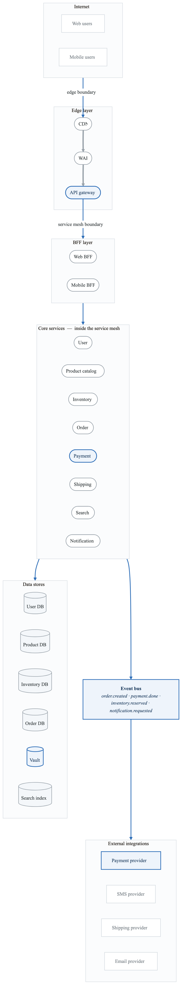
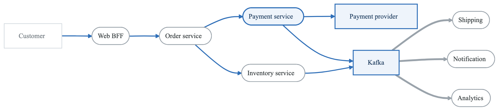
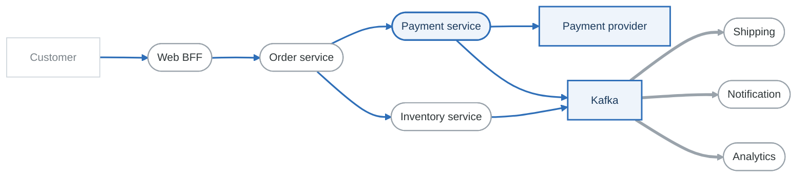
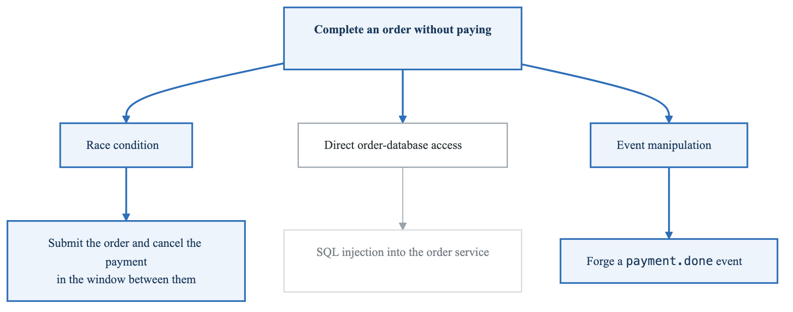
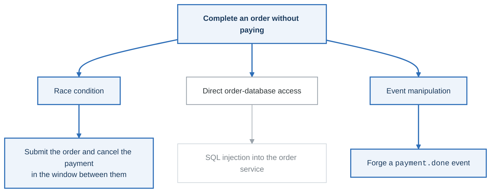

# Lab 03: Microservices Architecture with PASTA

## Objective

Apply the PASTA (Process for Attack Simulation and Threat Analysis) methodology to a microservices-based e-commerce platform, performing a complete 7-stage assessment.

---

## Scenario: ShopStream E-Commerce Platform

You are the security architect for ShopStream, an e-commerce platform migrating from monolith to microservices.

### System Overview

**ShopStream Microservices:**

- Frontend Services
  - Web BFF (Backend for Frontend)
  - Mobile BFF
- Core Services
  - User Service
  - Product Catalog Service
  - Inventory Service
  - Order Service
  - Payment Service
  - Shipping Service
- Supporting Services
  - Notification Service
  - Search Service (Elasticsearch)
  - Recommendation Service
  - Analytics Service
- Infrastructure
  - API Gateway (Kong)
  - Service Mesh (Istio)
  - Message Broker (Kafka)
  - Databases (per-service)
  - Distributed Cache (Redis)


---

## Architecture Diagram

```mermaid
%%{init: {'theme':'base','themeVariables':{'fontFamily':'Helvetica, Arial, sans-serif','fontSize':'13px','primaryColor':'#ffffff','primaryTextColor':'#2d3436','primaryBorderColor':'#9aa3ab','lineColor':'#9aa3ab','textColor':'#2d3436','clusterBkg':'#fbfcfd','clusterBorder':'#d4dae0','edgeLabelBackground':'#ffffff','tertiaryColor':'#eef4fb'},'flowchart':{'curve':'basis','padding':14,'nodeSpacing':42,'rankSpacing':58}}}%%
flowchart TB
  classDef default fill:#ffffff,stroke:#9aa3ab,stroke-width:1.3px,color:#2d3436
  classDef n    fill:#ffffff,stroke:#9aa3ab,stroke-width:1.3px,color:#2d3436
  classDef crit fill:#eef4fb,stroke:#2f6fb8,stroke-width:1.8px,color:#1b3a5c
  classDef data fill:#f4f7fa,stroke:#9aa3ab,stroke-width:1.3px,color:#2d3436
  classDef mut  fill:#ffffff,stroke:#cfd6dc,stroke-width:1.1px,color:#7a8288
  classDef warn fill:#fdf0ec,stroke:#c0522d,stroke-width:1.6px,color:#8a3a1e
  subgraph NET["Internet"]
    direction LR
    WU["Web users"]
    MU["Mobile users"]
  end
  subgraph EDGE["Edge layer"]
    direction LR
    CDN(["CDN"])
    WAF(["WAF"])
    KONG(["API gateway"])
    CDN ==> WAF ==> KONG
  end
  subgraph BFF["BFF layer"]
    direction LR
    WB(["Web BFF"])
    MB(["Mobile BFF"])
  end
  subgraph CORE["Core services &nbsp;—&nbsp; inside the service mesh"]
    direction LR
    USR(["User"])
    PRD(["Product catalog"])
    INV(["Inventory"])
    ORD(["Order"])
    PAY(["Payment"])
    SHP(["Shipping"])
    SCH(["Search"])
    NTF(["Notification"])
  end
  subgraph DATA["Data stores"]
    direction LR
    UD[("User DB")]
    PD[("Product DB")]
    ID[("Inventory DB")]
    OD[("Order DB")]
    VA[("Vault")]
    ES[("Search index")]
  end
  KAFKA["<b>Event bus</b><br/><i>order.created · payment.done ·<br/>inventory.reserved · notification.requested</i>"]
  subgraph EXT["External integrations"]
    direction LR
    E1["Payment provider"]
    E2["SMS provider"]
    E3["Shipping provider"]
    E4["Email provider"]
  end
  NET ==>|"edge boundary"| CDN
  KONG ==>|"service mesh boundary"| BFF
  BFF ==> CORE
  CORE ==> DATA
  CORE ==> KAFKA
  KAFKA ==> EXT
  class WU,MU mut
  class CDN,WAF n
  class KONG crit
  class WB,MB n
  class USR,PRD,INV,ORD,SHP,SCH,NTF n
  class PAY crit
  class UD,PD,ID,OD,ES data
  class VA crit
  class KAFKA crit
  class E1 crit
  class E2,E3,E4 mut
  linkStyle 2,3,4,5,6,7 stroke:#2f6fb8,stroke-width:2px

%% The event bus is the boundary worth arguing about. Anything that can publish
%% to Kafka can make eight services believe something happened -- so "who may
%% publish to which topic" is an authorization decision, and in most clusters it
%% is not one anybody has made.
```

<!-- figure: generated from the Mermaid below by _shared/diagrams/embed-figures.py — do not edit the image -->


<details>
<summary>Diagram source (Mermaid)</summary>



</details>

---

## PASTA Assessment

### Stage 1: Define Business Objectives (20 minutes)

**Business Context:**

| Attribute | Details |
|-----------|---------|
| Industry | E-commerce / Retail |
| Annual Revenue | $50M+ |
| Transaction Volume | 100K orders/month |
| Customer Base | 500K registered users |
| Geographic Scope | US, EU, UK |

**Business Objectives:**

```
Document the following:

1. Business Goals:
   □
   □
   □

2. Compliance Requirements:
   □ PCI DSS (payment processing)
   □ GDPR (EU customers)
   □ CCPA (California customers)
   □

3. Risk Appetite:
   □ Financial loss tolerance: $______
   □ Downtime tolerance: ______ hours
   □ Data breach tolerance: ______

4. Security Priorities (rank 1-3):
   ___ Confidentiality (customer data)
   ___ Integrity (order/payment accuracy)
   ___ Availability (site uptime)
```

---

### Stage 2: Define Technical Scope (20 minutes)

**Scope Definition:**

| Category | In Scope | Out of Scope |
|----------|----------|--------------|
| Services | All core microservices | Legacy batch systems |
| Infrastructure | AWS EKS, RDS, ElastiCache | Corporate IT |
| Data | Customer PII, payment tokens | Analytics warehouse |
| Integrations | Stripe, shipping APIs | Marketing platforms |

**Technology Inventory:**

| Component | Technology | Version | Owner |
|-----------|------------|---------|-------|
| Container Orchestration | Kubernetes (EKS) | 1.28 | Platform |
| Service Mesh | Istio | 1.20 | Platform |
| API Gateway | Kong | 3.4 | Platform |
| Message Broker | Kafka | 3.5 | Platform |
| Databases | PostgreSQL | 15 | DBA Team |
| Cache | Redis | 7.2 | Platform |

---

### Stage 3: Application Decomposition (30 minutes)

**Service Inventory:**

| Service | Function | Data Assets | External Dependencies |
|---------|----------|-------------|----------------------|
| User Service | Authentication, profile | User PII, credentials | - |
| Product Catalog | Product data | Product info, images | S3 |
| Inventory | Stock management | Stock levels | - |
| Order Service | Order processing | Orders, history | Inventory, Payment |
| Payment Service | Payment processing | Payment tokens | Stripe |
| Shipping | Delivery management | Addresses | Shippo |
| Notification | Alerts, emails | Contact info | SendGrid, Twilio |

**Data Flow Matrix:**

| From → To | Data | Protocol | Auth |
|-----------|------|----------|------|
| Web BFF → User Service | Credentials | gRPC/mTLS | JWT |
| Order → Inventory | Reserve request | Kafka | Service account |
| Order → Payment | Payment request | gRPC/mTLS | Service account |
| Payment → Stripe | Card token | HTTPS | API Key |

**Create a detailed DFD for the Order Flow:**

<!-- figure: generated from the Mermaid below by _shared/diagrams/embed-figures.py — do not edit the image -->


<details>
<summary>Diagram source (Mermaid)</summary>



</details>

---

### Stage 4: Threat Analysis (30 minutes)

**Threat Actors:**

| Actor | Motivation | Capability | Targets |
|-------|------------|------------|---------|
| Cybercriminals | Financial | Medium-High | Payment data, accounts |
| Competitors | Business intel | Medium | Product catalog, pricing |
| Insiders | Various | High (access) | Customer data, orders |
| Script Kiddies | Fame | Low | Any exposed service |

**Threat Enumeration by Service:**

**Order Service Threats:**

| ID | Threat | STRIDE | Attack Vector |
|----|--------|--------|---------------|
| ORD-001 | Order manipulation | T | Modify order after payment |
| ORD-002 | Unauthorized order access | S, E | BOLA vulnerability |
| ORD-003 | Order replay | R | Duplicate order submission |
| ORD-004 | Price manipulation | T | Race condition in pricing |

**Payment Service Threats:**

| ID | Threat | STRIDE | Attack Vector |
|----|--------|--------|---------------|
| PAY-001 | Payment bypass | T, E | Skip payment step |
| PAY-002 | Refund fraud | T | Unauthorized refunds |
| PAY-003 | Token theft | I | Steal payment tokens |
| PAY-004 | Double charging | T | Race condition |

**Inter-Service Communication Threats:**

| ID | Threat | STRIDE | Attack Vector |
|----|--------|--------|---------------|
| IPC-001 | Service impersonation | S | Compromised service identity |
| IPC-002 | Message tampering | T | Kafka message modification |
| IPC-003 | Eavesdropping | I | Network traffic interception |
| IPC-004 | Message replay | T, R | Replay Kafka messages |

---

### Stage 5: Vulnerability Analysis (25 minutes)

**Design Vulnerabilities:**

| Category | Vulnerability | Services Affected |
|----------|---------------|-------------------|
| Authentication | Single JWT for all services | All |
| Authorization | Inconsistent authz checks | Order, Payment |
| Data exposure | Excessive data in responses | User, Order |
| Event handling | No message validation | Kafka consumers |

**Configuration Vulnerabilities:**

| Component | Vulnerability | Risk |
|-----------|---------------|------|
| Istio | Permissive mTLS mode | Service spoofing |
| Kong | Verbose error messages | Information disclosure |
| Kafka | No ACLs configured | Unauthorized access |
| Redis | No authentication | Cache poisoning |

**Code Vulnerabilities (Hypothetical):**

| Service | Vulnerability | CWE |
|---------|---------------|-----|
| User Service | SQL injection in search | CWE-89 |
| Product Catalog | SSRF in image fetcher | CWE-918 |
| Order Service | Mass assignment | CWE-915 |
| Notification | Template injection | CWE-94 |

---

### Stage 6: Attack Modeling (30 minutes)

**Attack Scenario 1: Payment Bypass**

<!-- figure: generated from the Mermaid below by _shared/diagrams/embed-figures.py — do not edit the image -->


<details>
<summary>Diagram source (Mermaid)</summary>



</details>

**Attack Scenario 2: Data Exfiltration**

Attack Chain:
1. Exploit SSRF in Product Catalog (image fetch)
2. Access IMDS → obtain IAM credentials
3. Use credentials to access S3 or databases
4. Exfiltrate customer data

**Timeline:**

- Hour 0: Initial SSRF exploitation
- Hour 1: Lateral movement via AWS credentials
- Hour 2-48: Data exfiltration
- Day 30+: Detection (if lucky)


**Attack Scenario 3: Supply Chain via Kafka**

Attack Chain:
1. Compromise low-privilege service (Analytics)
2. Publish malicious events to Kafka
3. Trigger actions in Order/Payment services
4. Achieve unauthorized transactions

**Kafka Topics at Risk:**

- order.created → Could trigger fulfillment
- payment.done → Could bypass payment
- inventory.updated → Could manipulate stock


---

### Stage 7: Risk & Impact Analysis (25 minutes)

**Risk Scoring:**

| Threat ID | Threat | Likelihood | Impact | Risk | Business Impact |
|-----------|--------|------------|--------|------|-----------------|
| PAY-001 | Payment bypass | Medium | Critical | Critical | Revenue loss, fraud |
| ORD-002 | Order data breach | Medium | High | High | GDPR fines, reputation |
| IPC-001 | Service impersonation | Low | Critical | High | Full compromise |
| PAY-003 | Token theft | Low | Critical | Medium | PCI violation |

**Mitigation Recommendations:**

| Threat ID | Mitigation | Priority | Effort | Owner |
|-----------|------------|----------|--------|-------|
| PAY-001 | Implement saga pattern with compensation | P0 | High | Order Team |
| ORD-002 | Add BOLA checks, audit logging | P0 | Medium | Order Team |
| IPC-001 | Enforce strict mTLS, service identity | P1 | Medium | Platform |
| IPC-002 | Implement message signing | P1 | Medium | Platform |

---

## Deliverables Checklist

```
Stage 1: Business Objectives
□ Business goals documented
□ Compliance requirements listed
□ Risk appetite defined
□ Security priorities ranked

Stage 2: Technical Scope
□ In/out of scope defined
□ Technology inventory complete
□ Data classification done

Stage 3: Application Decomposition
□ Service inventory complete
□ Data flow diagrams created
□ Trust boundaries identified
□ Entry points documented

Stage 4: Threat Analysis
□ Threat actors profiled
□ 20+ threats identified
□ Threats categorized by STRIDE

Stage 5: Vulnerability Analysis
□ Design vulnerabilities identified
□ Configuration issues listed
□ Code vulnerabilities noted

Stage 6: Attack Modeling
□ 3+ attack trees created
□ Attack scenarios documented
□ Kill chain analysis done

Stage 7: Risk Analysis
□ Risk scores calculated
□ Mitigations proposed
□ Roadmap created
```

---

## Evaluation Criteria

| Criteria | Points |
|----------|--------|
| Business objectives clarity | 10 |
| Scope definition | 10 |
| DFD completeness | 15 |
| Threat enumeration (quantity & quality) | 20 |
| Vulnerability identification | 15 |
| Attack modeling realism | 15 |
| Risk prioritization | 10 |
| Mitigation recommendations | 5 |
| **Total** | **100** |

---

## Next Lab

→ [Lab 04: Kubernetes Deployment](../lab-04-kubernetes/)

<!-- feynman-check -->

---

## Feynman check

Close the file. Blank page, no notes. Explain each of these to a competent engineer who has never
used this tool — **under five minutes, no jargon you can't define on the spot:**

- Scenario: ShopStream E-Commerce Platform
- PASTA Assessment
- Deliverables Checklist
- System Overview

**The gap is not what you forgot. It is where you used a word instead of a mechanism.**

| | |
|---|---|
| ✗ | *"We scan for vulnerabilities in the pipeline."* |
| ✓ | *"SAST reads source without running it, SCA resolves the dependency tree against an advisory database, and image scanning compares installed package versions to that same database. All three report what was known at build time — which is why the registry is re-scanned: the image does not change, the database does."* |

**Trace it:** A CVE published today against your base image → a blocked deploy. Name every component between the advisory and the refused `apply`.

Stop at the first component you cannot name. Reopen this file and read **only** that.

**Go deeper — only once the gap has a name:** the [SLSA threat model](https://slsa.dev/spec/v1.2/threats) — it names every point at which a build can be subverted, and most teams defend three of them.
Full list per domain: [`SOURCES.md`](../../SOURCES.md#devsecops)

→ Protocol, the three levels of knowing, and worked examples: [`MASTERY.md`](../../MASTERY.md)

<!-- /feynman-check -->
