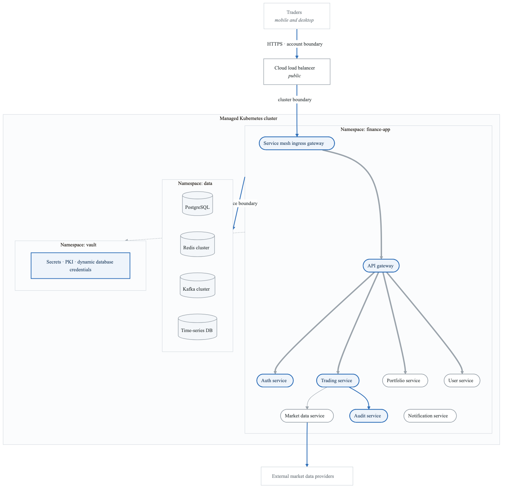
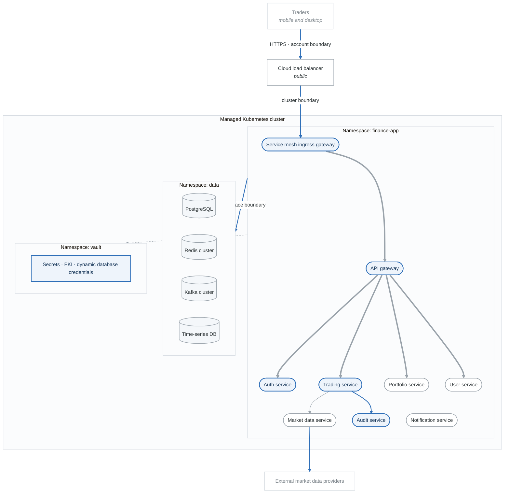
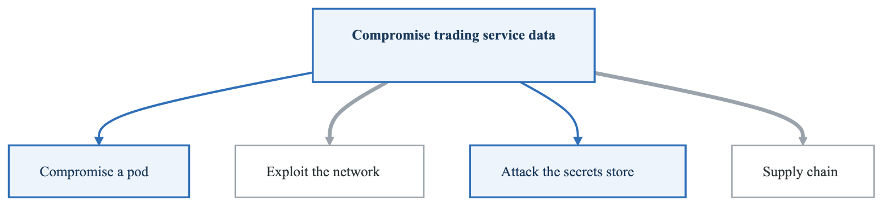
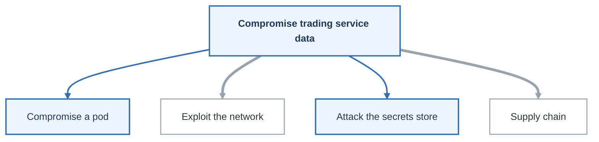

# Lab 04: Kubernetes Deployment Threat Model

## Objective

Perform a comprehensive threat model of a Kubernetes-based microservices deployment, identifying container-specific, orchestration, and cloud-native threats.

---

## Scenario: FinanceApp Microservices Platform

You are the security architect for a financial services company deploying a new trading platform on Kubernetes.

### Application Components

**FinanceApp Microservices:**

- API Gateway (Kong)
- Authentication Service
- User Service
- Trading Service
- Portfolio Service
- Market Data Service
- Notification Service
- Audit Service
- Supporting Infrastructure
  - PostgreSQL (via StatefulSet)
  - Redis (session cache)
  - Kafka (event streaming)
  - Vault (secrets management)


### Deployment Environment

| Aspect | Configuration |
|--------|---------------|
| Cloud Provider | AWS EKS |
| Kubernetes Version | 1.28 |
| Node Groups | 3 (system, application, data) |
| Namespaces | default, finance-app, monitoring, vault |
| Ingress | AWS ALB Ingress Controller |
| Service Mesh | Istio |
| Secrets | HashiCorp Vault with CSI driver |
| Monitoring | Prometheus, Grafana, Loki |

---

## Architecture Diagram

<!-- figure: generated from the Mermaid below by _shared/diagrams/embed-figures.py — do not edit the image -->


<details>
<summary>Diagram source (Mermaid)</summary>



</details>

---

## Kubernetes Manifests (Excerpts)

### Trading Service Deployment

```yaml
apiVersion: apps/v1
kind: Deployment
metadata:
  name: trading-service
  namespace: finance-app
spec:
  replicas: 3
  selector:
    matchLabels:
      app: trading-service
  template:
    metadata:
      labels:
        app: trading-service
        version: v1
      annotations:
        vault.hashicorp.com/agent-inject: "true"
        vault.hashicorp.com/role: "trading-service"
        vault.hashicorp.com/agent-inject-secret-db: "database/creds/trading"
    spec:
      serviceAccountName: trading-service
      securityContext:
        runAsNonRoot: true
        runAsUser: 1000
        fsGroup: 1000
      containers:
      - name: trading
        image: financeapp/trading-service:v2.3.1
        ports:
        - containerPort: 8080
        resources:
          limits:
            cpu: "500m"
            memory: "512Mi"
          requests:
            cpu: "250m"
            memory: "256Mi"
        securityContext:
          allowPrivilegeEscalation: false
          readOnlyRootFilesystem: true
          capabilities:
            drop:
              - ALL
        livenessProbe:
          httpGet:
            path: /health
            port: 8080
          initialDelaySeconds: 10
        readinessProbe:
          httpGet:
            path: /ready
            port: 8080
        volumeMounts:
        - name: tmp
          mountPath: /tmp
        - name: config
          mountPath: /etc/config
          readOnly: true
      volumes:
      - name: tmp
        emptyDir: {}
      - name: config
        configMap:
          name: trading-config
```

### Network Policy

```yaml
apiVersion: networking.k8s.io/v1
kind: NetworkPolicy
metadata:
  name: trading-service-policy
  namespace: finance-app
spec:
  podSelector:
    matchLabels:
      app: trading-service
  policyTypes:
  - Ingress
  - Egress
  ingress:
  - from:
    - podSelector:
        matchLabels:
          app: kong-gateway
    ports:
    - protocol: TCP
      port: 8080
  egress:
  - to:
    - namespaceSelector:
        matchLabels:
          name: data
      podSelector:
        matchLabels:
          app: postgresql
    ports:
    - protocol: TCP
      port: 5432
  - to:
    - podSelector:
        matchLabels:
          app: portfolio-service
    ports:
    - protocol: TCP
      port: 8080
```

### RBAC Configuration

```yaml
apiVersion: v1
kind: ServiceAccount
metadata:
  name: trading-service
  namespace: finance-app
---
apiVersion: rbac.authorization.k8s.io/v1
kind: Role
metadata:
  name: trading-service-role
  namespace: finance-app
rules:
- apiGroups: [""]
  resources: ["configmaps"]
  resourceNames: ["trading-config"]
  verbs: ["get", "watch"]
- apiGroups: [""]
  resources: ["secrets"]
  resourceNames: ["trading-tls"]
  verbs: ["get"]
---
apiVersion: rbac.authorization.k8s.io/v1
kind: RoleBinding
metadata:
  name: trading-service-binding
  namespace: finance-app
subjects:
- kind: ServiceAccount
  name: trading-service
  namespace: finance-app
roleRef:
  kind: Role
  name: trading-service-role
  apiGroup: rbac.authorization.k8s.io
```

---

## Lab Tasks

### Task 1: Kubernetes Threat Landscape Analysis (20 minutes)

Identify threats specific to each Kubernetes layer:

**KUBERNETES THREAT LAYERS**

**Layer 1: Cloud Infrastructure (AWS)**

- IAM misconfigurations
- Network exposure
- Resource quotas

**Layer 2: Kubernetes Control Plane**

- API Server access
- etcd security
- Admission controllers

**Layer 3: Node Security**

- Node access
- kubelet security
- Container runtime

**Layer 4: Workload Security**

- Pod security
- Container security
- Application vulnerabilities

**Layer 5: Data Security**

- Secrets management
- Persistent storage
- Data in transit


**Deliverable:** List 3-5 specific threats for each layer

---

### Task 2: STRIDE Analysis of Kubernetes Components (45 minutes)

Apply STRIDE to key Kubernetes components:

#### 2.1 API Server

| STRIDE | Threat | Attack Vector |
|--------|--------|---------------|
| Spoofing | | |
| Tampering | | |
| Repudiation | | |
| Info Disclosure | | |
| DoS | | |
| EoP | | |

#### 2.2 Service Account: trading-service

| STRIDE | Threat | Attack Vector |
|--------|--------|---------------|
| Spoofing | | |
| Tampering | | |
| Repudiation | | |
| Info Disclosure | | |
| DoS | | |
| EoP | | |

#### 2.3 Pod-to-Pod Communication (Service Mesh)

| STRIDE | Threat | Attack Vector |
|--------|--------|---------------|
| Spoofing | | |
| Tampering | | |
| Repudiation | | |
| Info Disclosure | | |
| DoS | | |
| EoP | | |

#### 2.4 Secrets (Vault Integration)

| STRIDE | Threat | Attack Vector |
|--------|--------|---------------|
| Spoofing | | |
| Tampering | | |
| Repudiation | | |
| Info Disclosure | | |
| DoS | | |
| EoP | | |

---

### Task 3: Container Image Security Analysis (20 minutes)

Analyze the container image security posture:

```
Container Image Threat Checklist:
□ Base image vulnerabilities
□ Dependency vulnerabilities
□ Hardcoded secrets in layers
□ Excessive permissions (USER root)
□ Unnecessary packages installed
□ Missing image signing
□ Mutable tags (e.g., :latest)
□ Unsigned/untrusted registry
```

**Questions to answer:**
1. What could go wrong with the image `financeapp/trading-service:v2.3.1`?
2. How could an attacker compromise the image supply chain?
3. What controls are missing from the deployment manifest?

---

### Task 4: Network Security Assessment (20 minutes)

Review the NetworkPolicy and identify gaps:

```yaml
# Current NetworkPolicy (from above)
# Analyze:
# 1. Is egress properly restricted?
# 2. Can pods communicate that shouldn't?
# 3. Is the policy enforced (CNI support)?
```

**Create a threat map:**
**Trading Service Network Threats:**

- Intra-namespace: Can any pod in finance-app reach trading-service?
- Cross-namespace: Can pods in other namespaces reach trading-service?
- Egress: What external endpoints can trading-service reach?
- DNS: Can trading-service resolve arbitrary domains?


---

### Task 5: RBAC Review (20 minutes)

Analyze the RBAC configuration for privilege escalation paths:

**Review checklist:**
```
□ Service account has minimal permissions
□ No cluster-wide permissions for workload accounts
□ No ability to create/modify secrets beyond needs
□ No ability to modify own RBAC
□ No access to other namespaces
□ Pod security admission enforced
```

**Identify:**
1. What could an attacker do if they compromised the trading-service pod?
2. Can they escalate privileges within the cluster?
3. Can they access other services' data?

---

### Task 6: Attack Tree - Cluster Compromise (25 minutes)

Build an attack tree for "Compromise Trading Service Data":

<!-- figure: generated from the Mermaid below by _shared/diagrams/embed-figures.py — do not edit the image -->


<details>
<summary>Diagram source (Mermaid)</summary>



</details>

**Decompose each path** to leaf nodes with:
- Attack technique
- Required access
- Detection difficulty

---

### Task 7: Compliance Mapping (15 minutes)

Map identified threats to compliance requirements:

| Threat | PCI DSS | SOC 2 | Mitigation Required |
|--------|---------|-------|---------------------|
| Container running as root | 2.2 | CC6.1 | |
| Secrets in environment vars | 3.4 | CC6.1 | |
| Missing network segmentation | 1.3 | CC6.6 | |
| No audit logging | 10.2 | CC7.2 | |

---

## Kubernetes Threat Reference

<details>
<summary>Click to reveal Kubernetes-specific threats</summary>

### Control Plane Threats
- Anonymous API access enabled
- Insecure API server flags
- etcd without encryption
- Missing admission controllers
- Weak authentication (no OIDC)

### Node Threats
- kubelet anonymous auth
- Privileged node access
- Host path mounts
- Node port exposure
- Container runtime vulnerabilities

### Workload Threats
- Privileged containers
- Host namespace sharing
- Writable root filesystem
- Missing resource limits
- Capability abuse

### Network Threats
- Missing network policies
- Service exposure (LoadBalancer/NodePort)
- DNS exfiltration
- Pod-to-pod lateral movement
- Ingress misconfiguration

### Secrets Threats
- Secrets mounted to unnecessary pods
- Base64 "encryption" only
- Secrets in environment variables
- etcd secrets unencrypted
- RBAC allowing secret access

### Supply Chain Threats
- Unsigned images
- Mutable image tags
- Vulnerable base images
- Malicious admission webhooks
- Compromised operators

</details>

---

## Evaluation Criteria

| Criteria | Points |
|----------|--------|
| Layer-specific threat identification | 15 |
| STRIDE analysis completeness | 25 |
| Container security assessment | 15 |
| Network security analysis | 15 |
| RBAC review thoroughness | 10 |
| Attack tree quality | 15 |
| Compliance mapping | 5 |
| **Total** | **100** |

---

## Tools for This Lab

| Tool | Purpose | Command |
|------|---------|---------|
| kubectl | Cluster inspection | `kubectl get pods -A` |
| kube-bench | CIS benchmark | `kube-bench run` |
| kubeaudit | Security audit | `kubeaudit all` |
| trivy | Image scanning | `trivy image <image>` |
| kube-hunter | Penetration testing | `kube-hunter --remote <ip>` |
| Falco | Runtime security | Runtime monitoring |

---

## Next Lab

→ [Lab 05: Serverless Application](labs-lab-05-serverless-README.md)

<!-- feynman-check -->

---

## Feynman check

Close the file. Blank page, no notes. Explain each of these to a competent engineer who has never
used this tool — **under five minutes, no jargon you can't define on the spot:**

- Scenario: FinanceApp Microservices Platform
- Kubernetes Manifests (Excerpts)
- Kubernetes Threat Reference
- Tools for This Lab

**The gap is not what you forgot. It is where you used a word instead of a mechanism.**

| | |
|---|---|
| ✗ | *"We scan for vulnerabilities in the pipeline."* |
| ✓ | *"SAST reads source without running it, SCA resolves the dependency tree against an advisory database, and image scanning compares installed package versions to that same database. All three report what was known at build time — which is why the registry is re-scanned: the image does not change, the database does."* |

**Trace it:** A CVE published today against your base image → a blocked deploy. Name every component between the advisory and the refused `apply`.

Stop at the first component you cannot name. Reopen this file and read **only** that.

**Go deeper — only once the gap has a name:** the [SLSA threat model](https://slsa.dev/spec/v1.2/threats) — it names every point at which a build can be subverted, and most teams defend three of them.
Full list per domain: [`SOURCES.md`](../../SOURCES.md#devsecops)

→ Protocol, the three levels of knowing, and worked examples: [`MASTERY.md`](../../MASTERY.md)

<!-- /feynman-check -->
