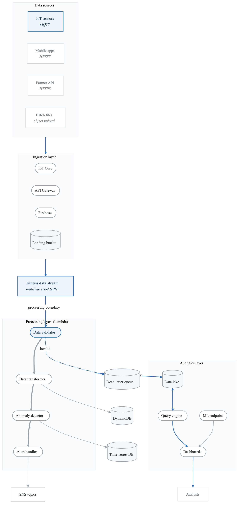
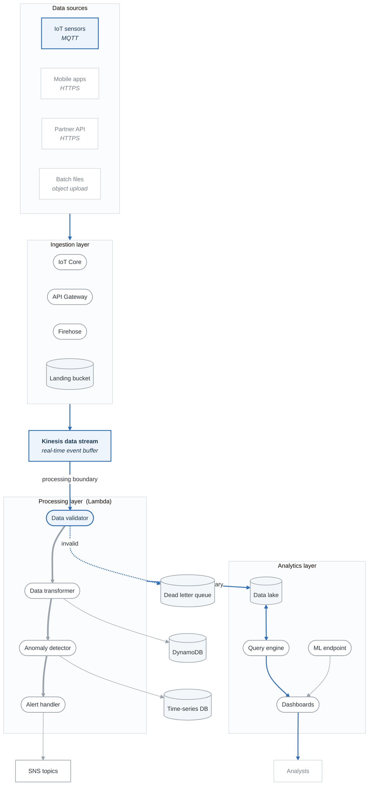
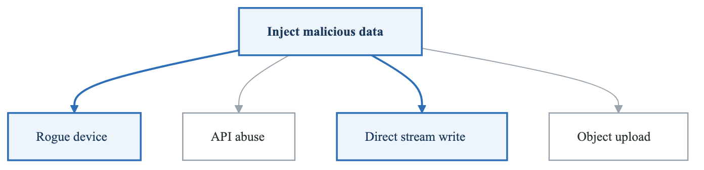
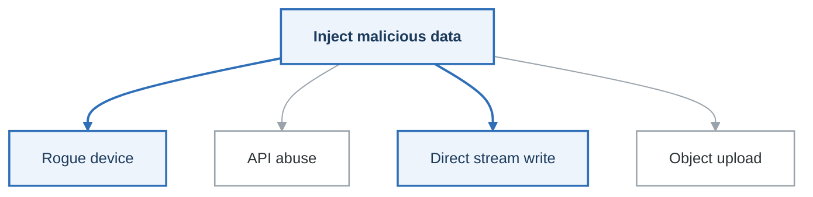

# Lab 05: Serverless Application Threat Model

## Objective

Perform a comprehensive threat model of a serverless data processing pipeline on AWS, identifying function-level, event-driven, and cloud-native threats.

---

## Scenario: DataPipe Analytics Platform

You are the security architect for DataPipe, a real-time analytics platform processing IoT sensor data.

### Platform Overview

**DataPipe Serverless Architecture:**

- Data Ingestion
  - API Gateway (REST endpoints)
  - IoT Core (MQTT ingestion)
  - Kinesis Data Streams
- Processing Layer
  - Lambda: Data Validator
  - Lambda: Data Transformer
  - Lambda: Anomaly Detector
  - Lambda: Alert Handler
- Storage Layer
  - DynamoDB (real-time data)
  - S3 (raw data lake)
  - Timestream (time-series)
  - ElastiCache (hot data)
- Analytics Layer
  - Athena (ad-hoc queries)
  - QuickSight (dashboards)
  - SageMaker (ML inference)
- Notification Layer
  - SNS (alerts)
  - SES (email reports)
  - EventBridge (event routing)


---

## Architecture Diagram

<!-- figure: generated from the Mermaid below by _shared/diagrams/embed-figures.py — do not edit the image -->


<details>
<summary>Diagram source (Mermaid)</summary>



</details>

---

## Lab Tasks

### Task 1: Serverless Threat Landscape (20 minutes)

Identify threats unique to serverless:

**Serverless-Specific Threats:**

- Function-Level
  - Event injection
  - Function code injection
  - Dependency vulnerabilities
  - Resource exhaustion
- Execution Environment
  - Cold start exploitation
  - Shared /tmp vulnerabilities
  - Environment variable exposure
  - Container escape
- Event Sources
  - Trigger manipulation
  - Event data poisoning
  - Unauthorized invocation
- Permissions
  - Overly permissive IAM roles
  - Cross-function privilege escalation
  - Resource policy bypass
- Data Flow
  - Insecure event bus
  - Unencrypted data in transit
  - Sensitive data in logs


**Map these to STRIDE:**

| Threat Category | S | T | R | I | D | E |
|-----------------|---|---|---|---|---|---|
| Event injection | | | | | | |
| Function code injection | | | | | | |
| Overly permissive IAM | | | | | | |
| Data in logs | | | | | | |

---

### Task 2: Lambda Function Analysis (30 minutes)

Analyze each Lambda function:

**Data Validator Function:**

```python
# validator.py
import json
import boto3

dynamodb = boto3.resource('dynamodb')
table = dynamodb.Table(os.environ['TABLE_NAME'])

def handler(event, context):
    for record in event['Records']:
        payload = json.loads(record['kinesis']['data'])

        # Validate schema
        if not validate_schema(payload):
            send_to_dlq(payload)
            continue

        # Validate device
        device_id = payload.get('device_id')
        if not is_registered_device(device_id):
            log_unauthorized(payload)  # Potential info disclosure
            continue

        # Forward to transformer
        invoke_transformer(payload)
```

| Threat | Code Location | STRIDE | Risk |
|--------|---------------|--------|------|
| Injection via payload | `json.loads()` | T | Medium |
| Log injection | `log_unauthorized()` | I, R | Medium |
| Unvalidated device_id | `payload.get()` | S, T | High |

**Analyze the remaining functions similarly:**

- Data Transformer
- Anomaly Detector
- Alert Handler

---

### Task 3: IAM Role Analysis (25 minutes)

Review function IAM roles:

```json
{
  "Version": "2012-10-17",
  "Statement": [
    {
      "Effect": "Allow",
      "Action": [
        "dynamodb:*",
        "s3:*",
        "kinesis:*",
        "logs:*",
        "sns:*"
      ],
      "Resource": "*"
    }
  ]
}
```

**Issues to identify:**

| Issue | Risk | Recommendation |
|-------|------|----------------|
| Wildcard actions | Privilege escalation | Specific actions only |
| Wildcard resources | Cross-data access | Specific ARNs |
| No conditions | Unrestricted access | Add conditions |

**Design least-privilege roles:**

| Function | Required Actions | Specific Resources |
|----------|------------------|-------------------|
| Data Validator | kinesis:GetRecords, dynamodb:PutItem | Specific stream, table |
| Data Transformer | dynamodb:Query, s3:PutObject | Specific table, bucket |
| Anomaly Detector | timestream:WriteRecords | Specific database |
| Alert Handler | sns:Publish | Specific topics |

---

### Task 4: Event Source Security (25 minutes)

Analyze event triggers:

**API Gateway → Lambda:**

```yaml
# Threat: Unauthenticated invocation
Resources:
  DataIngestionAPI:
    Type: AWS::ApiGateway::RestApi
    Properties:
      Name: DataIngestionAPI

  DataEndpoint:
    Type: AWS::ApiGateway::Method
    Properties:
      AuthorizationType: NONE  # VULNERABLE
      HttpMethod: POST
      Integration:
        Type: AWS_PROXY
        Uri: !Sub "arn:aws:lambda:..."
```

**IoT Core → Lambda:**

```yaml
# Threat: Device spoofing
IoTRule:
  Type: AWS::IoT::TopicRule
  Properties:
    TopicRulePayload:
      Sql: "SELECT * FROM 'sensors/+/data'"  # Wildcard subscription
      Actions:
        - Lambda:
            FunctionArn: !GetAtt ValidatorFunction.Arn
```

**Kinesis → Lambda:**

| Threat | Attack | Mitigation |
|--------|--------|------------|
| Event poisoning | Inject malicious records | Validate all fields |
| Resource exhaustion | High-volume events | Concurrency limits |
| Replay attacks | Reprocess old events | Idempotency checks |

---

### Task 5: Data Flow Security (25 minutes)

Trace sensitive data through the pipeline:

```
Sensor Data Flow:
[Device] → [IoT Core] → [Kinesis] → [Lambda] → [DynamoDB]
                                        ↓
                                    [CloudWatch Logs]
                                        ↓
                                    [S3 Data Lake]
                                        ↓
                                    [Athena/QuickSight]
```

**Data classification:**

| Data Element | Classification | Encryption Required | Retention |
|--------------|----------------|---------------------|-----------|
| Device ID | Internal | Transit | 90 days |
| Sensor readings | Confidential | Transit + Rest | 1 year |
| GPS coordinates | PII | Transit + Rest | 30 days |
| Alert content | Internal | Transit | 1 year |

**Identify data exposure points:**

| Location | Data Exposed | Risk | Mitigation |
|----------|--------------|------|------------|
| CloudWatch Logs | Sensor readings | Medium | Log filtering |
| S3 bucket policy | All data | High | Restrict access |
| Athena queries | PII | Medium | Column-level security |
| QuickSight | Aggregated data | Low | Role-based access |

---

### Task 6: Attack Scenarios (30 minutes)

**Scenario 1: Event Injection Attack**

**Attack chain**

1. The attacker discovers the IoT topic pattern — `sensors/+/data`
2. Registers a rogue device with a guessed `device_id`
3. Publishes a crafted payload containing SQL injection in the `sensor_type` field and command
   injection in the metadata
4. The payload is processed by the Lambda function
5. Malicious data is stored downstream
6. Analytics jobs consume it, and the injection fires somewhere nobody was looking

**Attack tree**

<!-- figure: generated from the Mermaid below by _shared/diagrams/embed-figures.py — do not edit the image -->


<details>
<summary>Diagram source (Mermaid)</summary>



</details>

Step 5 is the interesting one for a threat model. The injection does not fire where it enters — it is
*stored*, and it executes later, in a different service, run by a different team, against a query
nobody associated with the ingestion path.

**Scenario 2: Privilege Escalation via Lambda**

```
Attack Chain:
1. Exploit SSRF in Data Transformer (fetches external URLs)
2. Access IMDS: http://169.254.169.254/...
3. Obtain Lambda execution role credentials
4. Credentials have s3:* and dynamodb:*
5. Access all customer data across the platform

Mitigation Requirements:
□ VPC-only Lambda execution
□ VPC endpoints for AWS services
□ Least privilege IAM roles
□ No SSRF-capable code paths
```

**Scenario 3: Data Exfiltration via Logs**

Attack Chain:
1. Inject payload that triggers verbose logging
2. Sensitive data written to CloudWatch
3. Logs shipped to S3 for long-term storage
4. Attacker with log access reads sensitive data

**Data at Risk:**

- Device authentication tokens
- Sensor readings with PII
- Internal API keys
- Error messages with stack traces


---

### Task 7: Security Controls Design (25 minutes)

Design security controls for each layer:

**Ingestion Layer:**

| Control | Implementation | Priority |
|---------|----------------|----------|
| Authentication | IoT Core device certs, API Gateway authorizers | P0 |
| Input validation | JSON schema validation | P0 |
| Rate limiting | API Gateway throttling | P1 |
| Device allowlist | IoT Core policies | P1 |

**Processing Layer:**

| Control | Implementation | Priority |
|---------|----------------|----------|
| Least privilege | Function-specific IAM roles | P0 |
| Code signing | Lambda code signing | P1 |
| VPC isolation | VPC-bound execution | P1 |
| Secrets management | Secrets Manager, not env vars | P0 |

**Data Layer:**

| Control | Implementation | Priority |
|---------|----------------|----------|
| Encryption at rest | KMS CMK for all stores | P0 |
| Encryption in transit | TLS everywhere | P0 |
| Access logging | S3 access logs, DynamoDB streams | P1 |
| Data classification | Tagging and policies | P2 |

---

## Serverless Security Checklist

```
Function Security:
□ Minimal IAM permissions
□ No secrets in environment variables
□ Input validation on all event sources
□ Output encoding
□ Dependency scanning
□ Code signing enabled

Event Source Security:
□ Authentication on all triggers
□ Authorization checks
□ Rate limiting
□ Event validation

Data Security:
□ Encryption at rest (KMS)
□ Encryption in transit (TLS)
□ No sensitive data in logs
□ Data classification applied

Monitoring:
□ CloudWatch alarms configured
□ X-Ray tracing enabled
□ Security Hub integration
□ GuardDuty for serverless
```

---

## Evaluation Criteria

| Criteria | Points |
|----------|--------|
| Serverless threat landscape | 15 |
| Lambda function analysis | 20 |
| IAM role analysis | 15 |
| Event source security | 15 |
| Data flow security | 15 |
| Attack scenarios | 15 |
| Security controls design | 5 |
| **Total** | **100** |

---

## Next Lab

→ [Lab 06: Multi-Cloud Architecture](../lab-06-multi-cloud/)

<!-- feynman-check -->

---

## Feynman check

Close the file. Blank page, no notes. Explain each of these to a competent engineer who has never
used this tool — **under five minutes, no jargon you can't define on the spot:**

- Scenario: DataPipe Analytics Platform
- Serverless Security Checklist
- Platform Overview
- Serverless Threat Landscape

**The gap is not what you forgot. It is where you used a word instead of a mechanism.**

| | |
|---|---|
| ✗ | *"We scan for vulnerabilities in the pipeline."* |
| ✓ | *"SAST reads source without running it, SCA resolves the dependency tree against an advisory database, and image scanning compares installed package versions to that same database. All three report what was known at build time — which is why the registry is re-scanned: the image does not change, the database does."* |

**Trace it:** A CVE published today against your base image → a blocked deploy. Name every component between the advisory and the refused `apply`.

Stop at the first component you cannot name. Reopen this file and read **only** that.

**Go deeper — only once the gap has a name:** the [SLSA threat model](https://slsa.dev/spec/v1.2/threats) — it names every point at which a build can be subverted, and most teams defend three of them.
Full list per domain: [`SOURCES.md`](../../SOURCES.md#devsecops)

→ Protocol, the three levels of knowing, and worked examples: [`MASTERY.md`](../../MASTERY.md)

<!-- /feynman-check -->
