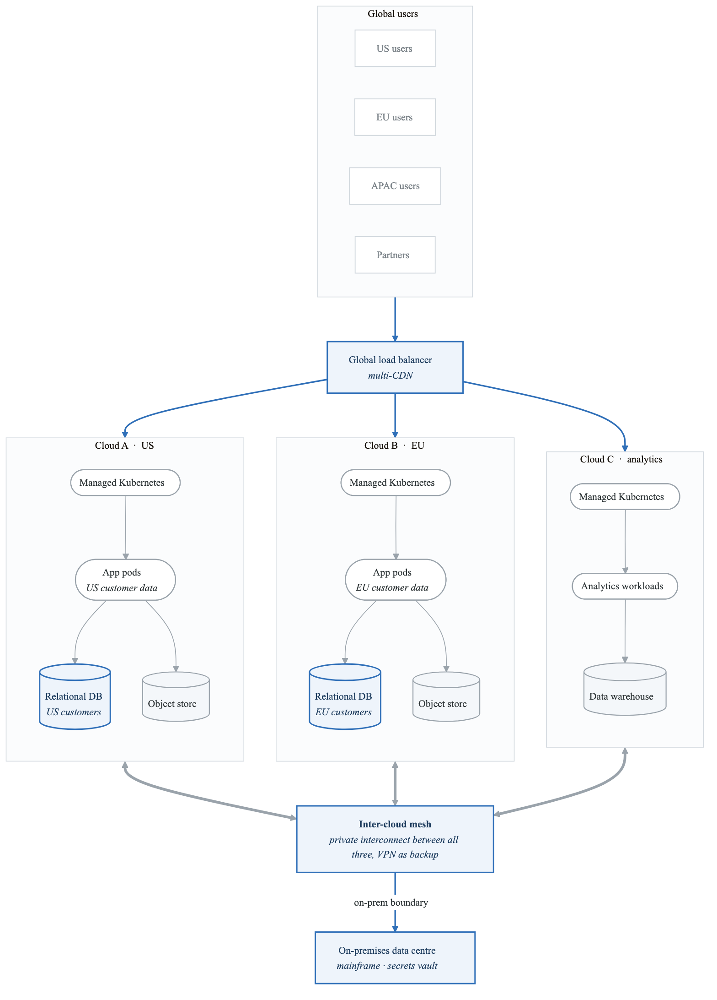
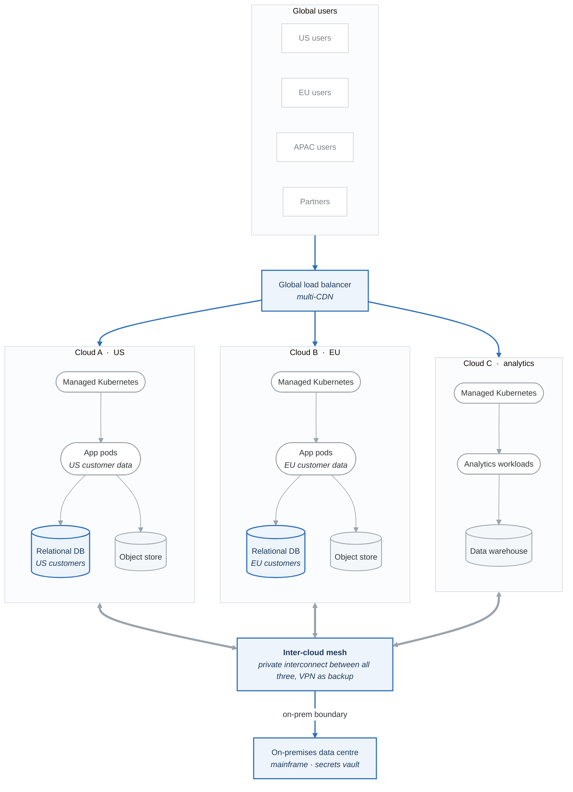
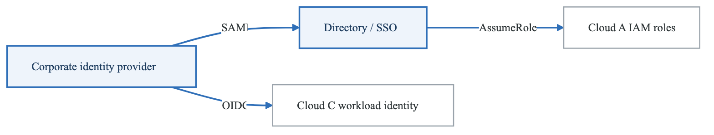
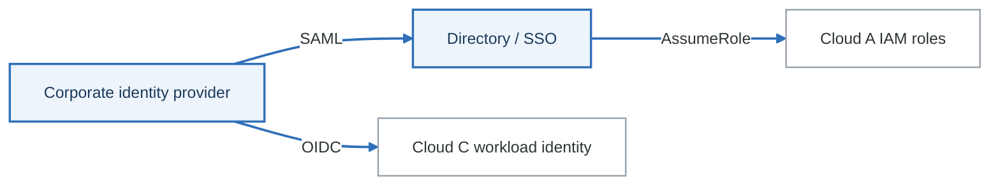
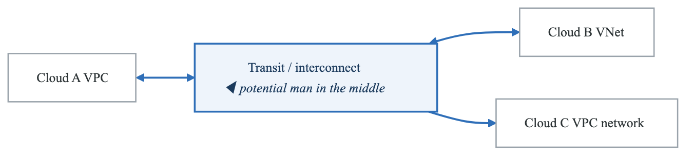
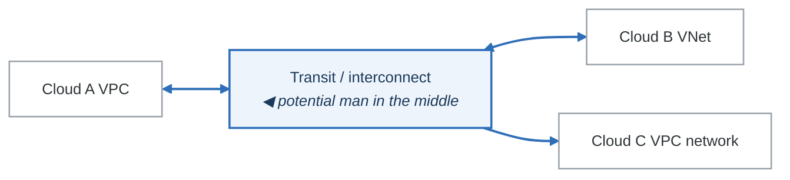
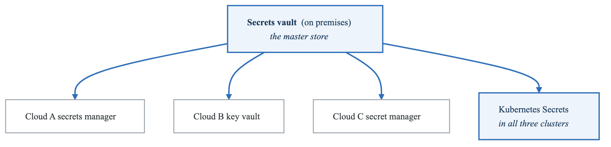
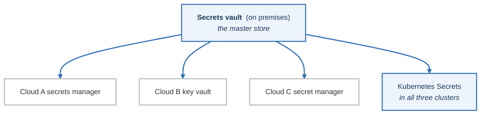

# Lab 06: Multi-Cloud Architecture Threat Model

## Objective

Perform a threat model of a multi-cloud deployment spanning AWS, Azure, and GCP, identifying cloud-specific and cross-cloud threats.

---

## Scenario: GlobalTech Hybrid Platform

You are the security architect for GlobalTech, an enterprise running workloads across multiple cloud providers for resilience and compliance.

### Deployment Rationale

| Cloud | Purpose | Workloads |
|-------|---------|-----------|
| AWS | Primary (US) | Core application, US customers |
| Azure | Europe (GDPR) | EU customer data, Office 365 integration |
| GCP | Analytics | BigQuery, ML/AI workloads |
| On-Prem | Legacy | Mainframe integration, sensitive data |

---

## Architecture Diagram

<!-- figure: generated from the Mermaid below by _shared/diagrams/embed-figures.py — do not edit the image -->


<details>
<summary>Diagram source (Mermaid)</summary>



</details>

---

## Lab Tasks

### Task 1: Multi-Cloud Attack Surface (25 minutes)

Map the attack surface across clouds:

**AWS Attack Surface:**

| Component | Entry Points | Data Assets | Threats |
|-----------|--------------|-------------|---------|
| EKS API Server | Kubectl, CI/CD | Cluster configs | Unauthorized access |
| RDS | App connection | US customer data | SQL injection |
| S3 | Presigned URLs | Documents | Bucket misconfiguration |
| IAM | Console, CLI | Credentials | Privilege escalation |

**Azure Attack Surface:**

| Component | Entry Points | Data Assets | Threats |
|-----------|--------------|-------------|---------|
| AKS | | EU customer data | |
| Azure SQL | | | |
| Blob Storage | | | |
| Azure AD | | | |

**GCP Attack Surface:**

| Component | Entry Points | Data Assets | Threats |
|-----------|--------------|-------------|---------|
| GKE | | Analytics data | |
| BigQuery | | | |
| Cloud Storage | | | |
| Service Accounts | | | |

---

### Task 2: Cross-Cloud Identity Analysis (30 minutes)

Analyze identity federation:

<!-- figure: generated from the Mermaid below by _shared/diagrams/embed-figures.py — do not edit the image -->


<details>
<summary>Diagram source (Mermaid)</summary>



</details>

**Identity threat matrix:**

| Threat | Attack Vector | Impact | Clouds Affected |
|--------|---------------|--------|-----------------|
| IdP compromise | Phish IdentityCo admin | All access | All |
| Token theft | Steal SAML assertion | Impersonation | AWS, Azure |
| Role chaining | Assume multiple roles | Privilege escalation | AWS |
| Service account leak | Exposed key file | GCP access | GCP |
| Conditional access bypass | Device spoofing | MFA bypass | Azure |

---

### Task 3: Data Residency Threat Analysis (25 minutes)

Analyze GDPR and data residency:

**Data Flow Compliance:**

| Data Type | Origin | Allowed Locations | Current Location | Compliant? |
|-----------|--------|-------------------|------------------|------------|
| EU Customer PII | EU Users | EU only | Azure EU-West | ✓ |
| EU Analytics | EU Users | EU or US (consent) | GCP US | ? |
| US Customer Data | US Users | US | AWS US-East | ✓ |
| Aggregated Metrics | All | Any | GCP US | ✓ |

**Cross-cloud data flow threats:**

| Flow | Data | Threat | Compliance Risk |
|------|------|--------|-----------------|
| Azure → GCP | EU analytics | Data leaves EU | GDPR violation |
| AWS → Azure | User sync | PII transfer | Requires DPA |
| GCP → AWS | ML results | May contain PII | Re-identification |

---

### Task 4: Network Security Analysis (25 minutes)

Analyze cross-cloud connectivity:

<!-- figure: generated from the Mermaid below by _shared/diagrams/embed-figures.py — do not edit the image -->


<details>
<summary>Diagram source (Mermaid)</summary>



</details>

**Network threats:**

| Threat | Location | Attack | Mitigation |
|--------|----------|--------|------------|
| Inter-cloud interception | Transit links | MITM | IPsec/mTLS |
| Lateral movement | Between clouds | Pivot from one to all | Segmentation |
| DNS poisoning | Cloud DNS | Redirect traffic | DNSSEC |
| BGP hijacking | Interconnect | Route manipulation | RPKI |

**Firewall rule analysis:**

| Cloud | Rule | Risk | Recommendation |
|-------|------|------|----------------|
| AWS | SG allows 0.0.0.0/0:443 | Overly permissive | Restrict to known IPs |
| Azure | NSG allows cross-VNet | Lateral movement | Micro-segmentation |
| GCP | Default allow egress | Data exfiltration | Restrict egress |

---

### Task 5: Secrets Management Across Clouds (25 minutes)

Analyze secrets distribution:

<!-- figure: generated from the Mermaid below by _shared/diagrams/embed-figures.py — do not edit the image -->


<details>
<summary>Diagram source (Mermaid)</summary>



</details>

**Secrets threat analysis:**

| Secret Type | Storage Location | Rotation | Threats |
|-------------|------------------|----------|---------|
| DB credentials | Vault → Cloud | 30 days | Long-lived credentials |
| API keys | K8s secrets | Manual | Exposed in pod specs |
| TLS certificates | Per-cloud | 90 days | Certificate expiry |
| Service account keys | GCP | Never | Permanent access |

---

### Task 6: Cloud-Specific Vulnerabilities (30 minutes)

Identify cloud-specific attack vectors:

**AWS Specific:**

| Vulnerability | Service | Attack | Mitigation |
|---------------|---------|--------|------------|
| IMDS exploitation | EC2/EKS | SSRF → credentials | IMDSv2 |
| S3 bucket takeover | S3 | Dangling DNS | Monitor buckets |
| Lambda privilege escalation | Lambda | Overly permissive role | Least privilege |

**Azure Specific:**

| Vulnerability | Service | Attack | Mitigation |
|---------------|---------|--------|------------|
| Managed identity abuse | VMs | Token theft | Conditional access |
| Storage account keys | Blob | Key exposure | Use Azure AD auth |
| Runbook exploitation | Automation | Code injection | Secure runbooks |

**GCP Specific:**

| Vulnerability | Service | Attack | Mitigation |
|---------------|---------|--------|------------|
| Service account key file | IAM | File theft | Workload Identity |
| Cloud Function injection | Functions | Event injection | Input validation |
| BigQuery data exfil | BigQuery | Unauthorized query | VPC-SC |

---

### Task 7: Incident Response Complexity (20 minutes)

Analyze multi-cloud incident response challenges:

**Scenario: Coordinated Attack Across Clouds**

Attack Timeline:
Hour 0: Compromise IdentityCo admin via phishing
Hour 1: Access AWS via SSO, enumerate resources
Hour 2: Pivot to Azure AD, access AKS
Hour 3: Use cross-cloud connectivity to reach GCP
Hour 4: Exfiltrate data from BigQuery
Hour 6: Detection triggered in Azure

**Challenges:**

- Logs in 3 different formats (CloudTrail, Azure Monitor, Cloud Audit)
- Different timestamp formats and time zones
- Correlation across cloud identities
- No unified SIEM view
- Coordinating 3 cloud security teams


**Design incident response requirements:**

| Requirement | Current State | Gap | Recommendation |
|-------------|---------------|-----|----------------|
| Unified logging | 3 separate systems | No correlation | Cloud SIEM |
| Identity correlation | Manual | Time-consuming | Identity mapping |
| Automated response | Per-cloud only | Inconsistent | Cross-cloud playbooks |
| Forensic capability | Limited | Evidence collection | Cloud forensic tools |

---

### Task 8: Create Unified Threat Model (30 minutes)

Consolidate findings into a unified threat model:

**Top 10 Multi-Cloud Risks:**

| Rank | Threat | Primary Cloud | Cross-Cloud Impact | Risk |
|------|--------|---------------|-------------------|------|
| 1 | IdP compromise | All | Total compromise | Critical |
| 2 | Cross-cloud lateral movement | All | Escalation | Critical |
| 3 | Data residency violation | Azure → GCP | GDPR fines | High |
| 4 | | | | |
| 5 | | | | |

**Mitigation Roadmap:**

| Phase | Actions | Clouds | Priority |
|-------|---------|--------|----------|
| Immediate | MFA everywhere, IdP hardening | All | P0 |
| 30 days | Network segmentation | All | P0 |
| 60 days | Unified SIEM | All | P1 |
| 90 days | Data classification | Azure, GCP | P1 |

---

## Multi-Cloud Security Checklist

```
Identity:
□ Unified IdP with MFA
□ Conditional access policies
□ Service account audit
□ Cross-cloud role mapping documented

Network:
□ Encrypted inter-cloud links
□ Micro-segmentation in each cloud
□ Egress controls
□ DNS security (DNSSEC)

Data:
□ Data residency compliance verified
□ Encryption at rest (all clouds)
□ Data classification applied
□ Cross-cloud data flows documented

Monitoring:
□ Logs shipped to central SIEM
□ Cross-cloud correlation rules
□ Unified alerting
□ Incident response playbooks

Governance:
□ Unified security policies
□ Compliance mapping (per cloud)
□ Regular multi-cloud assessments
□ Cloud security posture management
```

---

## Evaluation Criteria

| Criteria | Points |
|----------|--------|
| Attack surface mapping | 15 |
| Identity analysis | 15 |
| Data residency analysis | 15 |
| Network security analysis | 15 |
| Secrets management | 10 |
| Cloud-specific vulnerabilities | 15 |
| Incident response | 10 |
| Unified threat model | 5 |
| **Total** | **100** |

---

## Next Lab

→ [Lab 07: Healthcare PHI System](../lab-07-healthcare-phi/)

<!-- feynman-check -->

---

## Feynman check

Close the file. Blank page, no notes. Explain each of these to a competent engineer who has never
used this tool — **under five minutes, no jargon you can't define on the spot:**

- Scenario: GlobalTech Hybrid Platform
- Multi-Cloud Security Checklist
- Deployment Rationale
- Multi-Cloud Attack Surface

**The gap is not what you forgot. It is where you used a word instead of a mechanism.**

| | |
|---|---|
| ✗ | *"We scan for vulnerabilities in the pipeline."* |
| ✓ | *"SAST reads source without running it, SCA resolves the dependency tree against an advisory database, and image scanning compares installed package versions to that same database. All three report what was known at build time — which is why the registry is re-scanned: the image does not change, the database does."* |

**Trace it:** A CVE published today against your base image → a blocked deploy. Name every component between the advisory and the refused `apply`.

Stop at the first component you cannot name. Reopen this file and read **only** that.

**Go deeper — only once the gap has a name:** the [SLSA threat model](https://slsa.dev/spec/v1.2/threats) — it names every point at which a build can be subverted, and most teams defend three of them.
Full list per domain: [`SOURCES.md`](../../SOURCES.md#devsecops)

→ Protocol, the three levels of knowing, and worked examples: [`MASTERY.md`](../../MASTERY.md)

<!-- /feynman-check -->
