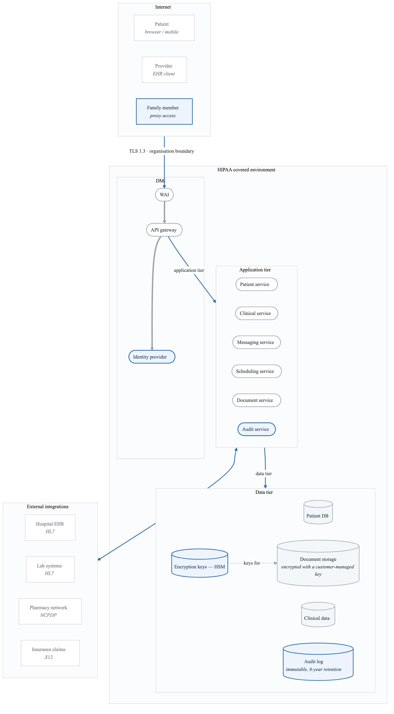
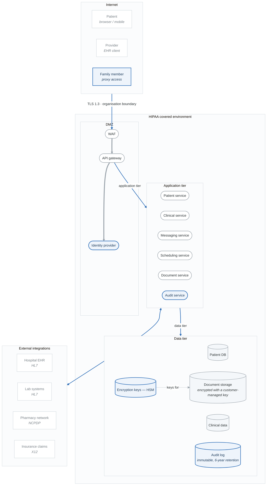

# Lab 07: Healthcare PHI System Threat Model (HIPAA)

## Objective

Perform a comprehensive threat model of a healthcare patient portal handling Protected Health Information (PHI), applying both STRIDE and LINDDUN methodologies with HIPAA compliance mapping.

---

## Scenario: MedConnect Patient Portal

You are the security architect for MedConnect, a healthcare technology company building a patient portal for a hospital network.

### System Overview

**MedConnect Patient Portal Features:**

- Patient Features
  - Secure login with MFA
  - View medical records
  - Download health documents
  - Schedule appointments
  - Request prescription refills
  - Secure messaging with providers
  - View/pay bills online
  - Manage family member access (proxy)
- Provider Features
  - View patient records
  - Document clinical encounters
  - E-prescribe medications
  - Order labs/imaging
  - Respond to patient messages
  - Review patient-submitted data
- Administrative Features
  - User management
  - Audit log review
  - Report generation
  - System configuration


### PHI Data Elements

| Data Category | Examples | Sensitivity |
|---------------|----------|-------------|
| Demographics | Name, DOB, SSN, Address | High |
| Medical Records | Diagnoses, procedures, notes | Very High |
| Medications | Prescriptions, allergies | High |
| Lab Results | Blood work, imaging | High |
| Mental Health | Therapy notes, diagnoses | Very High (42 CFR Part 2) |
| Substance Abuse | Treatment records | Very High (42 CFR Part 2) |
| HIV/AIDS | Test results, treatment | Very High (state laws) |
| Genetic Information | Genetic tests, markers | Very High (GINA) |
| Financial | Insurance, billing | Medium-High |

---

## Architecture Diagram

<!-- figure: generated from the Mermaid below by _shared/diagrams/embed-figures.py — do not edit the image -->


<details>
<summary>Diagram source (Mermaid)</summary>



</details>

---

## Lab Tasks

### Task 1: HIPAA Requirements Mapping (20 minutes)

Map system components to HIPAA requirements:

| HIPAA Requirement | §164.xxx | System Component | Control Needed |
|-------------------|----------|------------------|----------------|
| Access Control | 312(a)(1) | API Gateway, Services | |
| Audit Controls | 312(b) | Audit Service | |
| Integrity | 312(c)(1) | Document Storage | |
| Transmission Security | 312(e)(1) | All data flows | |
| Authentication | 312(d) | Identity Provider | |
| Encryption | 312(a)(2)(iv) | Database, Storage | |

**Administrative Safeguards (§164.308):**
```
□ Risk Analysis - Have we performed this threat model?
□ Workforce Security - Provider/admin access controls
□ Information Access - Minimum necessary access
□ Security Awareness - User training requirements
□ Incident Procedures - Breach response plan
□ Contingency Plan - Backup and recovery
```

---

### Task 2: STRIDE Analysis of PHI Flows (45 minutes)

Apply STRIDE to each PHI data flow:

#### Flow: Patient → View Medical Records

```
Patient Browser → API Gateway → Clinical Service → EHR Database
```

| Component | S | T | R | I | D | E | Specific Threats |
|-----------|---|---|---|---|---|---|------------------|
| Browser Session | ✓ | | | ✓ | | | |
| API Gateway | ✓ | ✓ | | ✓ | ✓ | | |
| Clinical Service | ✓ | ✓ | ✓ | ✓ | ✓ | ✓ | |
| EHR Database | | ✓ | | ✓ | ✓ | | |

**Document specific threats:**

| Threat ID | Flow | STRIDE | Description | HIPAA Impact |
|-----------|------|--------|-------------|--------------|
| PHI-001 | Medical Records | I | Unauthorized access to records | §164.312(a)(1) |
| PHI-002 | | | | |
| PHI-003 | | | | |

---

### Task 3: LINDDUN Privacy Analysis (40 minutes)

Apply LINDDUN to identify privacy threats:

#### Linkability
Questions:
- Can patient visits be linked across departments?
- Can prescription data be linked to diagnoses?
- Can proxy access patterns reveal family health history?

**Threats:**

- L1: Patient visit history linkable across facilities
- L2: Prescription patterns reveal undisclosed conditions
- L3: Proxy access logs link family members' health data


#### Identifiability
Questions:
- Can patients be identified from "de-identified" data?
- Are there unique quasi-identifiers in exports?
- Can patients be re-identified from aggregated reports?

**Threats:**

- I1: Small cell sizes in analytics reveal patient identity
- I2: Rare conditions make patients identifiable
- I3: Timing of access patterns identifies patients


#### Non-repudiation (Privacy)
**Questions**

- Can patients deny having accessed sensitive health information?
- Are there records a patient may need to disclaim?

**Threats**

| | |
|---|---|
| **N1** | Access to a mental-health portal is permanently logged |
| **N2** | Access to a substance-abuse record creates liability |

Non-repudiation is the STRIDE category that inverts under privacy law. Everywhere else, more logging
is better; here the log itself is the harm — an immutable record that someone opened a particular
chart is exactly what 42 CFR Part 2 exists to constrain. "Log everything" is not a safe default when
the access *is* the sensitive fact.

#### Detectability
Questions:
- Can existence of certain records be detected?
- Can patterns reveal sensitive conditions?

**Threats:**

- D1: Oncology appointment existence detectable
- D2: Mental health portal login patterns visible
- D3: Prescription service calls reveal medication use


#### Disclosure of Information
**Threats:**

- DI1: Breach of PHI database
- DI2: Screen capture of medical records
- DI3: Unencrypted backup exposure
- DI4: Debug logs containing PHI


#### Unawareness
Questions:
- Do patients know all uses of their data?
- Is consent clearly obtained and tracked?

**Threats:**

- U1: Patients unaware of analytics processing
- U2: Data sharing with insurers not transparent
- U3: Research use not clearly communicated


#### Non-compliance
**Threats:**

- NC1: PHI transmitted without encryption
- NC2: Missing breach notification procedures
- NC3: Inadequate BAA with cloud provider
- NC4: Audit logs not retained 6 years


---

### Task 4: Sensitive Data Classification (20 minutes)

Create a data classification scheme:

| Data Element | Classification | Handling Requirements | Access Restrictions |
|--------------|----------------|----------------------|---------------------|
| Patient Name | PHI | Encrypt, log access | Care team, patient |
| SSN | PHI-Sensitive | Encrypt, mask display | Billing only |
| Diagnoses | PHI | Encrypt, log access | Care team, patient |
| Mental Health Notes | PHI-Restricted | Separate system, extra consent | Specific providers |
| Substance Abuse | PHI-42CFR | Separate consent, restricted access | Specific programs |
| HIV Status | PHI-Restricted | State law compliance | Specific providers |
| Genetic Data | PHI-GINA | GINA compliance | Specific consent |
| Payment Info | PII/PCI | PCI DSS compliance | Billing team |

---

### Task 5: Break-the-Glass Analysis (20 minutes)

Design threat model for emergency access scenarios:

Break-the-Glass Scenario:
- Emergency room physician needs immediate access to patient records
- Patient is unconscious, cannot provide consent
- Normal access controls would delay care

**Threats:**

- Abuse: Provider uses BTG to snoop on non-emergency patients
- Insufficient Audit: BTG access not properly logged
- No Review: BTG events not reviewed for appropriateness
- False Emergency: BTG used for convenience, not emergency
- Persistent Access: BTG doesn't auto-expire

**Mitigations:**

- Mandatory reason code entry
- Real-time alert to privacy officer
- Time-limited access (e.g., 4 hours)
- Post-hoc review of all BTG events
- Consequences for abuse documented


---

### Task 6: Third-Party Risk Assessment (20 minutes)

Evaluate external integration risks:

| Integration | Data Shared | Protocol | Threats | Mitigations |
|-------------|-------------|----------|---------|-------------|
| Hospital EHR (Epic) | Full clinical data | HL7 FHIR | | BAA required |
| Lab Systems | Test orders, results | HL7 v2 | | |
| Pharmacy Network | Prescriptions | NCPDP | | |
| Insurance (Claims) | Diagnoses, procedures | X12 837 | | |
| Cloud Provider (AWS) | All PHI | Various | | |

**Business Associate Agreement (BAA) Checklist:**
```
□ BAA signed with all vendors handling PHI
□ Security responsibilities clearly defined
□ Breach notification requirements specified
□ Subcontractor requirements addressed
□ Termination and data return provisions
```

---

### Task 7: Attack Scenarios (25 minutes)

Develop realistic attack scenarios:

#### Scenario 1: Insider Threat - Snooping
```
Attacker: Curious employee (registration staff)
Goal: View celebrity patient records
Attack Path:
1. Legitimate system access for job function
2. Search for celebrity by name
3. Access medical records
4. Screenshot or photograph screen

Detection: ?
Prevention: ?
```

#### Scenario 2: External Attack - Data Breach
```
Attacker: Cybercriminal gang
Goal: Exfiltrate patient data for sale/ransom
Attack Path:
1. Phishing email to staff
2. Credential harvesting
3. Access portal with stolen creds
4. Escalate privileges
5. Exfiltrate database

Detection: ?
Prevention: ?
```

#### Scenario 3: Ransomware
```
Attacker: Ransomware operator
Goal: Encrypt systems, extort payment
Attack Path:
1. Exploit vulnerable public service
2. Lateral movement within network
3. Disable backups
4. Deploy ransomware
5. Demand payment

Detection: ?
Prevention: ?
Impact on patient care: ?
```

---

### Task 8: Risk Register and Remediation (20 minutes)

Create a prioritized risk register:

| ID | Threat | Likelihood | Impact | Risk | HIPAA § | Remediation | Priority |
|----|--------|------------|--------|------|---------|-------------|----------|
| R1 | PHI breach via SQL injection | Medium | Critical | Critical | 312(a)(1) | Parameterized queries | P0 |
| R2 | | | | | | | |
| R3 | | | | | | | |

**Remediation Roadmap:**
**Remediation plan — fill this in**

| Horizon | Actions |
|---|---|
| **Immediate** *(0–30 days)* | |
| | |
| | |
| **Short term** *(30–90 days)* | |
| | |
| | |
| **Medium term** *(90–180 days)* | |
| | |
| | |

Three horizons, not a single list. A finding that lands in "immediate" is one you would explain to a
regulator if it were exploited tomorrow; everything else needs a date and an owner, or it is a wish.

---

## HIPAA-Specific Threat Reference

<details>
<summary>Click to reveal HIPAA threat categories</summary>

### Technical Safeguards §164.312

**Access Control (a)(1):**
- Unauthorized PHI access
- Excessive user privileges
- Shared accounts
- Missing MFA

**Audit Controls (b):**
- Insufficient logging
- Log tampering
- Missing log review
- Short retention

**Integrity (c)(1):**
- PHI modification
- Unauthorized deletion
- Corruption during transmission

**Authentication (d):**
- Weak passwords
- No MFA
- Session hijacking
- Credential theft

**Transmission Security (e)(1):**
- Unencrypted transmission
- Weak TLS configuration
- MITM attacks

### Administrative Safeguards §164.308

**Risk Analysis (a)(1)(ii)(A):**
- Incomplete threat assessment
- Outdated risk analysis
- Missing remediation

**Workforce Security (a)(3):**
- Inadequate background checks
- Missing termination procedures
- Access not revoked

**Information Access (a)(4):**
- Minimum necessary not applied
- Role-based access incomplete

**Incident Procedures (a)(6):**
- No incident response plan
- Missing breach notification
- Inadequate forensics

### Physical Safeguards §164.310

**Facility Access (a)(1):**
- Unauthorized physical access
- Missing visitor logs
- Workstation in public areas

**Device/Media Controls (d)(1):**
- Unencrypted mobile devices
- Missing device inventory
- Improper disposal

</details>

---

## Evaluation Criteria

| Criteria | Points |
|----------|--------|
| HIPAA requirements mapping | 15 |
| STRIDE analysis of PHI flows | 20 |
| LINDDUN privacy analysis | 20 |
| Data classification | 10 |
| Break-the-glass analysis | 10 |
| Third-party risk assessment | 10 |
| Attack scenarios | 10 |
| Risk register quality | 5 |
| **Total** | **100** |

---

## Next Lab

→ [Lab 08: FinTech Payment Platform (PCI DSS)](../lab-08-fintech-pci/)

<!-- feynman-check -->

---

## Feynman check

Close the file. Blank page, no notes. Explain each of these to a competent engineer who has never
used this tool — **under five minutes, no jargon you can't define on the spot:**

- Scenario: MedConnect Patient Portal
- HIPAA-Specific Threat Reference
- System Overview
- PHI Data Elements

**The gap is not what you forgot. It is where you used a word instead of a mechanism.**

| | |
|---|---|
| ✗ | *"We scan for vulnerabilities in the pipeline."* |
| ✓ | *"SAST reads source without running it, SCA resolves the dependency tree against an advisory database, and image scanning compares installed package versions to that same database. All three report what was known at build time — which is why the registry is re-scanned: the image does not change, the database does."* |

**Trace it:** A CVE published today against your base image → a blocked deploy. Name every component between the advisory and the refused `apply`.

Stop at the first component you cannot name. Reopen this file and read **only** that.

**Go deeper — only once the gap has a name:** the [SLSA threat model](https://slsa.dev/spec/v1.2/threats) — it names every point at which a build can be subverted, and most teams defend three of them.
Full list per domain: [`SOURCES.md`](../../SOURCES.md#devsecops)

→ Protocol, the three levels of knowing, and worked examples: [`MASTERY.md`](../../MASTERY.md)

<!-- /feynman-check -->
