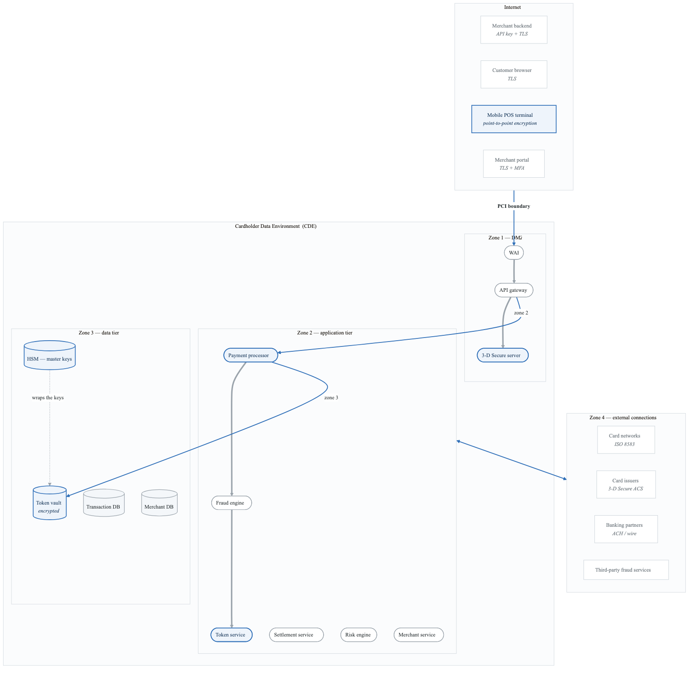
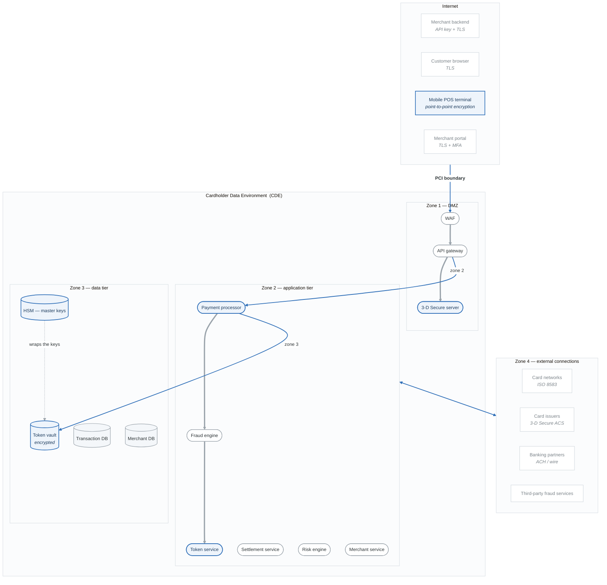
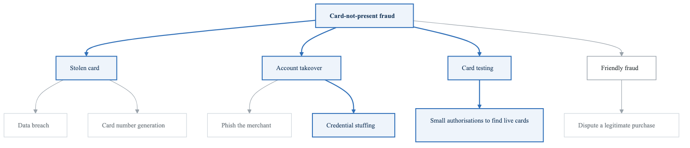
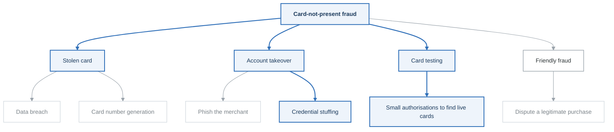
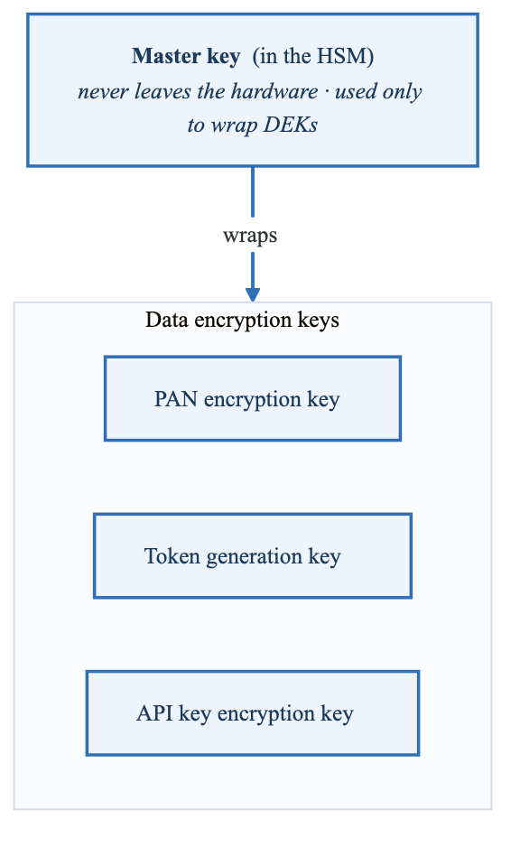
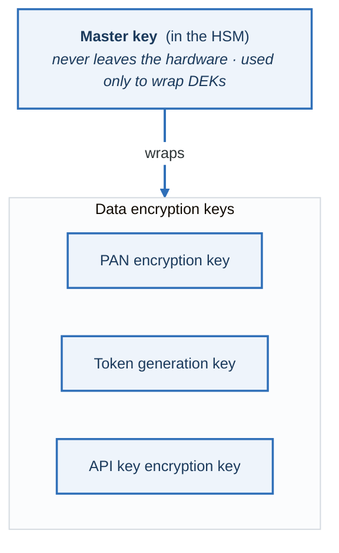

# Lab 08: FinTech Payment Platform Threat Model (PCI DSS)

## Objective

Perform a comprehensive threat model of a payment processing platform, applying STRIDE methodology with PCI DSS compliance mapping and financial industry-specific threats.

---

## Scenario: PayFlow Payment Gateway

You are the security architect for PayFlow, a fintech startup building a payment processing platform for e-commerce merchants.

### Platform Capabilities

**PayFlow Platform:**

- Merchant Features
  - Payment API integration
  - Virtual terminal
  - Recurring billing
  - Refund processing
  - Fraud rules configuration
  - Settlement reports
- Payment Processing
  - Card-present (POS terminals)
  - Card-not-present (e-commerce)
  - ACH/Bank transfers
  - Digital wallets
  - International payments
- Security Features
  - Tokenization
  - 3D Secure 2.0
  - Fraud detection (ML-based)
  - PCI-validated P2PE
- Administrative
  - Merchant onboarding
  - Risk management
  - Compliance reporting
  - Dispute management


### Cardholder Data Elements

| Data Element | PCI DSS Category | Storage Allowed | Protection Required |
|--------------|------------------|-----------------|---------------------|
| Primary Account Number (PAN) | CHD | Yes (encrypted) | Encryption, masking |
| Cardholder Name | CHD | Yes | Protection if with PAN |
| Expiration Date | CHD | Yes | Protection if with PAN |
| Service Code | CHD | Yes | Protection if with PAN |
| CVV/CVC | SAD | **NEVER** | Never store post-auth |
| PIN | SAD | **NEVER** | Never store |
| Full Track Data | SAD | **NEVER** | Never store post-auth |

**CHD = Cardholder Data, SAD = Sensitive Authentication Data**

---

## Architecture Diagram

<!-- figure: generated from the Mermaid below by _shared/diagrams/embed-figures.py — do not edit the image -->


<details>
<summary>Diagram source (Mermaid)</summary>



</details>

---

## Lab Tasks

### Task 1: PCI DSS Scope Definition (20 minutes)

Define the Cardholder Data Environment (CDE) scope:

#### 1.1 Data Flow Mapping

| Flow | Source | Destination | Data | In CDE? |
|------|--------|-------------|------|---------|
| Card Authorization | Customer Browser | Payment Processor | PAN, Exp, CVV | Yes |
| Tokenization | Payment Processor | Token Service | PAN → Token | Yes |
| Settlement | Settlement Service | Card Networks | Transaction data | Yes |
| Merchant Portal | Merchant | Admin Portal | Masked PAN | ? |
| Reports | Admin | Merchant | Transaction data | ? |

#### 1.2 System Categorization

| System | Category | Justification |
|--------|----------|---------------|
| Payment Processor | CDE | Processes PAN |
| Token Vault | CDE | Stores encrypted PAN |
| HSM | CDE | Holds encryption keys |
| Fraud Engine | Connected | Receives tokens, not PAN |
| Merchant Portal | Connected | Displays masked PAN |
| Corporate Network | Out of Scope | Segmented, no CHD access |

---

### Task 2: STRIDE Analysis of Payment Flows (45 minutes)

#### Flow 1: Card Authorization

```
Customer → Merchant Site → PayFlow API → Card Network → Issuer
                              │
                         [CVV checked,
                          then discarded]
```

| Component | S | T | R | I | D | E | Threats |
|-----------|---|---|---|---|---|---|---------|
| Customer Browser | ✓ | ✓ | | ✓ | | | |
| Merchant Site | ✓ | ✓ | | ✓ | ✓ | | |
| PayFlow API | ✓ | ✓ | ✓ | ✓ | ✓ | ✓ | |
| Card Network | ✓ | ✓ | | | ✓ | | |

**Document specific threats:**

| ID | Component | STRIDE | Threat | PCI Req |
|----|-----------|--------|--------|---------|
| PAY-001 | PayFlow API | I | Card data logged in plaintext | 3.2 |
| PAY-002 | | | | |

#### Flow 2: Tokenization

```
PAN → Token Service → [Encrypt with HSM] → Token Vault
                              │
                    [Return Token to Merchant]
```

| Component | S | T | R | I | D | E | Threats |
|-----------|---|---|---|---|---|---|---------|
| Token Service | | | | | | | |
| HSM | | | | | | | |
| Token Vault | | | | | | | |

---

### Task 3: PCI DSS Requirements Mapping (30 minutes)

Map threats to PCI DSS requirements:

| PCI Req | Requirement Summary | Relevant Threats | Current Controls | Gaps |
|---------|---------------------|------------------|------------------|------|
| 1.x | Firewall/Network Security | | WAF, Segmentation | |
| 2.x | Secure Configurations | | Hardening standards | |
| 3.x | Protect Stored Data | | Encryption, Tokenization | |
| 4.x | Encrypt Transmission | | TLS 1.3 | |
| 5.x | Anti-Malware | | EDR on all systems | |
| 6.x | Secure Development | | SDLC, code review | |
| 7.x | Access Control | | RBAC, least privilege | |
| 8.x | Authentication | | MFA, password policy | |
| 9.x | Physical Security | | Data center controls | |
| 10.x | Logging/Monitoring | | SIEM, log retention | |
| 11.x | Testing | | Pen tests, vulnerability scans | |
| 12.x | Security Policies | | Policies documented | |

---

### Task 4: Financial Fraud Threat Analysis (30 minutes)

Analyze payment-specific fraud threats:

#### 4.1 Card-Not-Present Fraud

<!-- figure: generated from the Mermaid below by _shared/diagrams/embed-figures.py — do not edit the image -->


<details>
<summary>Diagram source (Mermaid)</summary>



</details>

#### 4.2 Attack Scenarios

| Scenario | Attacker | Method | Impact | Prevention |
|----------|----------|--------|--------|------------|
| BIN Attack | Fraudster | Generate valid PANs | Financial loss | Velocity checks |
| Card Testing | Fraudster | Small transactions | Card validation | Amount thresholds |
| Refund Fraud | Insider | Process fake refunds | Financial loss | Dual approval |
| Merchant Fraud | Bad merchant | Submit fake transactions | Financial loss | KYC, monitoring |

---

### Task 5: API Security Assessment (25 minutes)

Analyze the Payment API:

```
POST /v1/payments/authorize
Authorization: Bearer sk_live_xxx
Content-Type: application/json

{
  "amount": 10000,
  "currency": "USD",
  "card": {
    "number": "4111111111111111",
    "exp_month": 12,
    "exp_year": 2025,
    "cvv": "123"
  },
  "merchant_id": "mer_abc123"
}
```

**API Threat Checklist:**

| Threat | Description | Present? | Mitigation |
|--------|-------------|----------|------------|
| Injection | Card number field injection | | Input validation |
| Broken Auth | API key compromise | | Key rotation, IP allowlist |
| Sensitive Data Exposure | Card data in logs | | Log redaction |
| Rate Limiting | Card testing attacks | | Velocity controls |
| BOLA | Access other merchant's data | | Authorization checks |
| Mass Assignment | Modify amount after auth | | Schema validation |

---

### Task 6: Key Management Analysis (20 minutes)

Analyze cryptographic key management:

<!-- figure: generated from the Mermaid below by _shared/diagrams/embed-figures.py — do not edit the image -->


<details>
<summary>Diagram source (Mermaid)</summary>



</details>

**Key Management Threats:**

| Threat | Description | Impact | Mitigation |
|--------|-------------|--------|------------|
| KEK-001 | Master key extraction | Total compromise | HSM, dual control |
| KEK-002 | DEK exposure in memory | Card data exposure | Memory encryption |
| KEK-003 | Key not rotated | Extended exposure | Rotation policy |
| KEK-004 | Weak key generation | Crypto weakness | HSM RNG |

---

### Task 7: Third-Party Risk (20 minutes)

Assess third-party payment ecosystem risks:

| Third Party | Data Shared | Risk Level | Controls Required |
|-------------|-------------|------------|-------------------|
| Card Networks (Visa/MC) | Transaction auth | Medium | PCI compliance |
| Card Issuers | 3DS authentication | Medium | Secure API |
| Banking Partners | Settlement, ACH | High | Encryption, reconciliation |
| Fraud Services | Transaction patterns | Medium | Data minimization |
| Cloud Provider (AWS) | All (encrypted) | High | Shared responsibility |

---

### Task 8: Incident Response for Payment Breach (20 minutes)

Design threat model for breach response:

#### Breach Scenario: Card Data Exfiltration

```
Attack Timeline:
Day 0: Attacker gains access via compromised API key
Day 1-30: Attacker moves laterally, accesses Token Vault
Day 31: Attacker exfiltrates 500,000 card records
Day 45: Cards appear on dark web
Day 47: Card network fraud alerts trigger investigation
```

**Threat Model the Response:**

| Phase | Threats | Controls Needed |
|-------|---------|-----------------|
| Detection | Slow detection extends breach | Real-time monitoring |
| Containment | Attacker maintains access | Incident response plan |
| Eradication | Incomplete removal | Forensic investigation |
| Recovery | Service disruption | Business continuity |
| Notification | Non-compliance | PCI, state law requirements |

**PCI Incident Requirements (12.10):**
```
□ Incident response plan documented
□ Roles and responsibilities defined
□ Contact information for card brands
□ Evidence preservation procedures
□ Business recovery procedures
□ Legal/regulatory notification procedures
```

---

## PCI DSS Threat Reference

<details>
<summary>Click to reveal PCI-specific threats by requirement</summary>

### Requirement 1: Network Security
- Unrestricted inbound to CDE
- Missing egress filtering
- Flat network (no segmentation)
- Direct internet access to CDE

### Requirement 3: Data Protection
- Unencrypted PAN storage
- Weak encryption algorithms
- Key stored with data
- CVV stored post-authorization
- Unmasked PAN in displays

### Requirement 4: Transmission Security
- TLS < 1.2
- Weak cipher suites
- Missing certificate validation
- Unencrypted internal traffic

### Requirement 6: Secure Development
- Injection vulnerabilities
- XSS in merchant portal
- Insecure direct object references
- Missing security in SDLC

### Requirement 7-8: Access Control
- Excessive privileges
- Shared accounts
- Missing MFA
- Weak passwords
- No session timeout

### Requirement 10: Logging
- Insufficient logging
- Logs not protected
- Missing log review
- Short retention (< 1 year)

### Requirement 11: Testing
- Missing quarterly scans
- No annual pen test
- Unpatched vulnerabilities
- Missing file integrity monitoring

</details>

---

## Evaluation Criteria

| Criteria | Points |
|----------|--------|
| PCI scope definition | 15 |
| STRIDE analysis quality | 20 |
| PCI requirements mapping | 15 |
| Fraud threat analysis | 15 |
| API security assessment | 15 |
| Key management analysis | 10 |
| Third-party risk assessment | 5 |
| Incident response | 5 |
| **Total** | **100** |

---

## Next Lab

→ [Lab 09: SaaS Multi-Tenant Platform](../lab-09-saas-multi-tenant/)

<!-- feynman-check -->

---

## Feynman check

Close the file. Blank page, no notes. Explain each of these to a competent engineer who has never
used this tool — **under five minutes, no jargon you can't define on the spot:**

- Scenario: PayFlow Payment Gateway
- PCI DSS Threat Reference
- Platform Capabilities
- Cardholder Data Elements

**The gap is not what you forgot. It is where you used a word instead of a mechanism.**

| | |
|---|---|
| ✗ | *"We scan for vulnerabilities in the pipeline."* |
| ✓ | *"SAST reads source without running it, SCA resolves the dependency tree against an advisory database, and image scanning compares installed package versions to that same database. All three report what was known at build time — which is why the registry is re-scanned: the image does not change, the database does."* |

**Trace it:** A CVE published today against your base image → a blocked deploy. Name every component between the advisory and the refused `apply`.

Stop at the first component you cannot name. Reopen this file and read **only** that.

**Go deeper — only once the gap has a name:** the [SLSA threat model](https://slsa.dev/spec/v1.2/threats) — it names every point at which a build can be subverted, and most teams defend three of them.
Full list per domain: [`SOURCES.md`](../../SOURCES.md#devsecops)

→ Protocol, the three levels of knowing, and worked examples: [`MASTERY.md`](../../MASTERY.md)

<!-- /feynman-check -->
