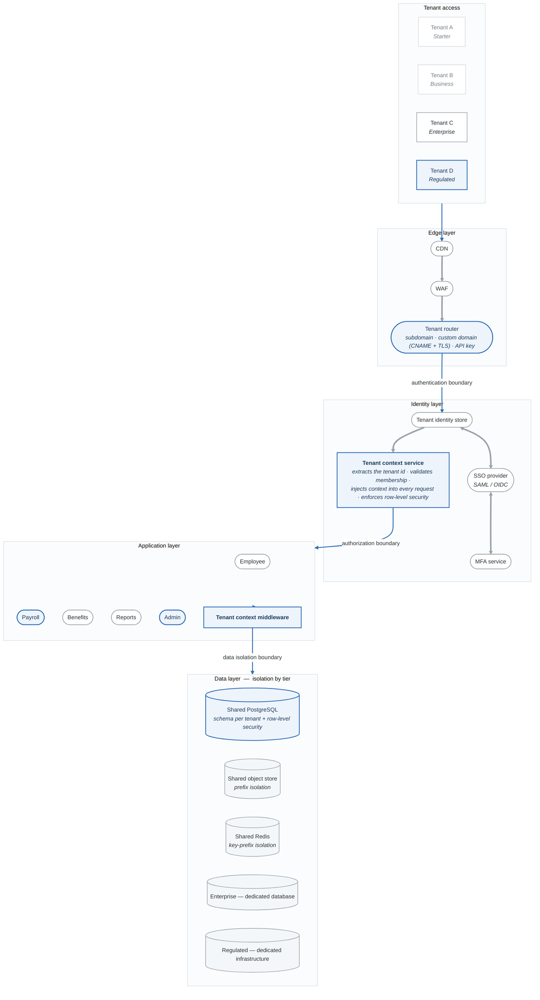
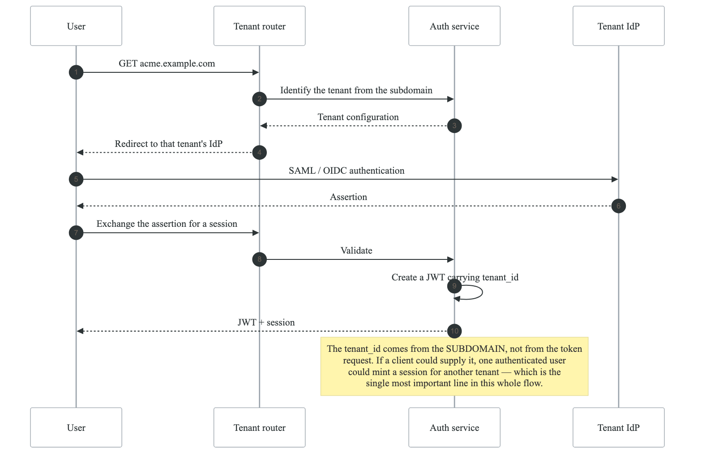
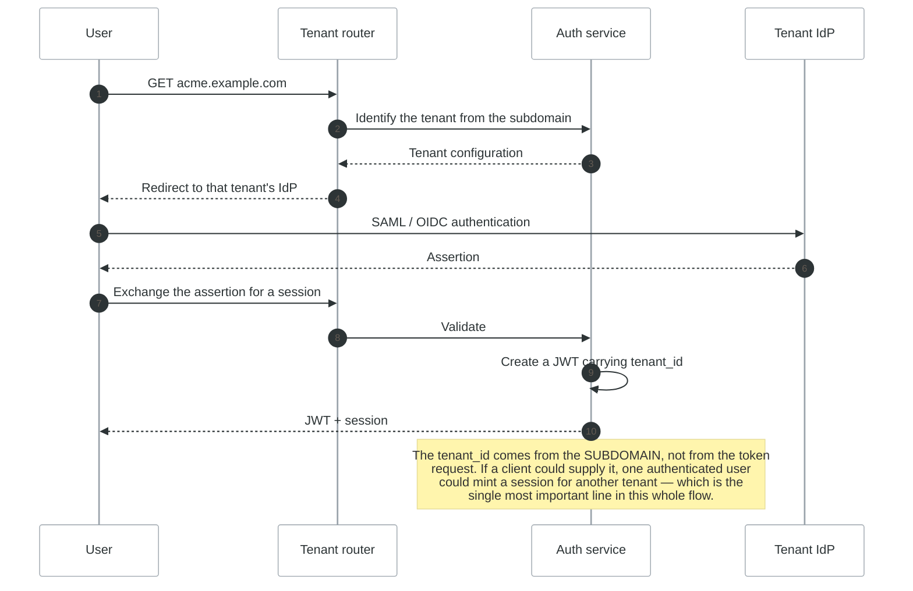
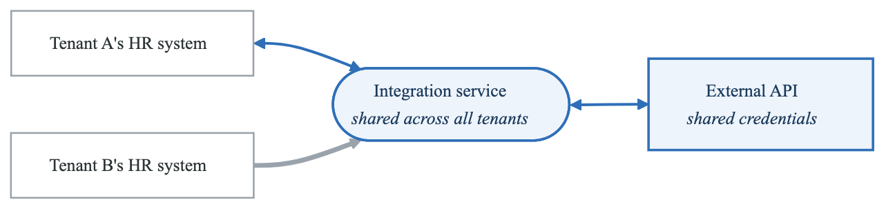
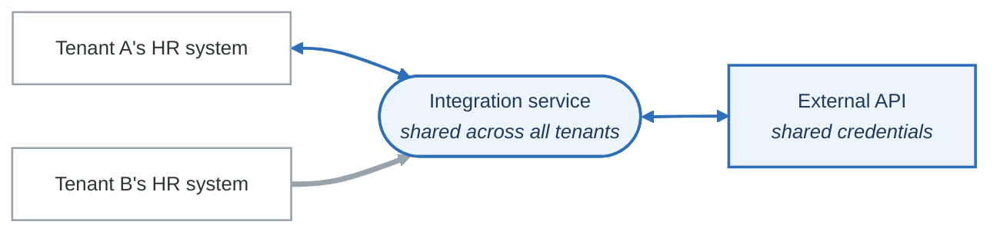

# Lab 09: SaaS Multi-Tenant Architecture Threat Model

## Objective

Perform a comprehensive threat model of a multi-tenant SaaS platform, focusing on tenant isolation, data segregation, and shared infrastructure risks.

---

## Scenario: CloudHR - HR Management SaaS

You are the security architect for CloudHR, a B2B SaaS platform providing HR management services to enterprise customers.

### Platform Overview

| Metric | Value |
|--------|-------|
| Tenants | 500+ enterprise customers |
| Users | 50,000+ across all tenants |
| Data | Employee PII, payroll, benefits |
| Compliance | SOC 2, GDPR, CCPA |
| Revenue | $20M ARR |

### Tenant Tiers

| Tier | Features | Isolation | Price |
|------|----------|-----------|-------|
| Starter | Core HR | Shared DB, shared schema | $5/user/mo |
| Business | + Payroll, Benefits | Shared DB, separate schema | $15/user/mo |
| Enterprise | + Custom integrations | Dedicated DB | $30/user/mo |
| Regulated | + Compliance features | Dedicated infrastructure | Custom |

---

## Architecture Diagram

<!-- figure: generated from the Mermaid below by _shared/diagrams/embed-figures.py — do not edit the image -->


<details>
<summary>Diagram source (Mermaid)</summary>



</details>

---

## Lab Tasks

### Task 1: Tenant Isolation Threat Analysis (30 minutes)

Analyze isolation mechanisms at each layer:

**Isolation Mechanisms:**

| Layer | Mechanism | Threat | Mitigation |
|-------|-----------|--------|------------|
| Network | Shared VPC | Cross-tenant traffic | Network policies |
| Compute | Shared containers | Container escape | Pod security |
| Database | Schema separation | SQL injection bypass | RLS, parameterized queries |
| Storage | Prefix isolation | Path traversal | Strict prefix validation |
| Cache | Key prefix | Key collision | Tenant-prefixed keys |

**Identify cross-tenant threats:**

Threat: Cross-Tenant Data Access

**Attack Vectors:**

- IDOR via tenant_id manipulation
  - GET /api/employees/{id} without tenant validation
- SQL injection bypassing RLS
  - UNION SELECT * FROM tenant_b.employees
- Cache poisoning
  - Overwrite cached data for another tenant
- S3 path traversal
  - filename: ../tenant_b/documents/payroll.pdf
- Shared resource exhaustion
  - One tenant DoS affecting all tenants


**Complete the tenant isolation matrix:**

| Resource | Starter | Business | Enterprise | Regulated |
|----------|---------|----------|------------|-----------|
| Database | Shared+RLS | Shared+Schema | Dedicated | Dedicated+Encrypted |
| Compute | Shared pods | Shared pods | ? | ? |
| Cache | Shared Redis | Shared Redis | ? | ? |
| Storage | Shared S3 | Shared S3 | ? | ? |
| Encryption Keys | Shared KMS | Shared KMS | ? | ? |
| Network | Shared VPC | Shared VPC | ? | ? |

---

### Task 2: Authentication & Authorization Analysis (30 minutes)

Analyze the multi-tenant authentication flow:

<!-- figure: generated from the Mermaid below by _shared/diagrams/embed-figures.py — do not edit the image -->


<details>
<summary>Diagram source (Mermaid)</summary>



</details>

**STRIDE the authentication flow:**

| Component | S | T | R | I | D | E | Threats |
|-----------|---|---|---|---|---|---|---------|
| Tenant identification | ✓ | | | | | | Subdomain spoofing |
| IdP integration | | | | | | | |
| JWT generation | | | | | | | |
| Session management | | | | | | | |
| Tenant context injection | | | | | | | |

**Authorization model threats:**

```yaml
# Role-Based Access Control with Tenant Scope
roles:
  - tenant_admin      # Full access within tenant
  - hr_manager        # Manage employees, view payroll
  - employee          # View own data only
  - api_integration   # Programmatic access

# Threat: Role confusion across tenants
vulnerabilities:
  - User with admin in Tenant A has no access in Tenant B
  - But what if tenant_id not validated?
  - What if JWT modified to change tenant_id?
  - What if service-to-service calls bypass tenant context?
```

---

### Task 3: Data Isolation Deep Dive (30 minutes)

Analyze database-level isolation:

**Shared Database with Row-Level Security:**

```sql
-- PostgreSQL Row-Level Security Policy
CREATE POLICY tenant_isolation ON employees
    FOR ALL
    TO application_user
    USING (tenant_id = current_setting('app.current_tenant_id')::uuid);

-- Threat: RLS bypass via SQL injection
-- Vulnerable code:
SELECT * FROM employees WHERE name LIKE '%' + userInput + '%';

-- Attack payload:
-- userInput = "'; SET app.current_tenant_id = 'other-tenant-id'; SELECT * FROM employees --"
```

**Complete the data isolation threat table:**

| Isolation Model | Implementation | Bypass Threat | Detection |
|-----------------|----------------|---------------|-----------|
| Shared DB + RLS | PostgreSQL RLS | SET command injection | Query logging |
| Schema per tenant | Separate schemas | Schema name injection | Audit logs |
| Database per tenant | Dedicated RDS | Connection string leak | VPC flow logs |
| Encrypted columns | Tenant-specific keys | Key access misconfig | KMS audit logs |

**S3 Bucket Isolation:**

```python
# Vulnerable: Direct user input in path
def get_document(tenant_id, document_path):
    s3_key = f"{tenant_id}/documents/{document_path}"
    return s3.get_object(Bucket='cloudhr-docs', Key=s3_key)

# Attack: document_path = "../other-tenant/payroll.pdf"
# Result: s3_key = "tenant-a/documents/../other-tenant/payroll.pdf"
#         Resolves to: "other-tenant/payroll.pdf"

# Threat analysis:
```

| Threat | Attack Vector | Impact | Mitigation |
|--------|---------------|--------|------------|
| Path traversal | ../ in filename | Cross-tenant data access | Path normalization |
| Bucket enumeration | Guessing keys | Data discovery | Random UUIDs |
| Presigned URL abuse | Sharing presigned URLs | Unauthorized access | Short expiry, IP binding |
| Metadata leakage | List operations | Tenant discovery | Disable listing |

---

### Task 4: API Security for Multi-Tenancy (25 minutes)

Analyze API endpoints for tenant isolation:

**API Threat Analysis:**

```
API: GET /api/v1/employees/{employee_id}

Request:
Authorization: Bearer {jwt_with_tenant_a}
X-Tenant-ID: tenant-a  # Optional header

Threats:
1. BOLA: Access employee from different tenant
   - employee_id from tenant-b used with tenant-a JWT

2. Tenant header manipulation:
   - JWT says tenant-a, header says tenant-b
   - Which takes precedence?

3. Mass assignment in POST/PUT:
   - { "name": "John", "tenant_id": "tenant-b" }
   - Can user override tenant_id?

4. Batch operations:
   - POST /api/v1/employees/bulk-update
   - { "ids": [tenant_a_id, tenant_b_id], "status": "active" }
```

**Complete the API security matrix:**

| Endpoint | Auth | Tenant Validation | BOLA Risk | Rate Limit |
|----------|------|-------------------|-----------|------------|
| GET /employees | JWT | From JWT claim | High | Per tenant |
| POST /employees | JWT | ? | ? | ? |
| GET /payroll/{id} | JWT + MFA | ? | ? | ? |
| POST /integrations | API Key | ? | ? | ? |
| GET /reports/export | JWT | ? | ? | ? |

**Design secure tenant context injection:**

```python
# Middleware for tenant context
class TenantContextMiddleware:
    def __init__(self, get_response):
        self.get_response = get_response

    def __call__(self, request):
        # Extract tenant from JWT (trusted source)
        jwt_tenant = extract_tenant_from_jwt(request)

        # Validate against URL/header (if present)
        url_tenant = extract_tenant_from_url(request)

        if url_tenant and url_tenant != jwt_tenant:
            # Threat: Tenant mismatch attack
            log.security_event("tenant_mismatch", {
                "jwt_tenant": jwt_tenant,
                "url_tenant": url_tenant,
                "user": request.user
            })
            return HttpResponseForbidden()

        # Set tenant context for database queries
        connection.set_tenant(jwt_tenant)

        return self.get_response(request)
```

---

### Task 5: Integration Security (25 minutes)

Analyze third-party integration risks:

**Integration Architecture:**

<!-- figure: generated from the Mermaid below by _shared/diagrams/embed-figures.py — do not edit the image -->


<details>
<summary>Diagram source (Mermaid)</summary>



</details>

**Integration threat matrix:**

| Integration Type | Data Exposed | Credential Storage | Threats |
|------------------|--------------|-------------------|---------|
| Payroll export | Salary, SSN | Tenant's SFTP creds | Credential theft |
| SSO/SAML | User identity | IdP metadata | IdP impersonation |
| Benefits API | Health data | OAuth tokens | Token leakage |
| Webhooks | Event data | Webhook secrets | SSRF, replay |

**Webhook security analysis:**

```json
// Webhook configuration
{
  "tenant_id": "tenant-a",
  "url": "https://tenant-a-internal.corp/webhook",
  "events": ["employee.created", "payroll.processed"],
  "secret": "whsec_abc123..."
}

// Threats:
// 1. SSRF via webhook URL
// 2. Internal network scanning
// 3. Data exfiltration to attacker URL
// 4. Webhook replay attacks
// 5. Secret leakage
```

| Threat | Attack | Mitigation |
|--------|--------|------------|
| SSRF | url: "http://169.254.169.254" | URL allowlist, block internal IPs |
| Data theft | url: "https://attacker.com" | Domain verification |
| Replay | Capture and replay signed webhook | Timestamp + nonce |
| Secret exposure | Logs contain secret | Mask in logs |

---

### Task 6: Noisy Neighbor & Resource Exhaustion (20 minutes)

Analyze shared resource threats:

**Resource Sharing Risks:**

**Shared Resources:**

- Database connections
  - Tenant A runs expensive query → pool exhausted
- API rate limits
  - Shared limits → one tenant blocks others
- `Memory/CPU`
  - Report generation spikes → affects all
- Storage IOPS
  - Bulk import → disk bottleneck
- Network bandwidth
  - Large file downloads → latency for all


**Design resource isolation controls:**

| Resource | Isolation Strategy | Monitoring | Enforcement |
|----------|-------------------|------------|-------------|
| DB connections | Per-tenant pool | Connection metrics | Pool limits |
| API calls | Per-tenant rate limits | Request counters | 429 responses |
| CPU | Request timeouts | CPU metrics | Kill long queries |
| Memory | Per-request limits | OOM tracking | Request rejection |
| Storage | Tenant quotas | Usage metrics | Upload rejection |

**Threat scenario: Cryptomining via bulk operations:**

```
Attack:
1. Attacker creates trial account
2. Uses bulk import API with complex CSV
3. CSV processing consumes CPU
4. Repeat with many trial accounts
5. Platform CPU exhausted, DoS for paying customers

Mitigations:
□ Background processing with queues
□ Per-tenant CPU quotas
□ Rate limiting on bulk operations
□ Trial account restrictions
□ Anomaly detection on resource usage
```

---

### Task 7: Compliance & Audit Requirements (25 minutes)

Map multi-tenant compliance requirements:

**Compliance Matrix by Tenant:**

| Requirement | Starter | Business | Enterprise | Regulated |
|-------------|---------|----------|------------|-----------|
| SOC 2 Type II | Platform | Platform | Platform | Platform |
| Data residency | US | US/EU | Configurable | Custom |
| Encryption at rest | Shared key | Shared key | Tenant key | Tenant key |
| Audit logs | 30 days | 90 days | 1 year | 7 years |
| Data retention | 1 year | 2 years | Custom | Regulatory |
| Right to erasure | API | API | Dedicated | Certified |

**Audit logging requirements:**

```json
// Audit log entry
{
  "timestamp": "2026-01-17T10:30:00Z",
  "tenant_id": "tenant-a",
  "actor": {
    "user_id": "user-123",
    "ip": "192.168.1.1",
    "user_agent": "Mozilla/5.0..."
  },
  "action": "employee.salary.viewed",
  "resource": {
    "type": "employee",
    "id": "emp-456"
  },
  "result": "success",
  "data_accessed": ["salary", "bonus"],
  "compliance_flags": ["pii_access", "financial_data"]
}
```

**Threat: Audit log tampering**

| Threat | Attack | Impact | Mitigation |
|--------|--------|--------|------------|
| Log deletion | Admin deletes logs | Cover tracks | Immutable logs (S3 Object Lock) |
| Log modification | Alter timestamps | False alibi | Signed log entries |
| Log injection | Inject false entries | Frame others | Input validation |
| Cross-tenant log access | View other tenant logs | Privacy breach | Tenant isolation on logs |

---

### Task 8: Create Multi-Tenant Threat Model (30 minutes)

Consolidate findings into comprehensive threat model:

**Top 10 Multi-Tenant SaaS Risks:**

| Rank | Threat | Layer | Impact | Likelihood | Risk |
|------|--------|-------|--------|------------|------|
| 1 | Cross-tenant data access | Data | Critical | Medium | Critical |
| 2 | Tenant context bypass | App | Critical | Medium | Critical |
| 3 | Privilege escalation across tenants | Identity | Critical | Low | High |
| 4 | Noisy neighbor DoS | Compute | High | High | High |
| 5 | | | | | |
| 6 | | | | | |
| 7 | | | | | |
| 8 | | | | | |
| 9 | | | | | |
| 10 | | | | | |

**Mitigation Roadmap:**

| Phase | Actions | Tenants Affected | Priority |
|-------|---------|------------------|----------|
| Immediate | Enable RLS on all tables | All | P0 |
| Week 1 | Implement tenant context middleware | All | P0 |
| Week 2 | Add per-tenant rate limiting | All | P1 |
| Month 1 | Tenant-specific encryption keys | Enterprise+ | P1 |
| Month 2 | Dedicated compute for regulated | Regulated | P2 |
| Quarter 1 | Full network isolation | Enterprise+ | P2 |

---

## Multi-Tenant Security Checklist

```
Tenant Isolation:
□ Row-level security enabled on all tables
□ Tenant context validated on every request
□ S3 prefix isolation with path validation
□ Cache keys prefixed with tenant ID
□ Logging separated by tenant

Authentication:
□ Tenant-aware login flow
□ SSO per tenant with validation
□ JWT contains immutable tenant claim
□ Session bound to tenant
□ Cross-tenant session detection

Authorization:
□ All endpoints validate tenant context
□ No tenant_id in request body
□ Batch operations scoped to tenant
□ Admin roles scoped to tenant
□ API keys bound to tenant

Resource Isolation:
□ Per-tenant rate limits
□ Database connection pools per tenant
□ CPU/memory quotas for batch jobs
□ Storage quotas per tenant
□ Network bandwidth controls

Data Protection:
□ Encryption at rest (tenant keys for Enterprise+)
□ Encryption in transit (TLS 1.3)
□ Data residency enforced
□ Backup isolation
□ Secure deletion verified

Monitoring:
□ Tenant-aware alerting
□ Cross-tenant access detection
□ Resource usage per tenant
□ Audit logs per tenant
□ Anomaly detection enabled
```

---

## Evaluation Criteria

| Criteria | Points |
|----------|--------|
| Tenant isolation analysis | 20 |
| Authentication/authorization | 15 |
| Data isolation deep dive | 15 |
| API security analysis | 15 |
| Integration security | 10 |
| Resource exhaustion | 10 |
| Compliance mapping | 10 |
| Unified threat model | 5 |
| **Total** | **100** |

---

## Next Lab

→ [Lab 10: CI/CD Pipeline Security](labs-lab-10-cicd-pipeline-README.md)

<!-- feynman-check -->

---

## Feynman check

Close the file. Blank page, no notes. Explain each of these to a competent engineer who has never
used this tool — **under five minutes, no jargon you can't define on the spot:**

- Scenario: CloudHR - HR Management SaaS
- Multi-Tenant Security Checklist
- Platform Overview
- Tenant Tiers

**The gap is not what you forgot. It is where you used a word instead of a mechanism.**

| | |
|---|---|
| ✗ | *"We scan for vulnerabilities in the pipeline."* |
| ✓ | *"SAST reads source without running it, SCA resolves the dependency tree against an advisory database, and image scanning compares installed package versions to that same database. All three report what was known at build time — which is why the registry is re-scanned: the image does not change, the database does."* |

**Trace it:** A CVE published today against your base image → a blocked deploy. Name every component between the advisory and the refused `apply`.

Stop at the first component you cannot name. Reopen this file and read **only** that.

**Go deeper — only once the gap has a name:** the [SLSA threat model](https://slsa.dev/spec/v1.2/threats) — it names every point at which a build can be subverted, and most teams defend three of them.
Full list per domain: [`SOURCES.md`](../../SOURCES.md#devsecops)

→ Protocol, the three levels of knowing, and worked examples: [`MASTERY.md`](../../MASTERY.md)

<!-- /feynman-check -->
