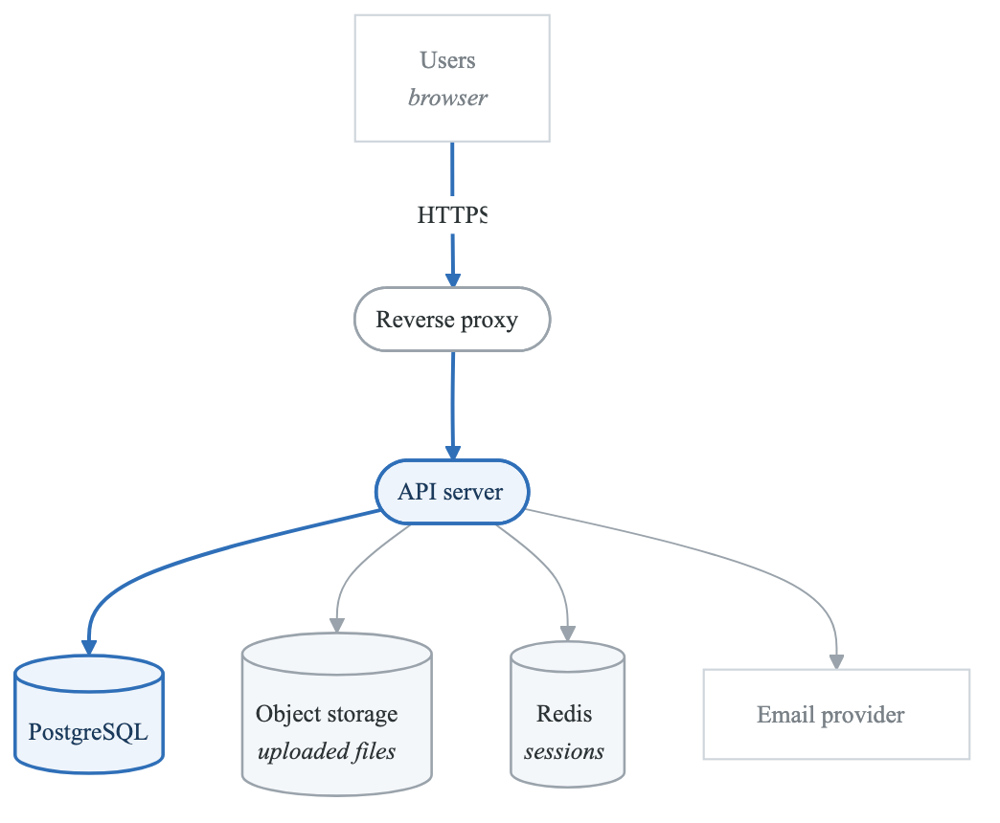
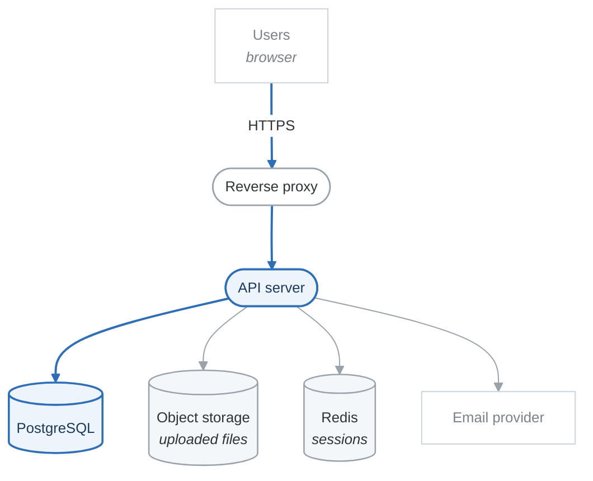

# Project 1: Basic Web Application Threat Model

## Overview

Create a complete threat model for a standard three-tier web application. This project applies fundamental threat modeling concepts to a common architecture pattern.

**Difficulty:** Beginner
**Estimated Time:** 4-6 hours
**Prerequisites:** Completed Foundation and STRIDE modules

---

## Scenario

You're a security consultant brought in to assess "TaskMaster," a new task management web application before its production launch.

### System Description

TaskMaster is a web-based task management application that allows users to:
- Create and manage personal task lists
- Share tasks with team members
- Set due dates and reminders
- Upload file attachments to tasks
- Receive email notifications

### Architecture

<!-- figure: generated from the Mermaid below by _shared/diagrams/embed-figures.py — do not edit the image -->

Diagram source (Mermaid)

### Technology Stack
- **Frontend:** React SPA
- **Backend:** Node.js with Express
- **Database:** PostgreSQL
- **Session Store:** Redis
- **File Storage:** AWS S3
- **Email:** SendGrid API
- **Hosting:** AWS (EC2, RDS, ElastiCache)

### Data Handled
- User credentials (email, hashed password)
- Task data (titles, descriptions, due dates)
- File attachments (up to 10MB per file)
- User profile information
- Team/sharing relationships

---

## Project Tasks

### Task 1: Create Data Flow Diagram (DFD)

Create a Level 1 DFD that includes:
- All external entities (users, external services)
- All processes (web server, API, background jobs)
- All data stores (database, cache, file storage)
- All data flows with labels
- Trust boundaries

**Deliverable:** DFD diagram (use draw.io, Lucidchart, or similar)

### Task 2: Enumerate Assets

Identify and classify:
- Data assets (what data exists and where)
- System assets (what components are critical)
- Business assets (what capabilities are valuable)

**Deliverable:** Asset inventory table with classification

### Task 3: STRIDE Analysis

For each component in your DFD, apply STRIDE:
- What spoofing threats exist?
- What tampering threats exist?
- What repudiation threats exist?
- What information disclosure threats exist?
- What denial of service threats exist?
- What elevation of privilege threats exist?

**Deliverable:** Completed STRIDE worksheet

### Task 4: Risk Assessment

For each threat identified:
- Assess likelihood (Low/Medium/High)
- Assess impact (Low/Medium/High)
- Calculate risk level
- Document existing controls (if any)

**Deliverable:** Risk matrix with prioritized threats

### Task 5: Mitigation Recommendations

For the top 10 threats:
- Recommend specific controls
- Identify implementation complexity
- Prioritize based on risk/effort ratio

**Deliverable:** Mitigation plan with priorities

### Task 6: Final Report

Compile all deliverables into a threat model report:
- Executive summary
- System overview
- Threat analysis
- Risk assessment
- Recommendations
- Appendices (DFD, worksheets)

**Deliverable:** Complete threat model document

---

## Hints and Guidance

### Common Threats to Consider

**Authentication:**
- Weak password policy
- Session hijacking
- Credential stuffing
- Password reset vulnerabilities

**Authorization:**
- IDOR (accessing other users' tasks)
- Privilege escalation
- Team permission bypass

**Data Protection:**
- SQL injection
- XSS in task descriptions
- Sensitive data in logs
- Unencrypted file storage

**File Uploads:**
- Malicious file uploads
- Path traversal
- File type bypass
- Storage exhaustion

**External Services:**
- S3 bucket misconfiguration
- Email header injection
- API key exposure
- Third-party data handling

### Questions to Ask

- What happens if an attacker steals a session token?
- Can users access other users' tasks?
- How are file uploads validated?
- What data is logged and where?
- How are API keys stored and rotated?
- What happens if the email service is compromised?

---

## Evaluation Criteria

| Criterion | Weight | Description |
|-----------|--------|-------------|
| DFD Accuracy | 20% | Correct components, flows, boundaries |
| Threat Coverage | 25% | Comprehensive STRIDE analysis |
| Risk Assessment | 20% | Realistic likelihood/impact ratings |
| Mitigation Quality | 25% | Practical, specific recommendations |
| Documentation | 10% | Clear, organized presentation |

---

## Submission Requirements

1. **DFD** - PNG or PDF format
2. **STRIDE Worksheet** - Completed spreadsheet or markdown
3. **Risk Matrix** - Prioritized threat list
4. **Threat Model Report** - Complete document (10-15 pages)

---

## Extension Challenges

Once complete, consider these advanced scenarios:

1. **Add OAuth Integration:** How does adding Google/GitHub login change the threat model?

2. **Add Real-Time Collaboration:** What new threats come with WebSocket connections?

3. **Add Mobile App:** How does a native mobile app expand the attack surface?

4. **Add Admin Panel:** What threats exist for administrative functionality?

---

## Resources

- [STRIDE Reference](../content/02-methodologies/stride.md)
- [DFD Basics](../content/01-foundations/dfd-basics.md)
- [OWASP Web Security Testing Guide](https://owasp.org/www-project-web-security-testing-guide/)
- [AWS Security Best Practices](https://docs.aws.amazon.com/wellarchitected/latest/security-pillar/)

<!-- feynman-check -->

---

## Feynman check

Close the file. Blank page, no notes. Explain each of these to a competent engineer who has never
used this tool — **under five minutes, no jargon you can't define on the spot:**

- Hints and Guidance
- Data Handled
- Create Data Flow Diagram (DFD)
- Enumerate Assets

**The gap is not what you forgot. It is where you used a word instead of a mechanism.**

| | |
|---|---|
| ✗ | *"We scan for vulnerabilities in the pipeline."* |
| ✓ | *"SAST reads source without running it, SCA resolves the dependency tree against an advisory database, and image scanning compares installed package versions to that same database. All three report what was known at build time — which is why the registry is re-scanned: the image does not change, the database does."* |

**Trace it:** A CVE published today against your base image → a blocked deploy. Name every component between the advisory and the refused `apply`.

Stop at the first component you cannot name. Reopen this file and read **only** that.

**Go deeper — only once the gap has a name:** the [SLSA threat model](https://slsa.dev/spec/v1.2/threats) — it names every point at which a build can be subverted, and most teams defend three of them.
Full list per domain: [`SOURCES.md`](../../SOURCES.md#devsecops)

→ Protocol, the three levels of knowing, and worked examples: [`MASTERY.md`](../../MASTERY.md)

<!-- /feynman-check -->
