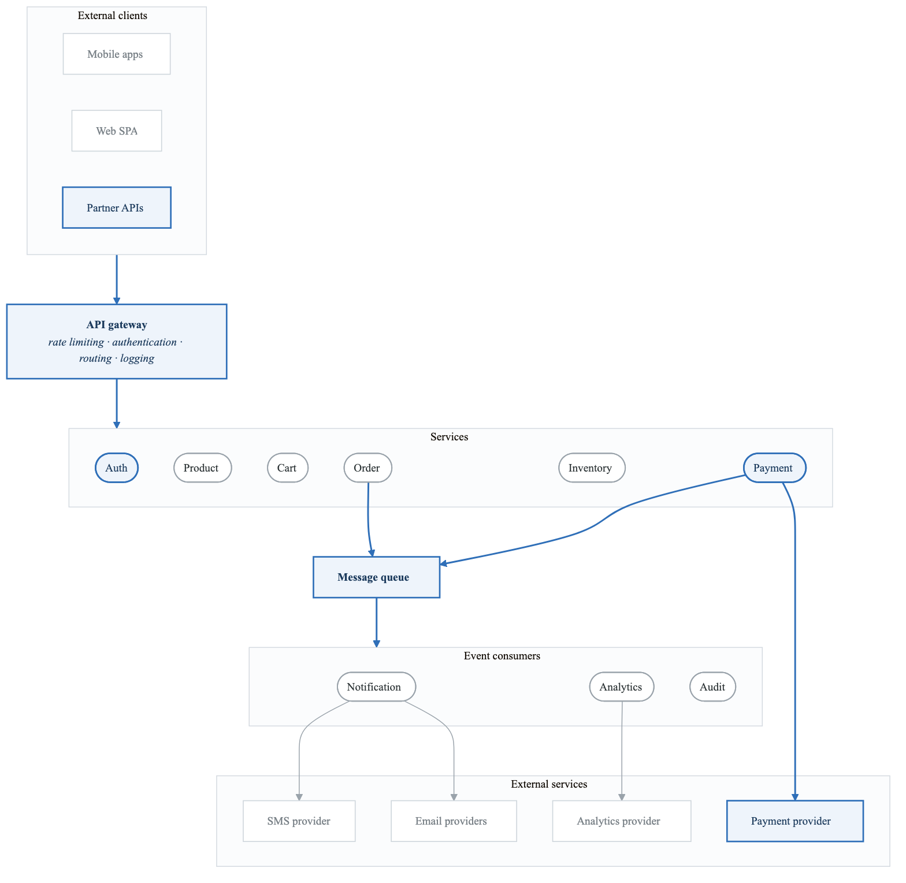
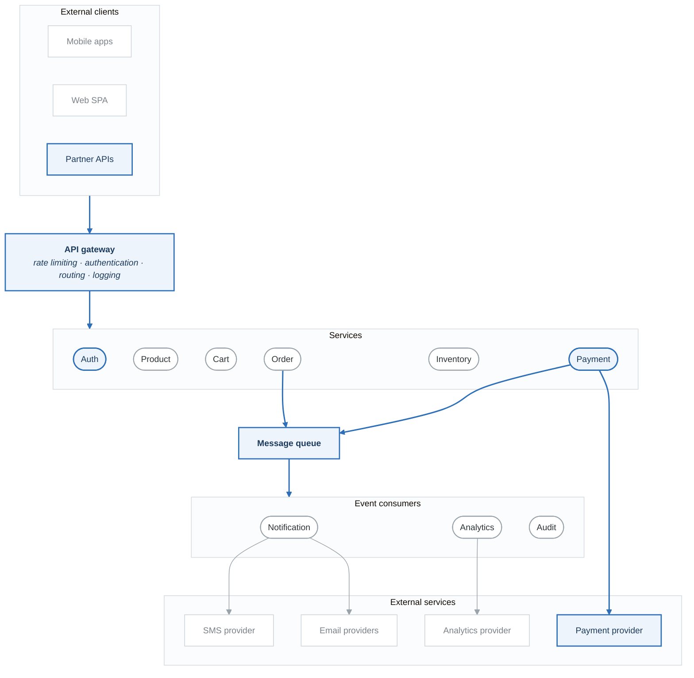

# Project 2: API and Microservices Threat Model

## Overview

Create a comprehensive threat model for a microservices-based e-commerce API platform. This project focuses on API-specific threats and inter-service communication security.

**Difficulty:** Intermediate
**Estimated Time:** 8-10 hours
**Prerequisites:** Project 1 completed, API Security module

---

## Scenario

You're the security lead for "ShopStream," a high-growth e-commerce platform migrating from a monolith to microservices. The platform handles 100K+ daily transactions and processes payment data.

### System Description

ShopStream is a microservices-based e-commerce platform with:
- Product catalog and search
- User accounts and authentication
- Shopping cart functionality
- Order processing and fulfillment
- Payment processing (PCI DSS scope)
- Inventory management
- Notification services

### Architecture

<!-- figure: generated from the Mermaid below by _shared/diagrams/embed-figures.py — do not edit the image -->

Diagram source (Mermaid)

### Technology Stack
- **API Gateway:** Kong
- **Services:** Node.js, Go, Python (mixed)
- **Service Mesh:** Istio
- **Databases:** PostgreSQL (per service), Redis, Elasticsearch
- **Message Queue:** Kafka
- **Container Orchestration:** Kubernetes
- **Cloud:** AWS (EKS, RDS, ElastiCache, S3)

### Compliance Requirements
- PCI DSS (payment processing)
- GDPR (EU customers)
- CCPA (California customers)

---

## Project Tasks

### Task 1: Service Inventory and Classification

Create an inventory of all services:
- Service name and purpose
- Data classification (PCI, PII, internal)
- External dependencies
- Internal dependencies
- Criticality rating

**Deliverable:** Service inventory matrix

### Task 2: API Endpoint Analysis

For each public-facing API:
- Document endpoints (method, path, purpose)
- Identify authentication requirements
- Classify data sensitivity
- Document rate limiting needs

**Deliverable:** API security matrix

### Task 3: STRIDE Analysis - External APIs

Apply STRIDE to public-facing APIs:
- Focus on OWASP API Top 10 threats
- Consider BOLA, BFLA, injection attacks
- Analyze authentication/authorization flows

**Deliverable:** External API threat analysis

### Task 4: STRIDE Analysis - Inter-Service Communication

Analyze service-to-service threats:
- Authentication between services
- Message queue security
- Data integrity in transit
- Service impersonation

**Deliverable:** Internal communication threat analysis

### Task 5: PCI DSS Scoping

Identify PCI DSS boundaries:
- Which services handle cardholder data?
- What are the trust boundaries?
- How is scope minimized?
- What compensating controls exist?

**Deliverable:** PCI scope diagram with justification

### Task 6: Third-Party Integration Risks

Assess external service integrations:
- What data is shared with each provider?
- What are the trust assumptions?
- What happens if a provider is breached?
- How are API keys managed?

**Deliverable:** Third-party risk assessment

### Task 7: Mitigation Recommendations

Prioritize and document mitigations:
- Top 15 threats with mitigations
- Implementation complexity
- Compliance alignment
- Quick wins vs. long-term improvements

**Deliverable:** Prioritized mitigation roadmap

### Task 8: Final Report

Compile comprehensive threat model:
- Executive summary
- Architecture overview
- Threat analysis (by category)
- Risk matrix
- Compliance considerations
- Recommendations

**Deliverable:** Complete threat model (20-30 pages)

---

## API-Specific Threats to Consider

### Authentication & Authorization
- JWT token theft and replay
- Broken object-level authorization (BOLA)
- Broken function-level authorization (BFLA)
- Mass assignment vulnerabilities
- API key exposure

### Inter-Service Security
- Service-to-service authentication bypass
- Message queue poisoning
- Credential exposure in service mesh
- Unauthorized service deployment

### Data Exposure
- Excessive data exposure in responses
- Sensitive data in URLs
- Improper filtering of query results
- GraphQL introspection abuse (if applicable)

### Rate Limiting & DoS
- Resource exhaustion
- Batch endpoint abuse
- Asymmetric attacks (expensive operations)
- Cascading failures

---

## Evaluation Criteria

| Criterion | Weight | Description |
|-----------|--------|-------------|
| Service Analysis | 15% | Comprehensive inventory and classification |
| API Threat Coverage | 25% | OWASP API Top 10 coverage |
| Inter-Service Analysis | 20% | Service mesh and queue security |
| Compliance Integration | 15% | PCI DSS considerations |
| Mitigation Quality | 15% | Practical, prioritized recommendations |
| Documentation | 10% | Clear, professional presentation |

---

## Submission Requirements

1. **Service Inventory** - Spreadsheet with all services classified
2. **API Security Matrix** - All public endpoints analyzed
3. **Threat Analysis** - External and internal threats
4. **PCI Scope Diagram** - Cardholder data flow
5. **Third-Party Assessment** - External service risks
6. **Threat Model Report** - Complete document

---

## Extension Challenges

1. **Add GraphQL API:** How does a GraphQL endpoint change the threat model?

2. **Implement Service Mesh Security:** Design mTLS and authorization policies for Istio

3. **Multi-Region Deployment:** What additional threats come with geographic distribution?

4. **Add B2B API Program:** How do partner APIs with API keys differ from consumer APIs?

---

## Resources

- [API Security Guide](../content/03-technical-skills/api-security.md)
- [OWASP API Security Top 10](https://owasp.org/API-Security/)
- [Kubernetes Security](../content/03-technical-skills/kubernetes.md)
- [PCI DSS Requirements](https://www.pcisecuritystandards.org/)

<!-- feynman-check -->

---

## Feynman check

Close the file. Blank page, no notes. Explain each of these to a competent engineer who has never
used this tool — **under five minutes, no jargon you can't define on the spot:**

- API-Specific Threats to Consider
- Compliance Requirements
- Service Inventory and Classification
- API Endpoint Analysis

**The gap is not what you forgot. It is where you used a word instead of a mechanism.**

| | |
|---|---|
| ✗ | *"We scan for vulnerabilities in the pipeline."* |
| ✓ | *"SAST reads source without running it, SCA resolves the dependency tree against an advisory database, and image scanning compares installed package versions to that same database. All three report what was known at build time — which is why the registry is re-scanned: the image does not change, the database does."* |

**Trace it:** A CVE published today against your base image → a blocked deploy. Name every component between the advisory and the refused `apply`.

Stop at the first component you cannot name. Reopen this file and read **only** that.

**Go deeper — only once the gap has a name:** the [SLSA threat model](https://slsa.dev/spec/v1.2/threats) — it names every point at which a build can be subverted, and most teams defend three of them.
Full list per domain: [`SOURCES.md`](../../SOURCES.md#devsecops)

→ Protocol, the three levels of knowing, and worked examples: [`MASTERY.md`](../../MASTERY.md)

<!-- /feynman-check -->
