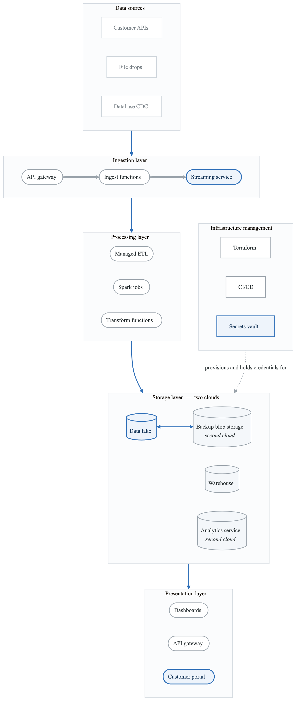
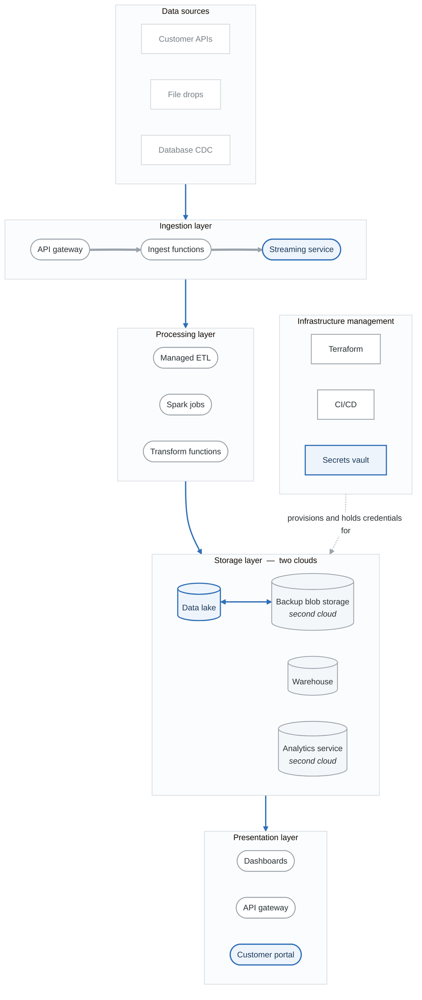

# Project 3: Cloud-Native Infrastructure Threat Model

## Overview

Create a comprehensive threat model for a multi-cloud infrastructure deployment. This project focuses on cloud security, infrastructure as code, and the shared responsibility model.

**Difficulty:** Intermediate
**Estimated Time:** 10-12 hours
**Prerequisites:** Projects 1-2, Cloud Security module

---

## Scenario

You're the lead security architect for "DataPipe," a data analytics company building a cloud-native data processing platform. The platform must handle sensitive customer data across AWS and Azure.

### System Description

DataPipe is a cloud-native data processing platform that:
- Ingests data from customer sources (APIs, files, databases)
- Processes and transforms data using serverless functions
- Stores processed data in data lakes and warehouses
- Provides analytics dashboards and APIs
- Supports multi-tenant operations

### Architecture

<!-- figure: generated from the Mermaid below by _shared/diagrams/embed-figures.py — do not edit the image -->

Diagram source (Mermaid)

### Technology Stack
- **IaC:** Terraform, CloudFormation
- **CI/CD:** GitHub Actions
- **Secrets:** HashiCorp Vault
- **Monitoring:** CloudWatch, Azure Monitor, Datadog
- **Identity:** AWS IAM, Azure AD, IdentityCo (SSO)

### Data Classification
- **Customer PII:** Names, emails, addresses
- **Business Data:** Customer's proprietary data
- **Financial Data:** Billing, usage metrics
- **System Data:** Logs, configurations

---

## Project Tasks

### Task 1: Cloud Asset Inventory

Document all cloud resources:
- AWS resources by service
- Azure resources by service
- Cross-cloud connections
- Shared services

**Deliverable:** Cloud asset inventory with security classification

### Task 2: Shared Responsibility Analysis

For each cloud service used:
- What is the cloud provider responsible for?
- What is DataPipe responsible for?
- What are the security configuration options?
- What are common misconfigurations?

**Deliverable:** Shared responsibility matrix

### Task 3: IAM and Access Analysis

Analyze identity and access:
- User identities and federation
- Service accounts and roles
- Cross-account access
- Privilege escalation paths

**Deliverable:** IAM security assessment

### Task 4: Data Flow and Encryption Analysis

Map data flows and encryption:
- Data at rest encryption
- Data in transit encryption
- Key management
- Cross-cloud data transfer

**Deliverable:** Data protection assessment

### Task 5: Infrastructure as Code Security

Analyze IaC security:
- Terraform/CloudFormation security
- State file protection
- CI/CD pipeline security
- Drift detection

**Deliverable:** IaC security assessment

### Task 6: Network Security Analysis

Assess network architecture:
- VPC/VNET design
- Network segmentation
- Ingress/egress controls
- Cross-cloud connectivity

**Deliverable:** Network security assessment

### Task 7: Multi-Tenant Isolation

Analyze tenant isolation:
- Resource isolation
- Data isolation
- Network isolation
- Credential isolation

**Deliverable:** Multi-tenancy security assessment

### Task 8: Threat Model Report

Compile comprehensive analysis:
- Executive summary
- Architecture overview
- Threat analysis by layer
- Cloud-specific risks
- Multi-cloud considerations
- Recommendations

**Deliverable:** Complete threat model (25-35 pages)

---

## Cloud-Specific Threats to Consider

### Identity and Access
- Overprivileged IAM roles
- Long-lived access keys
- Cross-account role confusion
- Federated identity attacks

### Data Security
- S3 bucket misconfigurations
- Unencrypted data stores
- Backup exposure
- Cross-region data residency

### Network Security
- Public exposure of internal services
- Security group misconfigurations
- VPC peering risks
- DNS/metadata attacks

### Serverless Security
- Function permission over-privilege
- Event injection attacks
- Cold start vulnerabilities
- Dependency risks in Lambda layers

### IaC Security
- Secrets in Terraform state
- Drift from desired state
- Supply chain attacks on modules
- Pipeline credential theft

### Multi-Cloud Risks
- Inconsistent security policies
- Cross-cloud authentication
- Data synchronization risks
- Lowest common denominator security

---

## Evaluation Criteria

| Criterion | Weight | Description |
|-----------|--------|-------------|
| Cloud Asset Coverage | 15% | Complete inventory of all resources |
| Shared Responsibility | 15% | Clear understanding of boundaries |
| IAM Analysis | 15% | Comprehensive identity review |
| Data Protection | 15% | Encryption and classification |
| IaC Security | 15% | Pipeline and code security |
| Multi-Cloud Analysis | 15% | Cross-cloud considerations |
| Documentation | 10% | Professional presentation |

---

## Submission Requirements

1. **Asset Inventory** - All cloud resources documented
2. **Shared Responsibility Matrix** - Provider vs. customer duties
3. **IAM Assessment** - Identity and access analysis
4. **Data Protection Analysis** - Encryption and data flow
5. **IaC Security Review** - Terraform/pipeline security
6. **Threat Model Report** - Complete document

---

## Extension Challenges

1. **Add GCP:** Extend to a three-cloud architecture

2. **Implement Zero Trust:** Design identity-based access for all resources

3. **Add Compliance Mapping:** Map threats to SOC 2 controls

4. **Automate Threat Detection:** Propose detection rules for top threats

---

## Resources

- [Cloud Security Guide](content-03-technical-skills-cloud-security.md)
- [IaC Security](content-03-technical-skills-iac-security.md)
- [Serverless Security](content-03-technical-skills-serverless.md)
- [AWS Well-Architected Security Pillar](https://docs.aws.amazon.com/wellarchitected/latest/security-pillar/)
- [Azure Security Documentation](https://docs.microsoft.com/en-us/azure/security/)

<!-- feynman-check -->

---

## Feynman check

Close the file. Blank page, no notes. Explain each of these to a competent engineer who has never
used this tool — **under five minutes, no jargon you can't define on the spot:**

- Cloud-Specific Threats to Consider
- Data Classification
- Cloud Asset Inventory
- Shared Responsibility Analysis

**The gap is not what you forgot. It is where you used a word instead of a mechanism.**

| | |
|---|---|
| ✗ | *"We scan for vulnerabilities in the pipeline."* |
| ✓ | *"SAST reads source without running it, SCA resolves the dependency tree against an advisory database, and image scanning compares installed package versions to that same database. All three report what was known at build time — which is why the registry is re-scanned: the image does not change, the database does."* |

**Trace it:** A CVE published today against your base image → a blocked deploy. Name every component between the advisory and the refused `apply`.

Stop at the first component you cannot name. Reopen this file and read **only** that.

**Go deeper — only once the gap has a name:** the [SLSA threat model](https://slsa.dev/spec/v1.2/threats) — it names every point at which a build can be subverted, and most teams defend three of them.
Full list per domain: [`SOURCES.md`](../../SOURCES.md#devsecops)

→ Protocol, the three levels of knowing, and worked examples: [`MASTERY.md`](../../MASTERY.md)

<!-- /feynman-check -->
