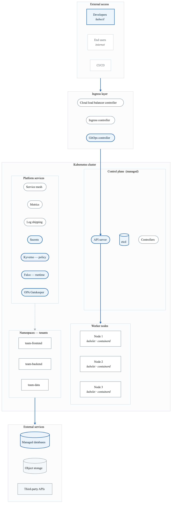
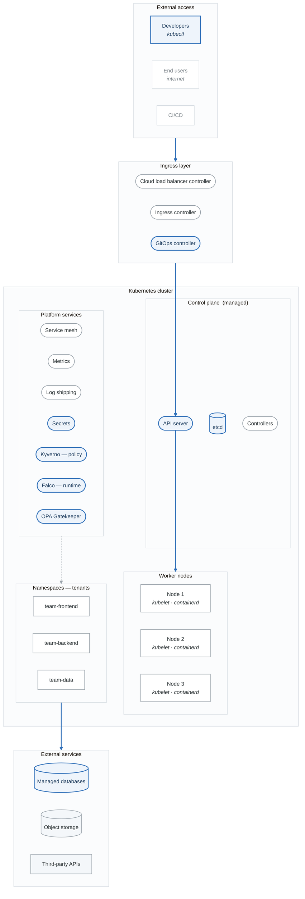

# Project 4: Kubernetes Platform Threat Model

## Overview

Create a comprehensive threat model for a production Kubernetes platform. This project focuses on container orchestration security across all Kubernetes layers.

**Difficulty:** Advanced
**Estimated Time:** 12-15 hours
**Prerequisites:** Projects 1-3, Kubernetes Security module

---

## Scenario

You're the platform security lead for "CloudScale," a company running a multi-tenant Kubernetes platform for internal development teams. The platform hosts 50+ microservices across 3 environments.

### System Description

CloudScale's Kubernetes platform provides:
- Self-service namespace provisioning for teams
- CI/CD integration with GitOps (ArgoCD)
- Centralized logging and monitoring
- Service mesh for inter-service communication
- Ingress management for external access

### Architecture

<!-- figure: generated from the Mermaid below by _shared/diagrams/embed-figures.py — do not edit the image -->

Diagram source (Mermaid)

### Security Controls in Place
- Pod Security Standards (Restricted)
- Network Policies per namespace
- OPA Gatekeeper admission control
- Falco runtime detection
- Vault for secrets management
- Istio mTLS for service mesh

---

## Project Tasks

### Task 1: Kubernetes Attack Surface Mapping

Document the 5-layer attack surface:
- Cloud (AWS/EKS)
- Cluster (Control plane)
- Container (Runtime)
- Code (Applications)
- CI/CD (Supply chain)

**Deliverable:** Attack surface diagram with entry points

### Task 2: RBAC Analysis

Analyze Kubernetes RBAC:
- ClusterRoles and Roles
- Service accounts
- User/group bindings
- Privilege escalation paths

**Deliverable:** RBAC security assessment

### Task 3: Network Security Analysis

Assess network isolation:
- Network policies effectiveness
- Ingress security
- Service mesh mTLS
- Egress controls

**Deliverable:** Network security assessment

### Task 4: Container Security Analysis

Analyze container security:
- Image security (scanning, signing)
- Pod Security Standards
- Runtime security (Falco rules)
- Secrets management

**Deliverable:** Container security assessment

### Task 5: Multi-Tenancy Threat Analysis

Analyze tenant isolation:
- Namespace isolation
- Resource quotas
- Network isolation
- RBAC boundaries
- Noisy neighbor attacks

**Deliverable:** Multi-tenancy security assessment

### Task 6: Supply Chain Analysis

Assess CI/CD and supply chain:
- GitOps security (ArgoCD)
- Image registry security
- Admission control policies
- SBOM and provenance

**Deliverable:** Supply chain security assessment

### Task 7: Runtime Threat Analysis

Identify runtime threats:
- Container escape scenarios
- Lateral movement paths
- Persistence mechanisms
- Data exfiltration methods

**Deliverable:** Runtime threat analysis

### Task 8: Final Threat Model Report

Compile comprehensive analysis:
- Executive summary
- Architecture overview
- 5-layer threat analysis
- Control gap analysis
- Prioritized recommendations

**Deliverable:** Complete threat model (30-40 pages)

---

## Kubernetes-Specific Threats

### Control Plane Threats
- API server authentication bypass
- etcd data exposure
- Controller privilege escalation
- Admission webhook abuse

### Node-Level Threats
- kubelet API exploitation
- Container runtime escape
- Host filesystem access
- DaemonSet abuse

### Workload Threats
- Privileged container escape
- Service account token theft
- Secrets exposure
- Sidecar injection attacks

### Network Threats
- Network policy bypass
- Service mesh configuration attacks
- DNS spoofing
- Metadata service abuse

### Supply Chain Threats
- Malicious base images
- CI/CD credential theft
- GitOps repository compromise
- Admission control bypass

---

## Evaluation Criteria

| Criterion | Weight | Description |
|-----------|--------|-------------|
| Attack Surface Coverage | 15% | All 5 layers analyzed |
| RBAC Analysis | 15% | Comprehensive permission review |
| Network Security | 15% | Network policy and mesh analysis |
| Container Security | 15% | Image and runtime security |
| Multi-Tenancy | 15% | Isolation assessment |
| Supply Chain | 15% | CI/CD and image security |
| Documentation | 10% | Professional presentation |

---

## Submission Requirements

1. **Attack Surface Diagram** - Visual representation of entry points
2. **RBAC Assessment** - Roles, bindings, escalation paths
3. **Network Analysis** - Policies and controls
4. **Container Assessment** - Image and runtime security
5. **Multi-Tenancy Review** - Isolation controls
6. **Supply Chain Analysis** - CI/CD security
7. **Threat Model Report** - Complete document

---

## Extension Challenges

1. **Design Detection Rules:** Create Falco rules for top 10 threats

2. **Policy as Code:** Write Kyverno/OPA policies for identified gaps

3. **Incident Response:** Develop K8s-specific IR playbooks

4. **Red Team Exercise:** Design a simulated attack path through the cluster

---

## Resources

- [Kubernetes Security Guide](../content/03-technical-skills/kubernetes.md)
- [CNCF Kubernetes Security Whitepaper](https://github.com/cncf/tag-security)
- [NSA Kubernetes Hardening Guide](https://media.defense.gov/2022/Aug/29/2003066362/-1/-1/0/CTR_KUBERNETES_HARDENING_GUIDANCE_1.2_20220829.PDF)
- [Kubernetes Threat Matrix (Microsoft)](https://microsoft.github.io/Threat-Matrix-for-Kubernetes/)

<!-- feynman-check -->

---

## Feynman check

Close the file. Blank page, no notes. Explain each of these to a competent engineer who has never
used this tool — **under five minutes, no jargon you can't define on the spot:**

- Kubernetes-Specific Threats
- Security Controls in Place
- Kubernetes Attack Surface Mapping
- RBAC Analysis

**The gap is not what you forgot. It is where you used a word instead of a mechanism.**

| | |
|---|---|
| ✗ | *"We scan for vulnerabilities in the pipeline."* |
| ✓ | *"SAST reads source without running it, SCA resolves the dependency tree against an advisory database, and image scanning compares installed package versions to that same database. All three report what was known at build time — which is why the registry is re-scanned: the image does not change, the database does."* |

**Trace it:** A CVE published today against your base image → a blocked deploy. Name every component between the advisory and the refused `apply`.

Stop at the first component you cannot name. Reopen this file and read **only** that.

**Go deeper — only once the gap has a name:** the [SLSA threat model](https://slsa.dev/spec/v1.2/threats) — it names every point at which a build can be subverted, and most teams defend three of them.
Full list per domain: [`SOURCES.md`](../../SOURCES.md#devsecops)

→ Protocol, the three levels of knowing, and worked examples: [`MASTERY.md`](../../MASTERY.md)

<!-- /feynman-check -->
