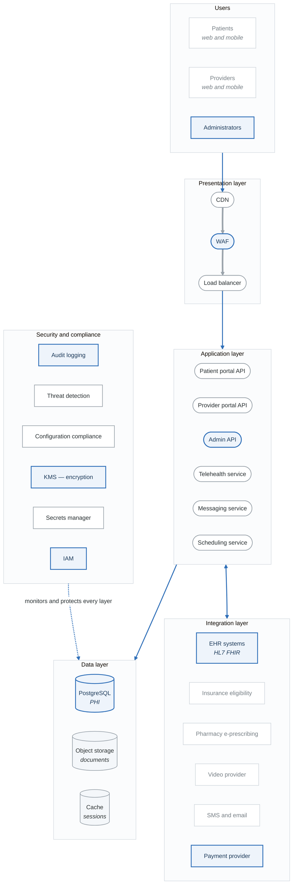

# Project 5: Healthcare System Threat Model (HIPAA)

## Overview

Create a comprehensive threat model for a healthcare application that handles Protected Health Information (PHI). This project focuses on healthcare-specific threats and HIPAA compliance requirements.

**Difficulty:** Advanced
**Estimated Time:** 12-15 hours
**Prerequisites:** Projects 1-3, Compliance Mapping module

---

## Scenario

You're the security architect for "HealthConnect," a telehealth platform connecting patients with healthcare providers. The platform handles PHI and must comply with HIPAA regulations.

### System Description

HealthConnect provides:
- Patient portal for appointment scheduling
- Video consultations with providers
- Secure messaging between patients and providers
- Electronic health records (EHR) integration
- Prescription management
- Insurance verification and billing

### Architecture

<!-- figure: generated from the Mermaid below by _shared/diagrams/embed-figures.py — do not edit the image -->

Diagram source (Mermaid)

### PHI Data Types
- Patient demographics (name, DOB, SSN, address)
- Medical records (diagnoses, treatments, medications)
- Insurance information
- Provider notes
- Video consultation recordings
- Secure messages

### Compliance Requirements
- HIPAA Privacy Rule
- HIPAA Security Rule
- HITECH Act
- State health privacy laws

---

## Project Tasks

### Task 1: PHI Data Inventory

Document all PHI:
- Data elements and classification
- Storage locations
- Processing systems
- Transmission paths
- Access controls

**Deliverable:** PHI data inventory with ePHI flow diagram

### Task 2: HIPAA Security Rule Mapping

Map threats to HIPAA requirements:
- Administrative safeguards
- Physical safeguards
- Technical safeguards

**Deliverable:** HIPAA control mapping matrix

### Task 3: Access Control Analysis

Analyze access to PHI:
- Authentication mechanisms
- Authorization models
- Role definitions
- Access logging

**Deliverable:** Access control assessment

### Task 4: Encryption Analysis

Assess encryption controls:
- Data at rest encryption
- Data in transit encryption
- Key management
- Encryption exceptions

**Deliverable:** Encryption assessment

### Task 5: Third-Party (BAA) Risk Analysis

Assess Business Associate risks:
- Identify all Business Associates
- Document PHI sharing
- Assess BA security posture
- Review BAA requirements

**Deliverable:** Business Associate risk assessment

### Task 6: Breach Scenario Analysis

Develop breach scenarios:
- Unauthorized PHI access
- PHI disclosure
- PHI modification
- System unavailability

**Deliverable:** Breach scenario documentation

### Task 7: STRIDE Analysis with HIPAA Context

Apply STRIDE with healthcare focus:
- Map threats to HIPAA requirements
- Consider patient safety implications
- Include insider threat scenarios

**Deliverable:** Healthcare-specific STRIDE analysis

### Task 8: Final Threat Model Report

Compile comprehensive analysis:
- Executive summary
- System overview
- PHI inventory
- HIPAA compliance mapping
- Threat analysis
- Risk assessment
- Recommendations

**Deliverable:** Complete threat model (30-40 pages)

---

## Healthcare-Specific Threats

### PHI Confidentiality
- Unauthorized access to patient records
- PHI exposure in logs or errors
- Business associate data breach
- Insider snooping

### PHI Integrity
- Medical record tampering
- Prescription modification
- Insurance fraud
- EHR data corruption

### PHI Availability
- Ransomware attacks
- System outages affecting care
- Data loss without backup
- Denial of service

### Patient Safety
- Telehealth session hijacking
- Prescription tampering
- Identity theft affecting care
- Provider impersonation

### Compliance Risks
- Audit trail gaps
- Insufficient access controls
- Inadequate encryption
- BAA violations

---

## HIPAA Threat Mapping

| STRIDE | HIPAA Safeguard | Example Threat |
|--------|-----------------|----------------|
| Spoofing | 164.312(d) | Provider account takeover |
| Tampering | 164.312(c)(1) | Medical record modification |
| Repudiation | 164.312(b) | Denied access to records |
| Info Disclosure | 164.312(e)(1) | PHI exposure in transit |
| DoS | 164.308(a)(7) | Ransomware attack |
| Elevation | 164.312(a)(1) | Admin privilege abuse |

---

## Evaluation Criteria

| Criterion | Weight | Description |
|-----------|--------|-------------|
| PHI Inventory | 15% | Complete data inventory |
| HIPAA Mapping | 20% | Security Rule compliance |
| Access Control | 15% | Authorization analysis |
| Encryption | 10% | Data protection |
| BA Risk | 15% | Third-party assessment |
| Threat Analysis | 15% | Comprehensive STRIDE |
| Documentation | 10% | Professional presentation |

---

## Submission Requirements

1. **PHI Inventory** - All PHI documented with flows
2. **HIPAA Mapping** - Threats to requirements matrix
3. **Access Control Review** - Authentication/authorization
4. **Encryption Assessment** - At-rest and in-transit
5. **BA Risk Assessment** - Third-party analysis
6. **Breach Scenarios** - Potential incident types
7. **Threat Model Report** - Complete document

---

## Extension Challenges

1. **Add IoT Devices:** Include medical device integration (e.g., patient monitors)

2. **HITRUST Mapping:** Extend to HITRUST CSF controls

3. **Incident Response:** Develop HIPAA breach notification procedures

4. **Patient Safety Analysis:** Conduct safety-focused threat analysis

---

## Resources

- [HIPAA Security Rule](https://www.hhs.gov/hipaa/for-professionals/security/)
- [NIST HIPAA Guidance](https://csrc.nist.gov/pubs/sp/800/66/r2/final)
- [Compliance Mapping Guide](../content/05-enterprise/compliance-mapping.md)
- [HHS Breach Portal](https://ocrportal.hhs.gov/ocr/breach/breach_report.jsf)

<!-- feynman-check -->

---

## Feynman check

Close the file. Blank page, no notes. Explain each of these to a competent engineer who has never
used this tool — **under five minutes, no jargon you can't define on the spot:**

- Healthcare-Specific Threats
- HIPAA Threat Mapping
- PHI Data Types
- Compliance Requirements

**The gap is not what you forgot. It is where you used a word instead of a mechanism.**

| | |
|---|---|
| ✗ | *"We scan for vulnerabilities in the pipeline."* |
| ✓ | *"SAST reads source without running it, SCA resolves the dependency tree against an advisory database, and image scanning compares installed package versions to that same database. All three report what was known at build time — which is why the registry is re-scanned: the image does not change, the database does."* |

**Trace it:** A CVE published today against your base image → a blocked deploy. Name every component between the advisory and the refused `apply`.

Stop at the first component you cannot name. Reopen this file and read **only** that.

**Go deeper — only once the gap has a name:** the [SLSA threat model](https://slsa.dev/spec/v1.2/threats) — it names every point at which a build can be subverted, and most teams defend three of them.
Full list per domain: [`SOURCES.md`](../../SOURCES.md#devsecops)

→ Protocol, the three levels of knowing, and worked examples: [`MASTERY.md`](../../MASTERY.md)

<!-- /feynman-check -->
