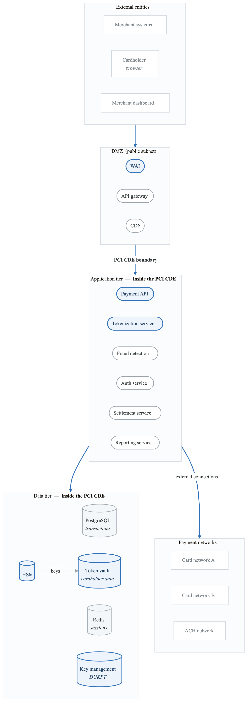
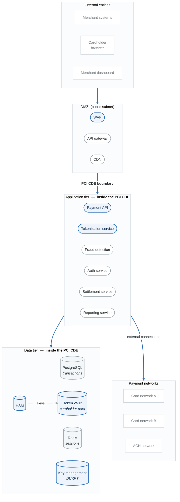

# Project 6: Fintech Payment Platform Threat Model (PCI DSS)

## Overview

Create a comprehensive threat model for a payment processing platform. This project focuses on financial services threats and PCI DSS compliance requirements.

**Difficulty:** Advanced
**Estimated Time:** 15-18 hours
**Prerequisites:** Projects 1-3, Compliance Mapping module

---

## Scenario

You're the security architect for "PayFlow," a fintech startup building a payment processing platform for e-commerce merchants. The platform handles cardholder data and must achieve PCI DSS Level 1 certification.

### System Description

PayFlow provides:
- Payment gateway APIs for merchants
- Cardholder data tokenization
- Fraud detection and prevention
- Transaction processing
- Settlement and reconciliation
- Merchant dashboard and reporting

### Architecture

<!-- figure: generated from the Mermaid below by _shared/diagrams/embed-figures.py — do not edit the image -->

Diagram source (Mermaid)

### Cardholder Data Elements
- Primary Account Number (PAN)
- Cardholder name
- Expiration date
- Service code
- CVV/CVC (never stored)

### Compliance Requirements
- PCI DSS v4.0 (Level 1 Service Provider)
- SOC 2 Type II
- State money transmitter licenses

---

## Project Tasks

### Task 1: CDE Scoping

Define Cardholder Data Environment:
- Systems that store, process, or transmit CHD
- Systems connected to CDE
- Systems that could impact CDE security
- Out-of-scope systems with justification

**Deliverable:** CDE scope diagram with justification

### Task 2: CHD Flow Analysis

Map cardholder data flows:
- Where CHD enters the system
- How CHD is processed
- Where CHD is stored (and why)
- Where CHD is transmitted
- How CHD is destroyed

**Deliverable:** CHD data flow diagram

### Task 3: PCI DSS Requirement Mapping

Map threats to PCI requirements:
- Requirement 1-2: Network security
- Requirement 3: CHD protection
- Requirement 4: Encryption in transit
- Requirement 5-6: Vulnerability management
- Requirement 7-9: Access control
- Requirement 10-11: Monitoring
- Requirement 12: Policies

**Deliverable:** PCI DSS threat mapping matrix

### Task 4: Tokenization Security Analysis

Analyze tokenization service:
- Token generation security
- Token-to-PAN mapping protection
- De-tokenization controls
- Token format security

**Deliverable:** Tokenization security assessment

### Task 5: Cryptographic Controls Analysis

Assess cryptographic implementation:
- Encryption algorithms
- Key management lifecycle
- HSM security
- Key rotation

**Deliverable:** Cryptographic assessment

### Task 6: Fraud Threat Analysis

Analyze fraud-specific threats:
- Card testing attacks
- Account takeover
- Transaction manipulation
- Merchant collusion

**Deliverable:** Fraud threat assessment

### Task 7: STRIDE Analysis with Payment Focus

Apply STRIDE to payment flows:
- Authorization flow
- Capture flow
- Settlement flow
- Refund flow

**Deliverable:** Payment flow threat analysis

### Task 8: Final Threat Model Report

Compile comprehensive analysis:
- Executive summary
- Architecture overview
- CDE scope documentation
- CHD flow analysis
- PCI DSS mapping
- Threat analysis
- Risk assessment
- Recommendations

**Deliverable:** Complete threat model (35-45 pages)

---

## Payment-Specific Threats

### Cardholder Data Theft
- PAN interception
- Token vault breach
- Key compromise
- Memory scraping

### Transaction Fraud
- Replay attacks
- Amount manipulation
- Authorization bypass
- Refund fraud

### Merchant Threats
- Rogue merchant
- API key theft
- Webhook manipulation
- Settlement fraud

### Infrastructure
- CDE network breach
- HSM compromise
- Backup exposure
- Logging of CHD

---

## PCI DSS Threat Examples

| Requirement | Threat Example | Control |
|-------------|----------------|---------|
| 3.4 | PAN stored unencrypted | Encryption at rest |
| 3.5 | Encryption keys exposed | HSM, key management |
| 4.1 | CHD transmitted unencrypted | TLS 1.2+ |
| 6.4 | Insecure code deployment | Change control |
| 7.1 | Excessive access to CHD | Need-to-know access |
| 8.3 | Weak authentication | MFA for CDE access |
| 10.1 | No audit trail | Comprehensive logging |
| 11.3 | Undetected vulnerabilities | Penetration testing |

---

## Evaluation Criteria

| Criterion | Weight | Description |
|-----------|--------|-------------|
| CDE Scoping | 15% | Accurate scope definition |
| CHD Flows | 15% | Complete data flow mapping |
| PCI Mapping | 20% | Requirements coverage |
| Tokenization | 10% | Token service security |
| Cryptography | 10% | Key and encryption analysis |
| Fraud Analysis | 10% | Payment fraud threats |
| STRIDE Analysis | 10% | Comprehensive threat coverage |
| Documentation | 10% | Professional presentation |

---

## Submission Requirements

1. **CDE Scope Diagram** - Clear boundary definition
2. **CHD Flow Diagram** - All data paths documented
3. **PCI Mapping Matrix** - Threats to requirements
4. **Tokenization Assessment** - Service security review
5. **Crypto Assessment** - Encryption and key management
6. **Fraud Analysis** - Payment-specific threats
7. **Threat Model Report** - Complete document

---

## Extension Challenges

1. **Add Cryptocurrency:** Include crypto payment support

2. **3D Secure Analysis:** Add 3DS authentication flow

3. **Real-Time Payments:** Include instant payment capabilities

4. **International Expansion:** Consider cross-border requirements

---

## Resources

- [PCI DSS v4.0](https://www.pcisecuritystandards.org/)
- [Compliance Mapping Guide](content-05-enterprise-compliance-mapping.md)
- [Payment Card Industry Documentation](https://www.pcisecuritystandards.org/document_library)
- [NIST Cryptographic Guidelines](https://csrc.nist.gov/publications/fips)

<!-- feynman-check -->

---

## Feynman check

Close the file. Blank page, no notes. Explain each of these to a competent engineer who has never
used this tool — **under five minutes, no jargon you can't define on the spot:**

- Payment-Specific Threats
- PCI DSS Threat Examples
- Cardholder Data Elements
- Compliance Requirements

**The gap is not what you forgot. It is where you used a word instead of a mechanism.**

| | |
|---|---|
| ✗ | *"We scan for vulnerabilities in the pipeline."* |
| ✓ | *"SAST reads source without running it, SCA resolves the dependency tree against an advisory database, and image scanning compares installed package versions to that same database. All three report what was known at build time — which is why the registry is re-scanned: the image does not change, the database does."* |

**Trace it:** A CVE published today against your base image → a blocked deploy. Name every component between the advisory and the refused `apply`.

Stop at the first component you cannot name. Reopen this file and read **only** that.

**Go deeper — only once the gap has a name:** the [SLSA threat model](https://slsa.dev/spec/v1.2/threats) — it names every point at which a build can be subverted, and most teams defend three of them.
Full list per domain: [`SOURCES.md`](../../SOURCES.md#devsecops)

→ Protocol, the three levels of knowing, and worked examples: [`MASTERY.md`](../../MASTERY.md)

<!-- /feynman-check -->
