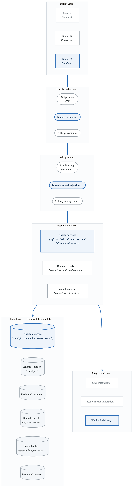

# Project 7: SaaS Multi-Tenant Platform Threat Model

## Overview

Create a comprehensive threat model for a multi-tenant SaaS platform. This project focuses on tenant isolation, data segregation, and shared infrastructure security.

**Difficulty:** Advanced
**Estimated Time:** 12-15 hours
**Prerequisites:** Projects 1-4, API Security and Cloud modules

---

## Scenario

You're the security architect for "ProjectHub," a B2B project management SaaS platform serving 500+ enterprise customers. Each customer (tenant) requires strict data isolation while sharing platform infrastructure.

### System Description

ProjectHub provides:
- Project and task management
- Document storage and collaboration
- Team communication (chat, comments)
- Time tracking and reporting
- Integrations with third-party tools
- API access for custom integrations

### Multi-Tenancy Model

```yaml
tenancy_model:
  isolation_level: Logical (shared infrastructure, isolated data)

  tenant_tiers:
    standard:
      - Shared database with tenant_id column
      - Shared application instances
      - Shared storage with path isolation

    enterprise:
      - Dedicated database schema
      - Isolated compute (dedicated pods)
      - Dedicated storage encryption keys

    regulated:
      - Dedicated database instance
      - Single-tenant compute
      - Dedicated encryption keys
      - Geographic isolation option
```

### Architecture

```mermaid
%%{init: {'theme':'base','themeVariables':{'fontFamily':'Helvetica, Arial, sans-serif','fontSize':'13px','primaryColor':'#ffffff','primaryTextColor':'#2d3436','primaryBorderColor':'#9aa3ab','lineColor':'#9aa3ab','textColor':'#2d3436','clusterBkg':'#fbfcfd','clusterBorder':'#d4dae0','edgeLabelBackground':'#ffffff','tertiaryColor':'#eef4fb'},'flowchart':{'curve':'basis','padding':14,'nodeSpacing':42,'rankSpacing':58}}}%%
flowchart TB
  classDef default fill:#ffffff,stroke:#9aa3ab,stroke-width:1.3px,color:#2d3436
  classDef n    fill:#ffffff,stroke:#9aa3ab,stroke-width:1.3px,color:#2d3436
  classDef crit fill:#eef4fb,stroke:#2f6fb8,stroke-width:1.8px,color:#1b3a5c
  classDef data fill:#f4f7fa,stroke:#9aa3ab,stroke-width:1.3px,color:#2d3436
  classDef mut  fill:#ffffff,stroke:#cfd6dc,stroke-width:1.1px,color:#7a8288
  classDef warn fill:#fdf0ec,stroke:#c0522d,stroke-width:1.6px,color:#8a3a1e
  subgraph TU["Tenant users"]
    direction LR
    TA["Tenant A<br/><i>Standard</i>"]
    TB["Tenant B<br/><i>Enterprise</i>"]
    TC["Tenant C<br/><i>Regulated</i>"]
  end
  subgraph IAM["Identity and access"]
    direction LR
    SSO(["SSO provider<br/><i>MFA</i>"])
    TRS(["Tenant resolution"])
    SCIM(["SCIM provisioning"])
  end
  subgraph GW["API gateway"]
    direction LR
    RL(["Rate limiting<br/><i>per tenant</i>"])
    TCI(["<b>Tenant context injection</b>"])
    AK(["API key management"])
  end
  subgraph APP["Application layer"]
    direction LR
    SH["Shared services<br/><i>projects · tasks · documents · chat<br/>(all standard tenants)</i>"]
    DP["Dedicated pods<br/><i>Tenant B — dedicated compute</i>"]
    DI["Isolated instance<br/><i>Tenant C — all services</i>"]
  end
  subgraph DL["Data layer &nbsp;—&nbsp; three isolation models"]
    direction LR
    D1[("Shared database<br/><i>tenant_id column + row-level security</i>")]
    D2[("Schema isolation<br/><i>tenant_b.*</i>")]
    D3[("Dedicated instance")]
    S1[("Shared bucket<br/><i>prefix per tenant</i>")]
    S2[("Shared bucket<br/><i>separate key per tenant</i>")]
    S3[("Dedicated bucket")]
  end
  subgraph INT["Integration layer"]
    direction LR
    I1["Chat integration"]
    I2["Issue-tracker integration"]
    I3["Webhook delivery"]
  end
  TU ==> IAM ==> GW ==> APP ==> DL
  APP <==> INT
  class TA mut
  class TB n
  class TC crit
  class SSO,SCIM n
  class TRS crit
  class RL,AK n
  class TCI crit
  class SH crit
  class DP,DI n
  class D1 crit
  class D2,D3,S1,S2,S3 data
  class I1,I2 mut
  class I3 crit
  linkStyle 0,1,2,3,4 stroke:#2f6fb8,stroke-width:2px

%% Three isolation models means three separate places tenant isolation can fail,
%% and only one of them is testable by an integration test that logs in as two
%% tenants. The shared-database path is the risky one, and webhook delivery is
%% the other: an outbound request to a tenant-supplied URL, made by shared
%% infrastructure holding every tenant's data.
```

<!-- figure: generated from the Mermaid below by _shared/diagrams/embed-figures.py — do not edit the image -->


<details>
<summary>Diagram source (Mermaid)</summary>



</details>

---

## Project Tasks

### Task 1: Tenant Isolation Analysis

Analyze isolation controls:
- Data isolation mechanisms
- Compute isolation
- Network isolation
- Authentication boundaries

**Deliverable:** Tenant isolation assessment matrix

### Task 2: Data Segregation Threats

Identify cross-tenant data risks:
- Query-based data leakage
- Cache poisoning
- Log exposure
- Backup mixing

**Deliverable:** Data segregation threat analysis

### Task 3: Authentication & Authorization

Analyze tenant access controls:
- SSO integration security
- Tenant context propagation
- Permission inheritance
- API key isolation

**Deliverable:** AuthN/AuthZ assessment

### Task 4: Noisy Neighbor Analysis

Assess resource contention risks:
- CPU/memory exhaustion
- Storage quota abuse
- Rate limit bypass
- Performance interference

**Deliverable:** Resource isolation assessment

### Task 5: Integration Security

Analyze third-party integrations:
- OAuth token isolation
- Webhook security
- API key management
- Data sharing scope

**Deliverable:** Integration security assessment

### Task 6: Administrative Access Threats

Analyze platform admin risks:
- Super-admin access to tenant data
- Audit logging for admin actions
- Tenant data access controls
- Break-glass procedures

**Deliverable:** Admin access threat analysis

### Task 7: Tenant Lifecycle Threats

Analyze tenant management:
- Provisioning security
- Data migration risks
- Offboarding/data deletion
- Tenant takeover scenarios

**Deliverable:** Lifecycle security assessment

### Task 8: Final Threat Model Report

Compile comprehensive analysis:
- Executive summary
- Multi-tenancy architecture
- Isolation analysis
- Threat findings
- Risk assessment
- Tier-specific recommendations

**Deliverable:** Complete threat model (30-40 pages)

---

## Multi-Tenant Specific Threats

### Tenant Isolation Failures
- SQL injection leading to cross-tenant data access
- Missing tenant_id filter in queries
- Tenant context not propagated to all services
- Shared cache key collisions

### Resource Exhaustion
- Noisy neighbor DoS
- Storage quota bypass
- API rate limit sharing
- Background job starvation

### Authorization Bypass
- Tenant ID manipulation
- IDOR between tenants
- Admin privilege escalation
- Integration token misuse

### Data Leakage
- Search results across tenants
- Error messages exposing tenant data
- Logs containing cross-tenant info
- Backup restoration errors

---

## Evaluation Criteria

| Criterion | Weight | Description |
|-----------|--------|-------------|
| Isolation Analysis | 20% | Comprehensive isolation review |
| Data Segregation | 15% | Cross-tenant data risks |
| AuthN/AuthZ | 15% | Access control analysis |
| Resource Isolation | 10% | Noisy neighbor threats |
| Integration Security | 10% | Third-party risks |
| Admin Access | 10% | Platform admin threats |
| Lifecycle Security | 10% | Provisioning/offboarding |
| Documentation | 10% | Professional presentation |

---

## Submission Requirements

1. **Isolation Matrix** - All isolation controls documented
2. **Data Segregation Analysis** - Cross-tenant risks
3. **AuthN/AuthZ Assessment** - Access control review
4. **Resource Analysis** - Contention threats
5. **Integration Review** - Third-party security
6. **Admin Access Analysis** - Privilege risks
7. **Threat Model Report** - Complete document

---

## Extension Challenges

1. **Geographic Isolation:** Add data residency requirements

2. **Zero Trust Multi-Tenancy:** Design tenant verification at every layer

3. **Tenant Self-Service Security:** Allow tenants to configure security settings

4. **Audit Trail by Tenant:** Design per-tenant audit and compliance

---

## Resources

- [SaaS Multi-Tenant Lab](labs-lab-09-saas-multi-tenant-README.md)
- [API Security Guide](content-03-technical-skills-api-security.md)
- [OWASP Multi-Tenant Security](https://owasp.org/www-project-kubernetes-top-ten/)

<!-- feynman-check -->

---

## Feynman check

Close the file. Blank page, no notes. Explain each of these to a competent engineer who has never
used this tool — **under five minutes, no jargon you can't define on the spot:**

- Multi-Tenant Specific Threats
- Multi-Tenancy Model
- Tenant Isolation Analysis
- Data Segregation Threats

**The gap is not what you forgot. It is where you used a word instead of a mechanism.**

| | |
|---|---|
| ✗ | *"We scan for vulnerabilities in the pipeline."* |
| ✓ | *"SAST reads source without running it, SCA resolves the dependency tree against an advisory database, and image scanning compares installed package versions to that same database. All three report what was known at build time — which is why the registry is re-scanned: the image does not change, the database does."* |

**Trace it:** A CVE published today against your base image → a blocked deploy. Name every component between the advisory and the refused `apply`.

Stop at the first component you cannot name. Reopen this file and read **only** that.

**Go deeper — only once the gap has a name:** the [SLSA threat model](https://slsa.dev/spec/v1.2/threats) — it names every point at which a build can be subverted, and most teams defend three of them.
Full list per domain: [`SOURCES.md`](../../SOURCES.md#devsecops)

→ Protocol, the three levels of knowing, and worked examples: [`MASTERY.md`](../../MASTERY.md)

<!-- /feynman-check -->
