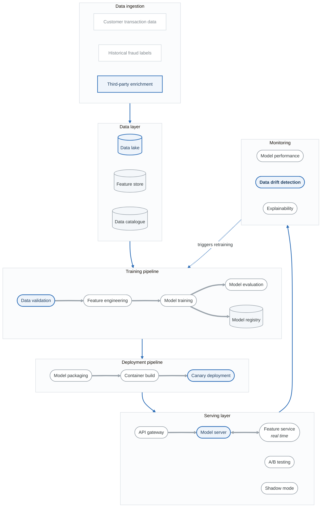

# Project 8: Machine Learning Pipeline Threat Model

## Overview

Create a comprehensive threat model for an ML/AI system including training pipeline, model serving, and production inference. This project focuses on AI-specific threats and adversarial machine learning.

**Difficulty:** Expert
**Estimated Time:** 15-18 hours
**Prerequisites:** Projects 1-4, AI/ML Threats module

---

## Scenario

You're the security lead for "FraudShield," a fraud detection ML platform serving financial institutions. The platform trains models on transaction data and provides real-time inference for fraud scoring.

### System Description

FraudShield provides:
- Model training on customer transaction data
- Feature engineering pipelines
- Real-time fraud scoring API
- Model versioning and deployment
- Model performance monitoring
- Explainability reports

### Architecture

<!-- figure: generated from the Mermaid below by _shared/diagrams/embed-figures.py — do not edit the image -->

Diagram source (Mermaid)

### Data Types
- Transaction data (amounts, merchants, locations)
- Customer profiles (demographics, history)
- Historical fraud labels
- Model features (engineered)
- Model weights and parameters
- Inference results and explanations

---

## Project Tasks

### Task 1: ML Asset Inventory

Catalog ML-specific assets:
- Training data and labels
- Feature engineering code
- Trained models
- Model configurations
- Serving infrastructure

**Deliverable:** ML asset inventory with classification

### Task 2: Training Pipeline Threats

Analyze training pipeline:
- Data poisoning risks
- Label manipulation
- Training environment security
- Model tampering

**Deliverable:** Training pipeline threat analysis

### Task 3: Model Security Analysis

Assess model assets:
- Model theft risks
- Backdoor insertion
- Weight tampering
- Model inversion attacks

**Deliverable:** Model security assessment

### Task 4: Inference Security Analysis

Analyze serving layer:
- Adversarial inputs
- Model evasion attempts
- Feature manipulation
- API abuse

**Deliverable:** Inference security assessment

### Task 5: Data Privacy Analysis

Assess privacy risks:
- Training data extraction
- Membership inference
- Feature leakage
- Explanation exposure

**Deliverable:** Privacy risk assessment

### Task 6: Supply Chain Analysis

Assess ML supply chain:
- Pre-trained model risks
- Library dependencies
- Training framework security
- Data provider risks

**Deliverable:** ML supply chain assessment

### Task 7: Adversarial ML Attack Scenarios

Develop attack scenarios:
- Fraud pattern evasion
- Model degradation attacks
- Competitive intelligence extraction
- System gaming

**Deliverable:** Adversarial scenario documentation

### Task 8: Final Threat Model Report

Compile comprehensive analysis:
- Executive summary
- ML system architecture
- Training pipeline security
- Model protection
- Inference security
- Privacy considerations
- Recommendations

**Deliverable:** Complete threat model (35-45 pages)

---

## ML-Specific Threats

### Training Pipeline
- Data poisoning (label flipping)
- Backdoor insertion
- Training data extraction
- Gradient leakage

### Model Attacks
- Model stealing (extraction)
- Model inversion
- Membership inference
- Weight tampering

### Inference Attacks
- Adversarial examples
- Evasion attacks
- Model probing
- Feature manipulation

### Privacy Threats
- Training data reconstruction
- Attribute inference
- Feature correlation leakage
- Explanation abuse

---

## Fraud Detection Context

Unique threats for fraud detection ML:
- Fraudsters adapting to model behavior
- Targeted evasion of specific rules
- Gaming model explanations
- False positive manipulation
- Label poisoning from fraud feedback

---

## Evaluation Criteria

| Criterion | Weight | Description |
|-----------|--------|-------------|
| Asset Inventory | 10% | Complete ML asset catalog |
| Training Security | 20% | Pipeline threat analysis |
| Model Protection | 15% | Asset security assessment |
| Inference Security | 15% | Serving layer threats |
| Privacy Analysis | 15% | Data privacy risks |
| Supply Chain | 10% | Dependency analysis |
| Attack Scenarios | 10% | Adversarial documentation |
| Documentation | 5% | Professional presentation |

---

## Submission Requirements

1. **ML Asset Inventory** - All ML assets classified
2. **Training Analysis** - Pipeline security review
3. **Model Security** - Protection assessment
4. **Inference Security** - Serving layer review
5. **Privacy Assessment** - Data and model privacy
6. **Supply Chain** - Dependency risks
7. **Attack Scenarios** - Adversarial documentation
8. **Threat Model Report** - Complete document

---

## Extension Challenges

1. **Federated Learning:** Add privacy-preserving distributed training

2. **LLM Integration:** Include LLM for natural language fraud detection

3. **Differential Privacy:** Implement DP training controls

4. **Red Team Exercise:** Design ML-specific red team scenarios

---

## Resources

- [AI/ML Threats Guide](../content/06-advanced/ai-ml-threats.md)
- [Adversarial Robustness Toolbox](https://github.com/Trusted-AI/adversarial-robustness-toolbox)
- [MITRE ATLAS](https://atlas.mitre.org/)
- [NIST AI Risk Management Framework](https://www.nist.gov/itl/ai-risk-management-framework)

<!-- feynman-check -->

---

## Feynman check

Close the file. Blank page, no notes. Explain each of these to a competent engineer who has never
used this tool — **under five minutes, no jargon you can't define on the spot:**

- ML-Specific Threats
- Fraud Detection Context
- Data Types
- ML Asset Inventory

**The gap is not what you forgot. It is where you used a word instead of a mechanism.**

| | |
|---|---|
| ✗ | *"We scan for vulnerabilities in the pipeline."* |
| ✓ | *"SAST reads source without running it, SCA resolves the dependency tree against an advisory database, and image scanning compares installed package versions to that same database. All three report what was known at build time — which is why the registry is re-scanned: the image does not change, the database does."* |

**Trace it:** A CVE published today against your base image → a blocked deploy. Name every component between the advisory and the refused `apply`.

Stop at the first component you cannot name. Reopen this file and read **only** that.

**Go deeper — only once the gap has a name:** the [SLSA threat model](https://slsa.dev/spec/v1.2/threats) — it names every point at which a build can be subverted, and most teams defend three of them.
Full list per domain: [`SOURCES.md`](../../SOURCES.md#devsecops)

→ Protocol, the three levels of knowing, and worked examples: [`MASTERY.md`](../../MASTERY.md)

<!-- /feynman-check -->
