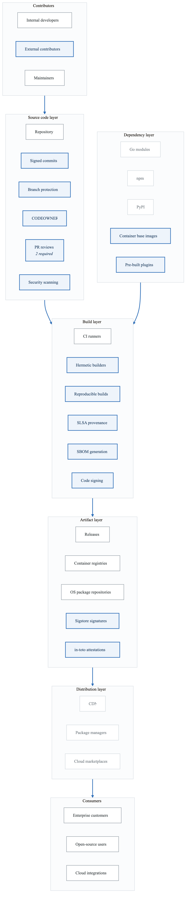

# Project 9: Software Supply Chain Threat Model

## Overview

Create a comprehensive threat model for a software supply chain, from source code to production deployment. This project focuses on supply chain security, CI/CD pipeline threats, and SLSA compliance.

**Difficulty:** Expert
**Estimated Time:** 15-18 hours
**Prerequisites:** Projects 1-4, Supply Chain Security module

---

## Scenario

You're the DevSecOps lead for "SecureDeploy," a company that develops a popular open-source infrastructure tool. The project has 500+ contributors, integrates with major cloud providers, and is downloaded 1M+ times per month.

### System Description

SecureDeploy includes:
- Open-source CLI tool
- Commercial enterprise features
- Plugin ecosystem
- Container images
- Cloud provider integrations
- Extensive documentation

### Supply Chain Architecture

```mermaid
%%{init: {'theme':'base','themeVariables':{'fontFamily':'Helvetica, Arial, sans-serif','fontSize':'13px','primaryColor':'#ffffff','primaryTextColor':'#2d3436','primaryBorderColor':'#9aa3ab','lineColor':'#9aa3ab','textColor':'#2d3436','clusterBkg':'#fbfcfd','clusterBorder':'#d4dae0','edgeLabelBackground':'#ffffff','tertiaryColor':'#eef4fb'},'flowchart':{'curve':'basis','padding':14,'nodeSpacing':42,'rankSpacing':58}}}%%
flowchart TB
  classDef default fill:#ffffff,stroke:#9aa3ab,stroke-width:1.3px,color:#2d3436
  classDef n    fill:#ffffff,stroke:#9aa3ab,stroke-width:1.3px,color:#2d3436
  classDef crit fill:#eef4fb,stroke:#2f6fb8,stroke-width:1.8px,color:#1b3a5c
  classDef data fill:#f4f7fa,stroke:#9aa3ab,stroke-width:1.3px,color:#2d3436
  classDef mut  fill:#ffffff,stroke:#cfd6dc,stroke-width:1.1px,color:#7a8288
  classDef warn fill:#fdf0ec,stroke:#c0522d,stroke-width:1.6px,color:#8a3a1e
  subgraph CON["Contributors"]
    direction LR
    ID["Internal developers"]
    EC["External contributors"]
    MN["Maintainers"]
  end
  subgraph SRC["Source code layer"]
    direction LR
    REPO["Repository"]
    SC["Signed commits"]
    BP["Branch protection"]
    CO["CODEOWNERS"]
    PR["PR reviews<br/><i>2 required</i>"]
    SS["Security scanning"]
  end
  subgraph DEP["Dependency layer"]
    direction LR
    GO["Go modules"]
    NPM["npm"]
    PY["PyPI"]
    BI["Container base images"]
    PL["Pre-built plugins"]
  end
  subgraph BLD["Build layer"]
    direction LR
    CI["CI runners"]
    HB["Hermetic builders"]
    RB["Reproducible builds"]
    SL["SLSA provenance"]
    SB["SBOM generation"]
    CS["Code signing"]
  end
  subgraph ART["Artifact layer"]
    direction LR
    REL["Releases"]
    REG["Container registries"]
    PKG["OS package repositories"]
    SIG["Sigstore signatures"]
    ATT["in-toto attestations"]
  end
  subgraph DIST["Distribution layer"]
    direction LR
    CDN["CDN"]
    PM["Package managers"]
    MP2["Cloud marketplaces"]
  end
  subgraph CSM["Consumers"]
    direction LR
    ENT["Enterprise customers"]
    OSS["Open-source users"]
    CLD["Cloud integrations"]
  end
  CON ==> SRC ==> BLD
  DEP ==> BLD
  BLD ==> ART ==> DIST ==> CSM
  class ID,MN n
  class EC crit
  class REPO n
  class SC,BP,CO,PR,SS crit
  class GO,NPM,PY mut
  class BI,PL crit
  class CI n
  class HB,RB,SL,SB,CS crit
  class REL,REG,PKG n
  class SIG,ATT crit
  class CDN,PM,MP2 mut
  class ENT,OSS,CLD n
  linkStyle 0,1,2,3,4,5 stroke:#2f6fb8,stroke-width:2px

%% Seven layers, and an attacker only needs one. External contributors and
%% third-party dependencies are the two entry points you do not control, which
%% is why the build layer carries the weight: hermetic, reproducible, attested,
%% signed. Those four properties are what let a consumer verify the artifact
%% came from the source it claims -- without trusting your pipeline.
```

<!-- figure: generated from the Mermaid below by _shared/diagrams/embed-figures.py — do not edit the image -->

Diagram source (Mermaid)

---

## Project Tasks

### Task 1: Supply Chain Mapping

Create complete supply chain map:
- All input sources
- All transformation steps
- All output destinations
- All human touchpoints

**Deliverable:** Supply chain diagram with trust boundaries

### Task 2: SLSA Assessment

Evaluate SLSA compliance:
- Current SLSA level
- Gaps to higher levels
- Build provenance generation
- Verification mechanisms

**Deliverable:** SLSA compliance assessment

### Task 3: Dependency Analysis

Analyze dependency risks:
- Direct dependencies
- Transitive dependencies
- Dependency sources
- Update mechanisms

**Deliverable:** Dependency threat analysis

### Task 4: Build Pipeline Security

Analyze build pipeline:
- Build environment security
- Secret management
- Artifact integrity
- Pipeline tampering risks

**Deliverable:** Build pipeline threat analysis

### Task 5: Contributor Threat Analysis

Assess contributor risks:
- Account compromise
- Malicious contributor
- Abandoned maintainer
- Social engineering

**Deliverable:** Contributor risk assessment

### Task 6: Distribution Security

Analyze distribution channels:
- Registry security
- CDN integrity
- Installation scripts
- Update mechanisms

**Deliverable:** Distribution security assessment

### Task 7: Consumer Risk Analysis

Assess consumer-side risks:
- Installation security
- Verification capabilities
- Update security
- Plugin ecosystem

**Deliverable:** Consumer security assessment

### Task 8: Final Threat Model Report

Compile comprehensive analysis:
- Executive summary
- Supply chain architecture
- SLSA assessment
- Layer-by-layer analysis
- Attack scenarios
- Recommendations

**Deliverable:** Complete threat model (35-45 pages)

---

## Supply Chain Threats by Layer

### Source Code
- Malicious commit injection
- Account takeover
- Branch protection bypass
- Review manipulation

### Dependencies
- Typosquatting
- Dependency confusion
- Abandoned package takeover
- Transitive vulnerabilities

### Build
- Build system compromise
- Compiler tampering
- Cache poisoning
- Secret exposure

### Artifacts
- Registry compromise
- Signature bypass
- Metadata manipulation
- Version manipulation

### Distribution
- CDN compromise
- Mirror poisoning
- Download interception
- Checksum tampering

---

## Real-World Case Study Integration

Apply lessons from:
- OrionSoft (build compromise)
- Codecov (script tampering)
- event-stream (maintainer takeover)
- ua-parser-js (account compromise)
- 3CX (cascading supply chain)

---

## Evaluation Criteria

| Criterion | Weight | Description |
|-----------|--------|-------------|
| Supply Chain Mapping | 15% | Complete chain documentation |
| SLSA Assessment | 15% | Compliance evaluation |
| Dependency Analysis | 15% | Risk identification |
| Build Security | 15% | Pipeline threat analysis |
| Contributor Risks | 10% | Human factor threats |
| Distribution Security | 10% | Channel security |
| Consumer Risks | 10% | End-user threats |
| Documentation | 10% | Professional presentation |

---

## Submission Requirements

1. **Supply Chain Diagram** - Complete with trust boundaries
2. **SLSA Assessment** - Current level and gaps
3. **Dependency Analysis** - All dependency risks
4. **Build Pipeline Review** - Pipeline security
5. **Contributor Assessment** - Human factor risks
6. **Distribution Review** - Channel security
7. **Consumer Analysis** - User-side risks
8. **Threat Model Report** - Complete document

---

## Extension Challenges

1. **Implement SLSA Level 3:** Design controls for SLSA Level 3 compliance

2. **SBOM Integration:** Design SBOM generation and consumption

3. **Incident Response:** Create supply chain incident playbook

4. **Plugin Security:** Design secure plugin ecosystem

---

## Resources

- [Supply Chain Security Guide](content-06-advanced-supply-chain.md)
- [SLSA Framework](https://slsa.dev/)
- [Sigstore](https://sigstore.dev/)
- [CI/CD Pipeline Lab](labs-lab-10-cicd-pipeline-README.md)

<!-- feynman-check -->

---

## Feynman check

Close the file. Blank page, no notes. Explain each of these to a competent engineer who has never
used this tool — **under five minutes, no jargon you can't define on the spot:**

- Supply Chain Threats by Layer
- Real-World Case Study Integration
- Supply Chain Architecture
- Supply Chain Mapping

**The gap is not what you forgot. It is where you used a word instead of a mechanism.**

| | |
|---|---|
| ✗ | *"We scan for vulnerabilities in the pipeline."* |
| ✓ | *"SAST reads source without running it, SCA resolves the dependency tree against an advisory database, and image scanning compares installed package versions to that same database. All three report what was known at build time — which is why the registry is re-scanned: the image does not change, the database does."* |

**Trace it:** A CVE published today against your base image → a blocked deploy. Name every component between the advisory and the refused `apply`.

Stop at the first component you cannot name. Reopen this file and read **only** that.

**Go deeper — only once the gap has a name:** the [SLSA threat model](https://slsa.dev/spec/v1.2/threats) — it names every point at which a build can be subverted, and most teams defend three of them.
Full list per domain: [`SOURCES.md`](../../SOURCES.md#devsecops)

→ Protocol, the three levels of knowing, and worked examples: [`MASTERY.md`](../../MASTERY.md)

<!-- /feynman-check -->
