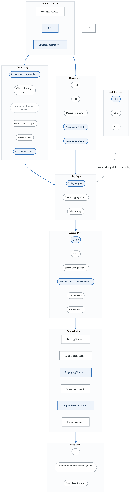

# Project 10: Zero Trust Enterprise Architecture Threat Model

## Overview

Create a comprehensive threat model for a Zero Trust enterprise transformation. This is a capstone project integrating all threat modeling skills to design and validate a Zero Trust architecture.

**Difficulty:** Expert
**Estimated Time:** 20-25 hours
**Prerequisites:** All previous projects and modules

---

## Scenario

You're the Chief Security Architect leading a Zero Trust transformation for "GlobalCorp," a Fortune 500 company with 50,000 employees, 200+ applications, and operations in 30 countries.

### Current State

GlobalCorp's legacy architecture includes:
- Traditional perimeter security (VPN, firewalls)
- On-premises Active Directory
- Mix of on-prem and cloud applications
- Network-based access controls
- Implicit trust for internal users

### Target State

Zero Trust architecture with:
- Identity-centric access control
- Continuous verification
- Micro-segmentation
- Device posture assessment
- Data-centric protection

### Architecture

```mermaid
%%{init: {'theme':'base','themeVariables':{'fontFamily':'Helvetica, Arial, sans-serif','fontSize':'13px','primaryColor':'#ffffff','primaryTextColor':'#2d3436','primaryBorderColor':'#9aa3ab','lineColor':'#9aa3ab','textColor':'#2d3436','clusterBkg':'#fbfcfd','clusterBorder':'#d4dae0','edgeLabelBackground':'#ffffff','tertiaryColor':'#eef4fb'},'flowchart':{'curve':'basis','padding':14,'nodeSpacing':42,'rankSpacing':58}}}%%
flowchart TB
  classDef default fill:#ffffff,stroke:#9aa3ab,stroke-width:1.3px,color:#2d3436
  classDef n    fill:#ffffff,stroke:#9aa3ab,stroke-width:1.3px,color:#2d3436
  classDef crit fill:#eef4fb,stroke:#2f6fb8,stroke-width:1.8px,color:#1b3a5c
  classDef data fill:#f4f7fa,stroke:#9aa3ab,stroke-width:1.3px,color:#2d3436
  classDef mut  fill:#ffffff,stroke:#cfd6dc,stroke-width:1.1px,color:#7a8288
  classDef warn fill:#fdf0ec,stroke:#c0522d,stroke-width:1.6px,color:#8a3a1e
  subgraph U["Users and devices"]
    direction LR
    MD["Managed devices"]
    BY["BYOD"]
    EXT["External / contractor"]
  end
  subgraph IDN["Identity layer"]
    direction LR
    IDP(["Primary identity provider"])
    DIR(["Cloud directory<br/><i>synced</i>"])
    AD(["On-premises directory<br/><i>legacy</i>"])
    MFA(["MFA — FIDO2 / push"])
    PWL(["Passwordless"])
    RBA(["Risk-based access"])
  end
  subgraph DEV["Device layer"]
    direction LR
    MDM(["MDM"])
    EDR(["EDR"])
    CERT(["Device certificate"])
    POS(["Posture assessment"])
    CMP(["Compliance engine"])
  end
  subgraph POL["Policy layer"]
    direction LR
    PE(["<b>Policy engine</b>"])
    CX(["Context aggregation"])
    RS(["Risk scoring"])
  end
  subgraph ACC["Access layer"]
    direction LR
    ZTNA(["ZTNA"])
    CASB(["CASB"])
    SWG(["Secure web gateway"])
    PAM(["Privileged access management"])
    AGW(["API gateway"])
    MESH(["Service mesh"])
  end
  subgraph APP["Application layer"]
    direction LR
    SAAS["SaaS applications"]
    INT2["Internal applications"]
    LEG["Legacy applications"]
    IAAS["Cloud IaaS / PaaS"]
    DC["On-premises data centre"]
    PS["Partner systems"]
  end
  subgraph DATA["Data layer"]
    direction LR
    DLP(["DLP"])
    ENC(["Encryption and rights management"])
    CLS(["Data classification"])
  end
  subgraph VIS["Visibility layer"]
    direction LR
    SIEM(["SIEM"])
    UEBA(["UEBA"])
    NDR(["NDR"])
  end
  U ==> IDN
  U ==> DEV
  IDN ==> POL
  DEV ==> POL
  POL ==> ACC ==> APP ==> DATA
  VIS -.->|"feeds risk signals back into policy"| POL
  class MD n
  class BY,EXT crit
  class IDP crit
  class DIR,MFA,PWL n
  class AD mut
  class RBA crit
  class MDM,EDR,CERT n
  class POS,CMP crit
  class PE crit
  class CX,RS n
  class ZTNA,PAM crit
  class CASB,SWG,AGW,MESH n
  class SAAS,INT2,IAAS,PS n
  class LEG,DC crit
  class DLP,ENC,CLS n
  class SIEM crit
  class UEBA,NDR n
  linkStyle 0,1,2,3,4,5,6 stroke:#2f6fb8,stroke-width:2px

%% Policy inputs: user + device + location + time + behaviour.
%%
%% Legacy applications and the on-premises data centre are crimson because they
%% are the two things that cannot participate. An application that only
%% understands network-level trust has to be fronted by a proxy that speaks
%% zero trust on its behalf -- and every zero-trust programme is ultimately
%% judged on how it handled these two boxes, not on the six that were easy.
```

<!-- figure: generated from the Mermaid below by _shared/diagrams/embed-figures.py — do not edit the image -->

Diagram source (Mermaid)

---

## Project Tasks

### Task 1: Current State Assessment

Analyze legacy architecture:
- Trust relationships
- Access patterns
- Security gaps
- Risk areas

**Deliverable:** Current state threat assessment

### Task 2: Zero Trust Component Analysis

Analyze each ZT component:
- Identity providers
- Policy decision points
- Policy enforcement points
- Monitoring systems

**Deliverable:** Component security analysis

### Task 3: Identity Layer Threats

Deep dive on identity:
- IdP security
- Federation risks
- Token security
- Credential threats

**Deliverable:** Identity threat analysis

### Task 4: Device Layer Threats

Analyze device security:
- MDM bypass risks
- EDR evasion
- Certificate theft
- Posture manipulation

**Deliverable:** Device threat analysis

### Task 5: Access Layer Threats

Analyze access controls:
- ZTNA bypass
- Policy decision manipulation
- Enforcement gaps
- Legacy application risks

**Deliverable:** Access control threat analysis

### Task 6: Data Layer Threats

Analyze data protection:
- DLP bypass
- Encryption gaps
- Classification failures
- Exfiltration paths

**Deliverable:** Data protection threat analysis

### Task 7: Attack Path Analysis

Identify attack paths:
- Initial access to crown jewels
- Lateral movement paths
- Privilege escalation routes
- Data exfiltration methods

**Deliverable:** Attack path documentation

### Task 8: Transition Risk Analysis

Analyze migration risks:
- Hybrid state vulnerabilities
- Migration gaps
- Rollback risks
- Coexistence threats

**Deliverable:** Transition risk assessment

### Task 9: Maturity Roadmap

Create security roadmap:
- Current maturity level
- Target maturity
- Gap remediation plan
- Priority order

**Deliverable:** ZT maturity roadmap

### Task 10: Final Threat Model Report

Compile capstone analysis:
- Executive summary
- Architecture overview
- Layer-by-layer analysis
- Attack paths
- Transition risks
- Prioritized recommendations
- Implementation roadmap

**Deliverable:** Complete threat model (50+ pages)

---

## Zero Trust Threat Categories

### Identity Threats
- IdP compromise (ThreatGroup-B scenario)
- Session token theft
- MFA bypass techniques
- Federation exploitation

### Device Threats
- Posture falsification
- MDM bypass
- Certificate theft
- Endpoint compromise

### Access Threats
- Policy bypass
- ZTNA vulnerabilities
- Legacy app exposure
- Privilege accumulation

### Data Threats
- DLP evasion
- Classification errors
- Encryption gaps
- Authorized insider abuse

### Visibility Gaps
- Detection blind spots
- Log tampering
- Alert fatigue
- Correlation failures

---

## Executive Presentation

Prepare 10-slide executive summary:
1. Current risk posture
2. Zero Trust benefits
3. Key threats addressed
4. Residual risks
5. Critical recommendations
6. Investment requirements
7. Implementation timeline
8. Success metrics
9. Quick wins
10. Call to action

---

## Evaluation Criteria

| Criterion | Weight | Description |
|-----------|--------|-------------|
| Current State | 10% | Legacy architecture analysis |
| Component Analysis | 15% | ZT component security |
| Identity Threats | 10% | IdP and access threats |
| Device Threats | 10% | Endpoint security |
| Access Threats | 10% | Control analysis |
| Data Threats | 10% | Protection analysis |
| Attack Paths | 10% | End-to-end paths |
| Transition Risks | 10% | Migration analysis |
| Roadmap | 10% | Maturity planning |
| Documentation | 5% | Professional presentation |

---

## Submission Requirements

1. **Current State Assessment** - Legacy risk analysis
2. **Component Analysis** - ZT component security
3. **Identity Analysis** - IdP and authentication
4. **Device Analysis** - Endpoint security
5. **Access Analysis** - ZTNA and controls
6. **Data Analysis** - Protection analysis
7. **Attack Paths** - End-to-end scenarios
8. **Transition Risks** - Migration analysis
9. **Maturity Roadmap** - Implementation plan
10. **Executive Presentation** - 10-slide summary
11. **Threat Model Report** - Complete document

---

## Extension Challenges

1. **Quantitative Risk:** Calculate financial risk reduction

2. **Detection Engineering:** Design detection rules for top threats

3. **Red Team Exercise:** Design ZT-specific red team campaign

4. **Compliance Mapping:** Map to NIST, ISO, SOC 2 controls

---

## Resources

- [Zero Trust Guide](../content/06-advanced/zero-trust.md)
- [NIST Zero Trust Architecture](https://www.nist.gov/publications/zero-trust-architecture)
- [CISA Zero Trust Maturity Model](https://www.cisa.gov/zero-trust-maturity-model)
- [Google BeyondCorp](https://cloud.google.com/beyondcorp)

---

## Congratulations

Completing this capstone project demonstrates mastery of enterprise threat modeling. You've applied:
- Foundational threat modeling skills
- Multiple methodologies (STRIDE, Attack Trees)
- Cloud and infrastructure security
- Compliance integration
- Enterprise program management
- Advanced threat analysis

You're now equipped to lead threat modeling programs at the enterprise level.

<!-- feynman-check -->

---

## Feynman check

Close the file. Blank page, no notes. Explain each of these to a competent engineer who has never
used this tool — **under five minutes, no jargon you can't define on the spot:**

- Zero Trust Threat Categories
- Executive Presentation
- Congratulations
- Current State

**The gap is not what you forgot. It is where you used a word instead of a mechanism.**

| | |
|---|---|
| ✗ | *"We scan for vulnerabilities in the pipeline."* |
| ✓ | *"SAST reads source without running it, SCA resolves the dependency tree against an advisory database, and image scanning compares installed package versions to that same database. All three report what was known at build time — which is why the registry is re-scanned: the image does not change, the database does."* |

**Trace it:** A CVE published today against your base image → a blocked deploy. Name every component between the advisory and the refused `apply`.

Stop at the first component you cannot name. Reopen this file and read **only** that.

**Go deeper — only once the gap has a name:** the [SLSA threat model](https://slsa.dev/spec/v1.2/threats) — it names every point at which a build can be subverted, and most teams defend three of them.
Full list per domain: [`SOURCES.md`](../../SOURCES.md#devsecops)

→ Protocol, the three levels of knowing, and worked examples: [`MASTERY.md`](../../MASTERY.md)

<!-- /feynman-check -->
