# Data Flow Diagram Template

## Overview

Use this template to create consistent, security-focused Data Flow Diagrams (DFDs) for threat modeling sessions.

---

## DFD Elements Reference

### 1. External Entities (Rectangles)
Entities outside your system that interact with it.

**User**

(Browser)

Examples:
- Users (customers, admins, operators)
- Third-party systems (payment processors, APIs)
- External services (email, SMS providers)

### 2. Processes (Circles/Rounded Rectangles)
Components that transform data.

<!-- figure: generated from the Mermaid below by _shared/diagrams/embed-figures.py — do not edit the image -->
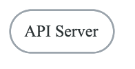

Diagram source (Mermaid)

Examples:
- Web servers
- API services
- Background workers
- Microservices

### 3. Data Stores (Parallel Lines/Cylinders)
Places where data is persisted.

<!-- figure: generated from the Mermaid below by _shared/diagrams/embed-figures.py — do not edit the image -->
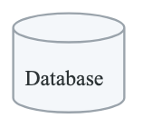

Diagram source (Mermaid)

```mermaid
%%{init: {'theme':'base','themeVariables':{'fontFamily':'Helvetica, Arial, sans-serif','fontSize':'13px','primaryColor':'#ffffff','primaryTextColor':'#2d3436','primaryBorderColor':'#9aa3ab','lineColor':'#9aa3ab','textColor':'#2d3436','clusterBkg':'#fbfcfd','clusterBorder':'#d4dae0','edgeLabelBackground':'#ffffff','tertiaryColor':'#eef4fb'},'flowchart':{'curve':'basis','padding':14,'nodeSpacing':42,'rankSpacing':58}}}%%
flowchart LR
  classDef default fill:#ffffff,stroke:#9aa3ab,stroke-width:1.3px,color:#2d3436
  classDef n    fill:#ffffff,stroke:#9aa3ab,stroke-width:1.3px,color:#2d3436
  classDef crit fill:#eef4fb,stroke:#2f6fb8,stroke-width:1.8px,color:#1b3a5c
  classDef data fill:#f4f7fa,stroke:#9aa3ab,stroke-width:1.3px,color:#2d3436
  classDef mut  fill:#ffffff,stroke:#cfd6dc,stroke-width:1.1px,color:#7a8288
  classDef warn fill:#fdf0ec,stroke:#c0522d,stroke-width:1.6px,color:#8a3a1e
  D[("Database")]
  class D data

%% A DATA STORE -- something that persists data at rest.
%% In Mermaid: a cylinder node, `id[("Name")]`.
```

Examples:
- Databases (PostgreSQL, MySQL)
- File storage (S3, local files)
- Caches (Redis, Memcached)
- Message queues

### 4. Data Flows (Arrows)
Movement of data between elements.

<!-- figure: generated from the Mermaid below by _shared/diagrams/embed-figures.py — do not edit the image -->
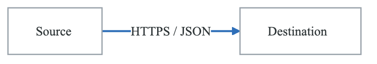

Diagram source (Mermaid)

```mermaid
%%{init: {'theme':'base','themeVariables':{'fontFamily':'Helvetica, Arial, sans-serif','fontSize':'13px','primaryColor':'#ffffff','primaryTextColor':'#2d3436','primaryBorderColor':'#9aa3ab','lineColor':'#9aa3ab','textColor':'#2d3436','clusterBkg':'#fbfcfd','clusterBorder':'#d4dae0','edgeLabelBackground':'#ffffff','tertiaryColor':'#eef4fb'},'flowchart':{'curve':'basis','padding':14,'nodeSpacing':42,'rankSpacing':58}}}%%
flowchart LR
  classDef default fill:#ffffff,stroke:#9aa3ab,stroke-width:1.3px,color:#2d3436
  classDef n    fill:#ffffff,stroke:#9aa3ab,stroke-width:1.3px,color:#2d3436
  classDef crit fill:#eef4fb,stroke:#2f6fb8,stroke-width:1.8px,color:#1b3a5c
  classDef data fill:#f4f7fa,stroke:#9aa3ab,stroke-width:1.3px,color:#2d3436
  classDef mut  fill:#ffffff,stroke:#cfd6dc,stroke-width:1.1px,color:#7a8288
  classDef warn fill:#fdf0ec,stroke:#c0522d,stroke-width:1.6px,color:#8a3a1e
  A["Source"] ==>|"HTTPS / JSON"| B["Destination"]
  class A,B n
  linkStyle 0 stroke:#2f6fb8,stroke-width:2px

%% A DATA FLOW. Label it with the protocol AND the content -- "HTTPS/JSON" says
%% how it travels; "session token + cart contents" says what an attacker gains
%% by reading it. The second label is the one a threat model can use.
```

Label with:
- Protocol (HTTPS, gRPC, TCP)
- Data format (JSON, XML, binary)
- Data types (credentials, PII, financial)

### 5. Trust Boundaries (Dashed Lines)
Boundaries where trust level changes.

<!-- figure: generated from the Mermaid below by _shared/diagrams/embed-figures.py — do not edit the image -->
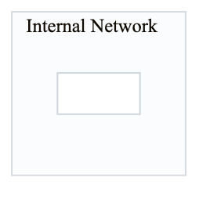

Diagram source (Mermaid)

```mermaid
%%{init: {'theme':'base','themeVariables':{'fontFamily':'Helvetica, Arial, sans-serif','fontSize':'13px','primaryColor':'#ffffff','primaryTextColor':'#2d3436','primaryBorderColor':'#9aa3ab','lineColor':'#9aa3ab','textColor':'#2d3436','clusterBkg':'#fbfcfd','clusterBorder':'#d4dae0','edgeLabelBackground':'#ffffff','tertiaryColor':'#eef4fb'},'flowchart':{'curve':'basis','padding':14,'nodeSpacing':42,'rankSpacing':58}}}%%
flowchart LR
  classDef default fill:#ffffff,stroke:#9aa3ab,stroke-width:1.3px,color:#2d3436
  classDef n    fill:#ffffff,stroke:#9aa3ab,stroke-width:1.3px,color:#2d3436
  classDef crit fill:#eef4fb,stroke:#2f6fb8,stroke-width:1.8px,color:#1b3a5c
  classDef data fill:#f4f7fa,stroke:#9aa3ab,stroke-width:1.3px,color:#2d3436
  classDef mut  fill:#ffffff,stroke:#cfd6dc,stroke-width:1.1px,color:#7a8288
  classDef warn fill:#fdf0ec,stroke:#c0522d,stroke-width:1.6px,color:#8a3a1e
  subgraph TB["Internal Network"]
    X[" "]
  end
  class X mut

%% A TRUST BOUNDARY -- where the trust level changes.
%% In Mermaid: a subgraph, or a dashed edge between the two sides. Label it
%% with WHAT changes across it, not just where it sits.
```

Examples:
- Internet/internal boundary
- VPC boundaries
- Container boundaries
- User/admin separation

---

## Level 0: Context Diagram

High-level view of system and external interactions.

<!-- figure: generated from the Mermaid below by _shared/diagrams/embed-figures.py — do not edit the image -->
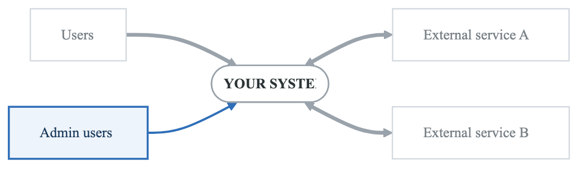

Diagram source (Mermaid)

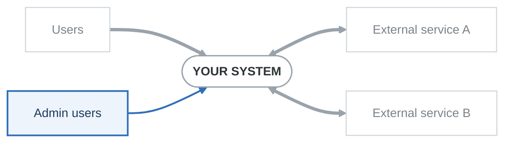

### Context Diagram Checklist
- [ ] All external entities identified
- [ ] All external integrations shown
- [ ] Data flow directions indicated
- [ ] High-level data types labeled

---

## Level 1: System Diagram

Decompose system into major components.

<!-- figure: generated from the Mermaid below by _shared/diagrams/embed-figures.py — do not edit the image -->
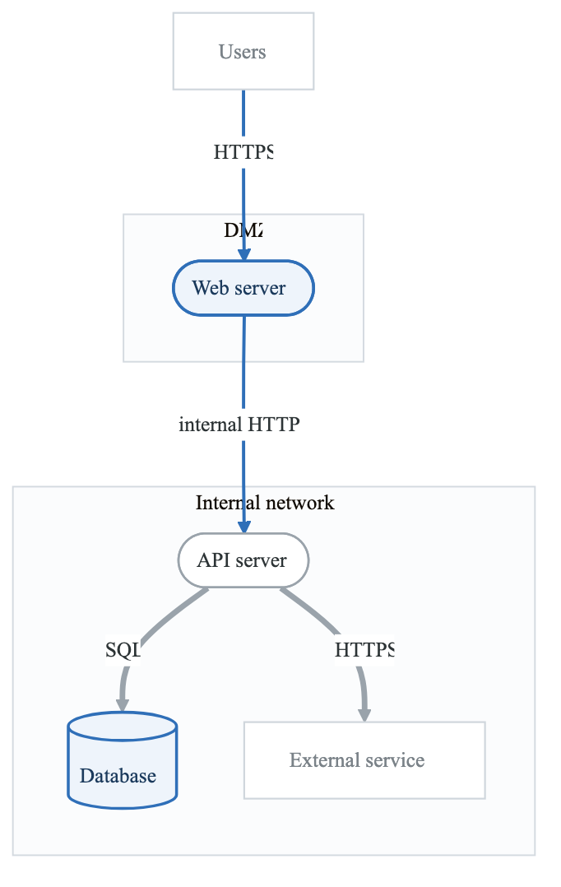

Diagram source (Mermaid)

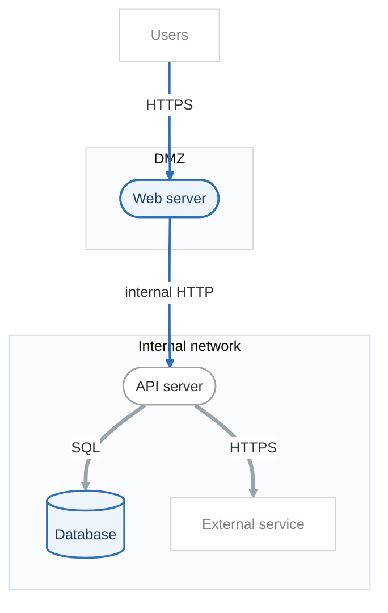

### Level 1 Checklist
- [ ] All major processes identified
- [ ] All data stores shown
- [ ] Trust boundaries drawn
- [ ] Data flow protocols labeled
- [ ] Data types on flows indicated

---

## Data Flow Inventory

| Flow ID | Source | Destination | Protocol | Data Types | Encryption | Auth |
|---------|--------|-------------|----------|------------|------------|------|
| DF-01 | User | Web Server | HTTPS | Credentials | TLS 1.3 | None |
| DF-02 | Web | API | HTTP/JSON | User data | None | JWT |
| DF-03 | API | Database | SQL | PII | TLS | Cert |
| DF-04 | API | External | HTTPS | Payment | TLS 1.3 | API Key |

---

## Component Inventory

| ID | Component | Type | Technology | Data Handled | Trust Level |
|----|-----------|------|------------|--------------|-------------|
| P-01 | Web Server | Process | Nginx | HTTP requests | Low |
| P-02 | API Server | Process | Node.js | Business logic | Medium |
| DS-01 | Database | Data Store | PostgreSQL | PII, credentials | High |
| DS-02 | Cache | Data Store | Redis | Session tokens | Medium |
| EE-01 | User | External Entity | Browser | Credentials | Untrusted |

---

## Trust Boundary Definitions

| Boundary | Description | Controls |
|----------|-------------|----------|
| Internet/DMZ | External to internal | WAF, Load Balancer |
| DMZ/Internal | DMZ to internal network | Firewall, Auth |
| App/Database | Application to data tier | Network ACL, TLS |
| Cloud/On-prem | Cloud to on-premises | VPN, mTLS |

---

## Tips for Effective DFDs

### Do's
- Start at Level 0, expand as needed
- Focus on security-relevant details
- Label all data flows with protocols
- Clearly mark trust boundaries
- Include authentication mechanisms
- Note encryption status

### Don'ts
- Don't include implementation details
- Don't show internal component logic
- Don't overcomplicate with too many levels
- Don't forget external entities
- Don't skip trust boundaries
- Don't omit data stores

---

## Tool Recommendations

| Tool | Type | Best For |
|------|------|----------|
| draw.io | Diagramming | Quick diagrams, free |
| Lucidchart | Diagramming | Collaboration, templates |
| Threat Dragon | Threat Modeling | STRIDE integration |
| Microsoft TMT | Threat Modeling | Azure diagrams |
| Miro | Whiteboard | Remote collaboration |

---

## Next Steps

After creating your DFD:
1. Review with system owners for accuracy
2. Apply STRIDE to each element
3. Document threats in threat model
4. Update as architecture changes

<!-- feynman-check -->

---

## Feynman check

Close the file. Blank page, no notes. Explain each of these to a competent engineer who has never
used this tool — **under five minutes, no jargon you can't define on the spot:**

- DFD Elements Reference
- Level 0: Context Diagram
- Level 1: System Diagram
- Data Flow Inventory

**The gap is not what you forgot. It is where you used a word instead of a mechanism.**

| | |
|---|---|
| ✗ | *"We scan for vulnerabilities in the pipeline."* |
| ✓ | *"SAST reads source without running it, SCA resolves the dependency tree against an advisory database, and image scanning compares installed package versions to that same database. All three report what was known at build time — which is why the registry is re-scanned: the image does not change, the database does."* |

**Trace it:** A CVE published today against your base image → a blocked deploy. Name every component between the advisory and the refused `apply`.

Stop at the first component you cannot name. Reopen this file and read **only** that.

**Go deeper — only once the gap has a name:** the [SLSA threat model](https://slsa.dev/spec/v1.2/threats) — it names every point at which a build can be subverted, and most teams defend three of them.
Full list per domain: [`SOURCES.md`](../../SOURCES.md#devsecops)

→ Protocol, the three levels of knowing, and worked examples: [`MASTERY.md`](../../MASTERY.md)

<!-- /feynman-check -->
