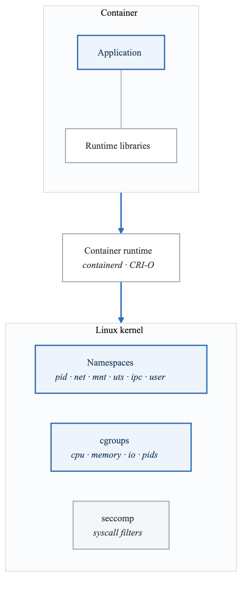
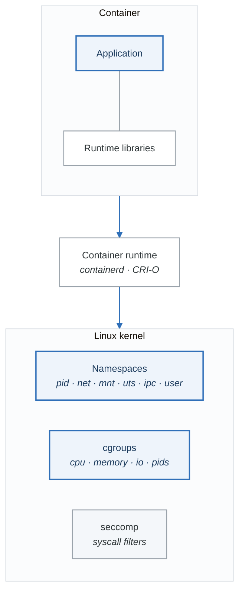
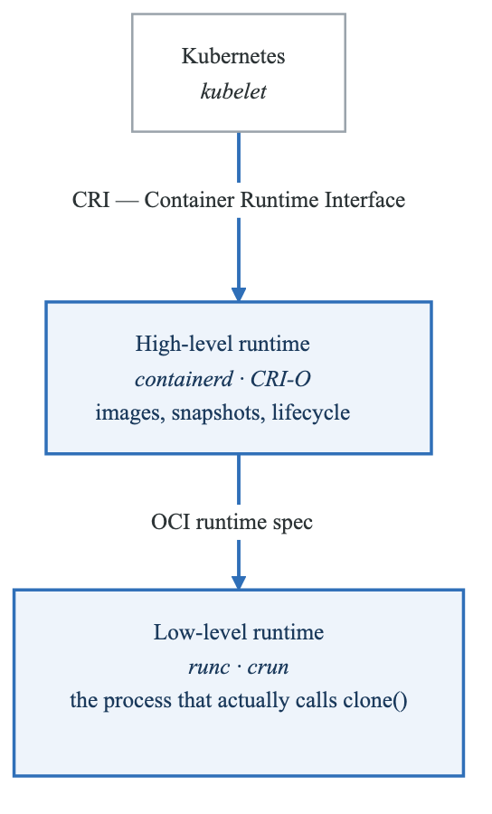
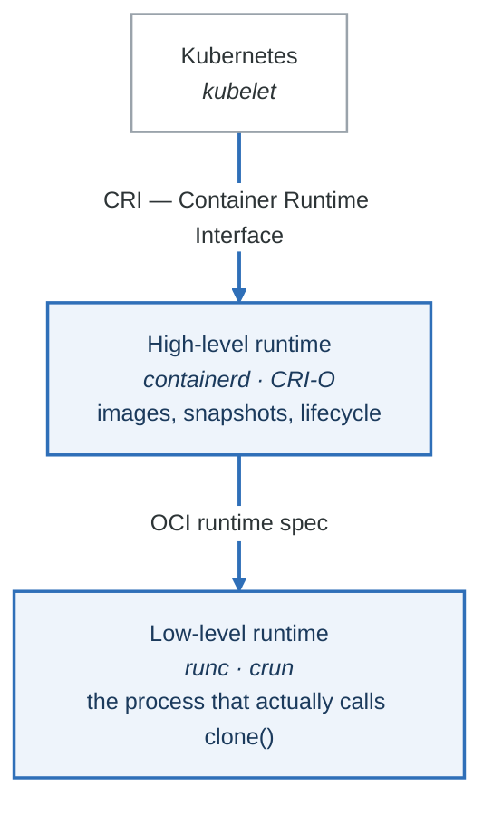

# Container Fundamentals

Master container technology before Kubernetes—it's the foundation everything builds upon.

## Learning Path

1. [Container Runtime Architecture](#container-runtime-architecture)
2. [Building Production Images](#building-production-images)
3. [Multi-Stage Builds](#multi-stage-builds)
4. [Image Security](#image-security)
5. [Container Registries](#container-registries)

---

## Container Runtime Architecture

### What is a Container?

A container is a standard unit of software that packages code and all its dependencies. Under the hood, containers use Linux kernel features:

<!-- figure: generated from the Mermaid below by _shared/diagrams/embed-figures.py — do not edit the image -->


<details>
<summary>Diagram source (Mermaid)</summary>



</details>

### Key Linux Features

**Namespaces** - Isolation
```bash
# View namespaces of a process
ls -la /proc/self/ns/

# Types:
# - pid:  Process isolation
# - net:  Network isolation
# - mnt:  Filesystem isolation
# - uts:  Hostname isolation
# - ipc:  Inter-process communication isolation
# - user: User ID isolation
```

**cgroups** - Resource Limits
```bash
# View cgroups of a container
cat /sys/fs/cgroup/memory/docker/<container-id>/memory.limit_in_bytes

# Key resources controlled:
# - CPU time and shares
# - Memory limits
# - I/O bandwidth
# - Process count
```

### Container Runtime Hierarchy

<!-- figure: generated from the Mermaid below by _shared/diagrams/embed-figures.py — do not edit the image -->


<details>
<summary>Diagram source (Mermaid)</summary>



</details>

### Hands-On: Explore Container Internals

```bash
# Run a container
docker run -d --name test nginx

# Get container PID
CONTAINER_PID=$(docker inspect --format '{{.State.Pid}}' test)
echo "Container PID: $CONTAINER_PID"

# View container namespaces
ls -la /proc/$CONTAINER_PID/ns/

# Enter container namespace manually
sudo nsenter -t $CONTAINER_PID -n ip addr  # Network namespace
sudo nsenter -t $CONTAINER_PID -p -r ps aux # PID namespace

# View cgroup limits
cat /sys/fs/cgroup/memory/docker/$(docker inspect --format '{{.Id}}' test)/memory.limit_in_bytes

# Cleanup
docker rm -f test
```

---

## Building Production Images

### Image Layer Architecture

| Container (writable layer) |  |
|---|---|
| Application layer | ← Your code |
| Dependencies layer | ← npm install, pip install |
| Runtime layer | ← Node, Python, etc. |
| Base OS layer | ← Ubuntu, Alpine, Distroless |


### Dockerfile Best Practices

```dockerfile
# examples/Dockerfile.best-practices

# 1. Use specific tags, never 'latest'
FROM node:20.10-alpine3.18 AS base

# 2. Set working directory early
WORKDIR /app

# 3. Create non-root user
RUN addgroup -g 1001 -S appgroup && \
    adduser -u 1001 -S appuser -G appgroup

# 4. Copy dependency files first (layer caching)
COPY package*.json ./

# 5. Install dependencies in a separate layer
RUN npm ci --only=production && \
    npm cache clean --force

# 6. Copy application code
COPY --chown=appuser:appgroup . .

# 7. Use non-root user
USER appuser

# 8. Document the port
EXPOSE 3000

# 9. Use exec form for CMD
CMD ["node", "server.js"]

# 10. Add health check
HEALTHCHECK --interval=30s --timeout=3s --start-period=5s --retries=3 \
  CMD wget --no-verbose --tries=1 --spider http://localhost:3000/health || exit 1

# 11. Add labels for metadata
LABEL org.opencontainers.image.source="https://github.com/your-org/your-app" \
      org.opencontainers.image.version="1.0.0" \
      org.opencontainers.image.description="Your application description"
```

### Common Mistakes to Avoid

```dockerfile
# BAD: Running as root
FROM node:20
COPY . .
CMD ["node", "server.js"]

# BAD: Using latest tag
FROM node:latest

# BAD: Installing dev dependencies in production
RUN npm install

# BAD: Not cleaning up in same layer
RUN apt-get update
RUN apt-get install -y curl
RUN apt-get clean

# GOOD: Combining and cleaning in one layer
RUN apt-get update && \
    apt-get install -y --no-install-recommends curl && \
    apt-get clean && \
    rm -rf /var/lib/apt/lists/*
```

---

## Multi-Stage Builds

Multi-stage builds reduce image size by separating build dependencies from runtime.

### Pattern: Builder Pattern

```dockerfile
# examples/Dockerfile.multistage-go

# ============ Build Stage ============
FROM golang:1.21-alpine AS builder

# Install build dependencies
RUN apk add --no-cache git ca-certificates

WORKDIR /build

# Download dependencies first (better caching)
COPY go.mod go.sum ./
RUN go mod download

# Copy source and build
COPY . .
RUN CGO_ENABLED=0 GOOS=linux GOARCH=amd64 go build \
    -ldflags="-w -s -X main.version=1.0.0" \
    -o /app ./cmd/server

# ============ Runtime Stage ============
FROM gcr.io/distroless/static-debian12

# Copy binary from builder
COPY --from=builder /app /app
COPY --from=builder /etc/ssl/certs/ca-certificates.crt /etc/ssl/certs/

# Run as non-root
USER nonroot:nonroot

EXPOSE 8080

ENTRYPOINT ["/app"]
```

### Pattern: Node.js Production Build

```dockerfile
# examples/Dockerfile.multistage-node

# ============ Dependencies Stage ============
FROM node:20-alpine AS deps
WORKDIR /app
COPY package*.json ./
RUN npm ci --only=production

# ============ Build Stage ============
FROM node:20-alpine AS builder
WORKDIR /app
COPY package*.json ./
RUN npm ci
COPY . .
RUN npm run build

# ============ Runtime Stage ============
FROM node:20-alpine AS runner
WORKDIR /app

ENV NODE_ENV=production

# Create non-root user
RUN addgroup -g 1001 -S nodejs && \
    adduser -u 1001 -S nodejs -G nodejs

# Copy only necessary files
COPY --from=deps /app/node_modules ./node_modules
COPY --from=builder /app/dist ./dist
COPY --from=builder /app/package.json ./

USER nodejs

EXPOSE 3000

CMD ["node", "dist/server.js"]
```

### Pattern: Python Application

```dockerfile
# examples/Dockerfile.multistage-python

# ============ Build Stage ============
FROM python:3.11-slim AS builder

WORKDIR /app

# Install build dependencies
RUN apt-get update && \
    apt-get install -y --no-install-recommends gcc libpq-dev && \
    rm -rf /var/lib/apt/lists/*

# Create virtual environment
RUN python -m venv /opt/venv
ENV PATH="/opt/venv/bin:$PATH"

# Install dependencies
COPY requirements.txt .
RUN pip install --no-cache-dir -r requirements.txt

# ============ Runtime Stage ============
FROM python:3.11-slim AS runner

WORKDIR /app

# Install runtime dependencies only
RUN apt-get update && \
    apt-get install -y --no-install-recommends libpq5 && \
    rm -rf /var/lib/apt/lists/* && \
    useradd --create-home --shell /bin/bash app

# Copy virtual environment from builder
COPY --from=builder /opt/venv /opt/venv
ENV PATH="/opt/venv/bin:$PATH"

# Copy application
COPY --chown=app:app . .

USER app

EXPOSE 8000

CMD ["gunicorn", "--bind", "0.0.0.0:8000", "app:create_app()"]
```

### Size Comparison

```bash
# Compare image sizes
docker images | grep myapp

# Example results:
# myapp:single-stage    1.2GB   # Everything in one stage
# myapp:multi-stage     150MB   # With multi-stage build
# myapp:distroless      25MB    # With distroless base
```

---

## Image Security

### Security Scanning with Trivy

```bash
# Install trivy
brew install trivy  # macOS
# or
curl -sfL https://raw.githubusercontent.com/aquasecurity/trivy/main/contrib/install.sh | sh -s -- -b /usr/local/bin

# Scan an image
trivy image nginx:latest

# Scan with severity filter
trivy image --severity HIGH,CRITICAL nginx:latest

# Scan and fail on high/critical vulnerabilities
trivy image --exit-code 1 --severity HIGH,CRITICAL myapp:latest

# Generate SBOM (Software Bill of Materials)
trivy image --format cyclonedx --output sbom.json myapp:latest

# Scan filesystem (during CI)
trivy fs --severity HIGH,CRITICAL .
```

### Example Trivy Output

```text
nginx:latest (debian 12.4)
===========================
Total: 142 (UNKNOWN: 0, LOW: 85, MEDIUM: 45, HIGH: 10, CRITICAL: 2)

┌──────────────────┬────────────────┬──────────┬─────────────────────┐
│     Library      │ Vulnerability  │ Severity │   Installed Version │
├──────────────────┼────────────────┼──────────┼─────────────────────┤
│ libssl3          │ CVE-2024-0727  │ CRITICAL │ 3.0.11-1            │
│ libcurl4         │ CVE-2024-2398  │ HIGH     │ 7.88.1-10           │
└──────────────────┴────────────────┴──────────┴─────────────────────┘
```

### Secure Base Images

```dockerfile
# Option 1: Alpine (small, security-focused)
FROM alpine:3.19

# Option 2: Distroless (minimal, no shell)
FROM gcr.io/distroless/static-debian12
FROM gcr.io/distroless/base-debian12
FROM gcr.io/distroless/java21-debian12
FROM gcr.io/distroless/python3-debian12
FROM gcr.io/distroless/nodejs20-debian12

# Option 3: Chainguard Images (security-hardened)
FROM cgr.dev/chainguard/static
FROM cgr.dev/chainguard/go
FROM cgr.dev/chainguard/python
```

### Security Checklist

```yaml
# .github/workflows/image-security.yml
name: Image Security Scan

on:
  push:
    branches: [main]
  pull_request:

jobs:
  scan:
    runs-on: ubuntu-latest
    steps:
      - uses: actions/checkout@v4

      - name: Build image
        run: docker build -t myapp:${{ github.sha }} .

      - name: Run Trivy vulnerability scanner
        uses: aquasecurity/trivy-action@master
        with:
          image-ref: 'myapp:${{ github.sha }}'
          format: 'sarif'
          output: 'trivy-results.sarif'
          severity: 'CRITICAL,HIGH'

      - name: Upload Trivy scan results
        uses: github/codeql-action/upload-sarif@v2
        with:
          sarif_file: 'trivy-results.sarif'

      - name: Fail on critical vulnerabilities
        uses: aquasecurity/trivy-action@master
        with:
          image-ref: 'myapp:${{ github.sha }}'
          exit-code: '1'
          severity: 'CRITICAL'
```

---

## Container Registries

### Registry Options

| Registry | Use Case | Features |
|----------|----------|----------|
| Docker Hub | Public images | Free tier, rate limits |
| Amazon ECR | AWS workloads | IRSA integration, scanning |
| Google GCR/Artifact Registry | GCP workloads | Workload Identity |
| Azure ACR | Azure workloads | AD integration |
| GitHub Container Registry | Open source | Free for public repos |
| Harbor | Self-hosted | Scanning, replication |

### Working with ECR

```bash
# Authenticate to ECR
aws ecr get-login-password --region us-west-2 | \
  docker login --username AWS --password-stdin \
  123456789012.dkr.ecr.us-west-2.amazonaws.com

# Create repository
aws ecr create-repository --repository-name myapp

# Tag and push
docker tag myapp:latest 123456789012.dkr.ecr.us-west-2.amazonaws.com/myapp:latest
docker push 123456789012.dkr.ecr.us-west-2.amazonaws.com/myapp:latest

# Enable image scanning
aws ecr put-image-scanning-configuration \
  --repository-name myapp \
  --image-scanning-configuration scanOnPush=true
```

### Working with GCR/Artifact Registry

```bash
# Authenticate to GCR
gcloud auth configure-docker

# Authenticate to Artifact Registry
gcloud auth configure-docker us-central1-docker.pkg.dev

# Tag and push to GCR
docker tag myapp:latest gcr.io/my-project/myapp:latest
docker push gcr.io/my-project/myapp:latest

# Tag and push to Artifact Registry
docker tag myapp:latest us-central1-docker.pkg.dev/my-project/my-repo/myapp:latest
docker push us-central1-docker.pkg.dev/my-project/my-repo/myapp:latest
```

### Working with ACR

```bash
# Authenticate to ACR
az acr login --name myregistry

# Tag and push
docker tag myapp:latest myregistry.azurecr.io/myapp:latest
docker push myregistry.azurecr.io/myapp:latest

# Enable content trust
export DOCKER_CONTENT_TRUST=1
docker push myregistry.azurecr.io/myapp:latest
```

---

## Exercises

Complete these exercises to validate your understanding:

1. **[Exercise 1: Build a Production Image](01-container-fundamentals-exercises-01-production-image.md)** - Build an optimized Node.js image
2. **[Exercise 2: Multi-Stage Build](01-container-fundamentals-exercises-02-multi-stage.md)** - Convert a single-stage to multi-stage
3. **[Exercise 3: Security Scanning](01-container-fundamentals-exercises-03-security-scanning.md)** - Scan and fix vulnerabilities
4. **[Exercise 4: Distroless Migration](01-container-fundamentals-exercises-04-distroless.md)** - Migrate to distroless base
5. **[Exercise 5: Registry Workflow](01-container-fundamentals-exercises-05-registry-workflow.md)** - Push to cloud registry

---

## Knowledge Check

Before moving on, ensure you can answer:

1. What Linux features enable container isolation?
2. Why should containers run as non-root?
3. What's the benefit of multi-stage builds?
4. How do you scan images for vulnerabilities?
5. What's the difference between ADD and COPY in a Dockerfile?

## Next Section

[02-kubernetes-architecture](02-kubernetes-architecture-README.md) - Deep dive into how Kubernetes works

<!-- feynman-check -->

---

## Feynman check

Close the file. Blank page, no notes. Explain each of these to a competent engineer who has never
used this tool — **under five minutes, no jargon you can't define on the spot:**

- Container Runtime Architecture
- Building Production Images
- Multi-Stage Builds
- Image Security

**The gap is not what you forgot. It is where you used a word instead of a mechanism.**

| | |
|---|---|
| ✗ | *"Kubernetes schedules the pod."* |
| ✓ | *"The scheduler watches for pods with no `nodeName`, filters nodes by predicates, scores the survivors, and writes `nodeName` into the pod spec. The kubelet on that node is watching the API for pods bound to it, and starts the containers."* |

**Trace it:** `kubectl apply -f pod.yaml` → a running container. Name every component that acts, in order, and what each one writes.

Stop at the first component you cannot name. Reopen this file and read **only** that.

**Go deeper — only once the gap has a name:** [Kubernetes the Hard Way](https://github.com/kelseyhightower/kubernetes-the-hard-way) — one weekend, and "the control plane" stops being a word.
Full list per domain: [`SOURCES.md`](../../SOURCES.md#kubernetes)

→ Protocol, the three levels of knowing, and worked examples: [`MASTERY.md`](../../MASTERY.md)

<!-- /feynman-check -->
