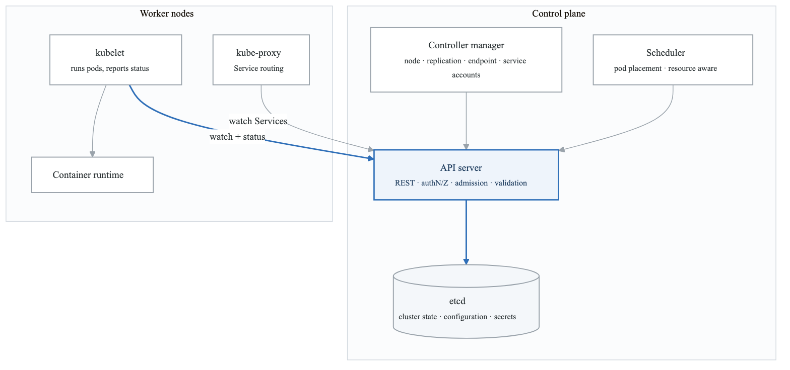
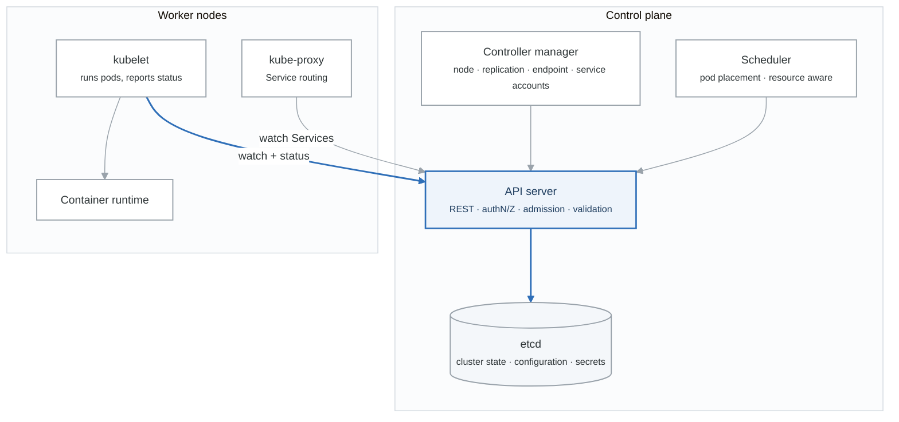
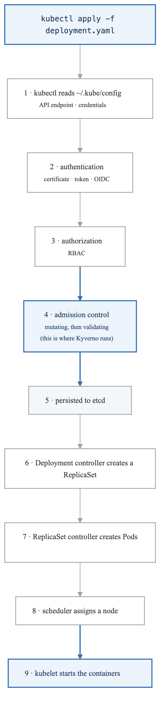
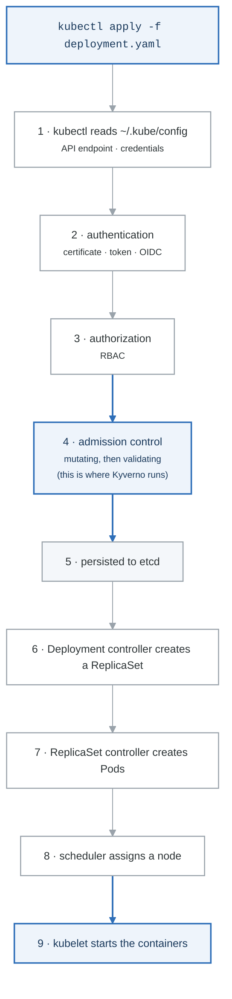

# Kubernetes Architecture

Understanding Kubernetes architecture is essential for troubleshooting and designing resilient systems.

## Learning Path

1. [Control Plane Components](#control-plane-components)
2. [Node Components](#node-components)
3. [Request Flow](#request-flow)
4. [Kubernetes The Hard Way](#kubernetes-the-hard-way)
5. [kubectl Mastery](#kubectl-mastery)

---

## Cluster Architecture Overview

<!-- figure: generated from the Mermaid below by _shared/diagrams/embed-figures.py — do not edit the image -->


<details>
<summary>Diagram source (Mermaid)</summary>



</details>

---

## Control Plane Components

### API Server (kube-apiserver)

The front door to your cluster. All communication goes through the API server.

**Responsibilities:**
- Serves the Kubernetes REST API
- Handles authentication and authorization
- Validates and configures API objects
- Serves as the gateway to etcd

```bash
# API Server is the only component that talks to etcd
# All other components communicate through the API Server

# View API server endpoints
kubectl get --raw /apis | jq .

# Check API server health
kubectl get --raw /healthz

# View all API resources
kubectl api-resources

# View API versions
kubectl api-versions
```

**Key Flags:**
```yaml
# Example API Server configuration
spec:
  containers:
  - command:
    - kube-apiserver
    - --advertise-address=10.0.0.1
    - --allow-privileged=true
    - --authorization-mode=Node,RBAC
    - --client-ca-file=/etc/kubernetes/pki/ca.crt
    - --enable-admission-plugins=NodeRestriction,PodSecurity
    - --etcd-servers=https://127.0.0.1:2379
    - --service-cluster-ip-range=10.96.0.0/12
    - --tls-cert-file=/etc/kubernetes/pki/apiserver.crt
    - --tls-private-key-file=/etc/kubernetes/pki/apiserver.key
```

### etcd

Distributed key-value store that holds all cluster state.

**Characteristics:**
- Consistent and highly available
- Uses Raft consensus algorithm
- Stores all cluster data
- Should be backed up regularly

```bash
# Check etcd health (if you have access)
ETCDCTL_API=3 etcdctl endpoint health \
  --endpoints=https://127.0.0.1:2379 \
  --cacert=/etc/kubernetes/pki/etcd/ca.crt \
  --cert=/etc/kubernetes/pki/etcd/server.crt \
  --key=/etc/kubernetes/pki/etcd/server.key

# List etcd members
ETCDCTL_API=3 etcdctl member list \
  --endpoints=https://127.0.0.1:2379 \
  --cacert=/etc/kubernetes/pki/etcd/ca.crt \
  --cert=/etc/kubernetes/pki/etcd/server.crt \
  --key=/etc/kubernetes/pki/etcd/server.key

# Backup etcd
ETCDCTL_API=3 etcdctl snapshot save /backup/etcd-snapshot.db \
  --endpoints=https://127.0.0.1:2379 \
  --cacert=/etc/kubernetes/pki/etcd/ca.crt \
  --cert=/etc/kubernetes/pki/etcd/server.crt \
  --key=/etc/kubernetes/pki/etcd/server.key

# Restore etcd
ETCDCTL_API=3 etcdctl snapshot restore /backup/etcd-snapshot.db \
  --data-dir=/var/lib/etcd-restore
```

### Controller Manager (kube-controller-manager)

Runs controller loops that regulate cluster state.

**Key Controllers:**

| Controller | Purpose |
|------------|---------|
| Node Controller | Monitors node health, handles node failures |
| Replication Controller | Maintains correct number of pods |
| Endpoints Controller | Populates Endpoints objects |
| Service Account Controller | Creates default ServiceAccounts |
| Deployment Controller | Manages Deployment rollouts |
| StatefulSet Controller | Manages StatefulSet ordering |

```bash
# Controllers run as goroutines in a single process
# Each controller watches specific resources and reconciles state

# Example: What happens when you create a Deployment
# 1. Deployment Controller sees new Deployment
# 2. Creates ReplicaSet
# 3. ReplicaSet Controller sees new ReplicaSet
# 4. Creates Pods
# 5. Scheduler assigns Pods to nodes
# 6. kubelet starts containers
```

### Scheduler (kube-scheduler)

Assigns Pods to Nodes based on resource requirements and constraints.

**Scheduling Process:**

**Scheduling Process**

**1. FILTERING (Predicates)**

- Does node have enough resources?
- Does node match nodeSelector?
- Does node satisfy affinity rules?
- Does node have required taints/tolerations?
- Is node schedulable (not cordoned)?

**2. SCORING (Priorities)**

- Balance resource usage across nodes
- Prefer nodes with image already pulled
- Spread pods across zones/nodes
- Custom priority functions

**3. BINDING**

- Assign Pod to highest-scoring node


```bash
# View scheduler decisions
kubectl describe pod <pod-name> | grep -A 10 Events

# Why wasn't my pod scheduled?
kubectl get events --field-selector reason=FailedScheduling

# View node allocatable resources
kubectl describe nodes | grep -A 5 "Allocatable"
```

---

## Node Components

### kubelet

The primary agent that runs on each node.

**Responsibilities:**
- Registers node with API server
- Watches for Pod assignments
- Mounts volumes
- Runs containers via CRI
- Reports node and pod status
- Executes liveness/readiness probes

```bash
# kubelet configuration
cat /var/lib/kubelet/config.yaml

# Check kubelet logs
journalctl -u kubelet -f

# kubelet API (local)
curl -sk https://localhost:10250/pods | jq .
```

### kube-proxy

Maintains network rules for Service communication.

**Modes:**

| Mode | Description | Use Case |
|------|-------------|----------|
| iptables | Default, uses iptables rules | Most clusters |
| IPVS | Uses IPVS for load balancing | High-scale clusters |
| userspace | Legacy, slow | Deprecated |

```bash
# View iptables rules created by kube-proxy
sudo iptables -t nat -L KUBE-SERVICES -n

# Check kube-proxy mode
kubectl get configmap kube-proxy -n kube-system -o yaml | grep mode

# kube-proxy logs
kubectl logs -n kube-system -l k8s-app=kube-proxy
```

### Container Runtime

Runs containers based on OCI specification.

**Common Runtimes:**

| Runtime | Description |
|---------|-------------|
| containerd | Industry standard, used by Docker |
| CRI-O | Lightweight, OCI-compliant |
| Docker (via cri-dockerd) | Legacy support |

```bash
# Check container runtime
kubectl get nodes -o wide | grep -i runtime

# Using crictl (CRI CLI)
crictl ps
crictl images
crictl logs <container-id>
crictl inspect <container-id>
```

---

## Request Flow

### What happens when you run `kubectl apply`?

<!-- figure: generated from the Mermaid below by _shared/diagrams/embed-figures.py — do not edit the image -->


<details>
<summary>Diagram source (Mermaid)</summary>



</details>

---

## Kubernetes The Hard Way

Building Kubernetes from scratch teaches you what managed services abstract away.

### Condensed Guide

```bash
# This is a simplified overview - follow Kelsey Hightower's full guide
# https://github.com/kelseyhightower/kubernetes-the-hard-way

# 1. Provision Infrastructure
# - 3 control plane nodes
# - 3 worker nodes
# - Load balancer for API server

# 2. Generate PKI Infrastructure
# Certificate Authority
openssl genrsa -out ca.key 4096
openssl req -x509 -new -nodes -key ca.key -sha256 -days 1826 \
  -out ca.crt -subj "/CN=kubernetes-ca"

# API Server certificate
openssl genrsa -out apiserver.key 4096
openssl req -new -key apiserver.key -out apiserver.csr \
  -subj "/CN=kube-apiserver"
openssl x509 -req -in apiserver.csr -CA ca.crt -CAkey ca.key \
  -CAcreateserial -out apiserver.crt -days 365

# Generate certs for: admin, controller-manager, scheduler,
# kubelet (per node), kube-proxy, service-accounts

# 3. Generate kubeconfig files
kubectl config set-cluster kubernetes \
  --certificate-authority=ca.crt \
  --embed-certs=true \
  --server=https://LOAD_BALANCER_IP:6443 \
  --kubeconfig=admin.kubeconfig

kubectl config set-credentials admin \
  --client-certificate=admin.crt \
  --client-key=admin.key \
  --embed-certs=true \
  --kubeconfig=admin.kubeconfig

kubectl config set-context default \
  --cluster=kubernetes \
  --user=admin \
  --kubeconfig=admin.kubeconfig

# 4. Bootstrap etcd cluster
# Configure and start etcd on each control plane node

# 5. Bootstrap Control Plane
# Download and configure: kube-apiserver, kube-controller-manager, kube-scheduler

# 6. Bootstrap Workers
# Download and configure: kubelet, kube-proxy, containerd

# 7. Configure Networking
# Deploy CNI plugin (Calico, Cilium, etc.)

# 8. Verify cluster
kubectl get nodes
kubectl get componentstatuses
```

### Alternative: kubeadm

For a faster but still educational experience:

```bash
# On control plane node
kubeadm init \
  --control-plane-endpoint "LOAD_BALANCER:6443" \
  --upload-certs \
  --pod-network-cidr=10.244.0.0/16

# Save the join command for workers
# Install CNI plugin

# On worker nodes
kubeadm join LOAD_BALANCER:6443 \
  --token <token> \
  --discovery-token-ca-cert-hash sha256:<hash>
```

---

## kubectl Mastery

### Essential Configuration

```bash
# ~/.bashrc or ~/.zshrc

# Alias
alias k=kubectl
alias kgp='kubectl get pods'
alias kgs='kubectl get svc'
alias kgd='kubectl get deployments'
alias kgn='kubectl get nodes'
alias kdp='kubectl describe pod'
alias kl='kubectl logs'
alias kx='kubectl exec -it'

# Enable bash completion
source <(kubectl completion bash)
complete -o default -F __start_kubectl k

# Use kubectx and kubens for context/namespace switching
# brew install kubectx
```

### Power User Commands

```bash
# Get all resources in a namespace
kubectl get all -n <namespace>

# Get resources across all namespaces
kubectl get pods -A

# Watch resources
kubectl get pods -w

# Get resources with additional columns
kubectl get pods -o wide
kubectl get nodes -o wide

# Custom columns
kubectl get pods -o custom-columns=NAME:.metadata.name,STATUS:.status.phase,NODE:.spec.nodeName

# JSONPath queries
kubectl get pods -o jsonpath='{.items[*].metadata.name}'
kubectl get nodes -o jsonpath='{range .items[*]}{.metadata.name}{"\t"}{.status.capacity.cpu}{"\n"}{end}'

# Sort output
kubectl get pods --sort-by=.metadata.creationTimestamp
kubectl get pods --sort-by=.status.containerStatuses[0].restartCount

# Field selectors
kubectl get pods --field-selector status.phase=Running
kubectl get pods --field-selector spec.nodeName=node-1

# Label selectors
kubectl get pods -l app=nginx
kubectl get pods -l 'app in (nginx, redis)'
kubectl get pods -l 'environment!=production'

# Dry run and diff
kubectl apply -f deployment.yaml --dry-run=client
kubectl diff -f deployment.yaml

# Debug commands
kubectl describe pod <pod>
kubectl logs <pod> -f --tail=100
kubectl logs <pod> -c <container>
kubectl logs <pod> --previous
kubectl exec -it <pod> -- /bin/sh
kubectl port-forward <pod> 8080:80
kubectl cp <pod>:/path/to/file ./local-file

# Resource management
kubectl top nodes
kubectl top pods
kubectl get events --sort-by=.lastTimestamp

# Quick resource creation
kubectl create deployment nginx --image=nginx --replicas=3
kubectl expose deployment nginx --port=80 --type=LoadBalancer
kubectl create configmap my-config --from-file=config.txt
kubectl create secret generic my-secret --from-literal=password=secret123

# Generate YAML templates
kubectl create deployment nginx --image=nginx --dry-run=client -o yaml > deployment.yaml
kubectl create service clusterip my-svc --tcp=80:80 --dry-run=client -o yaml

# Explain resources
kubectl explain pod.spec.containers
kubectl explain deployment.spec.strategy
```

### Debugging Toolkit

```bash
# Why won't my pod start?
kubectl describe pod <pod-name>
kubectl get events --field-selector involvedObject.name=<pod-name>

# Why can't I reach my service?
kubectl get endpoints <service-name>
kubectl describe service <service-name>

# What's using resources on a node?
kubectl describe node <node-name> | grep -A 20 "Allocated resources"

# Interactive debugging with ephemeral containers
kubectl debug <pod-name> -it --image=busybox

# Debug a node
kubectl debug node/<node-name> -it --image=ubuntu
```

---

## Exercises

1. **Exercise 1: Explore the API** - Navigate the Kubernetes API
2. **Exercise 2: Component Deep Dive** - Inspect control plane components
3. **Exercise 3: kubeadm Cluster** - Bootstrap a cluster with kubeadm
4. **Exercise 4: etcd Operations** - Backup and restore etcd
5. **Exercise 5: kubectl Mastery** - Advanced kubectl operations
6. **Exercise 6: Troubleshooting** - Debug cluster issues

---

## Knowledge Check

Before moving on, ensure you can:

1. Explain the role of each control plane component
2. Describe the flow when you `kubectl apply` a Deployment
3. Navigate the cluster using kubectl efficiently
4. Backup and restore etcd
5. Troubleshoot component failures

## Next Section

[03-core-workloads](03-core-workloads-README.md) - Master Kubernetes workload types

<!-- feynman-check -->

---

## Feynman check

Close the file. Blank page, no notes. Explain each of these to a competent engineer who has never
used this tool — **under five minutes, no jargon you can't define on the spot:**

- Cluster Architecture Overview
- Control Plane Components
- Node Components
- Request Flow

**The gap is not what you forgot. It is where you used a word instead of a mechanism.**

| | |
|---|---|
| ✗ | *"Kubernetes schedules the pod."* |
| ✓ | *"The scheduler watches for pods with no `nodeName`, filters nodes by predicates, scores the survivors, and writes `nodeName` into the pod spec. The kubelet on that node is watching the API for pods bound to it, and starts the containers."* |

**Trace it:** `kubectl apply -f pod.yaml` → a running container. Name every component that acts, in order, and what each one writes.

Stop at the first component you cannot name. Reopen this file and read **only** that.

**Go deeper — only once the gap has a name:** [Kubernetes the Hard Way](https://github.com/kelseyhightower/kubernetes-the-hard-way) — one weekend, and "the control plane" stops being a word.
Full list per domain: [`SOURCES.md`](../../SOURCES.md#kubernetes)

→ Protocol, the three levels of knowing, and worked examples: [`MASTERY.md`](../../MASTERY.md)

<!-- /feynman-check -->
