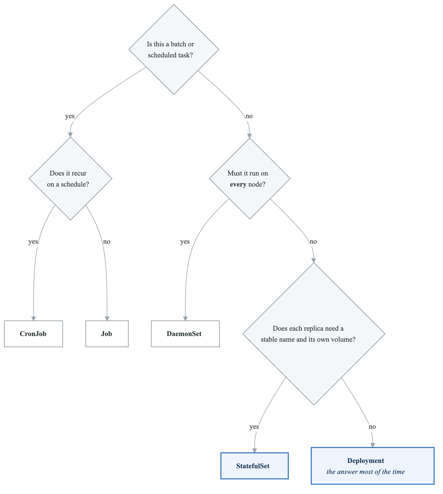
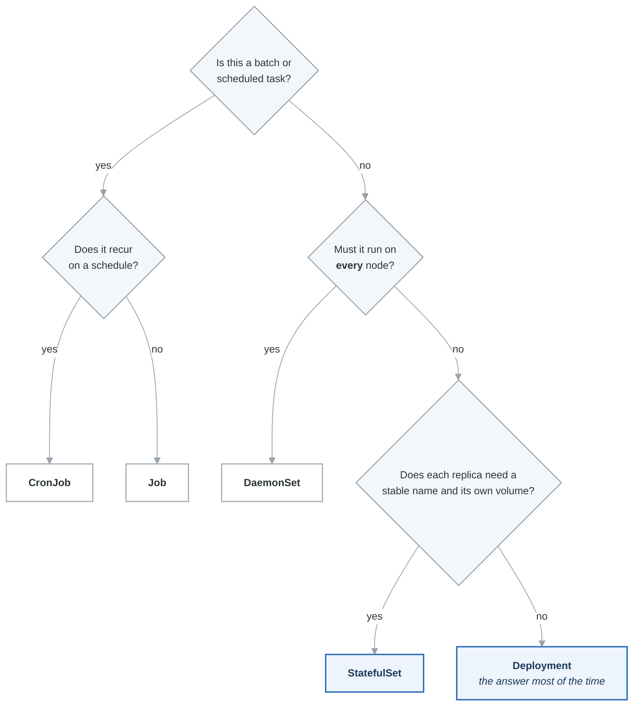

# Core Kubernetes Workloads

Master every workload type—knowing when and how to use each is fundamental.

## Learning Path

1. [Pods](#pods)
2. [ReplicaSets and Deployments](#replicasets-and-deployments)
3. [StatefulSets](#statefulsets)
4. [DaemonSets](#daemonsets)
5. [Jobs and CronJobs](#jobs-and-cronjobs)
6. [ConfigMaps and Secrets](#configmaps-and-secrets)

---

## Workload Decision Tree

<!-- figure: generated from the Mermaid below by _shared/diagrams/embed-figures.py — do not edit the image -->


<details>
<summary>Diagram source (Mermaid)</summary>



</details>

---

## Pods

The smallest deployable unit in Kubernetes. You rarely create Pods directly.

### Pod Anatomy

```yaml
# examples/pod-complete.yaml
apiVersion: v1
kind: Pod
metadata:
  name: complete-pod
  namespace: default
  labels:
    app: myapp
    version: v1
  annotations:
    prometheus.io/scrape: "true"
spec:
  # Security context at pod level
  securityContext:
    runAsNonRoot: true
    runAsUser: 1000
    fsGroup: 2000
    seccompProfile:
      type: RuntimeDefault

  # Service account
  serviceAccountName: myapp-sa

  # Init containers run first, in order
  initContainers:
  - name: init-db
    image: busybox:1.36
    command: ['sh', '-c', 'until nc -z db-service 5432; do sleep 2; done']

  - name: init-config
    image: busybox:1.36
    command: ['sh', '-c', 'cp /config-template/* /config/']
    volumeMounts:
    - name: config-template
      mountPath: /config-template
    - name: config
      mountPath: /config

  # Main containers
  containers:
  - name: app
    image: myapp:1.0.0
    imagePullPolicy: IfNotPresent

    # Resource management
    resources:
      requests:
        memory: "128Mi"
        cpu: "100m"
      limits:
        memory: "256Mi"
        cpu: "200m"

    # Port configuration
    ports:
    - name: http
      containerPort: 8080
      protocol: TCP
    - name: metrics
      containerPort: 9090
      protocol: TCP

    # Environment variables
    env:
    - name: POD_NAME
      valueFrom:
        fieldRef:
          fieldPath: metadata.name
    - name: POD_IP
      valueFrom:
        fieldRef:
          fieldPath: status.podIP
    - name: DATABASE_URL
      valueFrom:
        secretKeyRef:
          name: db-secret
          key: url
    - name: LOG_LEVEL
      valueFrom:
        configMapKeyRef:
          name: app-config
          key: log_level

    # Environment from ConfigMap/Secret
    envFrom:
    - configMapRef:
        name: app-config
    - secretRef:
        name: app-secrets

    # Volume mounts
    volumeMounts:
    - name: config
      mountPath: /app/config
      readOnly: true
    - name: data
      mountPath: /app/data
    - name: tmp
      mountPath: /tmp

    # Probes
    startupProbe:
      httpGet:
        path: /healthz
        port: http
      failureThreshold: 30
      periodSeconds: 10

    livenessProbe:
      httpGet:
        path: /healthz
        port: http
      initialDelaySeconds: 0
      periodSeconds: 10
      timeoutSeconds: 5
      failureThreshold: 3

    readinessProbe:
      httpGet:
        path: /ready
        port: http
      initialDelaySeconds: 0
      periodSeconds: 5
      timeoutSeconds: 3
      failureThreshold: 3

    # Container security context
    securityContext:
      allowPrivilegeEscalation: false
      readOnlyRootFilesystem: true
      capabilities:
        drop:
        - ALL

    # Lifecycle hooks
    lifecycle:
      postStart:
        exec:
          command: ["/bin/sh", "-c", "echo Started > /tmp/started"]
      preStop:
        exec:
          command: ["/bin/sh", "-c", "sleep 10"]

  # Sidecar container
  - name: log-shipper
    image: fluent/fluent-bit:2.2
    resources:
      requests:
        memory: "64Mi"
        cpu: "50m"
      limits:
        memory: "128Mi"
        cpu: "100m"
    volumeMounts:
    - name: logs
      mountPath: /var/log/app
      readOnly: true

  # Volumes
  volumes:
  - name: config-template
    configMap:
      name: app-config-template
  - name: config
    emptyDir: {}
  - name: data
    persistentVolumeClaim:
      claimName: app-data-pvc
  - name: tmp
    emptyDir:
      medium: Memory
      sizeLimit: 100Mi
  - name: logs
    emptyDir: {}

  # Scheduling
  nodeSelector:
    kubernetes.io/os: linux

  affinity:
    podAntiAffinity:
      preferredDuringSchedulingIgnoredDuringExecution:
      - weight: 100
        podAffinityTerm:
          labelSelector:
            matchLabels:
              app: myapp
          topologyKey: kubernetes.io/hostname

  tolerations:
  - key: "dedicated"
    operator: "Equal"
    value: "app"
    effect: "NoSchedule"

  # Pod behavior
  restartPolicy: Always
  terminationGracePeriodSeconds: 30
  dnsPolicy: ClusterFirst

  # Topology spread
  topologySpreadConstraints:
  - maxSkew: 1
    topologyKey: topology.kubernetes.io/zone
    whenUnsatisfiable: ScheduleAnyway
    labelSelector:
      matchLabels:
        app: myapp
```

### Multi-Container Patterns

**Sidecar Pattern**
```yaml
# Log shipping, monitoring, proxy
spec:
  containers:
  - name: app
    image: myapp:1.0
  - name: log-shipper
    image: fluent-bit:2.2
    volumeMounts:
    - name: logs
      mountPath: /var/log/app
```

**Ambassador Pattern**
```yaml
# Proxy to external services
spec:
  containers:
  - name: app
    image: myapp:1.0
  - name: ambassador
    image: envoyproxy/envoy:v1.28
    ports:
    - containerPort: 8001
```

**Adapter Pattern**
```yaml
# Transform output for monitoring
spec:
  containers:
  - name: app
    image: myapp:1.0
  - name: adapter
    image: prom/statsd-exporter:v0.26
    ports:
    - containerPort: 9102
```

---

## ReplicaSets and Deployments

### ReplicaSet

Ensures a specified number of pod replicas are running.

```yaml
# examples/replicaset.yaml
apiVersion: apps/v1
kind: ReplicaSet
metadata:
  name: frontend
  labels:
    app: frontend
spec:
  replicas: 3
  selector:
    matchLabels:
      app: frontend
  template:
    metadata:
      labels:
        app: frontend
    spec:
      containers:
      - name: frontend
        image: nginx:1.25
        ports:
        - containerPort: 80
        resources:
          requests:
            memory: "64Mi"
            cpu: "50m"
          limits:
            memory: "128Mi"
            cpu: "100m"
```

### Deployment

The standard way to deploy stateless applications. Manages ReplicaSets.

```yaml
# examples/deployment-production.yaml
apiVersion: apps/v1
kind: Deployment
metadata:
  name: api
  labels:
    app: api
spec:
  replicas: 3

  # Revision history
  revisionHistoryLimit: 10

  # Deployment strategy
  strategy:
    type: RollingUpdate
    rollingUpdate:
      maxSurge: 25%        # Can exceed replicas by 25%
      maxUnavailable: 25%  # At least 75% always available

  selector:
    matchLabels:
      app: api

  template:
    metadata:
      labels:
        app: api
      annotations:
        # Force rollout on config change
        checksum/config: "{{ sha256sum .Values.config }}"
    spec:
      # Spread across zones
      topologySpreadConstraints:
      - maxSkew: 1
        topologyKey: topology.kubernetes.io/zone
        whenUnsatisfiable: DoNotSchedule
        labelSelector:
          matchLabels:
            app: api

      # Don't schedule on same node
      affinity:
        podAntiAffinity:
          requiredDuringSchedulingIgnoredDuringExecution:
          - labelSelector:
              matchLabels:
                app: api
            topologyKey: kubernetes.io/hostname

      containers:
      - name: api
        image: myapp/api:1.0.0
        ports:
        - containerPort: 8080

        resources:
          requests:
            memory: "256Mi"
            cpu: "250m"
          limits:
            memory: "512Mi"
            cpu: "500m"

        readinessProbe:
          httpGet:
            path: /health/ready
            port: 8080
          initialDelaySeconds: 5
          periodSeconds: 5

        livenessProbe:
          httpGet:
            path: /health/live
            port: 8080
          initialDelaySeconds: 15
          periodSeconds: 20

        # Graceful shutdown
        lifecycle:
          preStop:
            exec:
              command: ["sh", "-c", "sleep 10"]

      terminationGracePeriodSeconds: 30
```

### Deployment Operations

```bash
# Create deployment
kubectl apply -f deployment.yaml

# Check rollout status
kubectl rollout status deployment/api

# View rollout history
kubectl rollout history deployment/api
kubectl rollout history deployment/api --revision=2

# Rollback
kubectl rollout undo deployment/api
kubectl rollout undo deployment/api --to-revision=2

# Pause/Resume rollout
kubectl rollout pause deployment/api
kubectl rollout resume deployment/api

# Scale deployment
kubectl scale deployment/api --replicas=5

# Update image
kubectl set image deployment/api api=myapp/api:2.0.0

# View ReplicaSets
kubectl get rs -l app=api
```

### Deployment Strategies

**Rolling Update (Default)**
```yaml
strategy:
  type: RollingUpdate
  rollingUpdate:
    maxSurge: 1
    maxUnavailable: 0  # Zero downtime
```

**Recreate** (Downtime acceptable)
```yaml
strategy:
  type: Recreate
```

**Blue-Green** (Manual with Services)
```bash
# Deploy green version
kubectl apply -f deployment-green.yaml

# Test green version
kubectl port-forward deployment/api-green 8080:8080

# Switch traffic
kubectl patch service api -p '{"spec":{"selector":{"version":"green"}}}'

# Delete blue version
kubectl delete deployment api-blue
```

**Canary** (Manual with multiple deployments)
```yaml
# Stable deployment (90% traffic)
apiVersion: apps/v1
kind: Deployment
metadata:
  name: api-stable
spec:
  replicas: 9
  selector:
    matchLabels:
      app: api
      track: stable
---
# Canary deployment (10% traffic)
apiVersion: apps/v1
kind: Deployment
metadata:
  name: api-canary
spec:
  replicas: 1
  selector:
    matchLabels:
      app: api
      track: canary
---
# Service selects both
apiVersion: v1
kind: Service
metadata:
  name: api
spec:
  selector:
    app: api  # Matches both stable and canary
```

---

## StatefulSets

For applications that need stable identities and persistent storage.

### When to Use StatefulSet

- Databases (PostgreSQL, MySQL, MongoDB)
- Message queues (Kafka, RabbitMQ)
- Distributed systems (ZooKeeper, etcd, Consul)
- Any app needing stable network identity or ordered deployment

### StatefulSet Guarantees

| Feature | Deployment | StatefulSet |
|---------|------------|-------------|
| Pod Names | Random (`api-7f9d8-x2k9l`) | Ordered (`db-0`, `db-1`, `db-2`) |
| Storage | Shared or ephemeral | Per-pod PVCs |
| Scaling | Parallel | Ordered (0, 1, 2...) |
| Updates | Parallel | Reverse order (2, 1, 0) |
| DNS | Service only | Per-pod DNS |

### Production StatefulSet

```yaml
# examples/statefulset-postgres.yaml
apiVersion: apps/v1
kind: StatefulSet
metadata:
  name: postgres
spec:
  serviceName: postgres  # Required: Headless service name
  replicas: 3

  # Pod management policy
  podManagementPolicy: OrderedReady  # or Parallel

  # Update strategy
  updateStrategy:
    type: RollingUpdate
    rollingUpdate:
      partition: 0  # Only update pods >= partition

  selector:
    matchLabels:
      app: postgres

  template:
    metadata:
      labels:
        app: postgres
    spec:
      terminationGracePeriodSeconds: 60

      # Init container to set up replication
      initContainers:
      - name: init-permissions
        image: busybox:1.36
        command:
        - sh
        - -c
        - |
          chown -R 999:999 /var/lib/postgresql/data
        volumeMounts:
        - name: data
          mountPath: /var/lib/postgresql/data

      containers:
      - name: postgres
        image: postgres:15-alpine
        ports:
        - containerPort: 5432
          name: postgres

        env:
        - name: POSTGRES_PASSWORD
          valueFrom:
            secretKeyRef:
              name: postgres-secret
              key: password
        - name: PGDATA
          value: /var/lib/postgresql/data/pgdata

        # Ordered index available as environment variable
        - name: POD_NAME
          valueFrom:
            fieldRef:
              fieldPath: metadata.name

        resources:
          requests:
            memory: "1Gi"
            cpu: "500m"
          limits:
            memory: "2Gi"
            cpu: "1000m"

        volumeMounts:
        - name: data
          mountPath: /var/lib/postgresql/data

        livenessProbe:
          exec:
            command:
            - pg_isready
            - -U
            - postgres
          initialDelaySeconds: 30
          periodSeconds: 10

        readinessProbe:
          exec:
            command:
            - pg_isready
            - -U
            - postgres
          initialDelaySeconds: 5
          periodSeconds: 5

  # Volume claim templates - creates PVC per pod
  volumeClaimTemplates:
  - metadata:
      name: data
    spec:
      accessModes: ["ReadWriteOnce"]
      storageClassName: ssd-retain
      resources:
        requests:
          storage: 100Gi
---
# Headless service for StatefulSet
apiVersion: v1
kind: Service
metadata:
  name: postgres
  labels:
    app: postgres
spec:
  ports:
  - port: 5432
    name: postgres
  clusterIP: None  # Headless
  selector:
    app: postgres
---
# Regular service for read traffic
apiVersion: v1
kind: Service
metadata:
  name: postgres-read
spec:
  ports:
  - port: 5432
  selector:
    app: postgres
```

### StatefulSet DNS

```bash
# Pod DNS names (headless service required)
# Format: <pod-name>.<service-name>.<namespace>.svc.cluster.local

postgres-0.postgres.default.svc.cluster.local
postgres-1.postgres.default.svc.cluster.local
postgres-2.postgres.default.svc.cluster.local

# From within the cluster
nslookup postgres-0.postgres
```

---

## DaemonSets

Run a pod on every (or selected) node.

### Use Cases

- Log collection (Fluentd, Fluent Bit)
- Node monitoring (Node Exporter, Datadog Agent)
- Network plugins (Calico, Cilium)
- Storage daemons (GlusterFS, Ceph)

```yaml
# examples/daemonset-logging.yaml
apiVersion: apps/v1
kind: DaemonSet
metadata:
  name: fluentbit
  namespace: logging
spec:
  selector:
    matchLabels:
      app: fluentbit

  updateStrategy:
    type: RollingUpdate
    rollingUpdate:
      maxUnavailable: 1

  template:
    metadata:
      labels:
        app: fluentbit
    spec:
      serviceAccountName: fluentbit

      # Tolerate all taints to run on all nodes
      tolerations:
      - operator: Exists

      # Or specific tolerations
      # tolerations:
      # - key: node-role.kubernetes.io/control-plane
      #   effect: NoSchedule

      containers:
      - name: fluentbit
        image: fluent/fluent-bit:2.2
        resources:
          requests:
            memory: "100Mi"
            cpu: "100m"
          limits:
            memory: "200Mi"
            cpu: "200m"

        volumeMounts:
        - name: varlog
          mountPath: /var/log
          readOnly: true
        - name: varlibdockercontainers
          mountPath: /var/lib/docker/containers
          readOnly: true
        - name: config
          mountPath: /fluent-bit/etc/

      volumes:
      - name: varlog
        hostPath:
          path: /var/log
      - name: varlibdockercontainers
        hostPath:
          path: /var/lib/docker/containers
      - name: config
        configMap:
          name: fluentbit-config
```

### Target Specific Nodes

```yaml
spec:
  template:
    spec:
      # Only nodes with SSD
      nodeSelector:
        disk: ssd

      # Or using affinity
      affinity:
        nodeAffinity:
          requiredDuringSchedulingIgnoredDuringExecution:
            nodeSelectorTerms:
            - matchExpressions:
              - key: node-type
                operator: In
                values:
                - worker
```

---

## Jobs and CronJobs

### Job

One-time task execution.

```yaml
# examples/job-migration.yaml
apiVersion: batch/v1
kind: Job
metadata:
  name: db-migration
spec:
  # Retry configuration
  backoffLimit: 3           # Retries before marking failed
  activeDeadlineSeconds: 600  # Max runtime

  # Completion configuration
  completions: 1            # How many successful completions needed
  parallelism: 1            # How many pods run in parallel

  # Pod failure policy
  podFailurePolicy:
    rules:
    - action: FailJob
      onExitCodes:
        containerName: migration
        operator: In
        values: [42]  # Custom error code = fail immediately

  template:
    spec:
      restartPolicy: Never  # or OnFailure

      containers:
      - name: migration
        image: myapp/migration:1.0.0
        command: ["./migrate.sh"]

        env:
        - name: DATABASE_URL
          valueFrom:
            secretKeyRef:
              name: db-secret
              key: url

        resources:
          requests:
            memory: "256Mi"
            cpu: "250m"

  # Cleanup
  ttlSecondsAfterFinished: 3600  # Delete job 1 hour after completion
```

### Parallel Job

```yaml
# Process multiple items in parallel
apiVersion: batch/v1
kind: Job
metadata:
  name: parallel-processor
spec:
  completions: 10    # Total items to process
  parallelism: 3     # Process 3 at a time
  completionMode: Indexed  # Each pod gets unique index

  template:
    spec:
      restartPolicy: Never
      containers:
      - name: processor
        image: myapp/processor:1.0.0
        env:
        - name: JOB_INDEX
          valueFrom:
            fieldRef:
              fieldPath: metadata.annotations['batch.kubernetes.io/job-completion-index']
```

### CronJob

Scheduled recurring tasks.

```yaml
# examples/cronjob-backup.yaml
apiVersion: batch/v1
kind: CronJob
metadata:
  name: database-backup
spec:
  schedule: "0 2 * * *"  # 2 AM daily

  # Timezone (Kubernetes 1.27+)
  timeZone: "America/New_York"

  # Concurrency policy
  concurrencyPolicy: Forbid  # Skip if previous still running
  # concurrencyPolicy: Allow  # Run concurrent jobs
  # concurrencyPolicy: Replace  # Kill previous, start new

  # History
  successfulJobsHistoryLimit: 3
  failedJobsHistoryLimit: 3

  # Deadline
  startingDeadlineSeconds: 300  # Must start within 5 min of scheduled time

  # Suspend (pause scheduling)
  suspend: false

  jobTemplate:
    spec:
      backoffLimit: 2
      activeDeadlineSeconds: 3600

      template:
        spec:
          restartPolicy: OnFailure

          containers:
          - name: backup
            image: postgres:15-alpine
            command:
            - /bin/sh
            - -c
            - |
              pg_dump -h $DB_HOST -U $DB_USER $DB_NAME | \
              gzip > /backup/backup-$(date +%Y%m%d-%H%M%S).sql.gz

            env:
            - name: DB_HOST
              value: postgres
            - name: DB_USER
              valueFrom:
                secretKeyRef:
                  name: db-secret
                  key: username
            - name: PGPASSWORD
              valueFrom:
                secretKeyRef:
                  name: db-secret
                  key: password
            - name: DB_NAME
              value: production

            volumeMounts:
            - name: backup
              mountPath: /backup

          volumes:
          - name: backup
            persistentVolumeClaim:
              claimName: backup-pvc
```

### Cron Schedule Format

**Cron schedule syntax**

```text
┌───────────── minute        (0 – 59)
│ ┌───────────── hour        (0 – 23)
│ │ ┌───────────── day of month (1 – 31)
│ │ │ ┌───────────── month     (1 – 12)
│ │ │ │ ┌───────────── day of week (0 – 6, Sunday = 0)
│ │ │ │ │
* * * * *
```

| Expression | Means |
|---|---|
| `0 * * * *` | Every hour, on the hour |
| `*/15 * * * *` | Every 15 minutes |
| `0 2 * * *` | Daily at 02:00 |
| `0 2 * * 0` | Weekly, Sunday at 02:00 |
| `0 2 1 * *` | Monthly, the 1st at 02:00 |
| `0 2 1 1 *` | Yearly, 1 January at 02:00 |

The timezone is the cluster's, not yours, unless you set `spec.timeZone` — and a job scheduled for
02:00 that runs at 02:00 UTC is a different job from one that runs at 02:00 local during daylight
saving.

---

## ConfigMaps and Secrets

### ConfigMaps

```yaml
# examples/configmap.yaml
apiVersion: v1
kind: ConfigMap
metadata:
  name: app-config
data:
  # Simple key-value
  log_level: "info"
  max_connections: "100"

  # File content
  config.json: |
    {
      "database": {
        "host": "postgres",
        "port": 5432
      },
      "cache": {
        "host": "redis",
        "port": 6379
      }
    }

  nginx.conf: |
    server {
      listen 80;
      location / {
        proxy_pass http://backend:8080;
      }
    }
```

### Using ConfigMaps

```yaml
# As environment variables
env:
- name: LOG_LEVEL
  valueFrom:
    configMapKeyRef:
      name: app-config
      key: log_level

# All keys as environment variables
envFrom:
- configMapRef:
    name: app-config

# As volume
volumes:
- name: config
  configMap:
    name: app-config
    items:
    - key: config.json
      path: config.json

volumeMounts:
- name: config
  mountPath: /app/config
```

### Secrets

```yaml
# examples/secret.yaml
apiVersion: v1
kind: Secret
metadata:
  name: db-secret
type: Opaque
data:
  # Base64 encoded
  username: cG9zdGdyZXM=  # postgres
  password: c2VjcmV0MTIz  # secret123
---
# String data (auto-encoded)
apiVersion: v1
kind: Secret
metadata:
  name: db-secret
type: Opaque
stringData:
  username: postgres
  password: secret123
```

### Secret Types

| Type | Description |
|------|-------------|
| `Opaque` | Generic secret |
| `kubernetes.io/service-account-token` | Service account token |
| `kubernetes.io/dockerconfigjson` | Docker registry credentials |
| `kubernetes.io/tls` | TLS certificate and key |
| `kubernetes.io/basic-auth` | Basic authentication |
| `kubernetes.io/ssh-auth` | SSH credentials |

```yaml
# TLS Secret
apiVersion: v1
kind: Secret
metadata:
  name: tls-secret
type: kubernetes.io/tls
data:
  tls.crt: <base64-encoded-cert>
  tls.key: <base64-encoded-key>

# Docker registry secret
apiVersion: v1
kind: Secret
metadata:
  name: regcred
type: kubernetes.io/dockerconfigjson
data:
  .dockerconfigjson: <base64-encoded-docker-config>
```

### Create Secrets Imperatively

```bash
# Generic secret
kubectl create secret generic db-secret \
  --from-literal=username=postgres \
  --from-literal=password=secret123

# From file
kubectl create secret generic tls-secret \
  --from-file=tls.crt=./cert.pem \
  --from-file=tls.key=./key.pem

# Docker registry
kubectl create secret docker-registry regcred \
  --docker-server=https://index.docker.io/v1/ \
  --docker-username=user \
  --docker-password=password \
  --docker-email=user@example.com

# TLS secret
kubectl create secret tls my-tls \
  --cert=./cert.pem \
  --key=./key.pem
```

---

## Exercises

1. **Exercise 1: Pod Lifecycle** - Understand pod states and debugging
2. **Exercise 2: Deployment Strategies** - Implement rolling, blue-green, canary
3. **Exercise 3: StatefulSet Database** - Deploy PostgreSQL with replication
4. **Exercise 4: DaemonSet Logging** - Deploy cluster-wide logging
5. **Exercise 5: Job Processing** - Parallel job processing
6. **Exercise 6: CronJob Backup** - Scheduled database backups
7. **Exercise 7: Configuration Management** - ConfigMaps and Secrets
8. **Exercise 8: Full Stack** - Deploy complete application

---

## Knowledge Check

Before moving on, ensure you can:

1. Choose the right workload type for any use case
2. Configure production-ready Deployments with proper strategies
3. Deploy StatefulSets with persistent storage
4. Set up DaemonSets with appropriate tolerations
5. Create Jobs and CronJobs with proper retry logic
6. Manage configuration securely with ConfigMaps and Secrets

## Next: Phase 1 Project

[Project: Microservices E-Commerce Application](project-microservices-app-README.md)

<!-- feynman-check -->

---

## Feynman check

Close the file. Blank page, no notes. Explain each of these to a competent engineer who has never
used this tool — **under five minutes, no jargon you can't define on the spot:**

- Workload Decision Tree
- Pods
- ReplicaSets and Deployments
- StatefulSets

**The gap is not what you forgot. It is where you used a word instead of a mechanism.**

| | |
|---|---|
| ✗ | *"Kubernetes schedules the pod."* |
| ✓ | *"The scheduler watches for pods with no `nodeName`, filters nodes by predicates, scores the survivors, and writes `nodeName` into the pod spec. The kubelet on that node is watching the API for pods bound to it, and starts the containers."* |

**Trace it:** `kubectl apply -f pod.yaml` → a running container. Name every component that acts, in order, and what each one writes.

Stop at the first component you cannot name. Reopen this file and read **only** that.

**Go deeper — only once the gap has a name:** [Kubernetes the Hard Way](https://github.com/kelseyhightower/kubernetes-the-hard-way) — one weekend, and "the control plane" stops being a word.
Full list per domain: [`SOURCES.md`](../../SOURCES.md#kubernetes)

→ Protocol, the three levels of knowing, and worked examples: [`MASTERY.md`](../../MASTERY.md)

<!-- /feynman-check -->
