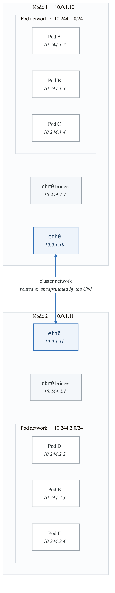
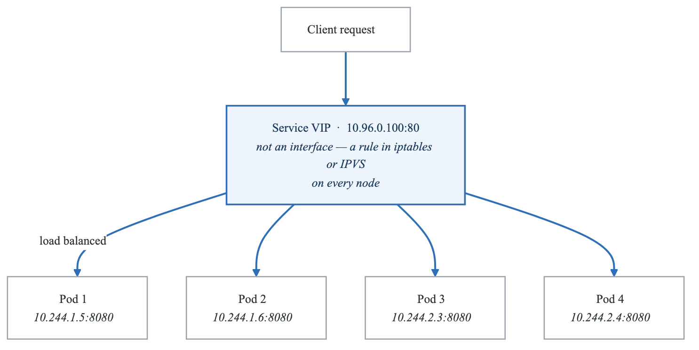
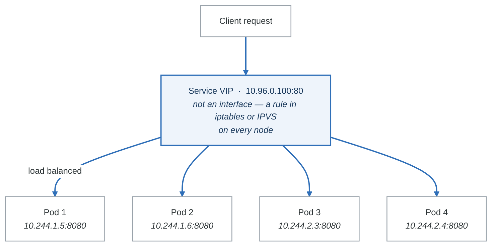

# Networking Deep Dive

Kubernetes networking is notoriously complex. Master it here.

## Learning Path

1. [Pod Networking Model](#pod-networking-model)
2. [CNI Plugins](#cni-plugins)
3. [Services](#services)
4. [Ingress](#ingress)
5. [Network Policies](#network-policies)
6. [DNS](#dns)

---

## Pod Networking Model

### The Four Kubernetes Networking Rules

1. **All Pods can communicate with all other Pods** without NAT
2. **All Nodes can communicate with all Pods** without NAT
3. **The IP a Pod sees itself as** is the same IP others see it as
4. **Pods on a host can communicate with all pods on all nodes** without NAT

### Network Topology

```mermaid
%%{init: {'theme':'base','themeVariables':{'fontFamily':'Helvetica, Arial, sans-serif','fontSize':'13px','primaryColor':'#ffffff','primaryTextColor':'#2d3436','primaryBorderColor':'#9aa3ab','lineColor':'#9aa3ab','textColor':'#2d3436','clusterBkg':'#fbfcfd','clusterBorder':'#d4dae0','edgeLabelBackground':'#ffffff','tertiaryColor':'#eef4fb'},'flowchart':{'curve':'basis','padding':14,'nodeSpacing':42,'rankSpacing':58}}}%%
flowchart TB
  classDef default fill:#ffffff,stroke:#9aa3ab,stroke-width:1.3px,color:#2d3436
  classDef n    fill:#ffffff,stroke:#9aa3ab,stroke-width:1.3px,color:#2d3436
  classDef crit fill:#eef4fb,stroke:#2f6fb8,stroke-width:1.8px,color:#1b3a5c
  classDef data fill:#f4f7fa,stroke:#9aa3ab,stroke-width:1.3px,color:#2d3436
  classDef mut  fill:#ffffff,stroke:#cfd6dc,stroke-width:1.1px,color:#7a8288
  classDef warn fill:#fdf0ec,stroke:#c0522d,stroke-width:1.6px,color:#8a3a1e
  subgraph N1["Node 1 &nbsp;·&nbsp; 10.0.1.10"]
    direction TB
    subgraph P1["Pod network &nbsp;·&nbsp; 10.244.1.0/24"]
      direction LR
      PA["Pod A<br/><i>10.244.1.2</i>"]
      PB["Pod B<br/><i>10.244.1.3</i>"]
      PC["Pod C<br/><i>10.244.1.4</i>"]
    end
    BR1["<code>cbr0</code> bridge<br/><i>10.244.1.1</i>"]
    E1["<code>eth0</code><br/><i>10.0.1.10</i>"]
    P1 --- BR1 --- E1
  end
  subgraph N2["Node 2 &nbsp;·&nbsp; 10.0.1.11"]
    direction TB
    E2["<code>eth0</code><br/><i>10.0.1.11</i>"]
    BR2["<code>cbr0</code> bridge<br/><i>10.244.2.1</i>"]
    subgraph P2["Pod network &nbsp;·&nbsp; 10.244.2.0/24"]
      direction LR
      PD["Pod D<br/><i>10.244.2.2</i>"]
      PE["Pod E<br/><i>10.244.2.3</i>"]
      PF["Pod F<br/><i>10.244.2.4</i>"]
    end
    E2 --- BR2 --- P2
  end
  E1 <==>|"cluster network<br/><i>routed or encapsulated by the CNI</i>"| E2
  class PA,PB,PC,PD,PE,PF n
  class BR1,BR2 data
  class E1,E2 crit
  linkStyle 4 stroke:#2f6fb8,stroke-width:2px

%% Each node owns a distinct /24 out of the cluster CIDR, so a pod IP is
%% globally unique and routable without NAT. How a packet crosses between nodes
%% -- a route the cloud router already knows, or a VXLAN tunnel -- is the one
%% thing your CNI plugin actually decides.
```

<!-- figure: generated from the Mermaid below by _shared/diagrams/embed-figures.py — do not edit the image -->


<details>
<summary>Diagram source (Mermaid)</summary>



</details>

---

## CNI Plugins

### CNI Comparison

| Feature | Calico | Cilium | Flannel | AWS VPC CNI |
|---------|--------|--------|---------|-------------|
| Network Policy | Yes | Yes (Extended) | No | Yes |
| Encryption | WireGuard | WireGuard/IPsec | No | No |
| eBPF Dataplane | Optional | Native | No | No |
| Performance | High | Very High | Medium | Very High |
| Complexity | Medium | Higher | Low | Low |
| Best For | General | Security/Observability | Simple setups | AWS EKS |

### Cilium Installation and Configuration

```bash
# Install Cilium CLI
curl -L --remote-name-all https://github.com/cilium/cilium-cli/releases/latest/download/cilium-linux-amd64.tar.gz
tar xzvf cilium-linux-amd64.tar.gz
sudo mv cilium /usr/local/bin

# Install Cilium
cilium install --version 1.14.4

# Enable Hubble for observability
cilium hubble enable --ui

# Verify installation
cilium status
cilium connectivity test
```

```yaml
# Cilium Helm values for production
# values-cilium.yaml
kubeProxyReplacement: strict
k8sServiceHost: ${API_SERVER_IP}
k8sServicePort: 6443

hubble:
  enabled: true
  relay:
    enabled: true
  ui:
    enabled: true

encryption:
  enabled: true
  type: wireguard

bpf:
  masquerade: true

ipam:
  mode: kubernetes

operator:
  replicas: 2

loadBalancer:
  algorithm: maglev

bandwidthManager:
  enabled: true
```

### Calico Installation

```yaml
# Calico operator installation
apiVersion: operator.tigera.io/v1
kind: Installation
metadata:
  name: default
spec:
  calicoNetwork:
    bgp: Disabled
    ipPools:
    - blockSize: 26
      cidr: 10.244.0.0/16
      encapsulation: VXLAN
      natOutgoing: Enabled
      nodeSelector: all()
  controlPlaneNodeSelector:
    node-role.kubernetes.io/control-plane: ""
```

---

## Services

### Service Types Deep Dive

```yaml
# ClusterIP - Internal only
apiVersion: v1
kind: Service
metadata:
  name: backend-clusterip
spec:
  type: ClusterIP
  selector:
    app: backend
  ports:
  - port: 80
    targetPort: 8080

---
# Headless Service - Direct pod IPs
apiVersion: v1
kind: Service
metadata:
  name: backend-headless
spec:
  type: ClusterIP
  clusterIP: None  # Makes it headless
  selector:
    app: backend
  ports:
  - port: 80
    targetPort: 8080

---
# NodePort - Expose on node IP
apiVersion: v1
kind: Service
metadata:
  name: backend-nodeport
spec:
  type: NodePort
  selector:
    app: backend
  ports:
  - port: 80
    targetPort: 8080
    nodePort: 30080  # 30000-32767

---
# LoadBalancer - Cloud provider LB
apiVersion: v1
kind: Service
metadata:
  name: backend-lb
  annotations:
    # AWS-specific
    service.beta.kubernetes.io/aws-load-balancer-type: nlb
    service.beta.kubernetes.io/aws-load-balancer-scheme: internet-facing
    # GCP-specific
    cloud.google.com/load-balancer-type: External
    # Azure-specific
    service.beta.kubernetes.io/azure-load-balancer-internal: "false"
spec:
  type: LoadBalancer
  selector:
    app: backend
  ports:
  - port: 80
    targetPort: 8080

---
# ExternalName - DNS alias
apiVersion: v1
kind: Service
metadata:
  name: external-db
spec:
  type: ExternalName
  externalName: db.example.com
```

### Service Traffic Flow

<!-- figure: generated from the Mermaid below by _shared/diagrams/embed-figures.py — do not edit the image -->


<details>
<summary>Diagram source (Mermaid)</summary>



</details>

---

## Ingress

### NGINX Ingress Controller Setup

```bash
# Install NGINX Ingress Controller
helm repo add ingress-nginx https://kubernetes.github.io/ingress-nginx
helm install ingress-nginx ingress-nginx/ingress-nginx \
  --namespace ingress-nginx \
  --create-namespace \
  --set controller.replicaCount=2 \
  --set controller.metrics.enabled=true \
  --set controller.podAnnotations."prometheus\.io/scrape"=true \
  --set controller.podAnnotations."prometheus\.io/port"=10254
```

### Comprehensive Ingress Configuration

```yaml
# Production Ingress with all features
apiVersion: networking.k8s.io/v1
kind: Ingress
metadata:
  name: production-ingress
  annotations:
    # NGINX specific
    nginx.ingress.kubernetes.io/ssl-redirect: "true"
    nginx.ingress.kubernetes.io/proxy-body-size: "50m"
    nginx.ingress.kubernetes.io/proxy-read-timeout: "60"
    nginx.ingress.kubernetes.io/proxy-send-timeout: "60"

    # Rate limiting
    nginx.ingress.kubernetes.io/limit-rps: "100"
    nginx.ingress.kubernetes.io/limit-connections: "10"

    # CORS
    nginx.ingress.kubernetes.io/enable-cors: "true"
    nginx.ingress.kubernetes.io/cors-allow-origin: "https://example.com"

    # Security headers
    nginx.ingress.kubernetes.io/configuration-snippet: |
      add_header X-Frame-Options "SAMEORIGIN" always;
      add_header X-Content-Type-Options "nosniff" always;
      add_header X-XSS-Protection "1; mode=block" always;

    # cert-manager
    cert-manager.io/cluster-issuer: "letsencrypt-prod"
spec:
  ingressClassName: nginx
  tls:
  - hosts:
    - app.example.com
    - api.example.com
    secretName: example-tls
  rules:
  - host: app.example.com
    http:
      paths:
      - path: /
        pathType: Prefix
        backend:
          service:
            name: frontend
            port:
              number: 80
  - host: api.example.com
    http:
      paths:
      - path: /v1
        pathType: Prefix
        backend:
          service:
            name: api-v1
            port:
              number: 80
      - path: /v2
        pathType: Prefix
        backend:
          service:
            name: api-v2
            port:
              number: 80
```

### cert-manager for TLS

```yaml
# ClusterIssuer for Let's Encrypt
apiVersion: cert-manager.io/v1
kind: ClusterIssuer
metadata:
  name: letsencrypt-prod
spec:
  acme:
    server: https://acme-v02.api.letsencrypt.org/directory
    email: admin@example.com
    privateKeySecretRef:
      name: letsencrypt-prod-key
    solvers:
    - http01:
        ingress:
          class: nginx
---
# Certificate resource (usually auto-created by ingress annotation)
apiVersion: cert-manager.io/v1
kind: Certificate
metadata:
  name: example-cert
  namespace: default
spec:
  secretName: example-tls
  issuerRef:
    name: letsencrypt-prod
    kind: ClusterIssuer
  dnsNames:
  - app.example.com
  - api.example.com
```

---

## Network Policies

### Network Policy Fundamentals

```yaml
# Default deny all ingress
apiVersion: networking.k8s.io/v1
kind: NetworkPolicy
metadata:
  name: default-deny-ingress
  namespace: production
spec:
  podSelector: {}
  policyTypes:
  - Ingress

---
# Default deny all egress
apiVersion: networking.k8s.io/v1
kind: NetworkPolicy
metadata:
  name: default-deny-egress
  namespace: production
spec:
  podSelector: {}
  policyTypes:
  - Egress

---
# Allow DNS egress (required after deny-all)
apiVersion: networking.k8s.io/v1
kind: NetworkPolicy
metadata:
  name: allow-dns
  namespace: production
spec:
  podSelector: {}
  policyTypes:
  - Egress
  egress:
  - to:
    - namespaceSelector: {}
      podSelector:
        matchLabels:
          k8s-app: kube-dns
    ports:
    - protocol: UDP
      port: 53
    - protocol: TCP
      port: 53
```

### Three-Tier Application Network Policies

```yaml
# Frontend: Allow ingress from internet, egress to API
apiVersion: networking.k8s.io/v1
kind: NetworkPolicy
metadata:
  name: frontend-policy
  namespace: production
spec:
  podSelector:
    matchLabels:
      tier: frontend
  policyTypes:
  - Ingress
  - Egress
  ingress:
  - from:
    - namespaceSelector:
        matchLabels:
          name: ingress-nginx
    ports:
    - protocol: TCP
      port: 80
  egress:
  - to:
    - podSelector:
        matchLabels:
          tier: api
    ports:
    - protocol: TCP
      port: 8080

---
# API: Allow from frontend, egress to database
apiVersion: networking.k8s.io/v1
kind: NetworkPolicy
metadata:
  name: api-policy
  namespace: production
spec:
  podSelector:
    matchLabels:
      tier: api
  policyTypes:
  - Ingress
  - Egress
  ingress:
  - from:
    - podSelector:
        matchLabels:
          tier: frontend
    ports:
    - protocol: TCP
      port: 8080
  egress:
  - to:
    - podSelector:
        matchLabels:
          tier: database
    ports:
    - protocol: TCP
      port: 5432

---
# Database: Allow from API only
apiVersion: networking.k8s.io/v1
kind: NetworkPolicy
metadata:
  name: database-policy
  namespace: production
spec:
  podSelector:
    matchLabels:
      tier: database
  policyTypes:
  - Ingress
  ingress:
  - from:
    - podSelector:
        matchLabels:
          tier: api
    ports:
    - protocol: TCP
      port: 5432
```

---

## DNS

### CoreDNS Configuration

```yaml
apiVersion: v1
kind: ConfigMap
metadata:
  name: coredns
  namespace: kube-system
data:
  Corefile: |
    .:53 {
        errors
        health {
            lameduck 5s
        }
        ready
        kubernetes cluster.local in-addr.arpa ip6.arpa {
            pods insecure
            fallthrough in-addr.arpa ip6.arpa
            ttl 30
        }
        prometheus :9153
        forward . /etc/resolv.conf {
            max_concurrent 1000
        }
        cache 30
        loop
        reload
        loadbalance
    }
    # Custom domain forwarding
    example.com:53 {
        forward . 10.0.0.53
    }
```

### DNS Debugging

```bash
# Deploy DNS debugging pod
kubectl apply -f - <<EOF
apiVersion: v1
kind: Pod
metadata:
  name: dnsutils
  namespace: default
spec:
  containers:
  - name: dnsutils
    image: registry.k8s.io/e2e-test-images/jessie-dnsutils:1.3
    command: ["sleep", "infinity"]
EOF

# Test DNS resolution
kubectl exec -it dnsutils -- nslookup kubernetes.default
kubectl exec -it dnsutils -- nslookup kubernetes.default.svc.cluster.local
kubectl exec -it dnsutils -- cat /etc/resolv.conf

# Check CoreDNS logs
kubectl logs -n kube-system -l k8s-app=kube-dns
```

---

## Exercises

1. **Exercise 1: CNI Exploration** - Compare CNI plugins
2. **Exercise 2: Service Deep Dive** - All service types
3. **Exercise 3: Ingress Configuration** - Advanced ingress
4. **Exercise 4: Network Policies** - Secure a multi-tier app
5. **Exercise 5: DNS Configuration** - Custom DNS setup
6. **Exercise 6: Traffic Analysis** - Debug network issues

---

## Next Section

[02-storage-systems](02-storage-systems-README.md) - Persistent storage for stateful workloads

<!-- feynman-check -->

---

## Feynman check

Close the file. Blank page, no notes. Explain each of these to a competent engineer who has never
used this tool — **under five minutes, no jargon you can't define on the spot:**

- Pod Networking Model
- CNI Plugins
- Services
- Ingress

**The gap is not what you forgot. It is where you used a word instead of a mechanism.**

| | |
|---|---|
| ✗ | *"Kubernetes schedules the pod."* |
| ✓ | *"The scheduler watches for pods with no `nodeName`, filters nodes by predicates, scores the survivors, and writes `nodeName` into the pod spec. The kubelet on that node is watching the API for pods bound to it, and starts the containers."* |

**Trace it:** `kubectl apply -f pod.yaml` → a running container. Name every component that acts, in order, and what each one writes.

Stop at the first component you cannot name. Reopen this file and read **only** that.

**Go deeper — only once the gap has a name:** [Kubernetes the Hard Way](https://github.com/kelseyhightower/kubernetes-the-hard-way) — one weekend, and "the control plane" stops being a word.
Full list per domain: [`SOURCES.md`](../../SOURCES.md#kubernetes)

→ Protocol, the three levels of knowing, and worked examples: [`MASTERY.md`](../../MASTERY.md)

<!-- /feynman-check -->
