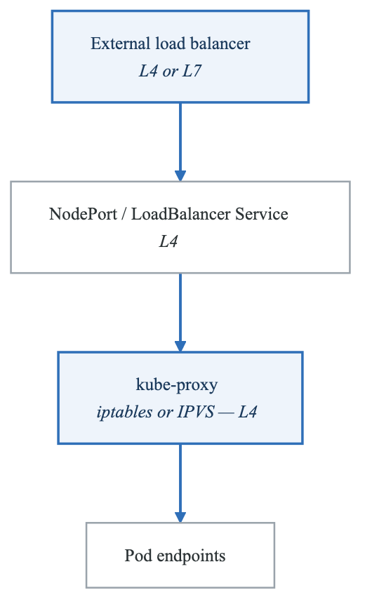
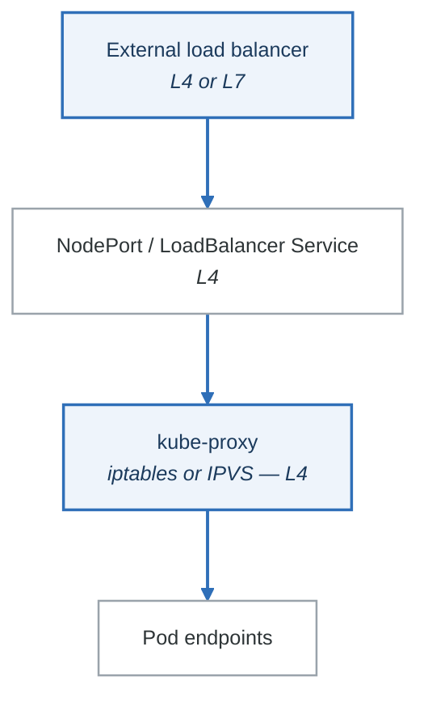

# Exercise 6: Load Balancing

## Objectives

- Understand Kubernetes load balancing mechanisms
- Configure MetalLB for bare-metal clusters
- Implement cloud load balancers
- Optimize load balancing for performance

## Prerequisites

- Completed Exercises 1-5
- Understanding of Services
- Basic load balancing concepts

---

## Part 1: Kubernetes Load Balancing Overview

### 1.1 Load Balancing Layers

<!-- figure: generated from the Mermaid below by _shared/diagrams/embed-figures.py — do not edit the image -->


<details>
<summary>Diagram source (Mermaid)</summary>



</details>

### 1.2 kube-proxy Modes

```bash
# Check current proxy mode
kubectl get configmap kube-proxy -n kube-system -o yaml | grep mode

# iptables mode (default)
# - Uses iptables rules for routing
# - Random pod selection
# - Good for <1000 services

# IPVS mode
# - Uses Linux IPVS
# - Multiple algorithms (rr, lc, dh, sh, sed, nq)
# - Better for large clusters (>1000 services)
```

### 1.3 IPVS Load Balancing Algorithms

```yaml
# kube-proxy configmap for IPVS
apiVersion: v1
kind: ConfigMap
metadata:
  name: kube-proxy
  namespace: kube-system
data:
  config.conf: |
    mode: ipvs
    ipvs:
      scheduler: "rr"      # round-robin (default)
      # scheduler: "lc"    # least-connections
      # scheduler: "dh"    # destination-hashing
      # scheduler: "sh"    # source-hashing
      # scheduler: "sed"   # shortest-expected-delay
      # scheduler: "nq"    # never-queue
```

---

## Part 2: MetalLB for Bare Metal

### 2.1 Installing MetalLB

```bash
# Install MetalLB
kubectl apply -f https://raw.githubusercontent.com/metallb/metallb/v0.14.3/config/manifests/metallb-native.yaml

# Wait for pods
kubectl wait --namespace metallb-system \
  --for=condition=ready pod \
  --selector=app=metallb \
  --timeout=90s
```

### 2.2 MetalLB Layer 2 Configuration

```yaml
# metallb-l2-config.yaml
apiVersion: metallb.io/v1beta1
kind: IPAddressPool
metadata:
  name: default-pool
  namespace: metallb-system
spec:
  addresses:
  - 192.168.1.240-192.168.1.250    # IP range for LoadBalancers
---
apiVersion: metallb.io/v1beta1
kind: L2Advertisement
metadata:
  name: default
  namespace: metallb-system
spec:
  ipAddressPools:
  - default-pool
```

```bash
kubectl apply -f metallb-l2-config.yaml

# Test LoadBalancer service
kubectl create deployment nginx --image=nginx:1.25
kubectl expose deployment nginx --type=LoadBalancer --port=80

# Should get external IP from pool
kubectl get svc nginx -w
```

### 2.3 MetalLB BGP Configuration

```yaml
# metallb-bgp-config.yaml
apiVersion: metallb.io/v1beta2
kind: BGPPeer
metadata:
  name: router1
  namespace: metallb-system
spec:
  myASN: 64500
  peerASN: 64501
  peerAddress: 10.0.0.1
  password: "bgp-secret"
---
apiVersion: metallb.io/v1beta1
kind: IPAddressPool
metadata:
  name: bgp-pool
  namespace: metallb-system
spec:
  addresses:
  - 203.0.113.0/24
---
apiVersion: metallb.io/v1beta1
kind: BGPAdvertisement
metadata:
  name: bgp-advert
  namespace: metallb-system
spec:
  ipAddressPools:
  - bgp-pool
  peers:
  - router1
  communities:
  - 65535:65282   # NO_EXPORT community
```

---

## Part 3: Cloud Load Balancers

### 3.1 AWS Network Load Balancer

```yaml
# aws-nlb-service.yaml
apiVersion: v1
kind: Service
metadata:
  name: my-service
  annotations:
    # Use NLB instead of Classic LB
    service.beta.kubernetes.io/aws-load-balancer-type: "nlb"

    # Internal or external
    service.beta.kubernetes.io/aws-load-balancer-internal: "false"

    # Cross-zone load balancing
    service.beta.kubernetes.io/aws-load-balancer-cross-zone-load-balancing-enabled: "true"

    # Health check
    service.beta.kubernetes.io/aws-load-balancer-healthcheck-path: "/health"
    service.beta.kubernetes.io/aws-load-balancer-healthcheck-interval: "10"

    # SSL termination
    service.beta.kubernetes.io/aws-load-balancer-ssl-cert: "arn:aws:acm:region:account:certificate/cert-id"
    service.beta.kubernetes.io/aws-load-balancer-ssl-ports: "443"
spec:
  type: LoadBalancer
  selector:
    app: my-app
  ports:
  - port: 443
    targetPort: 8080
```

### 3.2 GCP Load Balancer

```yaml
# gcp-lb-service.yaml
apiVersion: v1
kind: Service
metadata:
  name: my-service
  annotations:
    # Internal load balancer
    cloud.google.com/load-balancer-type: "Internal"

    # Network tier
    cloud.google.com/network-tier: "Premium"

    # Backend config
    cloud.google.com/backend-config: '{"default": "my-backend-config"}'
spec:
  type: LoadBalancer
  selector:
    app: my-app
  ports:
  - port: 80
    targetPort: 8080
```

### 3.3 Azure Load Balancer

```yaml
# azure-lb-service.yaml
apiVersion: v1
kind: Service
metadata:
  name: my-service
  annotations:
    # Internal load balancer
    service.beta.kubernetes.io/azure-load-balancer-internal: "true"

    # Specific subnet
    service.beta.kubernetes.io/azure-load-balancer-internal-subnet: "my-subnet"

    # Health probe
    service.beta.kubernetes.io/azure-load-balancer-health-probe-protocol: "TCP"
    service.beta.kubernetes.io/azure-load-balancer-health-probe-interval: "5"
spec:
  type: LoadBalancer
  selector:
    app: my-app
  ports:
  - port: 80
    targetPort: 8080
```

---

## Part 4: Ingress Load Balancing

### 4.1 NGINX Ingress with Upstream Hashing

```yaml
# nginx-ingress-lb.yaml
apiVersion: networking.k8s.io/v1
kind: Ingress
metadata:
  name: sticky-ingress
  annotations:
    nginx.ingress.kubernetes.io/upstream-hash-by: "$request_uri"
    # Or use client IP for session affinity
    # nginx.ingress.kubernetes.io/upstream-hash-by: "$remote_addr"
spec:
  ingressClassName: nginx
  rules:
  - host: app.example.com
    http:
      paths:
      - path: /
        pathType: Prefix
        backend:
          service:
            name: my-service
            port:
              number: 80
```

### 4.2 Cookie-Based Affinity

```yaml
# nginx-cookie-affinity.yaml
apiVersion: networking.k8s.io/v1
kind: Ingress
metadata:
  name: cookie-affinity-ingress
  annotations:
    nginx.ingress.kubernetes.io/affinity: "cookie"
    nginx.ingress.kubernetes.io/affinity-mode: "persistent"
    nginx.ingress.kubernetes.io/session-cookie-name: "SERVERID"
    nginx.ingress.kubernetes.io/session-cookie-max-age: "172800"  # 2 days
    nginx.ingress.kubernetes.io/session-cookie-path: "/"
    nginx.ingress.kubernetes.io/session-cookie-secure: "true"
spec:
  ingressClassName: nginx
  rules:
  - host: app.example.com
    http:
      paths:
      - path: /
        pathType: Prefix
        backend:
          service:
            name: my-service
            port:
              number: 80
```

### 4.3 Weighted Load Balancing (Canary)

```yaml
# canary-ingress.yaml
apiVersion: networking.k8s.io/v1
kind: Ingress
metadata:
  name: production
spec:
  ingressClassName: nginx
  rules:
  - host: app.example.com
    http:
      paths:
      - path: /
        pathType: Prefix
        backend:
          service:
            name: production-service
            port:
              number: 80
---
apiVersion: networking.k8s.io/v1
kind: Ingress
metadata:
  name: canary
  annotations:
    nginx.ingress.kubernetes.io/canary: "true"
    nginx.ingress.kubernetes.io/canary-weight: "20"  # 20% to canary
spec:
  ingressClassName: nginx
  rules:
  - host: app.example.com
    http:
      paths:
      - path: /
        pathType: Prefix
        backend:
          service:
            name: canary-service
            port:
              number: 80
```

---

## Part 5: Load Balancer Optimization

### 5.1 Connection Draining

```yaml
# graceful-shutdown.yaml
apiVersion: apps/v1
kind: Deployment
metadata:
  name: graceful-app
spec:
  template:
    spec:
      terminationGracePeriodSeconds: 60
      containers:
      - name: app
        lifecycle:
          preStop:
            exec:
              command: ["/bin/sh", "-c", "sleep 15"]
        readinessProbe:
          httpGet:
            path: /health
            port: 8080
          initialDelaySeconds: 5
          periodSeconds: 5
```

### 5.2 Pod Disruption Budget

```yaml
# pdb.yaml
apiVersion: policy/v1
kind: PodDisruptionBudget
metadata:
  name: my-app-pdb
spec:
  minAvailable: 2  # Or use maxUnavailable: 1
  selector:
    matchLabels:
      app: my-app
```

### 5.3 Topology-Aware Routing

```yaml
# topology-service.yaml
apiVersion: v1
kind: Service
metadata:
  name: topology-aware
  annotations:
    service.kubernetes.io/topology-mode: Auto
spec:
  selector:
    app: my-app
  ports:
  - port: 80
    targetPort: 8080
```

### 5.4 EndpointSlices for Large Services

```bash
# EndpointSlices are used automatically for services
# Each slice contains up to 100 endpoints

# View EndpointSlices
kubectl get endpointslices -l kubernetes.io/service-name=my-service

# Check configuration
kubectl get endpointslice my-service-xxxxx -o yaml
```

---

## Part 6: Monitoring Load Balancing

### 6.1 kube-proxy Metrics

```bash
# Port forward to kube-proxy metrics
kubectl port-forward -n kube-system $(kubectl get pods -n kube-system -l k8s-app=kube-proxy -o name | head -1) 10249:10249

# Get metrics
curl localhost:10249/metrics | grep -E "kubeproxy_sync|kubeproxy_network"
```

### 6.2 Service Load Distribution

```bash
#!/bin/bash
# test-load-distribution.sh

SERVICE="my-service"
REQUESTS=100

echo "Testing load distribution to $SERVICE with $REQUESTS requests"

# Make requests and count responses
for i in $(seq 1 $REQUESTS); do
  kubectl run test-$i --rm -it --restart=Never --image=busybox -- wget -qO- $SERVICE 2>/dev/null
done | sort | uniq -c | sort -rn
```

### 6.3 Latency Monitoring

```yaml
# servicemonitor for load balancer metrics
apiVersion: monitoring.coreos.com/v1
kind: ServiceMonitor
metadata:
  name: lb-metrics
spec:
  selector:
    matchLabels:
      app: my-app
  endpoints:
  - port: metrics
    interval: 15s
    path: /metrics
```

---

## Part 7: Hands-on Challenges

### Challenge 1: MetalLB Setup

Configure MetalLB on a local cluster:
1. Install MetalLB
2. Configure IP address pool
3. Create LoadBalancer service
4. Verify external access

### Challenge 2: Load Testing

Perform load testing to verify load balancing:
1. Deploy application with multiple replicas
2. Generate load with various patterns
3. Verify distribution across pods
4. Measure latency under load

### Challenge 3: Failover Testing

Test load balancer behavior during failures:
1. Scale down pods during traffic
2. Verify graceful connection draining
3. Test pod startup and endpoint addition
4. Document recovery behavior

---

## Verification Tasks

1. [ ] Configured MetalLB for local cluster
2. [ ] Implemented cloud LB annotations
3. [ ] Set up Ingress with session affinity
4. [ ] Configured canary deployments
5. [ ] Monitored load distribution
6. [ ] Tested failover scenarios

---

## Key Takeaways

- kube-proxy handles L4 load balancing
- MetalLB enables LoadBalancer on bare metal
- Cloud annotations customize LB behavior
- Ingress provides L7 load balancing features
- Proper configuration ensures graceful failover
- Monitoring is essential for optimization

---

## Module Complete!

You've completed the Networking Deep Dive module. Continue to:
- [Storage Systems Module](../../02-storage-systems/README.md)

<!-- feynman-check -->

---

## Feynman check

Close the file. Blank page, no notes. Explain each of these to a competent engineer who has never
used this tool — **under five minutes, no jargon you can't define on the spot:**

- Kubernetes Load Balancing Overview
- MetalLB for Bare Metal
- Cloud Load Balancers
- Ingress Load Balancing

**The gap is not what you forgot. It is where you used a word instead of a mechanism.**

| | |
|---|---|
| ✗ | *"Kubernetes schedules the pod."* |
| ✓ | *"The scheduler watches for pods with no `nodeName`, filters nodes by predicates, scores the survivors, and writes `nodeName` into the pod spec. The kubelet on that node is watching the API for pods bound to it, and starts the containers."* |

**Trace it:** `kubectl apply -f pod.yaml` → a running container. Name every component that acts, in order, and what each one writes.

Stop at the first component you cannot name. Reopen this file and read **only** that.

**Go deeper — only once the gap has a name:** [Kubernetes the Hard Way](https://github.com/kelseyhightower/kubernetes-the-hard-way) — one weekend, and "the control plane" stops being a word.
Full list per domain: [`SOURCES.md`](../../SOURCES.md#kubernetes)

→ Protocol, the three levels of knowing, and worked examples: [`MASTERY.md`](../../MASTERY.md)

<!-- /feynman-check -->
