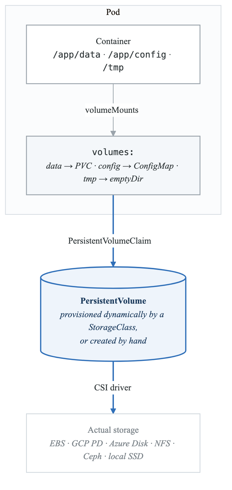
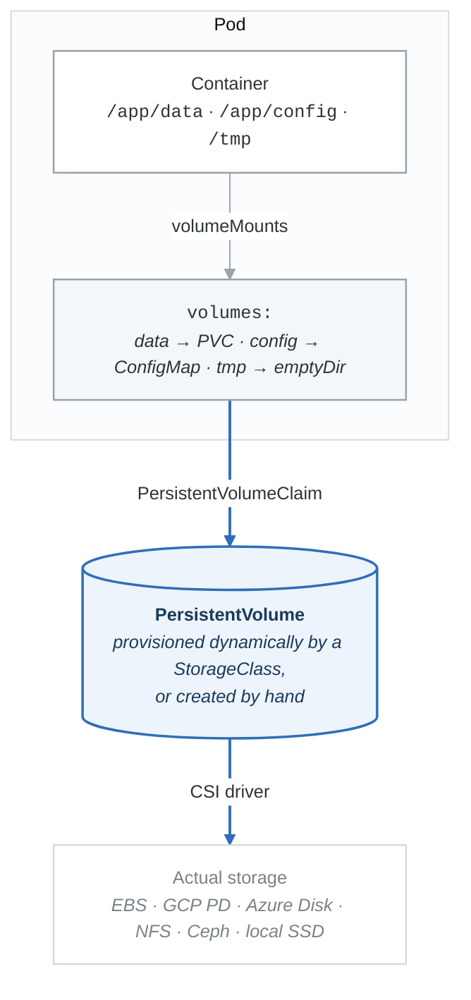

# Storage Systems

Persistent storage for stateful workloads—databases, queues, and data processing.

## Learning Path

1. [Storage Architecture](#storage-architecture)
2. [Persistent Volumes](#persistent-volumes)
3. [Storage Classes](#storage-classes)
4. [CSI Drivers](#csi-drivers)
5. [Backup and Recovery](#backup-and-recovery)

---

## Storage Architecture

### Storage Hierarchy

<!-- figure: generated from the Mermaid below by _shared/diagrams/embed-figures.py — do not edit the image -->


<details>
<summary>Diagram source (Mermaid)</summary>



</details>

### Volume Types

| Type | Use Case | Lifecycle | Performance |
|------|----------|-----------|-------------|
| emptyDir | Temp files, cache | Pod lifetime | Node disk speed |
| hostPath | Node access, testing | Node lifetime | Node disk speed |
| PVC | Persistent data | Independent | Storage backend |
| ConfigMap | Configuration files | Cluster lifetime | Memory |
| Secret | Sensitive config | Cluster lifetime | Memory |
| projected | Combine multiple sources | Varies | Memory |

---

## Persistent Volumes

### Static Provisioning

```yaml
# Admin creates PV
apiVersion: v1
kind: PersistentVolume
metadata:
  name: nfs-pv
spec:
  capacity:
    storage: 100Gi
  accessModes:
    - ReadWriteMany
  persistentVolumeReclaimPolicy: Retain
  storageClassName: nfs
  nfs:
    server: nfs-server.example.com
    path: /exports/data
---
# User creates PVC
apiVersion: v1
kind: PersistentVolumeClaim
metadata:
  name: nfs-pvc
spec:
  accessModes:
    - ReadWriteMany
  storageClassName: nfs
  resources:
    requests:
      storage: 50Gi
```

### Dynamic Provisioning

```yaml
# StorageClass enables dynamic provisioning
apiVersion: storage.k8s.io/v1
kind: StorageClass
metadata:
  name: fast-ssd
provisioner: ebs.csi.aws.com
parameters:
  type: gp3
  iops: "3000"
  throughput: "125"
  encrypted: "true"
reclaimPolicy: Delete
allowVolumeExpansion: true
volumeBindingMode: WaitForFirstConsumer
---
# PVC triggers automatic PV creation
apiVersion: v1
kind: PersistentVolumeClaim
metadata:
  name: database-storage
spec:
  accessModes:
    - ReadWriteOnce
  storageClassName: fast-ssd
  resources:
    requests:
      storage: 100Gi
```

### Access Modes

| Mode | Abbr | Description | Use Case |
|------|------|-------------|----------|
| ReadWriteOnce | RWO | Single node read-write | Databases |
| ReadOnlyMany | ROX | Multi-node read-only | Static content |
| ReadWriteMany | RWX | Multi-node read-write | Shared data |
| ReadWriteOncePod | RWOP | Single pod read-write | Exclusive access |

---

## Storage Classes

### Cloud Provider Storage Classes

```yaml
# AWS EBS gp3
apiVersion: storage.k8s.io/v1
kind: StorageClass
metadata:
  name: ebs-gp3
  annotations:
    storageclass.kubernetes.io/is-default-class: "true"
provisioner: ebs.csi.aws.com
parameters:
  type: gp3
  iops: "3000"
  throughput: "125"
  encrypted: "true"
  kmsKeyId: arn:aws:kms:us-west-2:111122223333:key/abcd1234
reclaimPolicy: Delete
allowVolumeExpansion: true
volumeBindingMode: WaitForFirstConsumer

---
# AWS EBS io2 (high IOPS)
apiVersion: storage.k8s.io/v1
kind: StorageClass
metadata:
  name: ebs-io2
provisioner: ebs.csi.aws.com
parameters:
  type: io2
  iops: "64000"
  encrypted: "true"
reclaimPolicy: Retain
volumeBindingMode: WaitForFirstConsumer

---
# GCP PD SSD
apiVersion: storage.k8s.io/v1
kind: StorageClass
metadata:
  name: pd-ssd
provisioner: pd.csi.storage.gke.io
parameters:
  type: pd-ssd
  replication-type: regional-pd  # For HA
reclaimPolicy: Retain
allowVolumeExpansion: true
volumeBindingMode: WaitForFirstConsumer

---
# Azure Premium SSD
apiVersion: storage.k8s.io/v1
kind: StorageClass
metadata:
  name: azure-premium
provisioner: disk.csi.azure.com
parameters:
  skuName: Premium_LRS
  cachingMode: ReadOnly
reclaimPolicy: Delete
allowVolumeExpansion: true
volumeBindingMode: WaitForFirstConsumer
```

### Topology-Aware Storage

```yaml
# Storage Class with allowed topologies
apiVersion: storage.k8s.io/v1
kind: StorageClass
metadata:
  name: regional-ssd
provisioner: pd.csi.storage.gke.io
parameters:
  type: pd-ssd
  replication-type: regional-pd
volumeBindingMode: WaitForFirstConsumer
allowedTopologies:
- matchLabelExpressions:
  - key: topology.gke.io/zone
    values:
    - us-central1-a
    - us-central1-b
```

---

## CSI Drivers

### AWS EBS CSI Driver

```yaml
# EBS CSI Driver installation via Helm
# helm repo add aws-ebs-csi-driver https://kubernetes-sigs.github.io/aws-ebs-csi-driver
# helm install aws-ebs-csi-driver aws-ebs-csi-driver/aws-ebs-csi-driver \
#   --namespace kube-system

# Volume Snapshot Class
apiVersion: snapshot.storage.k8s.io/v1
kind: VolumeSnapshotClass
metadata:
  name: ebs-snapshot-class
driver: ebs.csi.aws.com
deletionPolicy: Delete

---
# Create snapshot
apiVersion: snapshot.storage.k8s.io/v1
kind: VolumeSnapshot
metadata:
  name: database-snapshot
spec:
  volumeSnapshotClassName: ebs-snapshot-class
  source:
    persistentVolumeClaimName: database-storage

---
# Restore from snapshot
apiVersion: v1
kind: PersistentVolumeClaim
metadata:
  name: database-restored
spec:
  accessModes:
    - ReadWriteOnce
  storageClassName: ebs-gp3
  resources:
    requests:
      storage: 100Gi
  dataSource:
    name: database-snapshot
    kind: VolumeSnapshot
    apiGroup: snapshot.storage.k8s.io
```

### Volume Expansion

```yaml
# Expand PVC (StorageClass must have allowVolumeExpansion: true)
apiVersion: v1
kind: PersistentVolumeClaim
metadata:
  name: database-storage
spec:
  accessModes:
    - ReadWriteOnce
  storageClassName: fast-ssd
  resources:
    requests:
      storage: 200Gi  # Increased from 100Gi
```

```bash
# Check expansion progress
kubectl get pvc database-storage -o yaml | grep -A 5 conditions
```

---

## Backup and Recovery

### Velero Setup

```bash
# Install Velero with AWS provider
velero install \
  --provider aws \
  --plugins velero/velero-plugin-for-aws:v1.8.0 \
  --bucket velero-backups \
  --backup-location-config region=us-west-2 \
  --snapshot-location-config region=us-west-2 \
  --secret-file ./credentials-velero

# Create backup
velero backup create daily-backup \
  --include-namespaces production \
  --storage-location default \
  --volume-snapshot-locations default

# Schedule backups
velero schedule create daily \
  --schedule="0 2 * * *" \
  --include-namespaces production

# Restore
velero restore create --from-backup daily-backup
```

### Velero Configuration

```yaml
# Backup schedule
apiVersion: velero.io/v1
kind: Schedule
metadata:
  name: production-daily
  namespace: velero
spec:
  schedule: "0 2 * * *"
  template:
    includedNamespaces:
    - production
    excludedResources:
    - events
    - pods
    storageLocation: default
    volumeSnapshotLocations:
    - aws-primary
    ttl: 720h  # 30 days
    hooks:
      resources:
      - name: postgres-backup
        includedNamespaces:
        - production
        labelSelector:
          matchLabels:
            app: postgres
        pre:
        - exec:
            container: postgres
            command:
            - /bin/sh
            - -c
            - pg_dump -U postgres > /backup/pre-backup.sql
            onError: Fail
            timeout: 300s

---
# Backup storage location
apiVersion: velero.io/v1
kind: BackupStorageLocation
metadata:
  name: default
  namespace: velero
spec:
  provider: aws
  objectStorage:
    bucket: velero-backups
    prefix: production
  config:
    region: us-west-2
```

---

## Database Storage Patterns

### PostgreSQL with Persistent Storage

```yaml
apiVersion: apps/v1
kind: StatefulSet
metadata:
  name: postgres
spec:
  serviceName: postgres
  replicas: 1
  selector:
    matchLabels:
      app: postgres
  template:
    metadata:
      labels:
        app: postgres
    spec:
      containers:
      - name: postgres
        image: postgres:15
        ports:
        - containerPort: 5432
        env:
        - name: POSTGRES_PASSWORD
          valueFrom:
            secretKeyRef:
              name: postgres-secret
              key: password
        - name: PGDATA
          value: /var/lib/postgresql/data/pgdata
        volumeMounts:
        - name: data
          mountPath: /var/lib/postgresql/data
        resources:
          requests:
            memory: "1Gi"
            cpu: "500m"
          limits:
            memory: "2Gi"
            cpu: "1000m"
        livenessProbe:
          exec:
            command: ["pg_isready", "-U", "postgres"]
          initialDelaySeconds: 30
          periodSeconds: 10
  volumeClaimTemplates:
  - metadata:
      name: data
    spec:
      accessModes: ["ReadWriteOnce"]
      storageClassName: ebs-gp3
      resources:
        requests:
          storage: 100Gi
```

---

## Exercises

1. **Exercise 1: Storage Class Design** - Design storage classes
2. **Exercise 2: StatefulSet Storage** - Persistent databases
3. **Exercise 3: Volume Snapshots** - Backup and restore
4. **Exercise 4: Volume Expansion** - Online expansion
5. **Exercise 5: Velero Backup** - Disaster recovery

---

## Next Section

[03-configuration-secrets](03-configuration-secrets-README.md) - Secure configuration management

<!-- feynman-check -->

---

## Feynman check

Close the file. Blank page, no notes. Explain each of these to a competent engineer who has never
used this tool — **under five minutes, no jargon you can't define on the spot:**

- Storage Architecture
- Persistent Volumes
- Storage Classes
- CSI Drivers

**The gap is not what you forgot. It is where you used a word instead of a mechanism.**

| | |
|---|---|
| ✗ | *"Kubernetes schedules the pod."* |
| ✓ | *"The scheduler watches for pods with no `nodeName`, filters nodes by predicates, scores the survivors, and writes `nodeName` into the pod spec. The kubelet on that node is watching the API for pods bound to it, and starts the containers."* |

**Trace it:** `kubectl apply -f pod.yaml` → a running container. Name every component that acts, in order, and what each one writes.

Stop at the first component you cannot name. Reopen this file and read **only** that.

**Go deeper — only once the gap has a name:** [Kubernetes the Hard Way](https://github.com/kelseyhightower/kubernetes-the-hard-way) — one weekend, and "the control plane" stops being a word.
Full list per domain: [`SOURCES.md`](../../SOURCES.md#kubernetes)

→ Protocol, the three levels of knowing, and worked examples: [`MASTERY.md`](../../MASTERY.md)

<!-- /feynman-check -->
