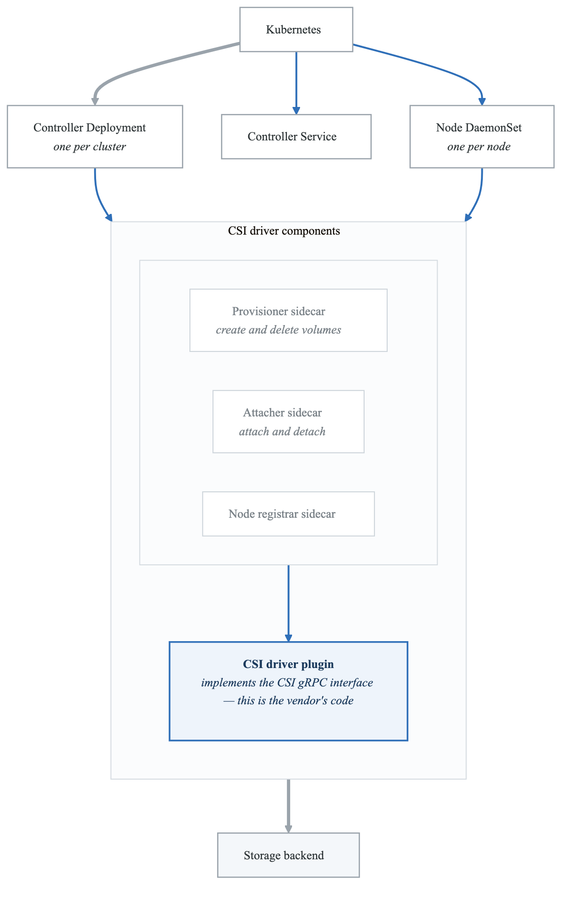
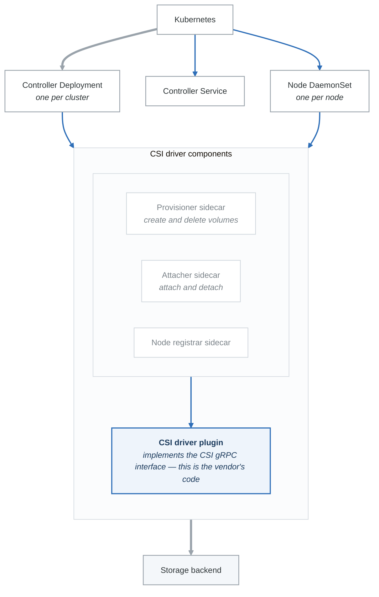

# Exercise 5: CSI Drivers

## Objectives

- Understand CSI architecture
- Deploy and configure CSI drivers
- Implement advanced CSI features
- Troubleshoot CSI issues

## Prerequisites

- Completed Exercises 1-4
- Understanding of storage concepts
- Access to cloud or local storage

---

## Part 1: CSI Architecture

### 1.1 CSI Components

<!-- figure: generated from the Mermaid below by _shared/diagrams/embed-figures.py — do not edit the image -->


<details>
<summary>Diagram source (Mermaid)</summary>



</details>

### 1.2 CSI Sidecar Containers

| Sidecar | Function | Required |
|---------|----------|----------|
| external-provisioner | Creates/deletes volumes | Yes (for dynamic) |
| external-attacher | Attaches/detaches volumes | Yes (for block) |
| external-snapshotter | Creates/deletes snapshots | Optional |
| external-resizer | Resizes volumes | Optional |
| node-driver-registrar | Registers driver with kubelet | Yes |
| livenessprobe | Health checking | Recommended |

### 1.3 Viewing Installed CSI Drivers

```bash
# List CSI drivers
kubectl get csidrivers

# View CSI driver details
kubectl describe csidriver ebs.csi.aws.com

# Check CSI nodes
kubectl get csinodes

# View CSI node details
kubectl describe csinode <node-name>
```

---

## Part 2: AWS EBS CSI Driver

### 2.1 Installation

```bash
# Create IAM policy (AWS CLI)
aws iam create-policy \
  --policy-name AmazonEKS_EBS_CSI_Driver_Policy \
  --policy-document file://ebs-csi-policy.json

# Create service account
eksctl create iamserviceaccount \
  --name ebs-csi-controller-sa \
  --namespace kube-system \
  --cluster my-cluster \
  --attach-policy-arn arn:aws:iam::$ACCOUNT_ID:policy/AmazonEKS_EBS_CSI_Driver_Policy \
  --approve

# Install with Helm
helm repo add aws-ebs-csi-driver https://kubernetes-sigs.github.io/aws-ebs-csi-driver
helm upgrade --install aws-ebs-csi-driver aws-ebs-csi-driver/aws-ebs-csi-driver \
  --namespace kube-system \
  --set controller.serviceAccount.create=false \
  --set controller.serviceAccount.name=ebs-csi-controller-sa
```

### 2.2 EBS CSI Configuration

```yaml
# ebs-csi-values.yaml
controller:
  replicaCount: 2
  serviceAccount:
    create: true
    name: ebs-csi-controller
    annotations:
      eks.amazonaws.com/role-arn: arn:aws:iam::ACCOUNT:role/EBS_CSI_Role

  extraVolumeTags:
    Environment: production
    ManagedBy: kubernetes

  resources:
    requests:
      cpu: 10m
      memory: 40Mi
    limits:
      cpu: 100m
      memory: 256Mi

node:
  tolerations:
  - operator: Exists

storageClasses:
- name: ebs-gp3
  annotations:
    storageclass.kubernetes.io/is-default-class: "true"
  parameters:
    type: gp3
    encrypted: "true"
  reclaimPolicy: Delete
  volumeBindingMode: WaitForFirstConsumer
  allowVolumeExpansion: true

- name: ebs-io2
  parameters:
    type: io2
    iops: "5000"
    encrypted: "true"
  reclaimPolicy: Retain
  volumeBindingMode: WaitForFirstConsumer
  allowVolumeExpansion: true
```

---

## Part 3: GCP Persistent Disk CSI

### 3.1 Installation

```bash
# GKE - usually pre-installed
# Verify installation
kubectl get deployment -n kube-system | grep csi

# Manual installation
kubectl apply -f https://raw.githubusercontent.com/kubernetes-sigs/gcp-compute-persistent-disk-csi-driver/master/deploy/kubernetes/base/setup-cluster.yaml
```

### 3.2 GCP PD Configuration

```yaml
# gcp-pd-storageclass.yaml
apiVersion: storage.k8s.io/v1
kind: StorageClass
metadata:
  name: pd-ssd
provisioner: pd.csi.storage.gke.io
parameters:
  type: pd-ssd
  disk-encryption-kms-key: projects/PROJECT/locations/REGION/keyRings/KEYRING/cryptoKeys/KEY
volumeBindingMode: WaitForFirstConsumer
allowVolumeExpansion: true
---
apiVersion: storage.k8s.io/v1
kind: StorageClass
metadata:
  name: pd-balanced-regional
provisioner: pd.csi.storage.gke.io
parameters:
  type: pd-balanced
  replication-type: regional-pd
volumeBindingMode: WaitForFirstConsumer
allowVolumeExpansion: true
```

---

## Part 4: Local Path Provisioner

### 4.1 Installation

```bash
# Install local path provisioner
kubectl apply -f https://raw.githubusercontent.com/rancher/local-path-provisioner/v0.0.26/deploy/local-path-storage.yaml

# Verify
kubectl get storageclass local-path
kubectl get pods -n local-path-storage
```

### 4.2 Configuration

```yaml
# local-path-config.yaml
apiVersion: v1
kind: ConfigMap
metadata:
  name: local-path-config
  namespace: local-path-storage
data:
  config.json: |
    {
      "nodePathMap": [
        {
          "node": "DEFAULT_PATH_FOR_NON_LISTED_NODES",
          "paths": ["/opt/local-path-provisioner"]
        },
        {
          "node": "worker-1",
          "paths": ["/data/local-storage", "/mnt/fast-ssd"]
        },
        {
          "node": "worker-2",
          "paths": ["/data/local-storage"]
        }
      ]
    }
  setup: |
    #!/bin/sh
    mkdir -m 0777 -p "$VOL_DIR"
  teardown: |
    #!/bin/sh
    rm -rf "$VOL_DIR"
```

---

## Part 5: NFS CSI Driver

### 5.1 Installation

```bash
# Install NFS CSI driver
helm repo add csi-driver-nfs https://raw.githubusercontent.com/kubernetes-csi/csi-driver-nfs/master/charts
helm install csi-driver-nfs csi-driver-nfs/csi-driver-nfs \
  --namespace kube-system \
  --set driver.name=nfs.csi.k8s.io
```

### 5.2 NFS StorageClass

```yaml
# nfs-storageclass.yaml
apiVersion: storage.k8s.io/v1
kind: StorageClass
metadata:
  name: nfs-csi
provisioner: nfs.csi.k8s.io
parameters:
  server: nfs-server.example.com
  share: /exported/path
  mountPermissions: "0777"
reclaimPolicy: Delete
volumeBindingMode: Immediate
allowVolumeExpansion: true
mountOptions:
  - nfsvers=4.1
  - hard
  - timeo=600
  - retrans=3
```

### 5.3 NFS PersistentVolume (Static)

```yaml
# nfs-pv-static.yaml
apiVersion: v1
kind: PersistentVolume
metadata:
  name: nfs-shared-data
spec:
  capacity:
    storage: 100Gi
  accessModes:
    - ReadWriteMany
  persistentVolumeReclaimPolicy: Retain
  storageClassName: nfs-static
  csi:
    driver: nfs.csi.k8s.io
    volumeHandle: nfs-server.example.com#/data#shared-data
    volumeAttributes:
      server: nfs-server.example.com
      share: /data/shared-data
  mountOptions:
    - nfsvers=4.1
    - hard
---
apiVersion: v1
kind: PersistentVolumeClaim
metadata:
  name: nfs-shared-data
spec:
  storageClassName: nfs-static
  accessModes:
    - ReadWriteMany
  resources:
    requests:
      storage: 100Gi
  volumeName: nfs-shared-data
```

---

## Part 6: CSI Advanced Features

### 6.1 Volume Expansion

```yaml
# Ensure StorageClass has allowVolumeExpansion: true

# Expand PVC
kubectl patch pvc my-pvc -p '{"spec":{"resources":{"requests":{"storage":"20Gi"}}}}'

# Check expansion status
kubectl get pvc my-pvc -o jsonpath='{.status.conditions}'
```

### 6.2 Volume Cloning

```yaml
# clone-pvc.yaml
apiVersion: v1
kind: PersistentVolumeClaim
metadata:
  name: cloned-pvc
spec:
  storageClassName: ebs-gp3
  dataSource:
    name: source-pvc
    kind: PersistentVolumeClaim
  accessModes:
    - ReadWriteOnce
  resources:
    requests:
      storage: 10Gi
```

### 6.3 Raw Block Volumes

```yaml
# block-volume.yaml
apiVersion: v1
kind: PersistentVolumeClaim
metadata:
  name: block-pvc
spec:
  storageClassName: ebs-gp3
  volumeMode: Block  # Instead of Filesystem
  accessModes:
    - ReadWriteOnce
  resources:
    requests:
      storage: 10Gi
---
apiVersion: v1
kind: Pod
metadata:
  name: block-pod
spec:
  containers:
  - name: app
    image: busybox
    command: ["sh", "-c", "sleep infinity"]
    volumeDevices:  # Instead of volumeMounts
    - name: data
      devicePath: /dev/xvda
  volumes:
  - name: data
    persistentVolumeClaim:
      claimName: block-pvc
```

### 6.4 Topology-Aware Provisioning

```yaml
# topology-storageclass.yaml
apiVersion: storage.k8s.io/v1
kind: StorageClass
metadata:
  name: topology-aware
provisioner: ebs.csi.aws.com
volumeBindingMode: WaitForFirstConsumer
allowedTopologies:
- matchLabelExpressions:
  - key: topology.ebs.csi.aws.com/zone
    values:
    - us-west-2a
    - us-west-2b
```

---

## Part 7: CSI Troubleshooting

### 7.1 Common Issues

```bash
# Check CSI driver pods
kubectl get pods -n kube-system | grep csi

# Check CSI driver logs
kubectl logs -n kube-system deployment/ebs-csi-controller -c csi-provisioner
kubectl logs -n kube-system deployment/ebs-csi-controller -c ebs-plugin

# Check node plugin logs
kubectl logs -n kube-system daemonset/ebs-csi-node -c ebs-plugin

# Check events
kubectl get events --sort-by='.lastTimestamp' | grep -i csi
```

### 7.2 Debugging Script

```bash
#!/bin/bash
# csi-debug.sh

echo "=== CSI Drivers ==="
kubectl get csidrivers

echo -e "\n=== CSI Nodes ==="
kubectl get csinodes

echo -e "\n=== CSI Controller Pods ==="
kubectl get pods -n kube-system | grep csi

echo -e "\n=== Storage Classes ==="
kubectl get storageclass

echo -e "\n=== PVCs with Issues ==="
kubectl get pvc -A | grep -v Bound

echo -e "\n=== Recent CSI Events ==="
kubectl get events -A --sort-by='.lastTimestamp' | grep -i 'csi\|provision\|attach' | tail -20
```

### 7.3 Volume Attachment Issues

```bash
# Check VolumeAttachment resources
kubectl get volumeattachment

# Describe stuck attachment
kubectl describe volumeattachment <name>

# Force detach (dangerous)
kubectl delete volumeattachment <name>
```

---

## Part 8: Hands-on Challenges

### Challenge 1: Multi-Backend Storage

Configure cluster with:
1. AWS EBS for databases (high IOPS)
2. EFS for shared files (ReadWriteMany)
3. Local path for ephemeral data

### Challenge 2: Custom CSI Driver

Explore creating a simple CSI driver:
1. Understand the CSI spec
2. Implement basic operations
3. Deploy as CSI driver
4. Create StorageClass

### Challenge 3: Storage Migration

Migrate from in-tree to CSI:
1. Audit existing volumes
2. Create CSI StorageClass
3. Migrate PVCs
4. Verify applications

---

## Verification Tasks

1. [ ] Installed cloud CSI driver
2. [ ] Created provider-specific StorageClass
3. [ ] Deployed local path provisioner
4. [ ] Configured NFS CSI driver
5. [ ] Tested volume expansion
6. [ ] Debugged CSI issues

---

## Key Takeaways

- CSI standardizes storage integration
- Sidecar containers handle K8s communication
- Cloud CSI drivers require IAM configuration
- Local path provisioner is great for development
- NFS provides ReadWriteMany access
- Troubleshooting requires checking multiple components

---

## Module Complete!

You've completed the Storage Systems module. Continue to:
- [Configuration & Secrets Module](03-configuration-secrets-README.md)

<!-- feynman-check -->

---

## Feynman check

Close the file. Blank page, no notes. Explain each of these to a competent engineer who has never
used this tool — **under five minutes, no jargon you can't define on the spot:**

- CSI Architecture
- AWS EBS CSI Driver
- GCP Persistent Disk CSI
- Local Path Provisioner

**The gap is not what you forgot. It is where you used a word instead of a mechanism.**

| | |
|---|---|
| ✗ | *"Kubernetes schedules the pod."* |
| ✓ | *"The scheduler watches for pods with no `nodeName`, filters nodes by predicates, scores the survivors, and writes `nodeName` into the pod spec. The kubelet on that node is watching the API for pods bound to it, and starts the containers."* |

**Trace it:** `kubectl apply -f pod.yaml` → a running container. Name every component that acts, in order, and what each one writes.

Stop at the first component you cannot name. Reopen this file and read **only** that.

**Go deeper — only once the gap has a name:** [Kubernetes the Hard Way](https://github.com/kelseyhightower/kubernetes-the-hard-way) — one weekend, and "the control plane" stops being a word.
Full list per domain: [`SOURCES.md`](../../SOURCES.md#kubernetes)

→ Protocol, the three levels of knowing, and worked examples: [`MASTERY.md`](../../MASTERY.md)

<!-- /feynman-check -->
