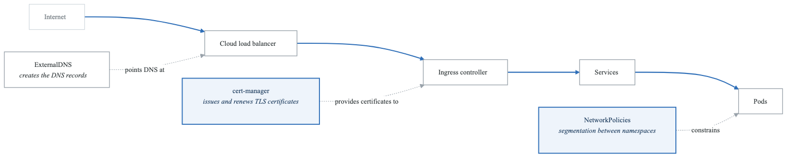
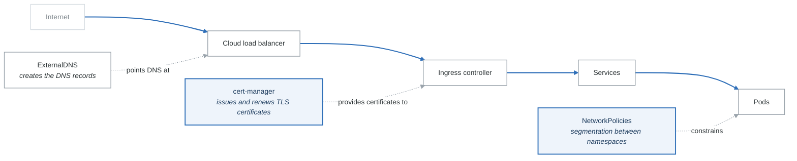

# Phase 2 Project: Production Networking Stack

Build a complete production networking setup with all enterprise requirements.

## Architecture

<!-- figure: generated from the Mermaid below by _shared/diagrams/embed-figures.py — do not edit the image -->


<details>
<summary>Diagram source (Mermaid)</summary>



</details>

## Components to Deploy

### 1. Cilium CNI

```bash
cilium install --version 1.14.4
cilium hubble enable --ui
```

### 2. NGINX Ingress Controller

```yaml
# values-ingress.yaml
controller:
  replicaCount: 2
  service:
    annotations:
      service.beta.kubernetes.io/aws-load-balancer-type: nlb
  metrics:
    enabled: true
  config:
    use-forwarded-headers: "true"
    compute-full-forwarded-for: "true"
```

### 3. cert-manager

```yaml
apiVersion: cert-manager.io/v1
kind: ClusterIssuer
metadata:
  name: letsencrypt-prod
spec:
  acme:
    server: https://acme-v02.api.letsencrypt.org/directory
    email: admin@example.com
    privateKeySecretRef:
      name: letsencrypt-prod
    solvers:
    - http01:
        ingress:
          class: nginx
```

### 4. External DNS

```yaml
apiVersion: apps/v1
kind: Deployment
metadata:
  name: external-dns
spec:
  replicas: 1
  selector:
    matchLabels:
      app: external-dns
  template:
    spec:
      containers:
      - name: external-dns
        image: registry.k8s.io/external-dns/external-dns:v0.14.0
        args:
        - --source=service
        - --source=ingress
        - --provider=aws
        - --policy=sync
        - --registry=txt
```

### 5. Network Policies

```yaml
# Default deny all
apiVersion: networking.k8s.io/v1
kind: NetworkPolicy
metadata:
  name: default-deny
spec:
  podSelector: {}
  policyTypes:
  - Ingress
  - Egress
```

## Validation Checklist

- [ ] Cilium running with Hubble UI accessible
- [ ] Ingress controller serving traffic
- [ ] TLS certificates auto-provisioned
- [ ] DNS records auto-created
- [ ] Network policies enforced
- [ ] All traffic encrypted in transit

## Deployment Commands

```bash
# Deploy all components
kubectl apply -k .

# Verify
cilium status
kubectl get pods -n ingress-nginx
kubectl get certificates
kubectl get externalsecrets
```

<!-- feynman-check -->

---

## Feynman check

Close the file. Blank page, no notes. Explain each of these to a competent engineer who has never
used this tool — **under five minutes, no jargon you can't define on the spot:**

- Components to Deploy
- Validation Checklist
- Deployment Commands
- Cilium CNI

**The gap is not what you forgot. It is where you used a word instead of a mechanism.**

| | |
|---|---|
| ✗ | *"Kubernetes schedules the pod."* |
| ✓ | *"The scheduler watches for pods with no `nodeName`, filters nodes by predicates, scores the survivors, and writes `nodeName` into the pod spec. The kubelet on that node is watching the API for pods bound to it, and starts the containers."* |

**Trace it:** `kubectl apply -f pod.yaml` → a running container. Name every component that acts, in order, and what each one writes.

Stop at the first component you cannot name. Reopen this file and read **only** that.

**Go deeper — only once the gap has a name:** [Kubernetes the Hard Way](https://github.com/kelseyhightower/kubernetes-the-hard-way) — one weekend, and "the control plane" stops being a word.
Full list per domain: [`SOURCES.md`](../../SOURCES.md#kubernetes)

→ Protocol, the three levels of knowing, and worked examples: [`MASTERY.md`](../../MASTERY.md)

<!-- /feynman-check -->
